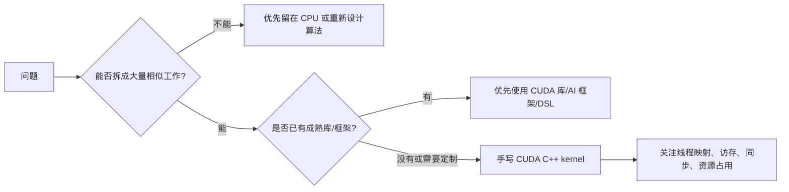

# 第 1 章 CUDA 为什么存在：GPU 不是更快的 CPU

第一次接触 CUDA 时，很多人会把问题理解成“怎么把 C++ 代码放到 GPU 上跑”。这个入口看起来直接，但很容易把后续概念学散：为什么 CUDA 要把线程组织成 block？为什么一个 kernel 要启动成千上万个线程？为什么 `if` 分支、内存访问和同步会强烈影响性能？为什么 NVIDIA 一直强调库、框架和 DSL，而不是让每个人都手写 kernel？

更稳的入口是先弄清：GPU 是一种什么样的计算机器。CUDA 做的事，是把适合吞吐型并行的数据处理任务交给一种取舍完全不同的硬件，而不是把 CPU 程序原样搬到另一块芯片上。

## 1.1 问题的由来

CPU 和 GPU 的差异不在于谁更先进，而在于芯片资源花在哪里。CPU 把大量资源投入到低延迟执行：大缓存、分支预测、乱序执行、复杂控制流、系统调用、单线程响应。GPU 把更多资源投入到大量执行单元和高内存带宽，目标是让很多相似工作同时向前推进。

这也是 CUDA 程序和普通 C++ 程序思维方式不同的根源。普通 C++ 程序往往先描述一条控制流：先做 A，再做 B，如果条件成立做 C。CUDA 程序通常先寻找一批可以独立处理的数据元素，然后让大量线程执行同一段逻辑，每个线程通过自己的索引处理一小份数据。

GPU 的来历可以解释这种取舍。图形渲染天然包含大量相似任务：顶点变换、片元着色、纹理采样、像素处理。GPU 从固定功能图形流水线逐步演进出可编程阶段，最终变成通用并行处理器。CUDA 的意义，就是把这种并行吞吐能力从图形 API 里释放出来，让科学计算、图像处理、信号处理、数据库、深度学习和生成式模型都能使用。

如果把两种芯片的面积分配画出来，差别很直观：CPU 只有少数几个核心，每个核心旁边配着大块控制逻辑和私有缓存，多个核心再共享一块很大的 L3；GPU 把大部分面积铺满了计算单元，控制逻辑和缓存只占很小的比例，主要靠共享的 L2 和高带宽显存供数。这种对比要这样理解：CPU 和 GPU 都是通用计算系统的一部分，CPU 更强调复杂控制和低延迟，GPU 更强调数据处理吞吐。它并不是说 CPU 不会并行，也不是说 GPU 不能执行分支；它提醒你的是，如果一个任务很难拆成大量相似工作，GPU 的优势就很难发挥出来。

## 1.2 核心模型

用 CUDA 之前，先要问的不是“我会不会写 kernel”，而是“这个问题值不值得表达成大量并行工作”。如果这个问题已经有成熟库解决，手写 kernel 往往不是最好的工程选择。

图 1.1 把这个判断画成一条决策路径：先问能否拆成大量相似工作，再问有没有成熟的库或框架，两关都过了才轮到手写 kernel。

<figure>

<figcaption>图 1.1：先判断能否拆成大量相似工作，再决定用库还是手写 kernel</figcaption>
</figure>

## 1.3 详解

GPU 适合的任务通常有几个特征。

第一，数据量足够大。启动 kernel、移动数据、同步结果都有成本。如果只处理几十个元素，GPU 的并行能力还没来得及展开，开销就可能盖过收益。

第二，任务之间依赖少。理想情况下，每个线程负责一个元素或一个小区域，线程之间不需要频繁等待。如果每一步都依赖前一步的全局结果，程序会被同步和通信拖住。

第三，控制流比较规则。GPU 可以执行分支，但同一个 warp 内线程走不同路径时，硬件会分批执行不同路径，吞吐会下降。分支不是禁忌，但高度分散的控制流不适合 GPU。

第四，内存访问有规律。GPU 的计算单元很多，如果线程访问内存的方式混乱，硬件很难合并访存请求，算力会等待数据。很多 CUDA 优化最后都会回到访存模式。

这些特征说明，CUDA 的加速来自“并行表达 + 硬件吞吐 + 合理数据移动”的组合，而不是把原来的串行程序逐行翻译过去。

### 1.3.1 CUDA 生态不是只有手写 kernel

使用 GPU 不只有手写 kernel 一条路，这一点在学习资料里经常被忽略。真实工程里的优先顺序通常是：

| 路线 | 代表 | 适用场景 | 代价 |
|---|---|---|---|
| CUDA libraries | cuBLAS、cuFFT、cuDNN、NPP、Thrust、CUB | 矩阵、FFT、深度学习算子、常见并行算法 | 受库接口约束 |
| AI frameworks | PyTorch、TensorFlow、JAX | 模型训练/推理，自动微分和算子调度 | 底层控制较少 |
| DSL | Triton、Warp | 需要写接近 kernel 的逻辑，但希望减少样板和部分调优 | 受 DSL 能力和生态限制 |
| CUDA C++ | 自定义 kernel、Runtime/Driver API | 库无法覆盖，或必须控制访存、同步、stream、graph、多 GPU | 需要理解底层模型 |

这张表对学习 CUDA 也有帮助。即使你的目标是手写 CUDA C++，也应该知道库和框架解决了哪些问题。否则你会把很多已经被高度优化的工作重新做一遍，还很难超过成熟实现。

### 1.3.2 什么时候值得手写 CUDA kernel

值得手写 kernel 的场景通常更具体：

- 现有库没有覆盖你的数据结构或计算模式。
- 多个小算子之间的数据来回写 global memory，想做 fusion。
- 访问模式特殊，需要用 shared memory、warp primitive 或 cooperative groups 表达。
- 需要和 stream、event、CUDA Graph、多 GPU、外部 API 互操作紧密结合。
- 需要把性能瓶颈压到某个特定 kernel 内部分析和优化。

如果只是“想让一个 for 循环更快”，还不够。你需要继续问：这个循环每次迭代是否独立？数据是否足够大？host/device 数据移动是否会抵消收益？是否已有库函数直接完成？

## 1.4 代码示例

先看一个 CPU 视角的循环：

```cpp
for (int i = 0; i < n; ++i) {
    y[i] = a * x[i] + y[i];
}
```

换成 CUDA 视角，不是让一个更快的线程执行这个循环，而是让很多线程各自处理一个 `i`：

```cpp
__global__ void saxpy(float a, const float* x, float* y, int n) {
    int i = blockIdx.x * blockDim.x + threadIdx.x;
    if (i < n) {
        y[i] = a * x[i] + y[i];
    }
}
```

这段 kernel 已经体现了 CUDA 的基本思想：

| 代码元素 | 含义 |
|---|---|
| `__global__` | 这个函数由 host 调用，在 device 上执行 |
| `blockIdx.x` | 当前 block 在 grid 中的位置 |
| `threadIdx.x` | 当前 thread 在 block 中的位置 |
| `blockDim.x` | 每个 block 有多少 thread |
| `if (i < n)` | 保护边界，避免最后一个 block 越界 |

这还不是完整程序。完整程序还需要 host 分配内存、把数据放到 GPU、启动 kernel、同步、检查错误、取回结果，[第 6 章](ch006.md)会把这条链完整展开。这里要抓住的是：CUDA 把循环迭代变成线程索引，把数据并行显式写进程序。

## 1.5 工程判断

| 问题 | 更适合 GPU | 更适合 CPU 或其他方案 |
|---|---|---|
| 数据规模 | 数十万到数十亿元素，或大量矩阵/张量 | 很小的数据量，启动和拷贝成本占主导 |
| 任务依赖 | 元素之间大多独立，或只需局部同步 | 强串行依赖、频繁全局同步 |
| 控制流 | 大多数线程走相似路径 | 每个元素分支都不同，且分支成本高 |
| 内存访问 | 连续、可合并、可复用 | 随机访问多，局部性很弱 |
| 生态支持 | 库/框架已有实现，或 kernel 可清晰表达 | 系统调用、复杂对象图、I/O 密集 |

常见误区是把 GPU 当作“加速器按钮”。CUDA 不会自动让任意代码变快；只有当你能把问题表达成大规模并行工作时，它才给你一套贴近硬件的执行和内存控制能力。

## 1.6 要点速查

| 概念 | 一句话 |
|---|---|
| Throughput | 单位时间处理大量相似工作的能力 |
| Latency | 单个任务从开始到完成的响应时间 |
| SIMT | 用线程表达并行，硬件按 warp 成组执行 |
| Kernel | host 发起、device 并行执行的函数 |
| CUDA library | 已经调优好的 GPU 算法实现，工程上应优先考虑 |

## 1.7 小结

读完本章，你应该能够：

- 解释 GPU 为什么不是“更快的 CPU”。
- 判断一个任务是否大致适合 CUDA。
- 说清库、框架、DSL、CUDA C++ 各自的位置。
- 把“写 kernel”看作一种工程选择，而不是默认答案。
