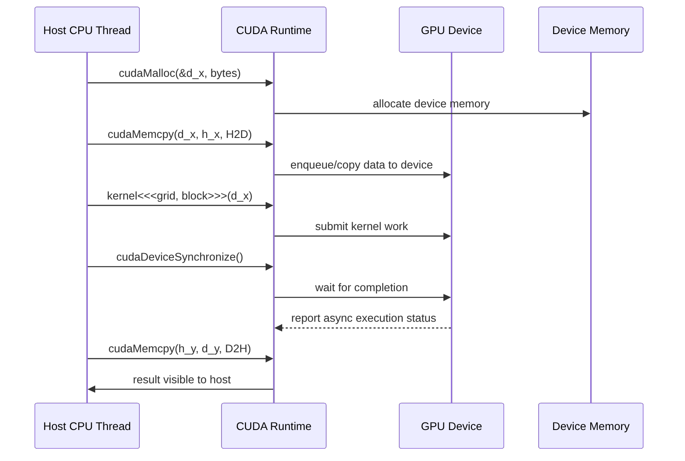

# 第 2 章 一个 CUDA 程序到底跑在哪里：host、device 与异构生命周期

CUDA 程序看起来像 C++ 程序里多了一些特殊关键字和 API，但它的执行位置并不单一。程序从 CPU 侧开始，GPU 侧只执行被提交过去的工作。理解这条边界，是理解 `cudaMalloc`、`cudaMemcpy`、kernel launch、stream、event、Unified Memory 和异步错误的前提。

很多初学者第一次写 CUDA 出错，不是因为不知道 `threadIdx.x`，而是不知道自己当前站在哪一侧：这段代码在 host 执行，还是在 device 执行？这个指针指向 host memory，还是 device memory？这个 API 返回时，GPU 工作真的完成了吗？

## 2.1 问题的由来

普通 C++ 程序通常只有一条主执行环境：进程在 CPU 上运行，内存由 CPU 侧代码分配和访问。CUDA 程序则天然是异构程序。CPU 和 GPU 都参与，但职责不同。

host 通常负责：

- 启动进程和执行普通 C++ 控制逻辑。
- 分配 host memory 和 device memory。
- 把输入数据送到 GPU 可访问的位置。
- 提交 kernel、memcpy、memset、graph 等 GPU 工作。
- 建立 stream/event 依赖关系。
- 在需要时同步并检查错误。
- 处理文件、网络、UI、系统调用等 CPU 侧工作。

device 通常负责：

- 执行 kernel 中的大量并行线程。
- 使用 global、shared、local、register 等 GPU 侧内存空间。
- 在 block、warp、cluster 或 device scope 内协作。
- 通过特定 device-callable API 做有限的运行时操作。

这条分工解释了 CUDA 的一个核心事实：kernel launch 是 host 向 device 提交工作，不是普通函数调用。

## 2.2 核心模型

图 2.1 按时间顺序画出一个最小 CUDA 程序里 host、Runtime 和 GPU 之间的交互：分配、拷入、launch、同步、拷回。

<figure>

<figcaption>图 2.1：host 经 CUDA Runtime 完成分配、拷贝、launch 与同步的时序</figcaption>
</figure>

图里有意把 Runtime 画在 host 和 GPU 中间。大多数 CUDA C++ 程序并不直接和硬件打交道，而是通过 CUDA Runtime API 提交资源管理、数据移动和执行请求；Runtime API 底层再经过 Driver API 和 NVIDIA 驱动。注意 kernel launch 那一步：host 只是把工作交给 Runtime，等待 GPU 完成并取回执行状态的，是后面的 `cudaDeviceSynchronize()`。

## 2.3 详解

### 2.3.1 Host 和 device 是位置概念

CUDA 文档里的 `host` 和 `device` 不是泛泛而谈的“主机”和“设备”，而是非常具体的位置概念。

| 名称 | 位置 | 典型内容 |
|---|---|---|
| host | CPU 侧 | 普通 C++ 代码、系统调用、host memory、CUDA API 调用 |
| device | GPU 侧 | kernel、GPU thread、global/shared/register memory |
| host memory | CPU 直接连接的系统内存 | `malloc`、`new`、`std::vector` 的常规存储 |
| device memory | GPU 直接连接或管理的内存 | `cudaMalloc` 返回的指针通常指向这里 |

现代 CUDA 支持 Unified Virtual Addressing，因此 host 指针和 device 指针可以处在统一虚拟地址空间里。统一地址空间不等于访问成本相同，也不等于所有代码都能随便解引用所有指针。位置、访问者和内存属性仍然重要。

### 2.3.2 Kernel launch 是一次提交

CUDA kernel 使用 `<<<grid, block, sharedMem, stream>>>` 启动。这个语法很像函数调用，但语义不同。

普通函数调用意味着当前 CPU 线程进入函数体，函数返回时工作完成。kernel launch 意味着 host 把一批 GPU 工作提交给 runtime。默认情况下，launch 返回时 GPU 可能还没执行完。host 会继续往下走，直到遇到显式同步、阻塞拷贝、某些隐式同步 API，或者程序退出。

这解释了为什么 CUDA 错误有两类：

| 错误类型 | 何时暴露 | 例子 |
|---|---|---|
| launch 配置错误 | launch 后可立即检查 | block 线程数超过上限、shared memory 配置非法 |
| device 执行错误 | 后续同步点暴露 | kernel 内非法地址访问、assert、misaligned access |

所以一个可靠的 CUDA 程序不会只写 `kernel<<<...>>>()`，还会在合适位置检查 launch 错误和执行错误。

### 2.3.3 数据移动是生命周期的一部分

CUDA 程序常见的基础生命周期是：

1. host 准备输入。
2. device 分配空间。
3. host 到 device 拷贝输入。
4. host 提交 kernel。
5. host 等待 device 完成。
6. device 到 host 拷贝输出。
7. 释放资源。

Unified Memory 可以让第 2、3、6 步看起来更简单，但不能让数据位置问题消失。数据仍然会迁移或被远程访问，只是控制方式从显式 copy 变成 runtime/driver/hardware 协作。

### 2.3.4 异构生命周期和性能测量

很多 CUDA 性能误判来自把生命周期不同阶段混在一起。第一次调用 CUDA API 可能触发 context 初始化；第一次加载某个 kernel 可能触发 module loading 或 PTX JIT；第一次访问 managed memory 可能触发 page fault 和迁移。把这些都算进 kernel 时间，就会得到错误结论。

测量 kernel 本身通常需要：

- 提前完成初始化和预热。
- 用 event 记录 GPU 时间。
- 避免把 host/device copy 混进 kernel 计时，除非你确实要测端到端时间。
- 明确同步点，否则 host 侧计时只是在测提交成本。

## 2.4 代码示例

下面是一个最小生命周期骨架。[第 6 章](ch006.md)会给出完整的 vector add 程序，这里只突出执行位置和同步边界。

```cpp
#include <cuda_runtime.h>
#include <cstdio>
#include <cstdlib>
#define CHECK_CUDA(call)                                                   \
    do {                                                                   \
        cudaError_t err__ = (call);                                        \
        if (err__ != cudaSuccess) {                                        \
            std::fprintf(stderr, "%s:%d: %s\n", __FILE__, __LINE__,       \
                         cudaGetErrorString(err__));                      \
            std::exit(1);                                                  \
        }                                                                  \
    } while (0)
__global__ void fill_kernel(float* out, int n) {
    int i = blockIdx.x * blockDim.x + threadIdx.x;
    if (i < n) {
        out[i] = static_cast<float>(i);
    }
}
int main() {
    int n = 1 << 20;
    size_t bytes = static_cast<size_t>(n) * sizeof(float);
    float* d_out = nullptr;
    CHECK_CUDA(cudaMalloc(&d_out, bytes));           // device allocation
    int block = 256;
    int grid = (n + block - 1) / block;
    fill_kernel<<<grid, block>>>(d_out, n);          // async launch
    CHECK_CUDA(cudaGetLastError());                  // launch error
    CHECK_CUDA(cudaDeviceSynchronize());             // execution error
    float* h_out = static_cast<float*>(std::malloc(bytes));
    CHECK_CUDA(cudaMemcpy(h_out, d_out, bytes, cudaMemcpyDeviceToHost));
    std::printf("h_out[123] = %.0f\n", h_out[123]);
    std::free(h_out);
    CHECK_CUDA(cudaFree(d_out));
}
```

代码里有两个错误检查点：

| 检查 | 发现什么 |
|---|---|
| `cudaGetLastError()` | launch 参数、配置、符号等提交阶段错误 |
| `cudaDeviceSynchronize()` | kernel 执行期间发生的异步错误 |

这个写法稍微啰嗦，但它逼你正视 CUDA 的异步边界。等到使用 stream/event 后，这种边界会变得更重要。

## 2.5 工程判断

| 场景 | 应该怎么想 | 常见误区 |
|---|---|---|
| kernel launch 返回了 | 只代表提交完成，不代表 device 完成 | 把 launch 当普通函数调用 |
| `cudaMemcpyDeviceToHost` 返回了 | 对默认阻塞 copy，结果已回到 host | 忽略异步 copy 和 stream 版本的差异 |
| kernel 内写了 global memory | host 不会立刻自动看到 | 忘记同步或拷回 |
| 使用 Unified Memory | 访问更方便，但迁移仍发生 | 以为没有数据位置成本 |
| 首次调用很慢 | 可能是 context/module/JIT 初始化 | 误判为 kernel 计算慢 |

## 2.6 API 与要点速查


| API | 作用 | 注意点 |
|---|---|---|
| `cudaMalloc` | 分配 device memory | 返回的指针通常不能由普通 host 代码直接解引用 |
| `cudaMemcpy` | 在 host/device 或 device/device 之间拷贝 | 同步或异步取决于 API 和内存类型 |
| `cudaGetLastError` | 取出并清除最近 runtime 错误 | 常用于 launch 后检查提交错误 |
| `cudaPeekAtLastError` | 查看最近错误但不清除 | 调试时有用 |
| `cudaDeviceSynchronize` | 等待当前 device 之前提交的工作完成 | 会暴露异步执行错误 |

## 2.7 小结

读完本章，你应该能够：

- 说清一段 CUDA 代码当前运行在 host 还是 device。
- 解释 kernel launch 为什么不是普通函数调用。
- 描述 CUDA 程序从分配、拷贝、launch、同步到释放的生命周期。
- 区分 launch 错误和 device 执行错误。
- 避免把初始化、JIT、数据移动和 kernel 时间混为一谈。
