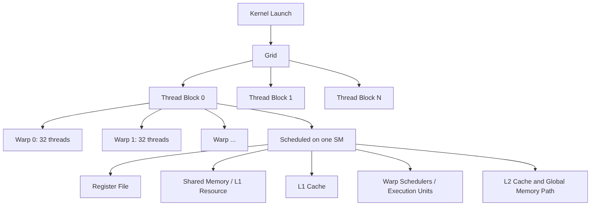
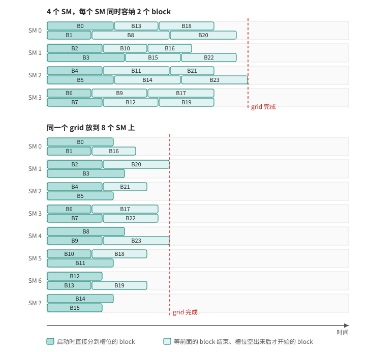

# 第 3 章 从 SM 看 GPU：线程不是独立跑在一块抽象设备上

CUDA 让你写的是“线程”，但 GPU 真正调度和执行这些线程时，有自己的层级结构。理解 SM、warp、block、grid 和 memory space 的关系，能提前解释很多问题：为什么 block 内可以同步但 block 间不行，为什么线程数常写 256，为什么 shared memory 很快却不能随便用，为什么寄存器太多会让性能下降。

如果把 CUDA 只看成“很多线程同时跑”，这个模型太粗。更准确的说法是：kernel 启动成一个 grid，grid 被划分成 thread block，block 被调度到 SM，block 内线程按 warp 成组执行，执行所需资源来自 SM 的寄存器、shared memory、cache 和调度器。

## 3.1 问题的由来

CUDA 编程模型有意屏蔽了 GPU 的很多物理细节。你不需要知道某一代 GPU 的完整电路，也不需要手动把 block 分配给某个 SM。这个抽象很有价值，因为同一个 CUDA 程序可以跑在不同规模的 GPU 上。

但抽象不等于可以忽略硬件模型。只要你遇到以下问题，就必须回到 SM 视角：

- kernel 启动失败，提示资源超限。
- block size 改变后性能剧烈变化。
- shared memory 用多了，occupancy 降低。
- 分支逻辑正确，但 warp divergence 让性能变差。
- 线程读写 global memory 合法，但带宽很差。
- 想使用 cooperative groups、cluster、distributed shared memory。

这些都不是单个线程自己的问题，而是线程如何被组织、调度和共享资源的问题。

## 3.2 核心模型

图 3.1 从一次 kernel launch 出发，往下展开到 grid、block、warp，再到 block 所在 SM 提供的资源。

<figure>

<figcaption>图 3.1：从 kernel launch 到 grid、block、warp 与 SM 资源</figcaption>
</figure>

这张图要读出三层边界：

| 边界 | 意义 |
|---|---|
| grid | 一次 kernel launch 的全部并行工作 |
| block | 调度到同一个 SM 的线程集合，是 shared memory 和 block sync 的边界 |
| warp | 硬件成组执行的线程集合，是理解 SIMT 性能的入口 |

这些编程层级背后是一套具体的物理平台：

| 硬件层级 | 包含什么 | 和 CUDA 程序的关系 |
|---|---|---|
| GPU | 若干 GPC、所有 SM 共享的 L2 cache、显存控制器和显存 | 一次 kernel launch 的所有 block 都在这里执行 |
| GPC | 一组 SM | 同一个 cluster 的 block 会被放进同一个 GPC |
| SM | 寄存器堆、L1 cache/shared memory、warp 调度器和执行单元 | block 驻留、warp 执行的地方 |
| CPU 与互连 | CPU 核心、系统内存，以及 PCIe 或 NVLink 这类连接 | host 和 device 之间的数据都要经过这条链路 |

thread/block/grid 是编程抽象，但数据移动、调度吞吐和多 GPU 扩展最终都落在 SM、GPU 显存和主机互连这些硬件边界上。

## 3.3 详解

### 3.3.1 Grid、block、thread 是编程坐标

当你写：

```cpp
kernel<<<gridDim, blockDim>>>(args...);
```

你是在告诉 CUDA：这次 kernel 有多少个 block，每个 block 有多少个 thread。kernel 内部通过内建变量得到自己的坐标：

```cpp
int i = blockIdx.x * blockDim.x + threadIdx.x;
```

grid 和 block 都可以是一维、二维或三维。维度只是索引的组织方式，不改变基本结构：同一个 kernel 的所有线程先分成大小相同的 block，这些 block 再排成 grid。

### 3.3.2 Block 是最重要的协作边界

一个 block 会被调度到一个 SM 上执行。正因为 block 内线程共处一个 SM，它们才能：

- 使用 shared memory 交换数据。
- 使用 `__syncthreads()` 做 block 级同步。
- 使用 cooperative groups 的 `thread_block` 对象表达协作。

block 之间没有默认同步。一个 grid 中可能有大量 block，而 GPU 的 SM 数量有限，block 会分批调度：每个 SM 同时容纳若干个 active block，某个 block 执行完、释放资源后，再接收还没开始的 block。程序不能依赖“block 0 一定先于 block 1 完成”，也不能在普通 kernel 中让任意 block 等待其他 block 的结果。

图 3.2 用 24 个执行时间长短不一的 block 演示这个过程：每个 SM 有两个槽位，block 按编号依次分到最先空出来的槽位，完成的先后和编号并不一致。同一个 grid 放到 8 个 SM 上，排队的 block 少了，整个 grid 也更早完成。

<figure>

<figcaption>图 3.2：同一个 grid 的 block 在 4 个 SM 和 8 个 SM 上分批执行</figcaption>
</figure>

这种调度方式带来了可扩展性。CUDA 程序的正确性不依赖具体 SM 数量：同一个 grid 在 SM 多的 GPU 上能同时跑更多 block，在 SM 少的 GPU 上分更多批完成。前提是 block 之间没有无法表达的执行依赖。

### 3.3.3 Warp 是性能模型的入口

block 内线程会被组织成 warp，通常每个 warp 32 个 thread。CUDA 代码看起来是每个线程执行自己的标量逻辑，但硬件以 warp 为单位推进指令。

这就是 SIMT：Single Instruction, Multiple Threads。每个 thread 有自己的寄存器和索引，但同一 warp 的线程通常一起执行同一条指令。如果它们在条件分支上走不同路径，就会发生 warp divergence。

CUDA 并不禁止写分支，分支的代价取决于 warp 内线程是否走同一路径。如果一个 warp 中一半线程走 `if`、一半线程走 `else`，硬件通常需要分别执行两条路径，并屏蔽不活跃的 lane。以按奇偶 lane 交替成立的条件为例：warp 先执行 `if` 分支，这时只有偶数 lane 活跃、奇数 lane 被屏蔽；再执行 `else` 分支，换成奇数 lane 活跃。两段路径各自只用到一半 lane，分支结束后 32 个 lane 重新汇合，一起执行后面的代码。

### 3.3.4 Cluster 是更高一级的协作层

从 compute capability 9.0 开始，CUDA 引入 thread block cluster。cluster 把多个 block 组织成一个更高层级的协作单位，例如让 grid 里每相邻 2 个 block 组成一个 cluster。

cluster 不替代 block，而是在 block 和 grid 之间提供更强的协作边界。同一个 cluster 的 block 保证被同时调度到同一个 GPC 内的 SM 上，因此可以使用 Cooperative Groups 接口进行同步和通信，并在支持的硬件上访问 distributed shared memory。

对基础学习来说，只要记住：普通 block 是默认协作边界；cluster 是现代架构上更高级的协作边界，后续会在 Cooperative Groups、cluster launch、work stealing 和 distributed shared memory 中展开。

### 3.3.5 Memory space 不只是速度差异

CUDA 中的内存空间同时描述位置、可见性、生命周期和访问成本。

| 内存空间 | 典型位置 | 可见性 | 生命周期 | 常见用途 |
|---|---|---|---|---|
| Register | SM register file | 单个 thread | thread 生命周期 | 局部标量变量 |
| Local memory | device memory 路径 | 单个 thread | thread 生命周期 | register spill、大局部数组 |
| Shared memory | SM on-chip memory | 同一个 block | block 生命周期 | tile、block 内通信 |
| Global memory | GPU device memory | device 级可见 | allocation 生命周期 | 大数组、输入输出 |
| Constant memory | device memory + constant cache | device 只读 | module/allocation 生命周期 | 小型只读广播数据 |
| Texture/surface | device memory + 专用访问路径 | 取决于绑定对象 | resource 生命周期 | 图像/空间局部性访问 |

register 和 shared memory 很快，但会影响 SM 的可驻留 block 数。global memory 容量大，但访问延迟高，需要依赖大量 active warps 和良好访问模式隐藏延迟。cache 能影响性能，但不能替代同步语义。

## 3.4 代码示例

下面这个 kernel 同时展示了线程坐标、warp 内 lane、shared memory 和 block 同步：

```cpp
__global__ void block_sum_256(const float* in, float* block_out, int n) {
    __shared__ float tile[256];
    int tid = threadIdx.x;
    int gid = blockIdx.x * blockDim.x + threadIdx.x;
    int lane = threadIdx.x & 31;
    int warp_id = threadIdx.x >> 5;
    tile[tid] = (gid < n) ? in[gid] : 0.0f;
    __syncthreads();
    for (int stride = blockDim.x / 2; stride > 0; stride >>= 1) {
        if (tid < stride) {
            tile[tid] += tile[tid + stride];
        }
        __syncthreads();
    }
    if (tid == 0) {
        block_out[blockIdx.x] = tile[0];
    }
}
```

这段代码不是最高性能的 reduction，它的价值在于把边界摆在明处：

| 元素 | 含义 |
|---|---|
| `tile` | 每个 block 一份 shared memory |
| `__syncthreads()` | 只同步当前 block 内线程 |
| `lane` | 当前线程在 warp 内的位置 |
| `warp_id` | 当前线程属于 block 内第几个 warp |
| `block_out[blockIdx.x]` | block 间不能直接同步，所以每个 block 先写一个部分结果 |

如果需要把所有 block 的结果继续合并，通常要再启动一个 kernel，或使用 cooperative launch、CUDA Graph、库函数等更明确的机制。

## 3.5 工程判断

| 现象 | 可能原因 | 应该检查 |
|---|---|---|
| kernel launch 报资源错误 | block 线程数、shared memory、register 超限 | compute capability、`cudaGetDeviceProperties`、ptxas 输出 |
| block size 增大反而慢 | register/shared memory 压低 occupancy | occupancy calculator、`--ptxas-options=-v` |
| 分支逻辑正确但吞吐低 | warp divergence 严重 | 分支条件是否在 warp 内分散 |
| shared memory 用了还是慢 | bank conflict 或复用不足 | 访问 stride、bank 映射、tile 形状 |
| global memory 带宽差 | 访问不连续，无法 coalesce | 相邻线程是否访问相邻地址 |
| 想让 block 间同步 | 普通 kernel 不提供全局同步 | kernel 边界、cooperative groups、graph、atomic/fence |

## 3.6 要点速查

| 名词 | 说明 |
|---|---|
| SM | Streaming Multiprocessor，block 驻留和 warp 执行的核心硬件单位 |
| GPC | 一组 SM 构成的硬件分区，cluster 内的 block 落在同一个 GPC |
| Warp | 通常 32 个 thread，硬件成组执行的单位 |
| Occupancy | 一个 SM 上 active warps 与最大 warps 的比例或相关度量 |
| Shared memory | block 内共享的片上内存，需要显式管理 |
| Local memory | thread 私有但通常走 device memory 路径，不等于 register |
| Cluster | compute capability 9.0+ 的 block 协作层 |
| Cache | 只影响性能，不提供同步语义 |

## 3.7 小结

读完本章，你应该能够：

- 把 grid、block、thread、warp、SM 放到同一张执行图里。
- 解释为什么 block 内能同步而 block 间不能默认同步。
- 理解 register/shared memory 为什么会影响 occupancy。
- 把分支分化、访存合并和 shared memory 问题关联到 warp/SM。
- 知道 cluster 是现代协作机制，而不是基础 kernel 的必需概念。
