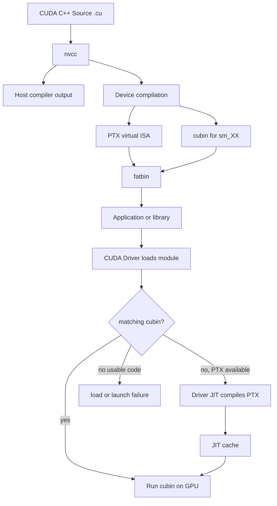

# 第 4 章 PTX、cubin、fatbin 与 JIT：CUDA 程序为什么有时第一次运行更慢

CUDA C++ 源码不会直接变成一个“所有 NVIDIA GPU 都能运行”的单一二进制。它会经过 host 编译、device 编译、PTX、cubin、fatbin、module loading 和可能的 JIT。理解这条平台栈，能解释很多工程问题：为什么换 GPU 后程序启动失败，为什么第一次 launch 慢，为什么发布包里要带多个 `sm_xx`，为什么保留 PTX 能提高前向兼容性。

如果你只在自己的机器上编译运行，平台层似乎不重要。只要程序进入部署、分发、容器、集群或多架构环境，这一层就会变成实际问题。

## 4.1 问题的由来

CPU 程序通常编译成某个 ISA 的机器码，例如 x86-64 或 AArch64。CUDA 程序更复杂，因为一个应用里同时有 host code 和 device code。host code 给 CPU 执行，device code 给 GPU 执行，而不同 GPU 架构支持的指令和特性不同。

CUDA 需要同时解决两个目标：

1. 让当前目标 GPU 启动快、性能可控。
2. 让程序在未来或不同架构 GPU 上尽可能还能运行。

cubin 和 PTX 分别服务这两个方向。cubin 是具体架构机器码，启动更直接；PTX 是虚拟 ISA，可以在运行时由 driver JIT 到当前 GPU。

## 4.2 核心模型

图 4.1 画出 device code 从源码到 GPU 上执行的整条路径：nvcc 把 device 部分编译成 PTX 和 cubin，打包进 fatbin，随应用或库一起分发；运行时由 CUDA driver 加载 module，再决定用哪一份代码。

<figure>

<figcaption>图 4.1：device code 从编译、打包到加载执行的路径</figcaption>
</figure>

图里最重要的分叉是“是否有匹配 cubin”。如果有，driver 可以直接加载对应 GPU 二进制；如果没有但 fatbin 里有合适 PTX，就走 JIT；如果两者都没有，程序可能在加载或 launch 阶段失败。

## 4.3 详解

### 4.3.1 PTX 是虚拟 ISA

PTX 可以理解成 NVIDIA GPU 的中间表示。它不是某块具体 GPU 的最终机器码，而是给 driver 或离线编译器继续生成机器码的输入。

PTX 的价值在于前向兼容。假设你发布程序时还没有未来某个 GPU 的具体 `sm_xx` cubin，只要 fatbin 里带了一份 PTX，新 GPU 上的 driver 就可能把它 JIT 成能执行的机器码。这要同时满足两个条件：一是 PTX 的虚拟架构不能高于目标 GPU，例如 `compute_90` 的 PTX 可以 JIT 到 compute capability 9.0 及更新的 GPU，却不能用在 8.x 的 GPU 上；二是 driver 要认识这份 PTX 的版本，用较新 toolkit 生成的 PTX，需要同样新或更新的 driver 才能 JIT。带 `a` 后缀的架构专用目标（如 `compute_90a`）不提供这种前向兼容。

代价是首次运行可能更慢，因为 JIT 是运行时成本。JIT 结果通常会进入 compute cache，后续运行可能复用缓存。

### 4.3.2 cubin 是具体架构机器码

cubin 面向具体 SM 架构，例如 `sm_80`、`sm_90`。它的优势是启动快，编译优化结果确定。它的限制是架构绑定更强，不能无限跨代运行。

常见规则可以这样记：

| 产物 | 优势 | 风险 |
|---|---|---|
| cubin | 启动快，性能可预期 | 需要为目标 GPU 架构提前生成 |
| PTX | 提供前向兼容机会 | 首次 JIT 慢，依赖 driver JIT 能力 |
| fatbin | 同时携带多个 cubin/PTX | 体积更大，需要正确配置 `-gencode` |

### 4.3.3 fatbin 是发布容器

fatbin 可以同时包含多个 cubin 和 PTX。一个发布给多种 GPU 的程序通常不应该只包含一个架构目标。

关键在于“一个应用可以携带多份 device code”。可执行文件或库里除了 CPU 机器码，还嵌着一个 fatbin，里面并排放着若干份 cubin 和 PTX。以 4.4 节的编译命令为例，生成的 fatbin 里有 `sm_80`、`sm_86`、`sm_90` 三份 cubin 和一份 `compute_90` PTX。运行时，driver 会根据当前 GPU 选择最合适的一份。如果 fatbin 只有 `sm_86` cubin，而程序运行在 `sm_90` 且没有 PTX 退路，就可能失败。

### 4.3.4 第一次慢不一定是 kernel 慢

一个 CUDA 程序第一次触达 GPU 时，可能发生多种一次性成本：

| 成本 | 触发时机 | 如何误判 |
|---|---|---|
| Context 初始化 | 第一次 CUDA API 或显式 init | 被算成第一次 kernel 时间 |
| Module loading | 第一次加载包含 kernel 的 module | 被误认为 launch overhead |
| PTX JIT | 没有匹配 cubin，需要从 PTX 编译 | 被误认为 kernel 计算慢 |
| JIT cache 写入 | JIT 后缓存结果 | 第一次运行比后续慢 |
| Lazy loading | 模块或 kernel 延迟加载 | 第一次触达某个 kernel 慢 |

认真做性能测量时，应该先预热，把平台初始化和 kernel 执行分开。

## 4.4 代码示例

下面是一个更明确的多架构发布命令：

```bash
nvcc app.cu -O3 -o app \
  -gencode arch=compute_80,code=sm_80 \
  -gencode arch=compute_86,code=sm_86 \
  -gencode arch=compute_90,code=sm_90 \
  -gencode arch=compute_90,code=compute_90
```

这条命令携带三类具体 cubin，并保留一份 `compute_90` PTX。它表达了两个意图：

- 对已知目标 GPU，尽量直接运行 cubin。
- 对未来兼容，保留 PTX 作为 JIT 输入。

你可以用环境变量验证程序是否真的有 PTX 退路：

```bash
CUDA_FORCE_PTX_JIT=1 ./app
```

如果强制 PTX JIT 后程序无法运行，说明你的发布包可能没有携带可用 PTX，或者 PTX 版本不满足目标环境。

也可以反向测试是否依赖 JIT：

```bash
CUDA_DISABLE_PTX_JIT=1 ./app
```

如果禁用 PTX JIT 后程序失败，说明当前 GPU 没有匹配 cubin，之前是靠 PTX JIT 跑起来的。

## 4.5 工程判断

| 场景 | 推荐做法 | 常见误区 |
|---|---|---|
| 只在本机开发 | 至少明确本机 `sm_xx`，不要完全依赖默认值 | 以为默认 `nvcc app.cu` 适合发布 |
| 发给多种 GPU | 为主要 GPU 生成 cubin，并保留 PTX | 只带一个 cubin |
| 集群环境 GPU 混杂 | 根据节点 GPU 列表配置多个 `-gencode` | 编译机 GPU 与运行机 GPU 不一致 |
| 第一次 launch 慢 | 预热并区分 context/module/JIT | 把一次性成本当 kernel 时间 |
| 追求最稳定启动延迟 | 尽量包含目标架构 cubin | 运行时才 JIT |
| 追求前向兼容 | 保留合适 PTX | 只发布 cubin |

## 4.6 要点速查

环境变量速查：

| 环境变量 | 作用 | 使用场景 |
|---|---|---|
| `CUDA_FORCE_PTX_JIT=1` | 强制从 PTX JIT，忽略 cubin | 验证发布包是否携带 PTX |
| `CUDA_DISABLE_PTX_JIT=1` | 禁用 PTX JIT | 验证是否有匹配 cubin |
| `CUDA_CACHE_DISABLE=1` | 禁用 JIT cache | 排查缓存影响 |
| `CUDA_CACHE_PATH` | 设置 JIT cache 路径 | 容器或权限受限环境 |
| `CUDA_CACHE_MAXSIZE` | 设置 cache 大小 | 大量 kernel 或多应用环境 |

编译选项速查：

| 选项 | 说明 |
|---|---|
| `-arch=sm_XX` | 简写：生成 `sm_XX` cubin，同时嵌入 `compute_XX` PTX，适合简单场景 |
| `-gencode arch=compute_XX,code=sm_XX` | 生成具体 cubin |
| `-gencode arch=compute_XX,code=compute_XX` | 保留 PTX |
| `-lineinfo` | 保留行号信息，便于 profiling |
| `-rdc=true` | 启用 relocatable device code，支持分离 device 编译 |

## 4.7 小结

读完本章，你应该能够：

- 解释 PTX、cubin、fatbin 的区别。
- 判断一个 CUDA 程序换 GPU 失败时该查什么。
- 用 `-gencode` 表达多架构发布意图。
- 区分首次运行慢是 JIT、module loading、context 初始化还是 kernel 本身。
- 用环境变量验证 JIT 和二进制兼容路径。
