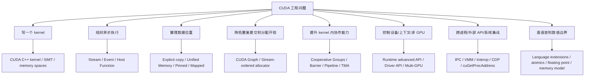

# 第 5 章 先有地图再查 API：CUDA Feature Tour 应该怎么读

官方《CUDA C++ Programming Guide》的后半部分逐项介绍了大量功能：Unified Memory、Stream、Graph、Allocator、Cooperative Groups、TMA、L2 policy、VMM、Interop、language extension、device-callable API。初学者如果按 API 名称逐个记，很快会失去方向。

更好的方式是先有一张地图：每个功能解决哪一类工程问题，它处在 CUDA 平台的哪个层次，什么时候是主路径，什么时候只是特殊工具。

## 5.1 问题的由来

CUDA 的复杂性主要不在于某个 API 很难，而在于它覆盖的层次很多。你可能在同一天看到：

- `cudaMalloc`：内存分配。
- `cudaStreamCreate`：异步调度。
- `cudaGraphInstantiate`：执行图。
- `cuCtxCreate`：driver context。
- `cooperative_groups::this_thread_block()`：kernel 内协作。
- `cudaImportExternalMemory`：图形/系统互操作。
- `__nv_atomic_add`：device 侧内存模型。

这些东西都叫 CUDA，但它们并不在同一层。把它们混在一起背，学习就会变成背名词表。浏览这些功能（也就是标题里说的 feature tour）时，应该先按问题类型分组。

## 5.2 核心模型

图 5.1 是本书的阅读地图：从“CUDA 工程问题”出发，分成八类问题，每类下面列出对应的功能。本书后面各部分基本按这些问题类型组织，而不是按 API 字母顺序推进。

<figure>

<figcaption>图 5.1：按工程问题划分的 CUDA 功能地图</figcaption>
</figure>

## 5.3 详解

### 5.3.1 第一层：写出正确 kernel

最基础的问题是：如何把数据并行工作表达成 kernel。这里涉及 thread/block/grid、SIMT、memory spaces、bounds checking、错误检查和最小 host/device 生命周期。

这一层的目标不是极致优化，而是写出正确、出了问题能定位的 CUDA C++ 程序，由第二部分（[第 6 章](ch006.md)起）负责。

### 5.3.2 第二层：组织异步执行

一旦有了多个 kernel 和多次数据移动，就需要 stream 和 event。stream 是 GPU 工作队列，event 是队列中的标记。它们解决的是“工作按什么顺序执行、哪些工作可以重叠、host 何时等待”。

这一层还包括 nvcc 工程化，因为异步执行和编译部署经常一起出现：你需要知道代码如何被编译，目标 GPU 如何选择，debug/release 构建怎么区分。

### 5.3.3 第三层：管理数据位置

CUDA 程序常常不是先卡在算力上，而是先卡在数据位置上。显式 copy、pinned memory、mapped memory、Unified Memory、prefetch、advice、多 GPU coherency，都围绕“数据在哪里、下一步谁访问、访问成本是什么”展开。

第四部分（[第 19 章](ch019.md)起）会把这条线拆开，避免把 Unified Memory 误解成“自动高性能内存”。

### 5.3.4 第四层：降低调度和分配开销

当程序变成大量重复的小 kernel、小 copy、小 allocation/free 时，单次提交和分配成本会变得明显。CUDA Graph 把重复执行流显式化，stream-ordered allocator 把内存生命周期纳入 stream 顺序。

这一层不是所有程序一开始都需要，但对推理服务、迭代求解器、固定拓扑计算图很重要。

### 5.3.5 第五层：现代 kernel 内协作

当单个 kernel 内部足够复杂，普通 thread/block/shared memory 已经不够表达协作时，就会用到 Cooperative Groups、cluster、asynchronous barrier、pipeline、async copy、TMA、L2 access policy、memory synchronization domains。

这一层集中了较新的 CUDA 特性，也是本书的重点之一（第八部分，[第 43 章](ch043.md)起）。不要把它们当作“高级 API 列表”来背，它们是更细粒度地控制数据搬运、同步和资源隔离的工具。

### 5.3.6 第六层：系统边界

多进程、多 GPU、图形 API、Vulkan/D3D、NVSCI、Driver Entry Point、Dynamic Parallelism 都属于系统边界问题。它们不是普通 kernel 写法的一部分，但在引擎、仿真、渲染、分布式训练、嵌入式和安全系统里会出现。

系统边界的问题通常有共同特征：资源所有权、handle、同步对象、版本、ABI、权限和释放顺序比单个 API 名字更重要。

### 5.3.7 第七层：语言、数值和参考手册

CUDA C++ 不是普通 C++ 加三尖括号。函数能否在 device 调用、lambda 有什么限制、atomic 的 scope/order 是什么、warp function 的 mask 是否正确、GPU 浮点和 CPU 结果为什么不同，这些都属于语言和数值边界。

第十二部分（[第 70 章](ch070.md)起）按“参考手册怎么读”来组织：正文解释判断方式，章末保留 API 和函数族索引。

## 5.4 代码示例

本章不需要大程序，给一段“选择路线”的伪代码更有用：

```text
如果问题已有成熟库:
    先用 cuBLAS/cuFFT/cuDNN/Thrust/CUB
否则如果需要自定义逐元素或局部计算:
    写 CUDA C++ kernel
    用 stream/event 组织执行
    用显式 copy 或 Unified Memory 管理数据
否则如果提交拓扑固定且重复很多次:
    考虑 CUDA Graph
否则如果 kernel 内部瓶颈来自搬运和同步:
    考虑 shared memory、cooperative groups、pipeline、async copy、TMA
否则如果问题跨进程、跨 API、跨 GPU:
    进入 Driver API、IPC、VMM、Interop
始终:
    查 compute capability、错误边界、内存模型、数值语义
```

实际的工程代码不会这样写，但这个流程能帮你决定先读哪一章、先查哪一类 API。

## 5.5 工程判断

| 你遇到的问题 | 优先看 | 不要一开始就 |
|---|---|---|
| 想把 for 循环并行化 | 第二部分 kernel 核心（[第 6 章](ch006.md)起） | 直接上 Graph 或 Driver API |
| 多个 kernel/copy 要重叠 | 第三部分 stream/event（[第 12 章](ch012.md)起） | 用全局 `cudaDeviceSynchronize` 串起来 |
| 数据在 CPU/GPU 间来回移动很慢 | 第四部分数据放置（[第 19 章](ch019.md)起） | 盲目换成 Unified Memory |
| kernel 慢但不知道原因 | 第五部分性能边界（[第 26 章](ch026.md)起） | 只调 block size |
| 需要加载 PTX/cubin 或控制 context | 第六部分 Driver API（[第 31 章](ch031.md)起） | 用 Runtime API 硬绕 |
| 重复提交大量固定流程 | 第七部分 Graph（[第 37 章](ch037.md)起） | 手工维护复杂同步链 |
| kernel 内数据搬运和同步复杂 | 第八部分 pipeline/TMA/barrier（[第 43 章](ch043.md)起） | 用更多全局同步解决 |
| 首次运行慢或错误信息少 | 第九部分可观测性（[第 53 章](ch053.md)起） | 把所有时间算进 kernel |
| 跨进程或系统级共享内存 | 第十部分 IPC/VMM（[第 57 章](ch057.md)起） | 传普通指针 |
| 和图形/Vulkan/NVSCI 共享资源 | 第十一部分 interop（[第 65 章](ch065.md)起） | 忽略资源所有权和同步对象 |
| device 编译、atomic、浮点差异 | 第十二部分语言参考（[第 70 章](ch070.md)起） | 把 CPU C++ 直觉直接套进去 |

## 5.6 要点速查

按功能查本书章节：

| 功能 | 本书位置 |
|---|---|
| CUDA libraries/frameworks/DSL | [第 1 章](ch001.md)；常用库的用法见[第 78 章](ch078.md)–[第 83 章](ch083.md) |
| Runtime API 基础 | [第 2 章](ch002.md)、[第 6 章](ch006.md)–[第 8 章](ch008.md) |
| Stream/Event | [第 12 章](ch012.md)–[第 15 章](ch015.md)、[第 18 章](ch018.md) |
| NVCC | [第 4 章](ch004.md)、[第 16 章](ch016.md)、[第 17 章](ch017.md) |
| Advanced Runtime API | [第 31 章](ch031.md) |
| Driver API | [第 32 章](ch032.md)、[第 33 章](ch033.md)、[第 36 章](ch036.md) |
| Multi-GPU | [第 23 章](ch023.md)、[第 34 章](ch034.md) |
| Unified Memory | [第 19 章](ch019.md)–[第 25 章](ch025.md) |
| CUDA Graphs | [第 37 章](ch037.md)–[第 40 章](ch040.md)、[第 42 章](ch042.md) |
| Stream-Ordered Allocator | [第 41 章](ch041.md) |
| Cooperative Groups | [第 43 章](ch043.md)、[第 44 章](ch044.md) |
| PDL、barrier、pipeline、async copy、TMA | [第 45 章](ch045.md)–[第 49 章](ch049.md) |
| L2 Cache Control、Memory Domains | [第 50 章](ch050.md)、[第 51 章](ch051.md) |
| Green Context、Lazy Loading、Error Log | [第 53 章](ch053.md)–[第 56 章](ch056.md) |
| IPC、VMM、EGM | [第 57 章](ch057.md)–[第 62 章](ch062.md) |
| CDP、Interop、Driver Entry Point | [第 63 章](ch063.md)–[第 69 章](ch069.md) |
| Environment、Language、Floating Point、Device API | [第 70 章](ch070.md)–[第 77 章](ch077.md) |

这张表把“CUDA 很大”拆成可导航的地图。你不需要一次记住所有功能，但需要知道每类问题该去哪里找答案。

## 5.7 小结

读完本章，你应该能够：

- 把 CUDA 功能按工程问题分组，而不是按 API 名称硬背。
- 判断一个问题优先该读本书哪一部分。
- 理解本书为什么按问题类型而不是按 API 顺序分成多个部分。
- 避免把 Graph、Driver API、VMM、Interop 这类系统工具过早引入简单 kernel 问题。
