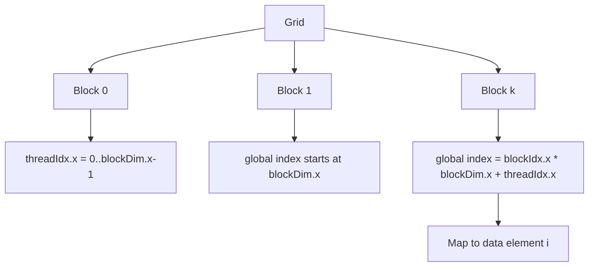

# 第 7 章 Thread、Block、Grid：CUDA 坐标系统怎么把数据分给线程

CUDA kernel 的每个线程执行同一段代码。要让同一段代码处理不同数据，关键就是索引。`threadIdx`、`blockIdx`、`blockDim`、`gridDim` 这几个内建变量构成了 CUDA 的坐标系统，负责把大规模并行工作映射到数据结构上。

一维向量、二维图像、三维体数据都可以用同一套坐标思想表达。写 CUDA kernel 的第一项基本功，就是能清楚地回答：这个线程负责哪个元素？

## 7.1 问题的由来

CPU 代码里你经常显式写循环：

```cpp
for (int i = 0; i < n; ++i) {
    c[i] = a[i] + b[i];
}
```

CUDA kernel 里没有一个单独线程替你执行完整循环。你启动很多线程，让每个线程算出自己的 `i`，然后处理一份数据。

```cpp
int i = blockIdx.x * blockDim.x + threadIdx.x;
```

这个公式是 CUDA 最常见的索引表达式。它的意义是：当前 block 前面已经有 `blockIdx.x * blockDim.x` 个线程位置，当前线程在本 block 内偏移 `threadIdx.x`，两者相加就是全局一维线程索引。

## 7.2 核心模型

CUDA 的坐标系统有两个层级：block 在 grid 里的位置，thread 在 block 里的位置。全局索引就是这两个层级合成出来的。

图 7.1 以一维情况为例：每个 block 内的 `threadIdx.x` 都从 0 数到 `blockDim.x - 1`；block 1 的第一个线程，全局索引从 `blockDim.x` 开始；任意 block k 中的线程，全局索引都是 `blockIdx.x * blockDim.x + threadIdx.x`，再由这个索引对应到数据元素 `i`。

<figure>

<figcaption>图 7.1：blockIdx 与 threadIdx 合成全局索引 i</figcaption>
</figure>

## 7.3 详解

### 7.3.1 一维索引：向量和线性数组

一维 kernel 最常见：

```cpp
__global__ void scale(float* x, float factor, int n)
{
    int i = blockIdx.x * blockDim.x + threadIdx.x;
    if (i < n) {
        x[i] *= factor;
    }
}
```

host 侧 launch：

```cpp
int threads = 256;
int blocks = (n + threads - 1) / threads;
scale<<<blocks, threads>>>(d_x, 2.0f, n);
```

这里的 `blocks` 是向上取整。多启动的线程靠 `if (i < n)` 退出。

### 7.3.2 二维索引：矩阵和图像

二维数据通常把 `x` 当列，把 `y` 当行：

```cpp
__global__ void add_image(const float* a, const float* b, float* c,
                          int width, int height)
{
    int x = blockIdx.x * blockDim.x + threadIdx.x;
    int y = blockIdx.y * blockDim.y + threadIdx.y;
    if (x < width && y < height) {
        int idx = y * width + x;
        c[idx] = a[idx] + b[idx];
    }
}
```

host 侧：

```cpp
dim3 block(16, 16);
dim3 grid((width + block.x - 1) / block.x,
          (height + block.y - 1) / block.y);
add_image<<<grid, block>>>(d_a, d_b, d_c, width, height);
```

这里的二维 grid 和二维 block 只是一种组织方式：grid 和 block 可以按数据形状排列，`blockIdx.x`/`blockIdx.y` 给出 block 在 grid 中的列和行，`threadIdx.x`/`threadIdx.y` 给出线程在 block 中的列和行。但性能仍然取决于 warp 内线程访问的地址是否连续。通常让 `threadIdx.x` 对应内存中连续变化的列，会更容易得到合并访问。

### 7.3.3 三维索引：体数据和批处理

三维数据只是继续扩展：

```cpp
int x = blockIdx.x * blockDim.x + threadIdx.x;
int y = blockIdx.y * blockDim.y + threadIdx.y;
int z = blockIdx.z * blockDim.z + threadIdx.z;
int idx = (z * height + y) * width + x;
```

三维 block 不一定更快，它只是让坐标表达更自然。底层线程仍然会被线性化，warp 的相邻关系仍然和 `x` 维最快变化有关。

### 7.3.4 Grid-stride loop：让线程处理多份数据

有时数据很大，或者你希望固定 grid size，不让 block 数随 `n` 线性增长。可以用 grid-stride loop：

```cpp
__global__ void scale_grid_stride(float* x, float factor, int n)
{
    int tid = blockIdx.x * blockDim.x + threadIdx.x;
    int stride = blockDim.x * gridDim.x;
    for (int i = tid; i < n; i += stride) {
        x[i] *= factor;
    }
}
```

这种写法常用于：

- 数据规模很大。
- 想限制 grid size。
- 想让每个线程处理多个元素，提高调度复用。
- 写更通用的 kernel 模板。

## 7.4 代码示例

下面是二维图像加法的完整 kernel 与 launch 片段：

```cpp
__global__ void add2d(const float* a, const float* b, float* c,
                      int width, int height)
{
    int x = blockIdx.x * blockDim.x + threadIdx.x;
    int y = blockIdx.y * blockDim.y + threadIdx.y;
    if (x >= width || y >= height) return;
    int idx = y * width + x;
    c[idx] = a[idx] + b[idx];
}
void launch_add2d(const float* d_a, const float* d_b, float* d_c,
                  int width, int height)
{
    dim3 block(16, 16);
    dim3 grid((width + block.x - 1) / block.x,
              (height + block.y - 1) / block.y);
    add2d<<<grid, block>>>(d_a, d_b, d_c, width, height);
}
```

这里的关键不是 `dim3`，而是二维坐标到线性内存的映射：

```cpp
idx = y * width + x;
```

如果你的数据布局是 column-major，这个公式就要变。线程索引必须服务于数据布局，而不是反过来。

## 7.5 工程判断

| 数据形状 | 推荐索引 | 注意点 |
|---|---|---|
| 一维数组 | `i = blockIdx.x * blockDim.x + threadIdx.x` | 保留 `i < n` |
| 二维 row-major 图像 | `x` 对列，`y` 对行，`idx = y * width + x` | 让相邻 `threadIdx.x` 访问连续地址 |
| 三维体数据 | `idx = (z * height + y) * width + x` | 注意总元素数和 block 维度上限 |
| 极大数组 | grid-stride loop | stride 应为 `blockDim.x * gridDim.x` |
| 不规则数据 | 先建立索引表或压缩结构 | 不要强行套二维 grid |

## 7.6 API 与要点速查

内建变量速查：

| 变量 | 类型 | 含义 |
|---|---|---|
| `threadIdx` | `dim3` | 当前 thread 在 block 内的坐标 |
| `blockIdx` | `dim3` | 当前 block 在 grid 内的坐标 |
| `blockDim` | `dim3` | 每个 block 的尺寸 |
| `gridDim` | `dim3` | grid 的尺寸 |

常见限制需要查 compute capability：

| 限制 | 说明 |
|---|---|
| 每 block 最大 thread 数 | 常见上限是 1024，但应查设备属性 |
| 每个维度最大 block/grid size | `cudaDeviceProp` 中有对应字段 |
| shared memory/register | 会影响一个 block 能否驻留 SM |

相关 API：

| API | 用途 |
|---|---|
| `cudaGetDeviceProperties` | 查询设备线程、block、grid、shared memory 等上限 |
| `cudaOccupancyMaxPotentialBlockSize` | 为 kernel 估算合适 block size 起点 |

## 7.7 小结

读完本章，你应该能够：

- 从 thread/block/grid 坐标推导一维、二维、三维数据索引。
- 解释为什么 kernel 中需要 bounds checking。
- 根据数据布局选择线程维度。
- 写 grid-stride loop。
- 意识到坐标表达不等于性能保证，访存连续性仍然要单独判断。
