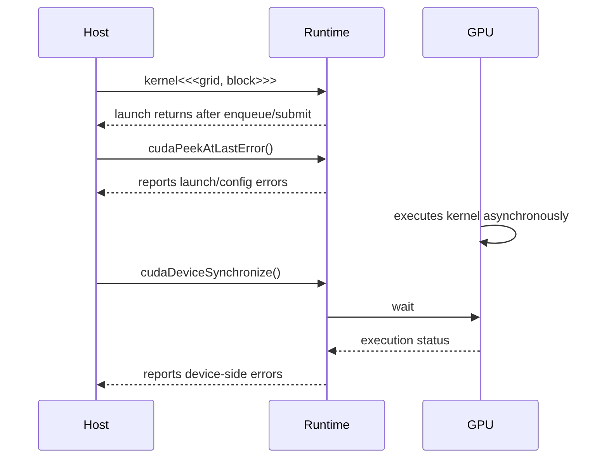

# 第 8 章 Kernel launch 不是函数调用：异步错误为什么会晚一点出现

CUDA kernel 的三尖括号语法很像函数调用，但它的语义完全不同。`kernel<<<grid, block>>>(...)` 对 host 来说是一次提交，通常不是一次等待执行完成的调用。这个差异解释了很多 CUDA 错误为什么“晚一点”才出现。

写 CUDA 程序必须分清三件事：launch 本身是否提交成功，kernel 在 device 上是否执行成功，host 何时能安全使用结果。

## 8.1 问题的由来

普通 C++ 函数调用有很强的顺序直觉：

```cpp
foo();
bar();
```

`bar` 开始执行时，`foo` 已经返回。CUDA kernel launch 不是这样：

```cpp
kernel<<<blocks, threads>>>(args...);
use_result_on_host();
```

第二行开始时，kernel 可能还没执行完。host 只是把工作提交给 GPU，然后继续向下走。除非你调用同步 API，或者使用会阻塞的拷贝/同步操作，否则 host 不会自动等待。

## 8.2 核心模型

CUDA 错误边界的关键是：launch 错误和执行错误不一定在同一个 API 暴露。

图 8.1 把这两类错误放在同一条时间线上：launch 在 Runtime 把工作排进队列后就返回，紧接着的 `cudaPeekAtLastError()` 只能报告 launch/配置错误；kernel 在 GPU 上异步执行，执行期间出的错要等 host 调用 `cudaDeviceSynchronize()`、Runtime 拿到执行状态后才报告回来。

<figure>

<figcaption>图 8.1：launch 错误与 device 执行错误分别在哪个调用暴露</figcaption>
</figure>

## 8.3 详解

### 8.3.1 Launch 配置错误

launch 配置错误通常和提交参数有关，例如：

- block 线程数超过设备上限。
- dynamic shared memory 需求超过允许值。
- kernel symbol 或参数配置不正确。
- launch attribute 不被当前设备支持。

这些错误可以在 launch 后通过 `cudaPeekAtLastError` 或 `cudaGetLastError` 观察到。

### 8.3.2 Device 执行错误

device 执行错误发生在 kernel 真正运行期间，例如：

- 非法 global memory 访问。
- misaligned access。
- device assert。
- stack overflow 或某些运行时资源错误。

这些错误通常在后续同步点暴露，例如：

- `cudaDeviceSynchronize`
- `cudaStreamSynchronize`
- 阻塞的 `cudaMemcpyDeviceToHost`
- 后续某个 Runtime API 调用

如果你只检查 launch 后的 `cudaGetLastError`，可能漏掉 kernel 内部错误。

### 8.3.3 `cudaPeekAtLastError` 和 `cudaGetLastError`

两者都读取 Runtime 的错误状态，但行为不同：

| API | 是否清除错误状态 | 典型用途 |
|---|---|---|
| `cudaPeekAtLastError` | 不清除 | launch 后调试检查 |
| `cudaGetLastError` | 清除 | 消费并重置 error state |

代码风格上，两者都可用，但要知道清除行为，否则可能把后续错误状态搞乱。

### 8.3.4 同步不是越多越好

初学阶段用 `cudaDeviceSynchronize` 很直观，但它会等待整个当前 device 上之前提交的工作。真实程序里，如果使用多个 stream，通常希望同步某个 stream 或某个 event，而不是粗暴等待整个 device。

第三部分（[第 12 章](ch012.md)起）会专门讲 stream/event。这里先记住：同步是为了建立顺序和观察错误，不是随手加的“保险”。

## 8.4 代码示例

下面的示例模拟一个常见错误：忘了分配 device memory，就把空指针传给了 kernel。launch 本身检查不出这个问题，错误要等到同步时才暴露：

```cpp
#include <cuda_runtime.h>
#include <cstdio>
#include <cstdlib>
#define CUDA_CHECK(call)                                                   \
    do {                                                                   \
        cudaError_t err__ = (call);                                        \
        if (err__ != cudaSuccess) {                                        \
            std::fprintf(stderr, "%s:%d CUDA error: %s\n",                \
                         __FILE__, __LINE__, cudaGetErrorString(err__));   \
            std::exit(1);                                                  \
        }                                                                  \
    } while (0)
__global__ void fill(float* out, int n)
{
    int i = blockIdx.x * blockDim.x + threadIdx.x;
    if (i < n) {
        out[i] = 1.0f;
    }
}
int main()
{
    int n = 1024;
    float* d_out = nullptr;  // bug: forgot cudaMalloc
    fill<<<4, 256>>>(d_out, n);
    // Launch succeeded: configuration is valid, nothing has run yet.
    CUDA_CHECK(cudaPeekAtLastError());
    // The illegal address is reported once we wait for the kernel.
    CUDA_CHECK(cudaDeviceSynchronize());
}
```

运行时，`cudaPeekAtLastError` 返回成功，程序在 `cudaDeviceSynchronize` 那一行报出 “an illegal memory access was encountered”。

反过来，如果只是越界几个元素，访问的地址往往仍落在已经分配的显存页里，运行时不会报任何错误。这类问题要用 `compute-sanitizer` 才能查出来。

调试时可以临时启用：

```bash
CUDA_LAUNCH_BLOCKING=1 ./bad
```

这会让 kernel launch 更接近同步执行，帮助定位错误位置。它是调试工具，不应作为性能运行的默认环境。

## 8.5 工程判断

| 现象 | 可能原因 | 检查方式 |
|---|---|---|
| launch 后立刻报错 | 配置非法、参数非法、资源超限 | `cudaPeekAtLastError` |
| 后续同步时报错 | kernel 内非法访问或 device assert | `cudaDeviceSynchronize` / `cudaStreamSynchronize` |
| 错误出现在无关 API | 前一个异步操作留下的错误 | 在每个 launch 后加检查缩小范围 |
| host 读到旧结果 | 缺同步或拷贝发生太早 | 在 D2H copy 前建立同步 |
| 加了同步后变慢 | 同步粒度太粗 | 改为 stream/event 级同步 |

## 8.6 API 与要点速查

三尖括号完整形式：

```cpp
kernel<<<gridDim, blockDim, dynamicSharedMemoryBytes, stream>>>(args...);
```

| 参数 | 作用 |
|---|---|
| `gridDim` | grid 中 block 数，可以是 `int` 或 `dim3` |
| `blockDim` | 每个 block 中 thread 数，可以是 `int` 或 `dim3` |
| `dynamicSharedMemoryBytes` | 动态 shared memory 字节数 |
| `stream` | kernel 提交到哪个 stream，默认是 default stream |

常用错误处理 API：

| API | 说明 |
|---|---|
| `cudaGetErrorName` | 返回错误枚举名 |
| `cudaGetErrorString` | 返回可读错误描述 |
| `cudaGetLastError` | 获取并清除最近错误 |
| `cudaPeekAtLastError` | 查看最近错误但不清除 |

相关环境变量：

| 变量 | 用途 |
|---|---|
| `CUDA_LAUNCH_BLOCKING=1` | 调试异步错误，将 launch 阻塞化 |
| `CUDA_LOG_FILE` | 将 driver/runtime 相关日志输出到文件/stdout/stderr |

## 8.7 小结

读完本章，你应该能够：

- 解释 kernel launch 为什么不是普通函数调用。
- 区分 launch 配置错误和 device 执行错误。
- 选择正确的错误检查位置。
- 用同步缩小异步错误范围。
- 避免用全局同步掩盖 stream 级调度问题。
