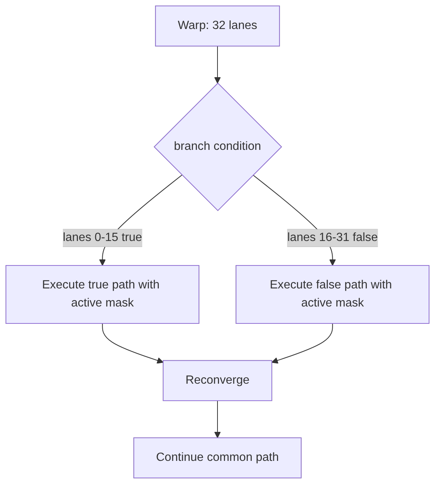

# 第 9 章 SIMT 与 warp：每个线程写标量代码，硬件按组执行

CUDA 让你像写普通标量程序一样写每个线程的逻辑，但 GPU 并不是把每个线程完全独立地随意调度。线程会按 warp 成组执行。理解 SIMT 和 warp，是理解分支、访存、warp primitive 和很多性能问题的入口。

功能正确的 CUDA kernel 可能性能很差，原因常常不是算法错了，而是同一个 warp 内线程行为太分散：有人走 `if`，有人走 `else`；有人访问连续地址，有人访问远处地址；有人进入循环，有人早早退出。

## 9.1 问题的由来

CUDA 的抽象是 thread。每个 thread 都有自己的 `threadIdx`、寄存器和控制流状态。从语义上说，不同 thread 可以走不同分支。

硬件的执行单位通常是 warp。一个 warp 包含 32 个 thread。warp 内线程大多数时候一起取指、发射和执行。如果分支条件让 warp 内线程分成两组，硬件需要分别执行不同路径，并通过 active mask 屏蔽不在当前路径上的 lane。

这就是 SIMT：Single Instruction, Multiple Threads。它给了你线程式编程模型，但性能仍然受成组执行影响。

## 9.2 核心模型

图 9.1 画的是一个 warp 遇到分支时的情形：lane 0–15 条件为真，lane 16–31 条件为假。硬件先在 active mask 下执行一条路径，再执行另一条，两条路径都走完后 lane 重新汇合，继续执行公共代码。

<figure>

<figcaption>图 9.1：warp 内分支分化：两条路径依次执行后重新汇合</figcaption>
</figure>

这就是 divergence 的成本：线程语义允许分支，但 warp 的不同路径通常不能同时以满 lane 利用率执行。

## 9.3 详解

### 9.3.1 Divergence 不是所有分支

不是看到 `if` 就一定慢。关键是同一个 warp 内线程是否走不同路径。

```cpp
if (blockIdx.x == 0) {
    // 整个 block 通常一起走，warp 内不分化
}
```

这种分支如果以 block 为单位一致，warp 内线程路径相同，成本相对可控。

```cpp
if ((threadIdx.x & 1) == 0) {
    // 偶数 lane
} else {
    // 奇数 lane
}
```

这种分支在 warp 内交错分化，通常更糟。

### 9.3.2 Active mask 是 warp 当前活跃 lane 的集合

CUDA 提供 `__activemask()` 观察当前 warp 活跃 lane：

```cpp
unsigned mask = __activemask();
```

warp-level primitive 通常需要 mask 参数，例如 shuffle、vote、reduce。mask 的意义是告诉硬件：哪些 lane 参与这次 warp 操作。错误的 mask 会导致难以定位的逻辑问题。

这两者要分开看。`__activemask()` 只报告“此刻碰巧一起执行的 lane”，是观察结果，不是承诺；`__shfl_sync`、`__ballot_sync` 这类 `_sync` 函数的 mask 则是你对“哪些 lane 一定会执行到这条指令”的声明，应当由程序逻辑给出：整个 warp 都会到达就写 `0xffffffff`，只有部分 lane 会到达，就先按条件用 `__ballot_sync` 算出来。

### 9.3.3 Independent Thread Scheduling 不是忽略 warp

现代 GPU 支持更细的线程调度语义，但这不意味着可以把 warp 当作不存在。warp 仍然是很多指令执行、访存合并和 warp primitive 的基本背景。旧式“warp-synchronous programming”中依赖隐式同步的写法，在现代架构上尤其要谨慎，必要时应使用 `__syncwarp(mask)`。

### 9.3.4 分支优化不是一味消灭 `if`

分支优化有几种路径：

| 方法 | 适用情况 |
|---|---|
| 数据重排 | 让同一 warp 内线程更可能走同一路径 |
| 按 block/warp 分组 | 把不同分支交给不同 warp 或 block |
| predication/算术替代 | 分支体很短时可能更合适 |
| 提前过滤 | 将不活跃元素 compact 后再处理 |
| 接受 divergence | 分支不可避免且成本不是瓶颈 |

不要为了消灭分支写出更难读、访存更差的代码。CUDA 优化总是在控制流、访存和资源之间折中。

## 9.4 代码示例

下面的示例展示 warp 内分支和 mask：

```cpp
__global__ void branch_mask_demo(const float* in, float* out, int n)
{
    int i = blockIdx.x * blockDim.x + threadIdx.x;
    // 在任何 lane 退出之前，整个 warp 按程序条件投票：谁会留下来
    unsigned stay = __ballot_sync(0xffffffffu, i < n);
    if (i >= n) return;
    if ((threadIdx.x & 1) == 0) {
        out[i] = in[i] * 2.0f;
    } else {
        out[i] = in[i] + 1.0f;
    }
    __syncwarp(stay);
}
```

这段代码里的 `__syncwarp(stay)` 不会让分支更快，它只是展示：当你需要 warp 内线程在后续某个点重新建立同步时，应该显式说明参与 lane。这个 mask 不是用 `__activemask()` 临时取的，而是在提前 return 之前由整个 warp 按条件 `i < n` 投票得出（这里假设 `blockDim.x` 是 32 的倍数，投票时 32 个 lane 都在）。

一个简单 warp reduction 更能体现 mask 的意义：

```cpp
__device__ float warp_sum(float v)
{
    // 约定：warp 的 32 个 lane 都会执行到这里
    for (int offset = 16; offset > 0; offset >>= 1) {
        v += __shfl_down_sync(0xffffffffu, v, offset);
    }
    return v;  // lane 0 得到整个 warp 的和
}
__global__ void sum_kernel(const float* in, float* out, int n)
{
    int i = blockIdx.x * blockDim.x + threadIdx.x;
    // 越界线程不提前 return，而是贡献 0，保证整个 warp 都参与 shuffle
    float v = (i < n) ? in[i] : 0.0f;
    v = warp_sum(v);
    if ((threadIdx.x & 31) == 0) {
        atomicAdd(out, v);
    }
}
```

mask 必须和实际执行这条 shuffle 的 lane 一致。上面让所有 lane 都留下来（同样假设 `blockDim.x` 是 32 的倍数），mask 自然就是全掩码。如果某些 lane 已经提前 return，就不能再写 `0xffffffff`；也不要改用 `__activemask()` 凑一个 mask，它可能漏掉本该参与的 lane。更要紧的是，`__shfl_down_sync` 从没有参与的 lane 读到的值是未定义的，就算 mask 写对了，跨过缺席 lane 的规约结果也不可靠。所以 warp 规约最稳的写法是像 `sum_kernel` 这样让越界线程补 0，而不是让它们退出。

## 9.5 工程判断

| 代码形态 | 风险 | 判断方式 |
|---|---|---|
| `if (threadIdx.x % 2)` | warp 内高度分化 | 尽量按连续 lane 分组或重排 |
| `if (blockIdx.x == k)` | block 级一致 | 通常不是 warp divergence 重点 |
| warp primitive 用 `0xffffffff` | 部分 lane 已退出时与实际不符 | 让所有 lane 都到达（越界补 0），或按条件用 `__ballot_sync` 算出 mask；不要拿 `__activemask()` 代替 |
| 线程提前 return | 后续 warp/block 同步风险 | 确认没有未参与同步的线程 |
| shared memory 后无同步 | 数据竞争 | 使用 `__syncthreads()` 或合适 group sync |
| 依赖 warp 隐式同步 | 架构相关风险 | 使用 `__syncwarp()` |

## 9.6 API 与要点速查

检查一个 SIMT kernel 时，可以从这几个观察点入手：

| 观察点 | 说明 |
|---|---|
| thread 如何组成 warp | warp 是性能讨论的基本单位 |
| warp 如何访问 memory transaction | 访存是否连续影响带宽利用 |
| active lanes 是否一致 | 分支分化会降低有效吞吐 |
| block 如何映射到 SM | block 资源占用决定并发度 |

常用 warp 相关内建函数：

| 函数 | 作用 |
|---|---|
| `__activemask` | 此刻一起执行的 lane，只用于观察，不宜直接当 mask 用 |
| `__syncwarp` | warp 范围同步 |
| `__shfl_sync` / `__shfl_down_sync` | warp 内寄存器交换 |
| `__ballot_sync` | 收集 predicate 到 mask |
| `__all_sync` / `__any_sync` | warp 内投票 |
| `__match_any_sync` / `__match_all_sync` | warp 内值匹配 |

## 9.7 小结

读完本章，你应该能够：

- 解释 SIMT 和 SIMD 的差异。
- 判断一个分支是否会造成 warp divergence。
- 理解 active mask 和 warp primitive 的关系。
- 避免依赖隐式 warp 同步。
- 把控制流优化和访存优化一起考虑。
