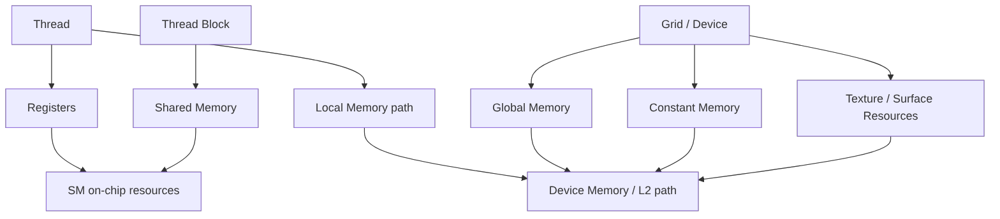

# 第 10 章 kernel 视角下的内存空间：global、shared、local、constant、texture、surface

CUDA 内存空间不能只按“快慢”记。对 kernel 作者来说，更重要的是四个问题：这块内存在哪里，谁能看见它，生命周期多长，访问模式适合什么。只记住 global 慢、shared 快，会错过很多影响正确性和性能的边界。

本章从写 kernel 的角度整理内存空间，并讲清 coalescing、shared memory、constant symbol、texture/surface 各自在工程中的位置。

## 10.1 问题的由来

CPU 程序里，绝大多数对象都在统一的内存模型下思考。CUDA 里同样是一个指针，背后可能完全不同：

- `cudaMalloc` 返回的 device pointer，通常指向 global memory。
- `__shared__` 变量只在一个 block 内共享。
- 大局部数组可能落到 local memory，虽然名字叫 local，但访问路径接近 global。
- `__constant__` symbol 在 device 侧只读，host 通过 symbol API 初始化。
- texture/surface 通过专用资源对象访问，更常出现在图像和互操作路径。

写 kernel 时，如果不知道变量在哪里，就很难判断同步、缓存、访问成本和生命周期。

## 10.2 核心模型

图 10.1 按可见范围把内存空间分成三组：thread 私有的 register 和 local memory，block 共享的 shared memory，grid/device 范围的 global、constant 和 texture/surface 资源；再标出它们最终落到 SM 片上资源还是 device memory/L2 这条路径。

<figure>

<figcaption>图 10.1：各内存空间的可见范围及其落到的硬件位置</figcaption>
</figure>

register 和 shared memory 是最直接的片上资源；global/local/constant/texture/surface 最终都和 device memory、L2、专用缓存路径有关，只是语义和访问路径不同。

## 10.3 详解

### 10.3.1 Global memory：容量大，访问模式决定带宽

global memory 是大多数输入输出数组所在位置。它对 device 范围可见，生命周期由 allocation 控制。它的容量大，但延迟高。性能关键是让 warp 内访问尽量合并。

连续线程访问连续地址时，内存系统可以用较少 transaction 搬回有效数据。如果连续线程访问大 stride 或随机地址，同样数量的线程可能触发更多 transaction，带宽利用率下降。

用一个 warp 的 32 个线程各读一个 4 字节 `float` 来算一笔账。在现代 GPU 上，global memory 的数据以 32 字节的 sector 为单位搬运，不同访问模式需要的 sector 数差别很大：

| 访问模式 | 请求覆盖的地址 | 搬运的 32 字节 sector | 有效数据占比 |
|---|---|---|---|
| 相邻线程读相邻元素，起点 128 字节对齐 | 连续 128 字节 | 4 个 | 100% |
| 相邻线程读相邻元素，起点错开 4 字节 | 连续 128 字节，跨过一个 128 字节边界 | 5 个 | 80% |
| 相邻线程相隔 32 个元素（stride 128 字节） | 32 个分散的 4 字节 | 32 个 | 12.5% |

第三种情况下，warp 一共只要 128 字节数据，却要搬回 1024 字节。

### 10.3.2 Shared memory：block 内共享，不是自动缓存

shared memory 是每个 block 共享的片上内存。它适合：

- 把 global memory 中复用的数据搬到片上。
- 让 block 内线程协作。
- 改写不友好的 global 访问模式。

但 shared memory 需要你自己管理同步。写入后被其他线程读取，通常需要 `__syncthreads()` 或 cooperative groups 的同步。

```cpp
__global__ void copy_tile(const float* in, float* out, int n)
{
    __shared__ float tile[256];
    int i = blockIdx.x * blockDim.x + threadIdx.x;
    int t = threadIdx.x;
    tile[t] = (i < n) ? in[i] : 0.0f;
    __syncthreads();
    if (i < n) {
        out[i] = tile[t];
    }
}
```

shared memory 也不是越多越好。每个 block 用量越大，一个 SM 上能同时驻留的 block 往往越少。

### 10.3.3 Register 和 local memory

register 是线程私有的最快存储，通常由编译器自动分配。你写的局部标量变量大多会进入 register。

local memory 名字很容易误导。它的作用域是线程私有，但物理访问通常走 device memory 路径。以下情况可能导致 local memory：

- 每线程局部数组太大。
- 数组索引编译期无法确定，不能放入 register。
- register pressure 太高，发生 spill。

可以通过 ptxas 输出观察 register 和 spill：

```bash
nvcc -O3 --ptxas-options=-v kernel.cu -o kernel
```

### 10.3.4 Constant memory：小型只读广播数据

constant memory 适合小型只读数据，尤其是 warp 内线程读取同一地址时，可以利用广播式访问。

```cpp
__constant__ float coeff[4];
__global__ void apply_coeff(float* out, int n)
{
    int i = blockIdx.x * blockDim.x + threadIdx.x;
    if (i < n) {
        out[i] = coeff[0] * i + coeff[1];
    }
}
void upload_coeff(const float* h_coeff)
{
    cudaMemcpyToSymbol(coeff, h_coeff, 4 * sizeof(float));
}
```

如果每个线程读 constant memory 的不同地址，constant cache 的优势会下降。

### 10.3.5 Texture 和 surface：专用资源路径

texture memory 常用于只读、空间局部性强、图像或采样式访问。surface memory 更偏向通过 CUDA array 读写图像式资源。它们在现代 CUDA 中不一定是第一选择，但在图形互操作、图像处理、特殊缓存行为中仍有位置。

不要把 texture/surface 理解成“更快的 global memory”。它们是有格式、绑定和访问语义的专用资源。

## 10.4 代码示例

下面是一个 constant symbol 的完整 host/device 交互骨架：

```cpp
#include <cuda_runtime.h>
__constant__ float coeff[8];
__global__ void affine(float* out, int n)
{
    int i = blockIdx.x * blockDim.x + threadIdx.x;
    if (i < n) {
        out[i] = coeff[0] * static_cast<float>(i) + coeff[1];
    }
}
void set_coeff_and_launch(float* d_out, int n)
{
    float h_coeff[8] = {2.0f, 1.0f};
    cudaMemcpyToSymbol(coeff, h_coeff, sizeof(h_coeff));
    void* symbol_addr = nullptr;
    size_t symbol_size = 0;
    cudaGetSymbolAddress(&symbol_addr, coeff);
    cudaGetSymbolSize(&symbol_size, coeff);
    int block = 256;
    int grid = (n + block - 1) / block;
    affine<<<grid, block>>>(d_out, n);
}
```

这段代码展示了 symbol API，而不是建议所有参数都放 constant memory。小型只读广播数据适合，大型每线程不同访问通常不适合。

## 10.5 工程判断

| 需求 | 优先考虑 | 风险 |
|---|---|---|
| 大型输入输出数组 | global memory | 访存不连续会浪费带宽 |
| block 内复用数据 | shared memory | 忘记同步、bank conflict、降低 occupancy |
| 每线程标量临时变量 | register | register pressure 过高 |
| 每线程大局部数组 | 重新设计或接受 local memory | local memory 延迟高 |
| 小型只读广播参数 | constant memory 或 kernel 参数 | 每线程不同地址会变慢 |
| 图像/采样式访问 | texture/surface | 绑定和格式复杂 |
| CPU/GPU 都要访问 | managed/pinned/mapped，见第四部分（[第 19 章](ch019.md)起） | 位置和迁移成本不能忽略 |

## 10.6 API 与要点速查

内存空间速查：

| 内存空间 | 可见范围 | 生命周期 | 所在位置 |
|---|---|---|---|
| register | 单个 thread | thread 生命周期 | SM |
| local memory | 单个 thread | thread 生命周期 | device memory 路径 |
| shared memory | 同一 block | block 生命周期 | SM |
| global memory | 整个 grid/device | 随 allocation，可跨多次 launch | device memory |
| constant memory | 整个 grid/device，只读 | 随 module | device memory + constant cache |
| texture | 取决于资源对象 | 随资源对象 | device memory + texture 访问路径 |
| surface | 取决于资源对象 | 随资源对象 | device memory + surface 访问路径 |

Symbol API：

| API | 作用 |
|---|---|
| `cudaMemcpyToSymbol` | host 写入 device symbol |
| `cudaMemcpyFromSymbol` | host 从 device symbol 读取 |
| `cudaGetSymbolAddress` | 获取 symbol 地址 |
| `cudaGetSymbolSize` | 获取 symbol 大小 |

访存关键词：

| 概念 | 说明 |
|---|---|
| Coalescing | warp 内多个 global load/store 合并成更少 transaction |
| Alignment | 地址对齐影响 transaction 和指令选择 |
| Bank conflict | shared memory 多线程访问同一 bank 的冲突 |
| Cache | 影响性能，不提供同步语义 |

## 10.7 小结

读完本章，你应该能够：

- 按位置、作用域、生命周期理解 CUDA memory spaces。
- 解释 global memory coalescing 为什么重要。
- 知道 shared memory 需要同步，且会影响 occupancy。
- 识别 local memory 和 register spill 的风险。
- 判断 constant、texture、surface 是否适合当前问题。
