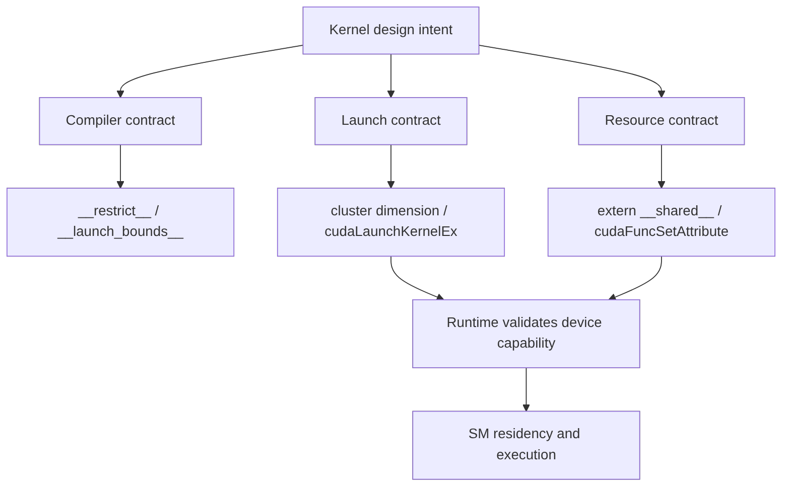

# 第 11 章 从能写 kernel 到能表达约束：`__restrict__`、cluster 与动态 shared memory

写出第一个 CUDA kernel 后，很快会遇到更细的表达需求：告诉编译器几个指针不会重叠；让多个 block 组成 cluster；给 kernel 分配运行时决定大小的 shared memory；在默认上限不够时显式设置函数属性。这些不是初学语法的主线，却是从“能跑”走向“能控制”必须跨过的一步。

本章集中讲几个入门时容易被一笔带过的点：`__restrict__`、cooperative groups、cluster launch、`cudaLaunchKernelEx` 和 dynamic shared memory 属性。

## 11.1 问题的由来

CUDA 编译器和 runtime 不能自动知道所有工程意图。比如：

- 三个指针参数是否可能指向重叠内存？
- 这个 kernel 是否希望按 cluster 组织 block？
- `extern __shared__` 到底需要多少字节？
- dynamic shared memory 是否超过默认限制？

如果这些信息不写出来，编译器只能保守优化，runtime 也只能按默认规则 launch。CUDA 提供了一些机制让你表达这些约束和属性。

## 11.2 核心模型

图 11.1 把 kernel 的设计意图分成三类约束：给编译器的约束（`__restrict__`、`__launch_bounds__`），给 launch 的约束（cluster 维度、`cudaLaunchKernelEx`），以及资源约束（`extern __shared__`、`cudaFuncSetAttribute`）。后两类在 launch 时要经过 runtime 对设备能力的检查，最后落实为 block 在 SM 上的驻留和执行。

<figure>

<figcaption>图 11.1：编译器、launch 与资源三类约束如何影响 kernel 执行</figcaption>
</figure>

这些机制不是装饰，它们会影响编译器优化、launch 合法性和 SM 资源分配。

## 11.3 详解

### 11.3.1 `__restrict__` 是优化契约

如果 kernel 的指针参数不会互相别名，可以写：

```cpp
__global__ void scale_add(const float* __restrict__ x,
                          const float* __restrict__ y,
                          float* __restrict__ out,
                          int n)
{
    int i = blockIdx.x * blockDim.x + threadIdx.x;
    if (i < n) {
        out[i] = 2.0f * x[i] + y[i];
    }
}
```

`__restrict__` 的意义是告诉编译器：这些指针指向的内存区域不会重叠。这样编译器可以减少保守 reload，做更大胆的优化。

它的风险也很直接：如果你传入的指针实际重叠，程序语义就不再可靠。`__restrict__` 不是性能开关，而是契约。

### 11.3.2 Dynamic shared memory

静态 shared memory 在编译期确定大小：

```cpp
__shared__ float tile[256];
```

动态 shared memory 在 launch 时决定大小：

```cpp
__global__ void use_dynamic_smem(float* out)
{
    extern __shared__ float tile[];
    tile[threadIdx.x] = 1.0f;
    __syncthreads();
    out[threadIdx.x] = tile[threadIdx.x];
}
```

host launch 时第三个配置参数传入字节数：

```cpp
int bytes = 256 * sizeof(float);
use_dynamic_smem<<<1, 256, bytes>>>(d_out);
```

动态 shared memory 常用于 tile 大小由运行时参数决定的 kernel，例如不同矩阵块大小、不同数据类型或可调算法参数。

### 11.3.3 超过默认 dynamic shared memory 上限时

很多设备允许每个 block 使用更大的 shared memory，但 dynamic shared memory 默认上限较低（通常是 48 KB），超出部分需要显式 opt-in，也就是设置函数属性：

```cpp
cudaFuncSetAttribute(
    use_dynamic_smem,
    cudaFuncAttributeMaxDynamicSharedMemorySize,
    bytes);
```

这只是允许 kernel 使用更大 dynamic shared memory，不表示性能一定更好。每个 block 用更多 shared memory，通常会减少同一 SM 上可驻留 block 数。

### 11.3.4 Cluster launch

thread block cluster 是 compute capability 9.0+ 的协作层。它把多个 block 组织成 cluster，使它们能通过 cooperative groups 的 cluster 接口进行同步和通信。

kernel 内：

```cpp
#include <cooperative_groups.h>
namespace cg = cooperative_groups;
__global__ void clustered_kernel(float* data)
{
    cg::cluster_group cluster = cg::this_cluster();
    int i = blockIdx.x * blockDim.x + threadIdx.x;
    data[i] = 1.0f;
    cluster.sync();
}
```

host 侧需要用 launch 属性表达 cluster dimension。

## 11.4 代码示例

`cudaLaunchKernelEx` 最小 cluster launch：

```cpp
__global__ void zero_fill_clustered(float* data)
{
    int i = blockIdx.x * blockDim.x + threadIdx.x;
    data[i] = 0.0f;
}
void launch_clustered(float* data)
{
    cudaLaunchConfig_t config = {};
    config.gridDim = dim3(128);
    config.blockDim = dim3(256);
    config.dynamicSmemBytes = 0;
    config.stream = 0;
    cudaLaunchAttribute attr = {};
    attr.id = cudaLaunchAttributeClusterDimension;
    attr.val.clusterDim.x = 2;
    attr.val.clusterDim.y = 1;
    attr.val.clusterDim.z = 1;
    config.attrs = &attr;
    config.numAttrs = 1;
    cudaLaunchKernelEx(&config, zero_fill_clustered, data);
}
```

dynamic shared memory + 属性设置：

```cpp
__global__ void use_large_dynamic_smem(float* out, int n)
{
    extern __shared__ float tile[];
    int t = threadIdx.x;
    int i = blockIdx.x * blockDim.x + t;
    tile[t] = (i < n) ? out[i] : 0.0f;
    __syncthreads();
    if (i < n) out[i] = tile[t] + 1.0f;
}
void launch_large_smem(float* d_out, int n, int smem_bytes)
{
    cudaFuncSetAttribute(
        use_large_dynamic_smem,
        cudaFuncAttributeMaxDynamicSharedMemorySize,
        smem_bytes);
    int block = 256;
    int grid = (n + block - 1) / block;
    use_large_dynamic_smem<<<grid, block, smem_bytes>>>(d_out, n);
}
```

真实代码里还应检查设备是否支持所需 shared memory 和 cluster 功能。

## 11.5 工程判断

| 需求 | 使用机制 | 风险 |
|---|---|---|
| 指针不重叠，想帮助优化 | `__restrict__` | 实际重叠会破坏语义 |
| 每 block shared memory 大小运行时决定 | `extern __shared__` + launch 第三个参数 | 字节数算错导致越界 |
| dynamic shared memory 超默认上限 | `cudaFuncSetAttribute` | occupancy 可能下降 |
| 多个 block 需要更强协作 | cluster launch + cooperative groups | 需要硬件支持和 launch 配置 |
| 普通 launch 不够表达属性 | `cudaLaunchKernelEx` | 属性不兼容会导致 launch 失败 |

## 11.6 API 与要点速查

关键 API 和修饰符：

| 类别 | 名称 | 作用 |
|---|---|---|
| 优化契约 | `__restrict__` | 声明指针无别名 |
| shared memory | `extern __shared__` | 声明动态 shared memory |
| function attribute | `cudaFuncSetAttribute` | 设置 kernel 函数属性 |
| dynamic smem 属性 | `cudaFuncAttributeMaxDynamicSharedMemorySize` | opt-in 更大 dynamic shared memory |
| extensible launch | `cudaLaunchKernelEx` | 使用结构体和属性 launch kernel |
| cluster 属性 | `cudaLaunchAttributeClusterDimension` | 设置 cluster 维度 |
| cooperative groups | `cg::this_cluster`、`cg::cluster_group` | 获取 cluster 级协作对象 |

能力查询建议：

| 要查什么 | API/来源 |
|---|---|
| compute capability | `cudaGetDeviceProperties` |
| shared memory 上限 | `cudaDeviceProp` 相关字段 |
| cluster 支持 | compute capability 和 launch attribute 支持 |
| occupancy 影响 | occupancy API、profiling、ptxas 资源输出 |

## 11.7 小结

读完本章，你应该能够：

- 把 `__restrict__` 当作语义契约，而不是盲目优化开关。
- 写出 dynamic shared memory kernel 和 launch。
- 知道何时需要 `cudaFuncSetAttribute`。
- 理解 cluster launch 表达的是 block 级协作结构。
- 在使用高级 launch 属性前检查硬件能力和资源约束。
