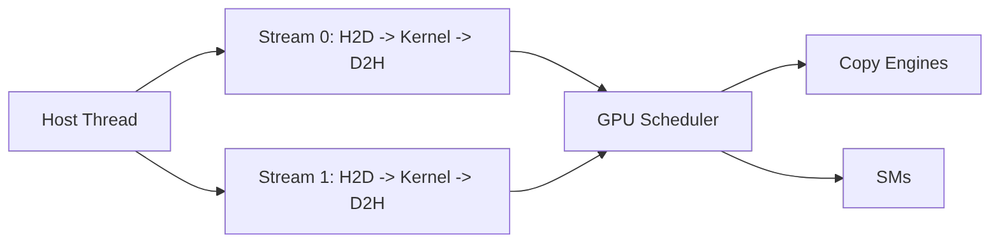

# 第 12 章 Stream 是 GPU 工作队列：异步不是自动并行

写完第一个 CUDA 程序后，你已经知道 kernel launch 对 host 是异步的。下一步要弄清的是 CUDA 如何表达顺序：哪些操作必须排队，哪些操作可以重叠，host 应该在哪里等待。只把 API 换成带 `Async` 后缀的版本，解决不了这个问题。

Stream 是这条线的起点。可以把 `cudaStream_t` 理解成 GPU 工作队列：同一条 stream 内的操作按提交顺序执行，不同 stream 之间默认没有顺序保证。

## 12.1 问题的由来

如果程序只有一个 kernel，用 `cudaDeviceSynchronize()` 等它完成就够了。但真实 CUDA 程序通常包含多段工作：

- 把下一批输入从 host 拷到 device。
- 对上一批输入执行 kernel。
- 把更早一批结果从 device 拷回 host。
- CPU 同时准备下一批数据或处理结果。

如果所有工作都串成一条线，GPU 和 CPU 会互相等待。Stream 让你把“必须有序”和“可以并行推进”的部分分别表达出来。

## 12.2 核心模型

同一 stream 内的 H2D、kernel、D2H 有序。不同 stream 的工作是否重叠，取决于 copy engine、SM 资源、内存类型、依赖关系和同步点。异步 API 只表示 host 不必等工作完成才返回，不保证工作一定并发。

<figure>

<figcaption>图 12.1：host 线程向两条 stream 提交工作，GPU 把它们调度到 copy engine 和 SM</figcaption>
</figure>

换到时间轴上看一条 stream，典型的过程是这样的：

1. host 依次调用 `cudaMemcpyAsync`、launch kernel、`cudaEventRecord`。这些调用都很快返回，host 接着去做自己的 CPU 工作。
2. GPU 侧按提交顺序执行 H2D copy 和 kernel，然后到达 event。这段时间里 CPU 工作和 GPU 工作同时推进。
3. host 需要结果时，才在同步点（例如 `cudaEventSynchronize` 或 `cudaStreamSynchronize`）停下来，等 GPU 侧追上。

也就是说，异步接口释放的是 host 线程，让 CPU 可以继续提交或准备工作；GPU 侧的 copy 与 kernel 能否重叠，要看 copy engine、SM 和依赖关系是否允许。把 `Async` 后缀理解成“必然并发”，是 stream 代码最常见的误判。

## 12.3 详解

### 12.3.1 Stream 的基本规则

Stream 的核心规则只有一句：同一 stream 内有序，不同 stream 之间默认无序。

```cpp
cudaStream_t s;
cudaStreamCreate(&s);
cudaMemcpyAsync(d_in, h_in, bytes, cudaMemcpyHostToDevice, s);
kernel<<<grid, block, 0, s>>>(d_in, d_out);
cudaMemcpyAsync(h_out, d_out, bytes, cudaMemcpyDeviceToHost, s);
cudaStreamSynchronize(s);
cudaStreamDestroy(s);
```

这段代码里，kernel 不会越过前面的 H2D copy，后面的 D2H copy 也不会越过 kernel。你不需要在同一 stream 内每一步之间手动同步。

### 12.3.2 多 stream 不等于一定并发

如果你创建两个 stream：

```cpp
cudaStream_t s0, s1;
cudaStreamCreate(&s0);
cudaStreamCreate(&s1);
```

然后分别提交工作，CUDA 会尝试调度它们。但并发是否发生取决于条件：

| 条件 | 影响 |
|---|---|
| GPU 是否支持 concurrent kernels | 不支持时多个 kernel 仍可能串行 |
| copy engine 数量 | 影响 H2D、D2H 与 kernel 能否重叠 |
| host memory 是否 pinned | pageable memory 可能引入同步或 staging |
| kernel 资源占用 | 一个 kernel 占满 SM 时，另一个 kernel 无法同时驻留 |
| 是否有默认 stream 隐式同步 | legacy default stream 可能把队列串起来 |

所以 stream 的语义是“允许表达并发机会”，不是“保证并发执行”。

### 12.3.3 Pinned memory 是异步 copy 的前提之一

涉及 host memory 的 copy 要做到异步，通常需要 page-locked memory：

```cpp
float* h = nullptr;
float* d = nullptr;
cudaMallocHost(&h, bytes);
cudaMalloc(&d, bytes);
cudaMemcpyAsync(d, h, bytes, cudaMemcpyHostToDevice, stream);
```

普通 `malloc` 得到的是 pageable memory。runtime 可能需要临时 pin 或 staging，这会引入额外开销和同步行为。第四部分（尤其是[第 22 章](ch022.md)）会进一步展开 pinned/mapped/managed 的差异。

### 12.3.4 默认 stream 是隐式同步高发区

没有指定 stream 的 kernel 会进入默认 stream：

```cpp
kernel<<<grid, block>>>(args);
```

默认 stream 有 legacy default stream 和 per-thread default stream 两种语义。legacy default stream 会和其他 blocking stream 发生特殊 ordering，容易让本来应该重叠的工作串行。

认真写异步代码时，建议：

- 显式传 stream。
- 需要避免 legacy default stream 影响时，用 `cudaStreamNonBlocking` 创建 stream。
- 或构建时启用 per-thread default stream。

```cpp
cudaStreamCreateWithFlags(&s, cudaStreamNonBlocking);
```

## 12.4 代码示例

下面是双 buffer 的 stream 结构。这段代码只展示调度结构，不是完整应用：

```cpp
cudaStream_t s[2];
cudaStreamCreate(&s[0]);
cudaStreamCreate(&s[1]);
for (int chunk = 0; chunk < chunks; ++chunk) {
    int k = chunk & 1;
    size_t offset = static_cast<size_t>(chunk) * chunk_elems;
    cudaMemcpyAsync(d_in[k],
                    h_in + offset,
                    bytes_per_chunk,
                    cudaMemcpyHostToDevice,
                    s[k]);
    transform<<<grid, block, 0, s[k]>>>(d_in[k], d_out[k], chunk_elems);
    cudaMemcpyAsync(h_out + offset,
                    d_out[k],
                    bytes_per_chunk,
                    cudaMemcpyDeviceToHost,
                    s[k]);
}
cudaStreamSynchronize(s[0]);
cudaStreamSynchronize(s[1]);
cudaStreamDestroy(s[0]);
cudaStreamDestroy(s[1]);
```

这里的重叠机会来自不同 chunk 分布在两条 stream 上。正确性不依赖“它们一定同时跑”，因为每个 chunk 内部的 copy/kernel/copy 都在同一 stream 中有序。

## 12.5 工程判断

| 需求 | 推荐做法 | 常见误区 |
|---|---|---|
| 串起同一批数据的 copy/kernel/copy | 放同一 stream | 每一步都 `cudaDeviceSynchronize` |
| 让两批数据流水推进 | 多 stream + pinned host buffer | 只换成 `cudaMemcpyAsync` 就期待并发 |
| 只等某条队列完成 | `cudaStreamSynchronize` | 总是等整个 device |
| 非阻塞查询 stream | `cudaStreamQuery` | 把 `cudaErrorNotReady` 当失败 |
| 避免默认 stream 干扰 | 显式 stream 或 non-blocking stream | 混用默认 stream 和显式 stream |
| 使用 stream priority | 作为调度提示 | 以为能抢占已经执行的 kernel |

## 12.6 API 与要点速查

Stream API 速查：

| API | 作用 |
|---|---|
| `cudaStreamCreate` | 创建普通 stream |
| `cudaStreamCreateWithFlags` | 创建带 flags 的 stream，如 non-blocking |
| `cudaStreamCreateWithPriority` | 创建带优先级的 stream |
| `cudaStreamDestroy` | 销毁 stream |
| `cudaStreamSynchronize` | 阻塞等待 stream 完成 |
| `cudaStreamQuery` | 非阻塞查询 stream 状态 |
| `cudaDeviceGetStreamPriorityRange` | 查询可用 priority 范围 |

异步执行可能重叠的类别：

| 类别 | 说明 |
|---|---|
| host computation | CPU 继续执行普通代码 |
| kernel execution | GPU SM 执行 kernel |
| H2D/D2H copy | host 与 device 间传输 |
| D2D copy/set | device 内部 copy 或 memset |
| multi-GPU copy | device 间或 peer copy |

## 12.7 小结

读完本章，你应该能够：

- 把 stream 解释成有序工作队列。
- 判断多 stream 只是提供并发机会，不保证并发。
- 知道 host 侧异步 copy 为什么通常需要 pinned memory。
- 避免默认 stream 引入的隐式同步。
- 用 stream 组织 copy/kernel/copy 的基本流水线。
