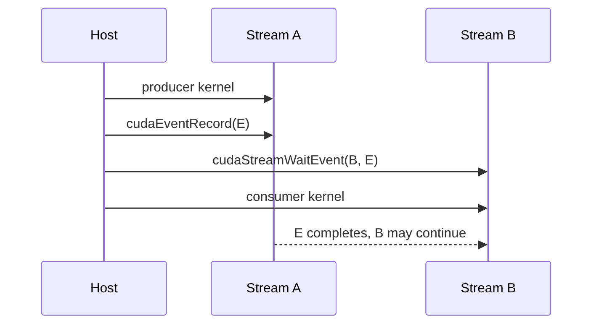

# 第 13 章 Event 不只是计时：它是 stream 之间的依赖标记

很多人第一次接触 CUDA event，是为了给 kernel 计时。这个用途很重要，但 event 更基础的意义是：它是插入 stream 中的完成标记。你可以等待它、查询它，也可以让另一条 stream 等它。

如果 stream 是队列，event 就是队列中的里程碑。它表达的是“这个位置之前的工作完成了”，而不是“整个 GPU 空了”。

## 13.1 问题的由来

只用 stream 时，同一条队列内有序，不同队列之间没有默认顺序。真实程序经常需要局部依赖：

- stream B 的 kernel 要等 stream A 的 H2D copy 完成。
- host 只想等第一个 kernel 完成，不想等后面整条 stream。
- 想测一段 GPU 工作时间，但不想把 CPU 提交成本混进来。

event 就是为这些局部完成点准备的。

## 13.2 核心模型

图 13.1 是最典型的跨 stream 依赖：host 先向 stream A 提交 producer kernel，并在它后面记录 event E；再让 stream B 等待 E，然后向 stream B 提交 consumer kernel。

<figure>

<figcaption>图 13.1：stream B 通过 event E 等 stream A 的 producer 完成后再跑 consumer</figcaption>
</figure>

host 在这里只负责提交依赖关系，不需要阻塞等待 event；等待发生在 stream B 的执行顺序里。E 完成之前，stream B 中排在 wait 之后的工作不会开始。

## 13.3 详解

### 13.3.1 Event 表达 stream 中的位置

创建、记录、等待、销毁：

```cpp
cudaEvent_t e;
cudaEventCreate(&e);
kernel<<<grid, block, 0, stream>>>(args);
cudaEventRecord(e, stream);
cudaEventSynchronize(e);
cudaEventDestroy(e);
```

`cudaEventRecord(e, stream)` 的含义不是“现在 event 立刻完成”，而是把 event 插入 stream。只有该 stream 中 event 之前的工作都完成后，event 才完成。

### 13.3.2 Event 计时测的是 GPU stream 时间

典型计时：

```cpp
cudaEvent_t start, stop;
cudaEventCreate(&start);
cudaEventCreate(&stop);
cudaEventRecord(start, stream);
kernel<<<grid, block, 0, stream>>>(args);
cudaEventRecord(stop, stream);
cudaEventSynchronize(stop);
float ms = 0.0f;
cudaEventElapsedTime(&ms, start, stop);
```

这测的是 start 和 stop 在 GPU stream 时间线上的间隔，不是 CPU 调用 `kernel<<<...>>>` 的墙钟时间。它适合测 kernel 或 GPU copy，不适合测整个应用端到端延迟，除非你把端到端路径也明确放入 stream。

### 13.3.3 跨 stream 依赖

跨 stream 依赖用 `cudaStreamWaitEvent`：

```cpp
producer<<<grid, block, 0, stream_a>>>(data);
cudaEventRecord(done, stream_a);
cudaStreamWaitEvent(stream_b, done, 0);
consumer<<<grid, block, 0, stream_b>>>(data);
```

这比 `cudaDeviceSynchronize` 更细。stream B 中 wait 后面的工作等待 event，其他无关 stream 和 host 工作可以继续推进。

### 13.3.4 Event flags

event 创建时可以带 flags：

| Flag | 作用 |
|---|---|
| `cudaEventDefault` | 默认 event |
| `cudaEventBlockingSync` | host 等待 event 时使用 blocking sync |
| `cudaEventDisableTiming` | 不需要计时，降低 event 开销 |
| `cudaEventInterprocess` | 用于 IPC event，必须同时设置 `cudaEventDisableTiming` |

如果 event 只是依赖标记，不用于计时，优先考虑 `cudaEventDisableTiming`。

## 13.4 代码示例

下面是一个 producer/consumer 跨 stream 示例：

```cpp
cudaStream_t load_stream, compute_stream;
cudaEvent_t input_ready;
cudaStreamCreate(&load_stream);
cudaStreamCreate(&compute_stream);
cudaEventCreateWithFlags(&input_ready, cudaEventDisableTiming);
cudaMemcpyAsync(d_input,
                h_input,
                bytes,
                cudaMemcpyHostToDevice,
                load_stream);
cudaEventRecord(input_ready, load_stream);
cudaStreamWaitEvent(compute_stream, input_ready, 0);
consumer<<<grid, block, 0, compute_stream>>>(d_input, d_output);
cudaStreamSynchronize(compute_stream);
cudaEventDestroy(input_ready);
cudaStreamDestroy(compute_stream);
cudaStreamDestroy(load_stream);
```

这里 host 没有在 copy 后阻塞等待。依赖被放进 GPU 工作流中表达，stream 调度器知道 consumer 不能越过 event。

## 13.5 工程判断

| 需求 | 使用 event 的方式 | 不推荐 |
|---|---|---|
| 测 GPU kernel 时间 | start/stop event + elapsed time | 用 CPU 时间包住异步 launch |
| 只等某个完成点 | `cudaEventSynchronize` | 等整个 stream 或 device |
| 跨 stream 排序 | record + `cudaStreamWaitEvent` | host 先 synchronize 再提交 |
| 非阻塞检查完成 | `cudaEventQuery` | 忙等不退让 CPU |
| 只做依赖不用计时 | `cudaEventDisableTiming` | 默认开启计时造成额外开销 |
| 跨进程同步 | IPC event | 普通 event handle 直接传进程 |

## 13.6 API 与要点速查

Event API 速查：

| API | 作用 |
|---|---|
| `cudaEventCreate` | 创建 event |
| `cudaEventCreateWithFlags` | 创建带 flags 的 event |
| `cudaEventRecord` | 在 stream 中记录 event |
| `cudaEventQuery` | 非阻塞查询 event 是否完成 |
| `cudaEventSynchronize` | host 阻塞等待 event |
| `cudaEventElapsedTime` | 计算两个 event 之间的毫秒时间 |
| `cudaEventDestroy` | 销毁 event |
| `cudaStreamWaitEvent` | 让 stream 等待 event |

计时注意事项：

| 问题 | 说明 |
|---|---|
| context 初始化 | 第一次 CUDA API 的成本不属于 kernel 时间 |
| JIT/module loading | 第一次触达 kernel 可能带来额外延迟 |
| CPU wall-clock | 包含提交、调度、同步和 host 开销 |
| event 时间 | 更接近 GPU stream 上实际执行区间 |

## 13.7 练习

1. 对同一个 kernel 做两种计时：一种用 start/stop event，另一种在 host 上用 `std::chrono` 从 launch 之前计到 `cudaStreamSynchronize` 返回之后。比较两个数字，说明差值里包含了什么（launch 提交开销、同步等待，第一次 launch 时还可能包含 module loading）。
2. 把计时范围扩大到 H2D copy、kernel、D2H copy 整条路径，用多个 event 分段记录三段时间。观察传输占总时间的比例：如果传输占了大头，只优化 kernel 对整体帮助有限。
3. 让输入规模从几千个元素逐步增加到几千万个元素，分别记录 kernel 时间和端到端时间相对 CPU 版本的加速比。观察小规模时 GPU 为什么可能更慢：固定开销和传输成本还没有被足够的计算量摊薄。所以单次 event 测出的 kernel 时间不能直接当作程序的总收益。

## 13.8 小结

读完本章，你应该能够：

- 把 event 看成 stream 中的完成点。
- 用 event 建立跨 stream 依赖。
- 区分 GPU event 计时和 CPU wall-clock 计时。
- 选择合适 event flags。
- 避免为局部依赖同步整个 device。
