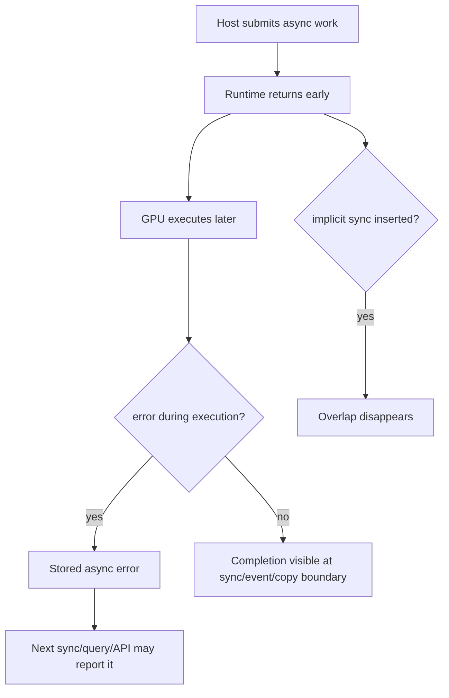

# 第 14 章 隐式同步和异步错误：CUDA 程序最容易误判的两条边界

CUDA 的异步模型带来两个常见误判。第一，程序看起来用了多个 stream，却没有发生预期重叠，原因往往是隐式同步把工作串起来了。第二，错误报在某个无关 API 上，真正出错的 kernel 可能早就提交过了。

本章专门处理这两个边界：哪些操作会显式或隐式同步，异步错误如何定位。

## 14.1 问题的由来

CUDA API 返回并不总是意味着 device 工作完成。反过来，有些 API 看起来只是“分配一点内存”或“拷贝一点数据”，却可能让队列等待。异步模型的难点就在这里：完成、提交、可见、同步、错误暴露是不同事件。

如果不建立清晰的同步边界，你会遇到两类问题：

- 性能问题：时间线本该重叠，却被默认 stream、pageable copy、allocation/free 或全局同步打断。
- 正确性问题：kernel 内非法访问延迟到后续 API 才报告，错误位置看起来不可信。

## 14.2 核心模型

图 14.1 把这两条边界画在一起。host 提交异步工作后，runtime 提前返回，GPU 稍后才执行。执行中出错时，错误先被记录下来，等到之后某次同步、查询或其他 API 调用时才报告；没有出错时，完成状态也要到同步、event 或 copy 边界才对 host 可见。另一条路上，如果某个 API 暗中插入了隐式同步，原本的重叠就消失了。

<figure>

<figcaption>图 14.1：异步提交后的两条岔路：执行错误延后报告，隐式同步让重叠消失</figcaption>
</figure>

所以调试时要同时问：错误在哪里发生，在哪里被报告；同步是你显式写的，还是 API/默认 stream 暗中引入的。

## 14.3 详解

### 14.3.1 显式同步

显式同步是你主动写出来的：

| API | 同步范围 |
|---|---|
| `cudaDeviceSynchronize` | 当前 device 上此前提交的工作 |
| `cudaStreamSynchronize(stream)` | 指定 stream |
| `cudaEventSynchronize(event)` | event 之前的工作 |
| `cudaStreamWaitEvent(stream, event)` | stream 中 wait 后续工作等待 event |

显式同步本身没有问题，问题在于用过宽的同步替代局部依赖，让本来可以并行推进的工作全部串行。

### 14.3.2 隐式同步

隐式同步更难排查。常见来源包括：

| 来源 | 说明 |
|---|---|
| legacy default stream | 与 blocking stream 发生特殊 ordering |
| pageable host memory copy | 可能引入临时 staging 和同步 |
| 某些 allocation/free | 可能影响 device 全局状态 |
| context/module 初始化 | 首次使用时引入加载和初始化成本 |
| peer access 配置 | 可能要求设备间状态更新 |
| blocking Runtime API | API 语义本身要求等待结果可见 |

当 Nsight Systems 时间线中看不到 overlap，不要先怀疑 GPU 不支持并发，先检查这些同步点。

### 14.3.3 异步错误定位

错误检查建议分两层：

```cpp
kernel<<<grid, block, 0, stream>>>(args);
CUDA_CHECK(cudaPeekAtLastError());          // launch/config check
CUDA_CHECK(cudaStreamSynchronize(stream));  // execution check
```

如果 stream 很长，错误只在最后同步时出现，可以临时缩短同步间隔，或使用 `CUDA_LAUNCH_BLOCKING=1` 让 kernel launch 更接近同步。这个环境变量适合定位问题，不适合性能运行。

### 14.3.4 不要让 error state 污染判断

Runtime error state 可能让后续 API 返回之前异步操作的错误。如果你看到一个看似无关的 API 报错，要检查前面是否有未同步的 kernel 或 async copy。

常见调试顺序：

1. 每个 kernel launch 后加 `cudaPeekAtLastError`。
2. 在可疑 kernel 后加 stream synchronize。
3. 用 `CUDA_LAUNCH_BLOCKING=1` 缩小错误位置。
4. 使用 compute-sanitizer 检查非法访问和 race。
5. 确认错误不是来自更早的 async work。

## 14.4 代码示例

一个调试宏可以区分 launch 与执行：

```cpp
#define CUDA_CHECK(call)                                                   \
    do {                                                                   \
        cudaError_t err__ = (call);                                        \
        if (err__ != cudaSuccess) {                                        \
            fprintf(stderr, "%s:%d: %s\n",                                \
                    __FILE__, __LINE__, cudaGetErrorString(err__));        \
            abort();                                                       \
        }                                                                  \
    } while (0)
#define CUDA_LAUNCH_CHECK(stream)                                          \
    do {                                                                   \
        CUDA_CHECK(cudaPeekAtLastError());                                 \
        CUDA_CHECK(cudaStreamSynchronize(stream));                         \
    } while (0)
kernel<<<grid, block, 0, stream>>>(args);
CUDA_LAUNCH_CHECK(stream);
```

性能版本不应该在每个 kernel 后同步。调试宏可以通过编译开关控制：

```cpp
#ifdef DEBUG_CUDA_SYNC
#define CUDA_DEBUG_SYNC(stream) CUDA_CHECK(cudaStreamSynchronize(stream))
#else
#define CUDA_DEBUG_SYNC(stream) do {} while (0)
#endif
```

## 14.5 工程判断

| 现象 | 先检查 | 处理方式 |
|---|---|---|
| 多 stream 没 overlap | default stream、pageable copy、全局同步 | 显式 stream、pinned memory、缩小同步 |
| 错误报在 `cudaMemcpy` | 前面 kernel 是否异步失败 | launch 后检查，拷贝前同步可疑 stream |
| 第一次运行很慢 | context/module/JIT/lazy loading | 预热，分开测初始化和 kernel |
| `cudaErrorNotReady` | stream/event query 未完成 | 这是状态，不是失败 |
| 加 `CUDA_LAUNCH_BLOCKING=1` 后错误位置变清楚 | 原错误是异步暴露 | 修完后关闭该变量测性能 |
| 用 `cudaDeviceSynchronize` 修好了 race | 原依赖表达太粗 | 改为 event/stream 或正确同步原语 |

## 14.6 API 与要点速查

显式同步 API：

| API | 类型 |
|---|---|
| `cudaDeviceSynchronize` | host 等待 device |
| `cudaStreamSynchronize` | host 等待 stream |
| `cudaEventSynchronize` | host 等待 event |
| `cudaStreamWaitEvent` | device 队列内部依赖 |

调试环境变量和工具：

| 名称 | 作用 |
|---|---|
| `CUDA_LAUNCH_BLOCKING=1` | 让 kernel launch 阻塞化，定位异步错误 |
| `CUDA_LOG_FILE` | 输出 CUDA 相关日志到文件/stdout/stderr |
| compute-sanitizer | 检查非法访问、race、initcheck、synccheck 等 |
| `-lineinfo` | 让工具能关联源码行 |

错误 API：

| API | 说明 |
|---|---|
| `cudaGetLastError` | 获取并清除 error state |
| `cudaPeekAtLastError` | 查看但不清除 error state |
| `cudaGetErrorName` | 错误枚举名 |
| `cudaGetErrorString` | 可读错误描述 |

## 14.7 小结

读完本章，你应该能够：

- 区分显式同步和隐式同步。
- 解释为什么异步错误可能在后续 API 暴露。
- 用 launch check 和 stream sync 缩小错误范围。
- 在性能调优时查找意外同步点。
- 避免用全局同步掩盖依赖设计问题。
