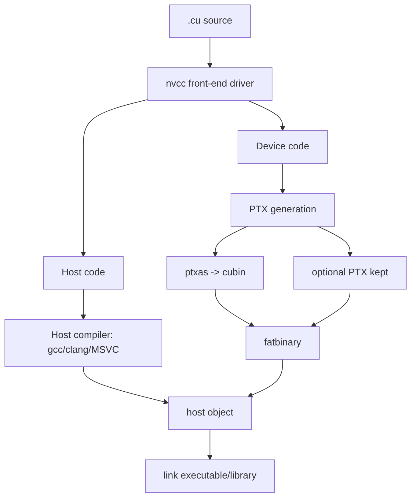

# 第 16 章 nvcc 为什么存在：host code 和 device code 是两条编译链

`.cu` 文件不是普通 C++ 文件。它可能同时包含 host 代码、device 代码、kernel 入口、host/device 双版本函数、device symbol 和普通 C++ 模板。普通 C++ 编译器无法单独理解整套 CUDA 语义，所以 CUDA Toolkit 提供了 `nvcc` 作为编译驱动。

`nvcc` 并不替代 gcc/clang/MSVC，它的工作是协调两条编译链：host code 交给 host compiler，device code 进入 NVIDIA GPU 编译链，最后把结果重新打包链接。

## 16.1 问题的由来

一段 CUDA C++ 源码里可能同时有：

```cpp
__global__ void kernel(float* x) { ... }     // device entry
__device__ float helper(float v) { ... }     // device function
void host_function() { ... }                 // host function
```

host 函数要生成 CPU 可执行代码，kernel 和 device 函数要生成 GPU 代码。GPU 代码还可能需要以 PTX、cubin、fatbin 的形式嵌入最终程序。`nvcc` 就是负责协调这些步骤的 driver。

## 16.2 核心模型

图 16.1 是 `nvcc` 处理一个 `.cu` 文件的大致流程：前端把源码拆成 host code 和 device code；host code 交给 gcc/clang/MSVC 这样的 host compiler，device code 先生成 PTX，再由 ptxas 生成 cubin，必要时保留 PTX，两者打包成 fatbinary；最后 fatbinary 嵌入 host object，参与链接。

<figure>

<figcaption>图 16.1：nvcc 把 .cu 源码分给 host 和 device 两条编译链，再合并链接</figcaption>
</figure>

这也是 `nvcc -v` 会显示很多内部工具调用的原因：`nvcc` 是编译驱动，负责调度这些工具，而不是一个独自完成所有工作的黑盒。

## 16.3 详解

### 16.3.1 文件类型

| 文件 | 常见含义 |
|---|---|
| `.cu` | CUDA 源文件，通常由 nvcc 编译 |
| `.cuh` | CUDA header，常含 device 或 host/device 代码 |
| `.cpp` / `.cc` / `.cxx` | 普通 C++ 源文件，通常只含 host code |
| `.ptx` | NVIDIA virtual ISA |
| `.cubin` | 具体架构 GPU 机器码 |
| fatbin | 包含多个 cubin/PTX 的容器 |

如果普通 `.cpp` 调用了 CUDA Runtime API，也需要链接 CUDA runtime。用 `nvcc` 做最终链接通常更省心。

### 16.3.2 nvcc 工作流

只面向一个目标架构时，流程就是图 16.1 的样子：host 函数编成 CPU 机器码；kernel 和 device 函数先生成 PTX，再经 ptxas 汇编成 cubin。PTX 和 cubin 一起放进 fatbinary，与 CPU 代码一同进入最终的可执行文件或库。

同时面向多个架构时，device code 会为每个目标各生成一份产物，再全部装进同一个 fatbinary。例如一个最终二进制里可能同时带有：

| 产物 | 怎么来的 | 运行时用途 |
|---|---|---|
| `sm_80` cubin | `compute_80` PTX 经 ptxas 汇编 | 在 compute capability 8.x 的 GPU 上直接加载 |
| `sm_90` cubin | `compute_90` PTX 经 ptxas 汇编 | 在 compute capability 9.0 的 GPU 上直接加载 |
| `compute_90` PTX | 原样保留 | 没有匹配 cubin 的更新 GPU 上由 driver JIT 编译 |

host 部分只有一份，device 部分则按目标数量增加。多架构参数怎么写，见[第 17 章](ch017.md)。

### 16.3.3 查看和保留中间产物

理解编译链时，两个选项很有用：

```bash
nvcc -v example.cu -o example
nvcc --keep --keep-dir build_intermediates example.cu -o example
```

`-v` 帮你看到 nvcc 调用了哪些工具；`--keep` 保留中间文件，便于查看 PTX、cubin、fatbin 生成过程。

### 16.3.4 host compiler

nvcc 会调用一个 host compiler 编译 CPU 侧代码。可以显式指定：

```bash
nvcc -ccbin=clang++ example.cu -o example
```

也可以向 host compiler 传参数：

```bash
nvcc example.cu -Xcompiler=-Wall -Xcompiler=-Wextra -o example
```

构建系统里要明确 host compiler 版本，因为 CUDA Toolkit 对 host compiler 有支持范围。

## 16.4 代码示例

一个最小多文件构建例子：

```text
project/
  include/kernels.cuh
  src/kernels.cu
  src/main.cpp
```

`kernels.cuh`：

```cpp
#pragma once
void launch_scale(float* d_x, int n, float factor);
```

`kernels.cu`：

```cpp
#include "kernels.cuh"
__global__ void scale_kernel(float* x, int n, float factor)
{
    int i = blockIdx.x * blockDim.x + threadIdx.x;
    if (i < n) x[i] *= factor;
}
void launch_scale(float* d_x, int n, float factor)
{
    int block = 256;
    int grid = (n + block - 1) / block;
    scale_kernel<<<grid, block>>>(d_x, n, factor);
}
```

构建：

```bash
nvcc -Iinclude -c src/kernels.cu -o kernels.o
g++ -Iinclude -c src/main.cpp -o main.o
nvcc main.o kernels.o -o app
```

最后一步用 `nvcc` 链接，可以自动处理 CUDA runtime 和 device code 相关链接细节。

## 16.5 工程判断

| 场景 | 推荐做法 | 常见误区 |
|---|---|---|
| 单文件 CUDA 程序 | `nvcc app.cu -o app` | 用普通 C++ 编译器直接编译 `.cu` |
| `.cpp` 调 CUDA Runtime | host compiler 编译，nvcc 或显式链接 cudart | 忘记链接 CUDA runtime |
| 想看 PTX/cubin | `--keep`、`-v` | 把 nvcc 当不可观察黑盒 |
| 指定 host compiler | `-ccbin` | 构建机和 CI host compiler 不一致 |
| 传 host 编译选项 | `-Xcompiler` | 把 host 选项直接传给 nvcc |
| 复杂多文件 device 调用 | RDC，见[第 17 章](ch017.md) | 以为所有 device symbol 自动跨 TU 可见 |

## 16.6 API 与要点速查

nvcc 相关选项：

| 选项 | 说明 |
|---|---|
| `-o` | 输出文件 |
| `-I` | include path |
| `-L` | library path |
| `-l` | 链接库 |
| `-c` | 只编译不链接 |
| `-v` | 显示详细命令 |
| `--keep` | 保留中间文件 |
| `--keep-dir` | 指定中间文件目录 |
| `-ccbin` | 指定 host compiler |
| `-Xcompiler` | 向 host compiler 传参数 |
| `--cudart=shared/static/none` | 控制 CUDA runtime 链接方式 |

CUDA 编译产物：

| 名称 | 作用 |
|---|---|
| PTX | virtual ISA，可 JIT |
| cubin | real GPU architecture binary |
| fatbin | 多架构 device code 容器 |
| host object | CPU 侧目标文件，可能嵌入 fatbin |

## 16.7 小结

读完本章，你应该能够：

- 解释为什么 CUDA C++ 需要 nvcc。
- 区分 host 编译链和 device 编译链。
- 通过 `-v`、`--keep` 观察中间产物。
- 组织简单的 `.cu` + `.cpp` 混合构建。
- 知道下一步多架构和 RDC 为什么必要。
