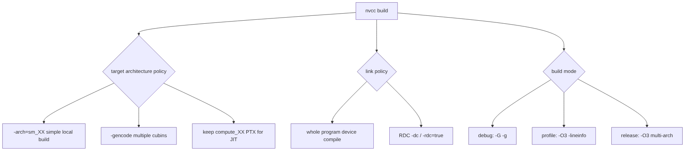

# 第 17 章 `-arch`、`-gencode`、RDC 与调试构建：让二进制跑在正确的 GPU 上

CUDA 程序能在开发机跑，不代表能在部署机跑。你需要明确为哪些 GPU 生成 cubin，是否保留 PTX 作为 JIT 退路，device 函数是否跨编译单元链接，debug/profile/release 构建是否混在一起。

本章集中讲 nvcc 的工程化选项：`-arch`、`-gencode`、RDC、LTO、`-G`、`-lineinfo`、ptxas 资源报告和 fast math。

## 17.1 问题的由来

CUDA 二进制有架构目标。`compute_XX` 是 virtual architecture，通常对应 PTX；`sm_XX` 是 real architecture，通常对应 cubin。你发布的应用如果只包含本机 GPU 的 cubin，换到另一个 major 架构就可能失败。

同时，debug 构建和性能构建的目标不同。`-G` 很适合调试 device 逻辑，但会显著改变优化；用 `-G` 的运行时间判断 kernel 性能，结论通常不可靠。

## 17.2 核心模型

nvcc 的工程化选项看起来很多，但按要回答的问题可以分成三类：为哪些架构生成代码，device code 是否跨编译单元链接，以及这次构建是为了调试、分析还是发布。图 17.1 把这三类决定和对应的选项放在一起，后面各小节依次展开。

<figure>

<figcaption>图 17.1：nvcc 构建要做的三类决定：目标架构、device 链接方式、构建模式</figcaption>
</figure>

## 17.3 详解

### 17.3.1 `-arch` 适合简单场景

```bash
nvcc app.cu -arch=sm_90 -O3 -o app
```

`-arch=sm_90` 是一个简写，相当于同时写 `-gencode arch=compute_90,code=sm_90` 和 `-gencode arch=compute_90,code=compute_90`：除了 `sm_90` cubin，还会嵌入一份 `compute_90` PTX。这适合本机实验或明确只支持某一类 GPU 的程序。发布给多种 GPU 时，建议改用 `-gencode`。

### 17.3.2 `-gencode` 表达多架构

```bash
nvcc app.cu -O3 -o app \
  -gencode arch=compute_80,code=sm_80 \
  -gencode arch=compute_86,code=sm_86 \
  -gencode arch=compute_90,code=sm_90 \
  -gencode arch=compute_90,code=compute_90
```

前三行生成具体 cubin，最后一行保留 PTX。这样当前目标架构启动更快，未来或未覆盖 GPU 还有 JIT 退路。

### 17.3.3 RDC：跨 translation unit 的 device code

默认 whole-program device compilation 更简单，但如果 device 函数跨 `.cu` 文件调用，就需要 relocatable device code。

```bash
nvcc -dc definition.cu -o definition.o
nvcc -dc example.cu -o example.o
nvcc definition.o example.o -o app
```

也可以显式 device link：

```bash
nvcc -dlink definition.o example.o -o device_link.o
nvcc definition.o example.o device_link.o -o app
```

RDC 让工程组织更灵活，但可能增加构建复杂度。需要性能时可以评估 device LTO：

```bash
nvcc -dc -dlto -arch=sm_90 definition.cu -o definition.o
nvcc -dc -dlto -arch=sm_90 example.cu -o example.o
nvcc -dlto -arch=sm_90 definition.o example.o -o app
```

链接这一步也要带上同样的 `-arch`。漏掉它，nvlink 会按默认架构链接，找不到对应的 LTO 目标，于是给出警告并忽略 `-dlto`，LTO 实际上没有生效。

### 17.3.4 Debug、profile、release 分开

建议至少有三套构建：

```bash
# device debug: 看逻辑，不看性能
nvcc -G -g -O0 app.cu -o app_debug
# profile: 保持优化，保留源码行号
nvcc -O3 -lineinfo app.cu -o app_profile
# release: 多架构发布
nvcc -O3 app.cu -o app_release \
  -gencode arch=compute_80,code=sm_80 \
  -gencode arch=compute_90,code=sm_90 \
  -gencode arch=compute_90,code=compute_90
```

不要拿 `app_debug` 的时间判断 kernel 是否慢。

## 17.4 代码示例

一个 Makefile 片段可以把三种构建分开（注意命令行必须以 tab 开头，不能用空格缩进）：

```makefile
NVCC := nvcc
SRC := app.cu
GENCODE := \
  -gencode arch=compute_80,code=sm_80 \
  -gencode arch=compute_90,code=sm_90 \
  -gencode arch=compute_90,code=compute_90
debug:
	$(NVCC) -G -g -O0 $(SRC) -o app_debug
profile:
	$(NVCC) -O3 -lineinfo $(SRC) -o app_profile
release:
	$(NVCC) -O3 $(GENCODE) $(SRC) -o app_release
```

资源使用检查：

```bash
nvcc -O3 --ptxas-options=-v app.cu -o app
nvcc -O3 --resource-usage app.cu -o app
```

如果看到大量 spill 或 local memory usage，需要回到 kernel 资源设计，而不是盲目调大 block size。

## 17.5 工程判断

| 目标 | 推荐命令/选项 | 风险 |
|---|---|---|
| 本机快速实验 | `-arch=native` 或明确 `-arch=sm_XX` | 不适合发布 |
| 多 GPU 发布 | 多个 `-gencode` | fatbin 变大 |
| 前向兼容 | 保留 `code=compute_XX` PTX | 首次 JIT 成本 |
| 跨 `.cu` device 调用 | `-dc` / `-rdc=true` | 构建复杂，需 device link |
| device 调试 | `-G -g` | 性能不代表真实优化版本 |
| 性能分析 | `-O3 -lineinfo` | 仍需 profiler 解读 |
| 限制寄存器 | `-Xptxas=-maxrregcount=N` | 可能导致 spill |
| 快速数学 | `--use_fast_math` | 改变数值语义 |

## 17.6 API 与要点速查

架构查询：

```bash
nvcc --list-gpu-arch
nvcc --list-gpu-code
```

常用选项：

| 选项 | 用途 |
|---|---|
| `-arch=sm_XX` | 简写：生成 `sm_XX` cubin，同时嵌入 `compute_XX` PTX |
| `-gencode arch=compute_XX,code=sm_XX` | 生成具体 cubin |
| `-gencode arch=compute_XX,code=compute_XX` | 保留 PTX |
| `-arch=native` | 为本机 GPU 生成目标 |
| `-arch=all` / `all-major` | 覆盖多个架构，二进制更大 |
| `-dc` | 编译 relocatable device code |
| `-dlink` | 显式 device link |
| `-dlto` | device link-time optimization |
| `-G` | device debug |
| `-g` | host debug info |
| `-lineinfo` | profiler 行号 |
| `--ptxas-options=-v` | ptxas 资源输出 |
| `--resource-usage` | 资源使用报告 |
| `--use_fast_math` | 快速数学路径 |

发布检查：

| 检查 | 方法 |
|---|---|
| 是否依赖 PTX JIT | `CUDA_DISABLE_PTX_JIT=1 ./app` |
| 是否携带可用 PTX | `CUDA_FORCE_PTX_JIT=1 ./app` |
| 是否有目标 cubin | 查看 fatbin 或运行禁用 JIT 测试 |

## 17.7 小结

读完本章，你应该能够：

- 解释 `compute_XX` 和 `sm_XX` 的区别。
- 写多架构 `-gencode` 命令。
- 判断何时需要 RDC。
- 区分 debug、profile、release 构建。
- 用 ptxas 输出和 profiler 连接 kernel 资源问题。
