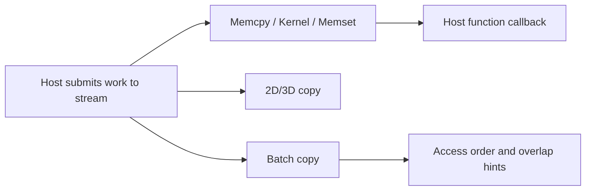

# 第 18 章 异步回调与批量拷贝 reference：把少见但重要的 stream API 补齐

## 18.1 问题的由来

前面几章已经讲过 stream、event、隐式同步和 nvcc。还有一类容易被略过的 API：host callback、host function、2D/3D copy、batch copy 和 access order。它们不在入门路径上，但在异步数据管线、图像/体数据传输、数据加载框架里很常见。

本章把这些 API 整理成一份参考。

## 18.2 核心模型

图 18.1 列出了本章涉及的三类工作，它们都由 host 提交到 stream：

<figure>

<figcaption>图 18.1：提交到 stream 的三类少见工作：host function、2D/3D copy 与 batch copy</figcaption>
</figure>

Host function 是 stream 中的一个节点，排在前面的 copy、kernel、memset 完成后才执行；2D/3D copy 按 pitch 和 extent 描述的布局搬运数据；批量拷贝把多个 copy request 合并提交，并通过属性告诉 CUDA 哪些源访问顺序可以更灵活，从而留出更多重叠空间。

## 18.3 详解

旧接口 `cudaStreamAddCallback` 和 `cudaStreamCallback_t` 在老代码里还会出现，但新代码应优先使用 `cudaLaunchHostFunc`。host function 在前序 stream work 完成后由 host 执行。回调里不能调用任何 CUDA API，也不能等待没有被规定排在它之前的 GPU 工作；违反时 runtime 可能返回 `cudaErrorNotPermitted`，也可能直接死锁。

2D/3D copy 用于 pitch memory、array、image、volume。不要把二维图像强行当一维线性数组拷贝，除非你确认 pitch、row stride 和布局完全一致。

Batch copy API 用于一次提交一组 copy 请求，并可以附带 access order 相关属性：如果源访问顺序不需要严格按 API 调用时刻保持，就可以给 runtime 更多重叠空间。

## 18.4 代码示例

Host function：

```cpp
void CUDART_CB after_work(void* user_data)
{
    auto* flag = static_cast<std::atomic<int>*>(user_data);
    flag->store(1, std::memory_order_release);
}
std::atomic<int> done{0};
kernel<<<grid, block, 0, stream>>>(args);
cudaLaunchHostFunc(stream, after_work, &done);
// 主线程稍后用 done.load(std::memory_order_acquire) 查看
```

回调由 CUDA 驱动在它自己的后台线程上调用，而不是在提交它的线程上。主线程读、回调线程写的标志因此要用 `std::atomic`（release 写配 acquire 读），用普通 `int` 就是数据竞争。`done` 的生命周期也要覆盖到回调执行完。

旧 callback 形状：

```cpp
void CUDART_CB old_callback(cudaStream_t stream,
                            cudaError_t status,
                            void* user_data)
{
    // Legacy callback style. Prefer cudaLaunchHostFunc in new code.
}
cudaStreamAddCallback(stream, old_callback, user_data, 0);
```

2D copy：

```cpp
cudaMemcpy2DAsync(dst, dst_pitch,
                  src, src_pitch,
                  width_bytes, height,
                  cudaMemcpyDeviceToDevice,
                  stream);
```

3D copy 骨架：

```cpp
cudaMemcpy3DParms p{};
p.srcPtr = make_cudaPitchedPtr(src, src_pitch, width, height);
p.dstPtr = make_cudaPitchedPtr(dst, dst_pitch, width, height);
p.extent = make_cudaExtent(width_bytes, height, depth);
p.kind = cudaMemcpyDeviceToDevice;
cudaMemcpy3DAsync(&p, stream);
```

Batch copy 的原型在 CUDA 12.8 引入后又调整过：12.x 版本多一个报告失败位置的 `failIdx` 参数，CUDA 13 去掉了它。下面按 CUDA 13 的原型写，所有 copy 共用一组属性：

```cpp
// dsts、srcs、sizes 是长度为 count 的数组，每一项描述一次一维 copy
cudaMemcpyAttributes attrs{};
attrs.srcAccessOrder = cudaMemcpySrcAccessOrderStream;
attrs.flags = cudaMemcpyFlagDefault;
size_t attr_start = 0;  // 从第 0 个 copy 起都使用 attrs
cudaMemcpyBatchAsync(dsts, srcs, sizes, count,
                     &attrs, &attr_start, 1, stream);
```

`attrsIdxs` 是分段下标：第 k 组属性从第 `attrsIdxs[k]` 个 copy 开始生效，一直用到下一组属性的起点。`stream` 不能是 legacy 默认 stream。三维和 CUDA array 的批量 copy 用 `cudaMemcpy3DBatchAsync`。

## 18.5 工程判断

| 场景 | 机制 | 注意点 |
|---|---|---|
| stream 前序 work 完成后通知 host | `cudaLaunchHostFunc` | 回调里不能调用 CUDA API |
| 维护老代码 | `cudaStreamAddCallback` | legacy API，理解即可 |
| 拷贝图像行数据 | `cudaMemcpy2DAsync` | pitch 和 width bytes 要分清 |
| 拷贝 volume/array | `cudaMemcpy3DAsync` | `cudaMemcpy3DParms` 字段必须完整 |
| 一次提交很多 copy | batch copy API | toolkit 原型和属性要核对 |
| 想放宽源访问顺序 | access order attributes | 只有确定语义允许时才放宽 |

## 18.6 API 与要点速查

Callback / host function：

| API/类型 | 作用 |
|---|---|
| `cudaLaunchHostFunc` | 在 stream 中插入 host function |
| `cudaHostFn_t` | host function 类型 |
| `cudaStreamAddCallback` | legacy stream callback |
| `cudaStreamCallback_t` | legacy callback 类型 |

2D/3D copy：

| API/类型 | 作用 |
|---|---|
| `cudaMemcpy2D`、`cudaMemcpy2DAsync` | 二维 pitched memory copy |
| `cudaMemcpy3D`、`cudaMemcpy3DAsync` | 三维 copy |
| `cudaMemcpy3DParms` | 3D copy 参数 |
| `cudaPitchedPtr` | pitched pointer |
| `cudaExtent` | 3D extent |
| `cudaArray_t`、`cudaMipmappedArray_t` | array/mipmapped array |

Batch copy / attributes：

| API/类型 | 作用 |
|---|---|
| `cudaMemcpyBatchAsync` | 批量一维 copy |
| `cudaMemcpy3DBatchAsync` | 批量 3D copy |
| `cudaMemcpyAttributes` | batch copy 属性 |
| `cudaMemcpySrcAccessOrder` | 源访问顺序控制 |
| `cudaMemcpySrcAccessOrderStream` | 按 stream 顺序 |
| `cudaMemcpySrcAccessOrderDuringApiCall` | API 调用期间访问 |
| `cudaMemcpySrcAccessOrderAny` | 允许更自由访问顺序 |
| `cudaMemcpyFlagDefault` | 默认 flag |
| `cudaMemcpyFlagPreferOverlapWithCompute` | 偏向 copy/compute 重叠 |

## 18.7 小结

读完本章，你应该能够：

- 区分 host function 和 legacy callback。
- 为图像/volume 数据选择 2D/3D copy。
- 知道 batch copy 不是普通 `cudaMemcpyAsync` 的简单循环。
- 查到 access order 相关的类型和枚举值。
