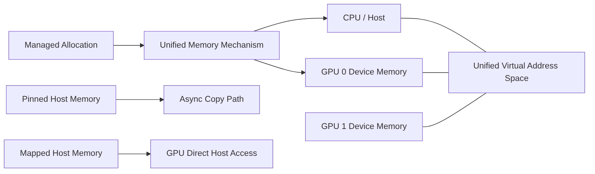

# 第 19 章 UVA、Unified Memory、Managed Memory：先把名字分清楚

CUDA 里的数据问题，难点通常不在“怎么分配一块数组”，而在“这块数组在哪里、谁能访问、访问时会发生什么”。`UVA`、`Unified Memory`、`Managed Memory`、`pinned memory`、`mapped memory` 这些名字很像，但它们解决的问题不同。

如果一开始把名字混在一起，后面学习 prefetch、advice、multi-GPU coherency、IPC、VMM 时都会混乱。

## 19.1 问题的由来

CPU 有 system memory，GPU 有 device memory。CUDA 程序跨 CPU/GPU 执行，数据位置就成了基础问题。一个指针可能来自：

- `malloc` / `new`
- `cudaMalloc`
- `cudaMallocManaged`
- `cudaMallocHost`
- `cudaHostAlloc`（带 `cudaHostAllocMapped` flag）
- `cudaHostRegister`
- VMM 或外部资源导入

这些指针都可能被传入某个 API，但语义、访问成本和合法访问者完全不同。

## 19.2 核心模型

UVA 是地址空间机制，Unified Memory 是访问和迁移能力，Managed Memory 是一种由 CUDA 管理的统一内存分配。Pinned 和 mapped 是 host memory 的特殊使用方式。

图 19.1 把这几个名字放在一起：CPU 和各 GPU 的内存都位于同一个统一虚拟地址空间里；managed allocation 依靠 Unified Memory 机制在 CPU 和 GPU 之间访问和迁移；pinned host memory 服务于异步 copy；mapped host memory 让 GPU 直接访问 host 内存。

<figure>

<figcaption>图 19.1：managed、pinned、mapped 各有用途，CPU 与各 GPU 共处统一虚拟地址空间</figcaption>
</figure>

## 19.3 详解

### 19.3.1 UVA：统一地址空间

Unified Virtual Addressing 让 host memory 和各 GPU memory 进入统一虚拟地址空间。它带来的直接好处是：runtime 可以根据指针属性判断指针归属。

这也是 `cudaMemcpyDefault` 可用的基础：

```cpp
cudaMemcpy(dst, src, bytes, cudaMemcpyDefault);
```

但 UVA 只是“地址可统一识别”，不等于访问成本统一，也不等于任意处理器都能高效访问任意地址。

### 19.3.2 Unified Memory：CPU/GPU 共同访问的一组能力

Unified Memory 是 CUDA 提供的统一访问和迁移机制。它可能表现为：

- CPU 和 GPU 访问同一 managed allocation。
- GPU 访问普通 system allocation。
- 页面在 CPU/GPU 之间迁移。
- 在某些平台上通过硬件一致性直接访问。

它是一组能力，不是一种单一内存类型。

不同系统上的 Unified Memory 支持程度不同，可以用几个 device attribute 逐级判断：

1. `cudaDevAttrManagedMemory` 为 1，说明可以使用 managed memory。
2. `cudaDevAttrConcurrentManagedAccess` 为 0 时只有受限支持（limited），为 1 时是完整支持（full）。
3. 在完整支持的基础上，`cudaDevAttrPageableMemoryAccess` 为 1 表示 GPU 也能访问普通的 pageable system memory；为 0 时，Unified Memory 只覆盖通过 CUDA API 分配的内存。
4. GPU 能访问 pageable system memory 时，`cudaDevAttrPageableMemoryAccessUsesHostPageTables` 进一步区分一致性是由软件维护还是由硬件维护。

所以不能只凭 `cudaMallocManaged` 调用成功就推断所有行为。[第 21 章](ch021.md)会详细讨论这些平台差异。

### 19.3.3 Managed Memory：CUDA 管理的统一内存分配

Managed Memory 通常指：

```cpp
float* x = nullptr;
cudaMallocManaged(&x, bytes);
```

或者：

```cpp
__managed__ int counter;
```

CPU 和 GPU 可以使用同一个指针访问这段内存，但实际数据仍然有 residency：它当前更靠近 CPU，还是 GPU，还是可被远程访问。性能取决于访问模式和平台能力。

### 19.3.4 System memory 也要分类

host 侧内存不是一个概念：

| 类型 | 分配方式 | GPU 访问方式 |
|---|---|---|
| Pageable memory | `malloc`、`new`、stack | 普通 host memory，copy 时可能 staging |
| Pinned memory | `cudaMallocHost`、`cudaHostAlloc`、`cudaHostRegister` | 适合异步 copy |
| Mapped memory | `cudaHostAllocMapped` 或 registered mapped | GPU 可直接访问 host memory |
| Managed memory | `cudaMallocManaged`、`__managed__` | CUDA 管理迁移/访问 |
| System allocated managed-capable memory | OS allocation | 依赖 full UM、HMM、ATS 等能力 |

## 19.4 代码示例

用 `cudaPointerGetAttributes` 建立指针归属意识：

```cpp
#include <cuda_runtime.h>
#include <cstdio>
const char* memory_type_name(cudaMemoryType t)
{
    switch (t) {
    case cudaMemoryTypeUnregistered: return "unregistered host";
    case cudaMemoryTypeHost:         return "pinned/registered host";
    case cudaMemoryTypeDevice:       return "device";
    case cudaMemoryTypeManaged:      return "managed";
    }
    return "unknown";
}
void describe_pointer(const void* p)
{
    cudaPointerAttributes attr{};
    cudaError_t err = cudaPointerGetAttributes(&attr, p);
    if (err != cudaSuccess) {  // 查询本身出错，例如 device 不可用
        std::printf("query failed: %s\n", cudaGetErrorString(err));
        cudaGetLastError();
        return;
    }
    std::printf("type=%s device=%d devicePointer=%p hostPointer=%p\n",
                memory_type_name(attr.type),
                attr.device,
                attr.devicePointer,
                attr.hostPointer);
}
```

它不是性能 API，用途是在调试时确认：当前指针到底被 CUDA runtime 识别成什么。普通 `malloc`/`new` 得到的指针也能查：自 CUDA 11 起，调用返回 `cudaSuccess`，`type` 为 `cudaMemoryTypeUnregistered`，表示这块内存没有经过 CUDA 分配或注册。更早的版本对这类指针返回 `cudaErrorInvalidValue`，所以老代码里常见“查询失败就当普通 host 指针”的写法，这个判断在现在的 CUDA 上已经不成立。

## 19.5 工程判断

| 名词 | 解决的问题 | 不要误解成 |
|---|---|---|
| UVA | 指针地址统一识别 | 所有内存访问成本相同 |
| Unified Memory | CPU/GPU 共同访问和迁移 | 自动高性能 |
| Managed Memory | CUDA 管理的统一内存 allocation | 永远驻留在 GPU |
| Pinned Memory | 支持稳定 DMA 和异步 copy | 普通 malloc 的无成本替代 |
| Mapped Memory | GPU 直接访问 host memory | device memory 的高速替代 |
| System Memory Access | GPU 访问 OS 分配内存 | 跨平台行为完全一致 |

## 19.6 API 与要点速查

关键 device attributes：

| Attribute | 说明 |
|---|---|
| `cudaDevAttrManagedMemory` | 是否支持 managed memory |
| `cudaDevAttrConcurrentManagedAccess` | CPU/GPU 是否可并发访问 managed memory |
| `cudaDevAttrPageableMemoryAccess` | GPU 是否可访问 pageable system memory |
| `cudaDevAttrPageableMemoryAccessUsesHostPageTables` | 是否使用 host page tables |
| `cudaDevAttrDirectManagedMemAccessFromHost` | host 是否能直接访问 GPU-resident managed memory |
| `cudaDevAttrHostNativeAtomicSupported` | host native atomic 能力 |

查询示例：

```cpp
int value = 0;
cudaDeviceGetAttribute(&value,
                       cudaDevAttrConcurrentManagedAccess,
                       device);
```

## 19.7 小结

读完本章，你应该能够：

- 区分 UVA、Unified Memory 和 Managed Memory。
- 把 host memory 细分为 pageable、pinned、mapped 等类别。
- 用 pointer attributes 辅助判断指针归属。
- 理解统一地址不等于统一性能。
- 为后续 prefetch、advice 和 multi-GPU 放置建立概念基础。
