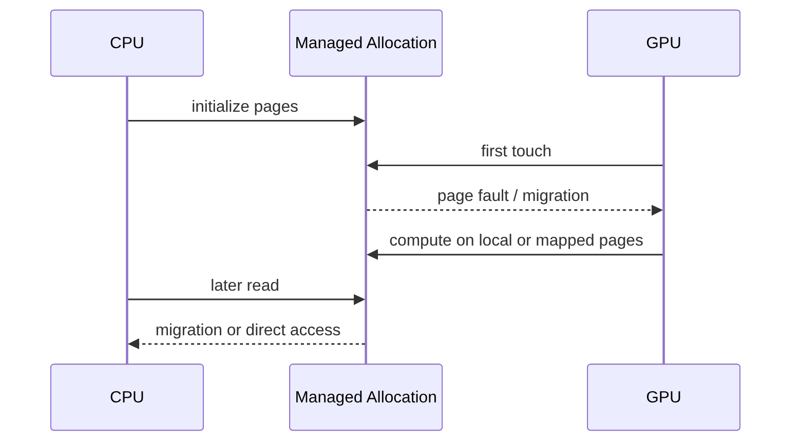

# 第 20 章 Managed Memory 的性能核心：page fault、迁移、prefetch 与 advice

`cudaMallocManaged` 让程序写起来很舒服：CPU 初始化，GPU 计算，CPU 读取结果，似乎都在同一个指针上完成。但性能问题没有消失，只是从显式 `cudaMemcpy` 变成了 page fault、迁移、远程访问和 residency 决策。

使用 Managed Memory 比较稳妥的思路是：先用它降低编程复杂度，再用 prefetch 和 advice 把关键迁移放回你能控制的位置。

## 20.1 问题的由来

Managed allocation 当前总有某种 residency。它可能驻留在 CPU memory，可能在某个 GPU 的 memory，可能被复制或远程映射。GPU 第一次访问不在本地的数据时，可能触发 page fault，然后 runtime/driver 迁移页面或建立映射。

这对代码可用性很好，但对性能有风险：

- page fault 发生在 kernel 执行路径中。
- CPU/GPU 交替访问同一页，页面来回迁移。
- 随机访问让 TLB 和 page migration 压力增大。
- 多 GPU 访问同一 allocation 时 residency 变复杂。

## 20.2 核心模型

不加任何提示时，一块 managed allocation 的典型经历如图 20.1：CPU 先初始化页面；GPU 第一次访问时触发 page fault 和迁移，然后在本地页面或映射页面上计算；之后 CPU 读取结果时，页面要么迁回 CPU，要么由 CPU 直接远程访问。

<figure>

<figcaption>图 20.1：managed allocation 的一次往返：GPU 首次访问触发迁移，CPU 读回时再迁移</figcaption>
</figure>

prefetch 的作用，是把由首次访问触发的按需 page fault 尽量提前，放到 stream 中一个显式的位置上。

## 20.3 详解

### 20.3.1 Page、TLB 和迁移

应用看到的是虚拟地址。虚拟地址通过 page table 映射到物理页面。CPU/GPU 都有 TLB 缓存地址翻译。

当 GPU 访问 managed memory 时，如果对应页面不在 GPU 可高效访问的位置，可能发生：

- page fault。
- 页面迁移。
- 页表更新。
- TLB 更新。
- 远程映射访问。

这些成本如果集中发生在 kernel 内，就会被误认为 kernel 算术慢。

### 20.3.2 Prefetch：把迁移提前

```cpp
cudaMemLocation gpu{cudaMemLocationTypeDevice, device};  // 第 device 号 GPU
cudaMemPrefetchAsync(ptr, bytes, gpu, 0, stream);
kernel<<<grid, block, 0, stream>>>(ptr);
```

把 prefetch 放入同一 stream，kernel 会在 prefetch 之后执行。这样迁移成本在时间线上可见，也可能和其他 stream 的工作重叠。

CUDA 13 用 `cudaMemLocation` 描述目标位置：`type` 写 `cudaMemLocationTypeDevice` 时 `id` 是 device 编号，写 `cudaMemLocationTypeHost` 时表示 host，`id` 被忽略。第四个参数 `flags` 目前必须为 0。CUDA 12.x 及更早的代码常见 `cudaMemPrefetchAsync(ptr, bytes, device, stream)` 这种直接传 device 编号、用 `cudaCpuDeviceId` 表示 CPU 的写法，在 CUDA 13 下已经编译不过；12.x 后期版本里接收 `cudaMemLocation` 的是带 `_v2` 后缀的函数，CUDA 13 把它变成了默认名字。

GPU 算完后 CPU 要读：

```cpp
cudaMemLocation cpu{cudaMemLocationTypeHost, 0};  // host，id 被忽略
cudaMemPrefetchAsync(ptr, bytes, cpu, 0, stream);
cudaStreamSynchronize(stream);
```

### 20.3.3 Advice：告诉 driver 访问意图

`cudaMemAdvise` 是 hint，不改变正确性，但可能影响放置策略。和 prefetch 一样，它在 CUDA 13 中也用 `cudaMemLocation` 指定位置（12.x 是 `int device`）。

| Advice | 含义 |
|---|---|
| `cudaMemAdviseSetPreferredLocation` | 希望这段内存优先驻留在某个位置 |
| `cudaMemAdviseSetAccessedBy` | 某个 device 会访问这段内存 |
| `cudaMemAdviseSetReadMostly` | 读多写少，可帮助复制/缓存策略 |
| unset variants | 取消对应 hint |

hint 错了可能更慢。不要为了“看起来高级”到处加 advice，应该先根据访问模式或 profiler 判断问题。

### 20.3.4 Range query

`cudaMemRangeGetAttribute` 可以查询某段 managed range 的属性，比如 last prefetch location。它适合诊断和验证，不是主执行路径的常规开销。

### 20.3.5 Discard 和 batch prefetch

迭代计算中，有些 managed buffer 的旧内容不再需要。CUDA 提供了 discard 和 batch prefetch API，可以告诉 runtime 不必保留旧值，或把多个范围合并提交。

这类 API 的前提是你确定旧数据语义上可以丢弃。否则就是错误，不是优化。

## 20.4 代码示例

Managed memory 的可控写法：

```cpp
float* x = nullptr;
cudaMallocManaged(&x, bytes);
initialize_on_cpu(x, n);
cudaMemLocation gpu{cudaMemLocationTypeDevice, device};
cudaMemLocation cpu{cudaMemLocationTypeHost, 0};
cudaMemAdvise(x, bytes, cudaMemAdviseSetPreferredLocation, gpu);
cudaMemAdvise(x, bytes, cudaMemAdviseSetAccessedBy, gpu);
cudaMemPrefetchAsync(x, bytes, gpu, 0, stream);
kernel<<<grid, block, 0, stream>>>(x, n);
cudaMemPrefetchAsync(x, bytes, cpu, 0, stream);
cudaStreamSynchronize(stream);
consume_on_cpu(x, n);
cudaFree(x);
```

查询 last prefetch location：

```cpp
int last = 0;
cudaMemRangeGetAttribute(&last,
                         sizeof(last),
                         cudaMemRangeAttributeLastPrefetchLocation,
                         x,
                         bytes);
```

## 20.5 工程判断

| 现象 | 可能原因 | 处理 |
|---|---|---|
| 第一次 kernel 很慢 | page fault 集中在 kernel 内 | kernel 前 prefetch |
| CPU/GPU 交替访问慢 | 页面反复迁移 | 调整阶段顺序，减少 ping-pong |
| 多 GPU 访问同一 managed allocation 慢 | residency 不稳定或远程访问 | preferred location + accessed-by |
| 读多写少数据重复迁移 | driver 不知道读多写少 | `cudaMemAdviseSetReadMostly` |
| 大量临时 buffer 旧值无用 | runtime 仍保留旧内容 | discard batch，前提是语义允许 |
| hint 后更慢 | hint 与实际访问不符 | 删除 hint，用 profiler 验证 |

## 20.6 API 与要点速查

核心 API：

| API | 用途 |
|---|---|
| `cudaMallocManaged` | 分配 managed memory |
| `cudaMemPrefetchAsync` | 主动迁移或准备访问 |
| `cudaMemAdvise` | 设置访问和放置 hint |
| `cudaMemRangeGetAttribute` | 查询 managed range 属性 |
| `cudaMemDiscardBatchAsync` | 批量丢弃旧内容 |
| `cudaMemDiscardAndPrefetchBatchAsync` | 丢弃并预取 |

常见 range attribute：

| Attribute | 说明 |
|---|---|
| `cudaMemRangeAttributeReadMostly` | 是否设置 read-mostly |
| `cudaMemRangeAttributePreferredLocation` | preferred location |
| `cudaMemRangeAttributeAccessedBy` | accessed-by 信息 |
| `cudaMemRangeAttributeLastPrefetchLocation` | 最近 prefetch 目标 |

## 20.7 小结

读完本章，你应该能够：

- 解释 managed memory 为什么仍然有数据位置。
- 把 page fault 和 migration 从 kernel 执行中分离出来看。
- 使用 prefetch 控制迁移时机。
- 根据访问模式谨慎使用 advice。
- 识别 discard/batch API 的语义前提。
