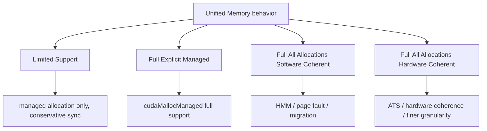

# 第 21 章 Full 与 Limited Unified Memory：平台差异决定写法保守程度

Unified Memory 在不同平台上的能力差异很大。某些 Linux/HMM/ATS 系统可以让 GPU 访问普通 system allocation，甚至支持更细粒度一致性；Windows、WSL 或部分 Tegra 环境可能只有 limited support。写跨平台 CUDA 程序时，不能把自己机器上的 managed memory 行为当成普遍规则。

本章讲平台能力边界：什么能做，什么要查 attribute，什么要保守同步。

## 21.1 问题的由来

同样一段代码：

```cpp
int* x = nullptr;
cudaMallocManaged(&x, bytes);
cpu_write(x);
kernel<<<grid, block>>>(x);
cudaDeviceSynchronize();
cpu_read(x);
```

在不同系统上都可能正确运行，但背后的成本和并发规则不同。更激进的代码，例如让 GPU 直接访问普通 `malloc` 内存，或 CPU/GPU 同时访问 managed allocation，就更依赖平台能力。

## 21.2 核心模型

按支持程度，平台大致分成四档（图 21.1）：limited support；只对显式 managed allocation 完整支持；对所有分配完整支持、由软件维护一致性；对所有分配完整支持、由硬件维护一致性。

<figure>

<figcaption>图 21.1：Unified Memory 的四档平台支持：从 limited 到硬件一致性</figcaption>
</figure>

分档的意义在于它直接影响写法：GPU 能否访问普通 host allocation、CPU/GPU 能否并发访问、page fault 和迁移粒度如何表现，都由平台落在哪一档决定。

## 21.3 详解

### 21.3.1 Limited Unified Memory

在 limited support 平台上，managed memory 仍然有用，但限制更多：

- 只有显式 managed allocation 是 Unified Memory。
- GPU 活跃时 CPU 访问 managed memory 可能不安全或受限。
- 同步后数据可能迁回 CPU。
- oversubscription 能力可能受限。
- 普通 `malloc` 内存通常不能直接给 GPU kernel 访问。

这种环境下，写法应更保守：阶段化 CPU/GPU 访问，明确同步，不依赖普通 host allocation 的 GPU 访问能力。

### 21.3.2 只对显式 managed memory 完整支持

这种平台对 `cudaMallocManaged` 支持更完整。CPU/GPU 对 managed allocation 的访问和迁移更灵活，但普通 system allocation 不一定属于 Unified Memory。

### 21.3.3 对所有分配完整支持：软件一致性

Linux HMM 是代表机制之一。GPU 可以访问进程中的普通 system allocation，driver/runtime 通过 page fault、迁移和页表更新维护一致性。

这让代码更自然，但性能依然可能被 page fault 和迁移影响。

### 21.3.4 对所有分配完整支持：硬件一致性

ATS 等机制可以让 CPU/GPU 在更硬件化的地址翻译和一致性机制下共享内存。Grace Hopper/Grace Blackwell 这类紧密连接系统属于这一方向。

这并不意味着所有访问都免费，只是减少某些整页迁移和软件 fault 成本。

## 21.4 代码示例

能力查询比猜平台更可靠：

```cpp
#include <cuda_runtime.h>
#include <cstdio>
struct UmCaps {
    bool managed;           // cudaDevAttrManagedMemory
    bool concurrent;        // cudaDevAttrConcurrentManagedAccess
    bool pageable;          // cudaDevAttrPageableMemoryAccess
    bool host_page_tables;  // cudaDevAttrPageableMemoryAccessUsesHostPageTables
    bool host_direct;       // cudaDevAttrDirectManagedMemAccessFromHost
};
static bool attr_on(int dev, cudaDeviceAttr attr)
{
    int v = 0;
    return cudaDeviceGetAttribute(&v, attr, dev) == cudaSuccess && v != 0;
}
UmCaps query_um_caps(int dev)
{
    UmCaps c;
    c.managed          = attr_on(dev, cudaDevAttrManagedMemory);
    c.concurrent       = attr_on(dev, cudaDevAttrConcurrentManagedAccess);
    c.pageable         = attr_on(dev, cudaDevAttrPageableMemoryAccess);
    c.host_page_tables = attr_on(dev, cudaDevAttrPageableMemoryAccessUsesHostPageTables);
    c.host_direct      = attr_on(dev, cudaDevAttrDirectManagedMemAccessFromHost);
    return c;
}
// 按 21.2 节的分档从低到高判断，每一档都以前一档成立为前提
const char* um_tier(const UmCaps& c)
{
    if (!c.managed)          return "no managed memory";
    if (!c.concurrent)       return "limited";
    if (!c.pageable)         return "full, managed allocations only";
    if (!c.host_page_tables) return "full, all allocations, software coherence";
    return "full, all allocations, hardware coherence";
}
int main()
{
    int count = 0;
    if (cudaGetDeviceCount(&count) != cudaSuccess) return 1;
    for (int dev = 0; dev < count; ++dev) {
        UmCaps c = query_um_caps(dev);
        std::printf("device %d: %s\n", dev, um_tier(c));
        std::printf("  managed=%d concurrent=%d pageable=%d "
                    "hostPageTables=%d hostDirect=%d\n",
                    c.managed, c.concurrent, c.pageable,
                    c.host_page_tables, c.host_direct);
    }
    return 0;
}
```

`um_tier` 的判断顺序就是本章的分档：不支持 managed memory 的设备排除在外；`concurrent` 为 0 是 limited；能并发访问但 GPU 访问不了 pageable 内存，是只对显式 managed allocation 完整支持；GPU 能访问 pageable 内存时，再看是否借用 host 页表，区分软件一致性（HMM 一类）和硬件一致性（ATS 一类）。`host_direct` 不参与分档，它说明 CPU 能否直接访问驻留在 GPU 上的 managed 数据而不必先迁回，影响 CPU 侧读取结果的代价。

Linux 上也可以辅助查看 addressing mode：

```bash
nvidia-smi -q | grep Addressing
```

但最终代码路径仍应以 CUDA attribute 为准。

## 21.5 工程判断

| 能力 | attribute 线索 | 写法影响 |
|---|---|---|
| managed allocation | `cudaDevAttrManagedMemory` | 是否能用 `cudaMallocManaged` |
| CPU/GPU 并发访问 managed | `cudaDevAttrConcurrentManagedAccess` | 是否能更自由重叠访问 |
| GPU 访问 pageable memory | `cudaDevAttrPageableMemoryAccess` | 普通 host allocation 是否可能被 GPU 访问 |
| 使用 host page tables | `cudaDevAttrPageableMemoryAccessUsesHostPageTables` | HMM/ATS 类访问路径判断 |
| host 直访 GPU-resident managed | `cudaDevAttrDirectManagedMemAccessFromHost` | CPU 读 GPU-resident 数据是否可直接发生 |
| host native atomic | `cudaDevAttrHostNativeAtomicSupported` | CPU/GPU 原子协作能力 |

## 21.6 API 与要点速查

平台术语：

| 术语 | 说明 |
|---|---|
| HMM | Heterogeneous Memory Management，Linux 软件一致性路径 |
| ATS | Address Translation Services，硬件地址翻译和一致性路径 |
| hardware-coherent | CPU/GPU 可通过硬件机制维护更强一致性 |
| software-coherent | 通过 fault、迁移、页表更新维护一致性 |
| limited support | 行为限制更多，需保守同步和显式 managed allocation |

保守跨平台原则：

| 原则 | 理由 |
|---|---|
| 先查 attribute | 不同 OS/GPU/driver 行为不同 |
| CPU/GPU 访问阶段化 | 避免并发访问限制和 ping-pong |
| 性能敏感路径显式 prefetch | 避免 fault 落入 kernel |
| 不假设 malloc 指针可给 GPU | full UM 才可能支持 |
| Windows/WSL/Tegra 更谨慎 | limited support 更常见 |

## 21.7 小结

读完本章，你应该能够：

- 解释 Unified Memory 为什么有平台差异。
- 区分 limited、software-coherent 和 hardware-coherent 支持。
- 用 device attributes 决定写法，而不是凭经验猜。
- 为跨平台程序选择更保守的数据访问模式。
- 理解 HMM/ATS 对性能和一致性的影响。
