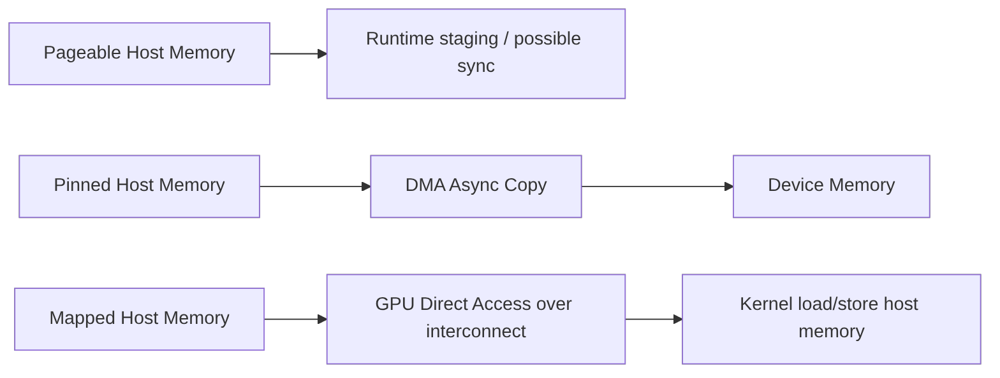

# 第 22 章 Pinned 与 Mapped Host Memory：异步拷贝和零拷贝的前提

Host memory 不是只有普通 `malloc`。CUDA 提供 pinned host memory 和 mapped host memory，它们都发生在 CPU 侧内存，但目的不同：pinned memory 让异步 DMA 拷贝稳定高效，mapped memory 让 GPU 可以直接访问 host memory。

两者都很有用，也都容易被滥用。

## 22.1 问题的由来

普通 pageable host memory 可以被操作系统换出或移动。GPU DMA copy 需要稳定的物理页面，所以 H2D/D2H copy 要做到真正异步，通常需要 pinned memory。

Mapped memory 则解决另一个问题：能否让 GPU kernel 直接访问 host memory，避免显式 copy。这有时能简化小量控制数据访问，但不等于获得 device memory 带宽。

## 22.2 核心模型

图 22.1 对比了三种 host memory 的数据路径：pageable memory 的 copy 要经过 runtime 的 staging，还可能引入同步；pinned memory 可以由 DMA 异步拷到 device memory；mapped memory 则让 kernel 通过互连直接 load/store host 内存。

<figure>

<figcaption>图 22.1：三种 host memory 的数据路径：staging、DMA 异步 copy、GPU 直接访问</figcaption>
</figure>

Pinned memory 主要服务 copy，mapped memory 主要服务直接访问。不要把它们都叫“更快的 host memory”。

## 22.3 详解

### 22.3.1 Pinned memory

分配：

```cpp
float* h = nullptr;
cudaMallocHost(&h, bytes);
```

或者：

```cpp
cudaHostAlloc(&h, bytes, cudaHostAllocDefault);
```

已有内存也可以注册：

```cpp
float* h = static_cast<float*>(std::malloc(bytes));
cudaHostRegister(h, bytes, 0);
// async copy
cudaHostUnregister(h);
std::free(h);
```

Pinned memory 适合用于长期复用的传输 buffer。不要把大量普通业务内存全部锁页，这会影响 OS 内存管理。

### 22.3.2 Mapped memory

Mapped host memory 允许 GPU 直接访问 host memory：

```cpp
float* h = nullptr;
cudaHostAlloc(&h, bytes, cudaHostAllocMapped);
```

在某些系统上，host pointer 可直接传给 kernel；在另一些情况下，你需要取得 device pointer：

```cpp
float* d_alias = nullptr;
cudaHostGetDevicePointer(&d_alias, h, 0);
kernel<<<grid, block>>>(d_alias);
```

直接访问通常跨 PCIe 或 NVLink C2C。延迟和带宽特征不同于本地 device memory。它适合少量、低频、控制类数据，不适合大规模主数据路径。

### 22.3.3 Write-combined 和 portable

`cudaHostAlloc` 支持 flags：

| Flag | 作用 |
|---|---|
| `cudaHostAllocPortable` | pinned allocation 可被多个 CUDA context 使用 |
| `cudaHostAllocMapped` | 映射到 device 可访问地址空间 |
| `cudaHostAllocWriteCombined` | 优化 CPU 写、GPU 读的传输模式 |

write-combined memory 对 CPU 读不友好。适合 CPU 只写、GPU 读取的流式输入，不适合 CPU 频繁读写。

## 22.4 代码示例

Pinned memory + async copy：

```cpp
float *h_in = nullptr, *h_out = nullptr;
float *d_in = nullptr, *d_out = nullptr;
cudaMallocHost(&h_in, bytes);
cudaMallocHost(&h_out, bytes);
cudaMalloc(&d_in, bytes);
cudaMalloc(&d_out, bytes);
cudaMemcpyAsync(d_in, h_in, bytes, cudaMemcpyHostToDevice, stream);
kernel<<<grid, block, 0, stream>>>(d_in, d_out, n);
cudaMemcpyAsync(h_out, d_out, bytes, cudaMemcpyDeviceToHost, stream);
cudaStreamSynchronize(stream);
```

Mapped memory：

```cpp
float* h_mapped = nullptr;
float* d_mapped = nullptr;
cudaHostAlloc(&h_mapped, bytes, cudaHostAllocMapped);
cudaHostGetDevicePointer(&d_mapped, h_mapped, 0);
kernel_read_host_buffer<<<grid, block>>>(d_mapped, n);
cudaDeviceSynchronize();
cudaFreeHost(h_mapped);
```

## 22.5 工程判断

| 需求 | 选择 | 不适合 |
|---|---|---|
| H2D/D2H 异步拷贝 | pinned memory | 大量长期锁页 |
| 第三方库给的 host buffer 要异步 copy | `cudaHostRegister` | 注册生命周期混乱 |
| GPU 少量读取 host 控制数据 | mapped memory | 高频随机大规模访问 |
| CPU 单向写、GPU 读 | write-combined pinned | CPU 频繁读 |
| 跨 context 使用 pinned allocation | portable flag | 单 context 简单程序不必用 |
| 主数据路径追求带宽 | device memory + explicit copy | mapped host memory 替代 device memory |

## 22.6 API 与要点速查

Pinned/mapped API：

| API | 作用 |
|---|---|
| `cudaMallocHost` | 分配 pinned host memory |
| `cudaFreeHost` | 释放 pinned host memory |
| `cudaHostAlloc` | 带 flags 分配 host memory |
| `cudaHostRegister` | 注册已有 host memory 为 pinned |
| `cudaHostUnregister` | 取消注册 |
| `cudaHostGetDevicePointer` | 获取 mapped host memory 的 device pointer |

Flags：

| Flag | 说明 |
|---|---|
| `cudaHostAllocDefault` | 默认 pinned allocation |
| `cudaHostAllocPortable` | portable pinned memory |
| `cudaHostAllocMapped` | 可映射给 device |
| `cudaHostAllocWriteCombined` | write-combined host memory |

Mapped memory 注意：

- GPU 对 host memory 的 atomic 支持和可见性依赖平台能力。
- 直接访问不等于本地 device memory。
- 访问模式越随机、越频繁，越容易成为瓶颈。

## 22.7 小结

读完本章，你应该能够：

- 解释 pinned memory 为什么是异步 copy 的基础。
- 区分 pinned memory 和 mapped memory。
- 知道何时用 `cudaHostRegister`。
- 评估 mapped memory 的访问成本。
- 避免把 mapped host memory 当作 device memory 替代品。
