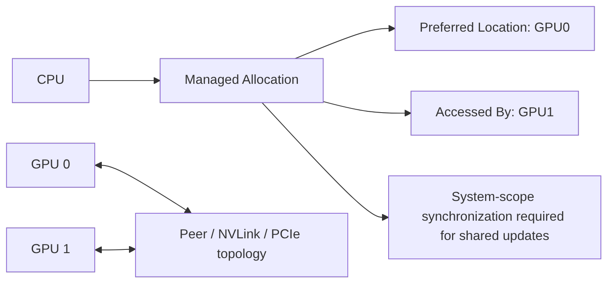

# 第 23 章 多 GPU 下的 managed memory：可见性、迁移和一致性边界

单 GPU managed memory 已经涉及 residency 和迁移；多 GPU 后，问题会再加一层：这段内存当前更靠近哪块 GPU，另一块 GPU 是迁移访问、远程访问，还是需要 peer access？CPU 是否也在访问？谁负责同步？

本章把多 GPU managed memory 的判断方式逐项拆开。

## 23.1 问题的由来

在多 GPU 程序中，一个 managed pointer 可以被多个 device 使用。看起来很方便，但底层必须回答：

- 哪个 device 是 preferred location？
- 哪些 device 会访问这段内存？
- GPU 之间是否支持 peer access？
- 是否支持 concurrent managed access？
- CPU/GPU 是否会并发访问同一数据？
- 原子和同步的 scope 是否覆盖 system？

如果这些问题不明确，managed memory 可能在多个处理器之间来回迁移，或者以远程访问方式拖慢 kernel。

## 23.2 核心模型

图 23.1 是一个典型的双 GPU 场景：CPU 分配一块 managed allocation，把 preferred location 设为 GPU0，并声明 GPU1 会访问它；两块 GPU 之间的访问成本取决于 peer access、NVLink 或 PCIe 拓扑；多方更新同一份数据时，还需要 system scope 的同步。

<figure>

<figcaption>图 23.1：双 GPU 共用一块 managed allocation：常驻位置、访问者、拓扑与同步</figcaption>
</figure>

这几项设置分工不同：`preferred location` 表达常驻倾向，`accessed by` 让访问者提前做好映射准备，prefetch 表示立即迁移或准备。它们都不能替代正确同步。

## 23.3 详解

### 23.3.1 preferred location

如果 GPU0 是主要计算者：

```cpp
cudaMemLocation gpu0{cudaMemLocationTypeDevice, 0};
cudaMemAdvise(ptr, bytes, cudaMemAdviseSetPreferredLocation, gpu0);
cudaMemPrefetchAsync(ptr, bytes, gpu0, 0, stream0);
```

这告诉 driver：这段内存更希望靠近 GPU0。CUDA 13 中这两个 API 都用 `cudaMemLocation` 指定 GPU（见[第 20 章](ch020.md)）。

### 23.3.2 accessed by

如果 GPU1 偶尔也会访问：

```cpp
cudaMemLocation gpu1{cudaMemLocationTypeDevice, 1};
cudaMemAdvise(ptr, bytes, cudaMemAdviseSetAccessedBy, gpu1);
```

这不一定迁移数据，但可以让 driver 提前建立访问映射或准备相关状态。

### 23.3.3 P2P 和 topology

多 GPU 访问性能受拓扑影响。NVLink、PCIe、是否支持 peer access 都会改变访问成本。Runtime API 中：

```cpp
int can = 0;
cudaDeviceCanAccessPeer(&can, dev0, dev1);
if (can) {
    cudaSetDevice(dev0);
    cudaDeviceEnablePeerAccess(dev1, 0);
}
```

Managed memory 不会让拓扑成本消失。它只是让访问更容易表达。

### 23.3.4 CPU/GPU 同步和 system scope

如果 CPU 和 GPU 都会更新同一 managed 数据，普通内存读写不自动消除 data race。需要同步边界或 system-scope atomic。

```cpp
cuda::atomic_ref<int, cuda::thread_scope_system> flag(*managed_flag);
flag.store(1, cuda::std::memory_order_release);
```

这类代码还要确认设备和内存类型支持对应原子能力。[第 76 章](ch076.md)会深入 memory model。

### 23.3.5 `CUDA_VISIBLE_DEVICES`

如果一组可见 GPU 中有某些设备不支持合适的 peer/unified memory 组合，程序可能退化。可以用 `CUDA_VISIBLE_DEVICES` 控制进程看到的 GPU 集合，避免 runtime 选择不合适组合。

## 23.4 代码示例

双 GPU managed memory 的最小策略：

```cpp
int dev0 = 0;
int dev1 = 1;
cudaMemLocation loc0{cudaMemLocationTypeDevice, dev0};
cudaMemLocation loc1{cudaMemLocationTypeDevice, dev1};
float* x = nullptr;
cudaMallocManaged(&x, bytes);
cudaMemAdvise(x, bytes, cudaMemAdviseSetPreferredLocation, loc0);
cudaMemAdvise(x, bytes, cudaMemAdviseSetAccessedBy, loc1);
cudaSetDevice(dev0);
cudaStream_t s0;
cudaStreamCreate(&s0);
cudaMemPrefetchAsync(x, bytes, loc0, 0, s0);
producer<<<grid, block, 0, s0>>>(x);
cudaStreamSynchronize(s0);
cudaSetDevice(dev1);
cudaStream_t s1;
cudaStreamCreate(&s1);
cudaMemPrefetchAsync(x, bytes, loc1, 0, s1);
consumer<<<grid, block, 0, s1>>>(x);
cudaStreamSynchronize(s1);
```

这个例子用阶段化访问避免并发 coherency 问题。真实程序可以更复杂，但必须明确同步和 residency。

## 23.5 工程判断

| 场景 | 推荐策略 | 风险 |
|---|---|---|
| 一个 GPU 主要读写 | preferred location + prefetch | 另一个 GPU 频繁写导致迁移 |
| 另一个 GPU 偶尔读取 | accessed-by | 远程访问成本仍存在 |
| 多 GPU 交替处理阶段 | 每阶段 prefetch 到当前 GPU | page ping-pong |
| CPU/GPU 共享状态 | system-scope atomic 或明确同步 | 普通读写 data race |
| 拓扑复杂 | 查询 P2P，控制 visible devices | runtime 选择低效组合 |
| 跨进程共享 | 优先评估 IPC/VMM | managed pointer 直接传进程不可行 |

## 23.6 API 与要点速查

Multi-GPU 相关 API：

| API/变量 | 用途 |
|---|---|
| `cudaGetDeviceCount` | 查询 device 数量 |
| `cudaSetDevice` | 设置当前 device |
| `cudaDeviceCanAccessPeer` | 查询 P2P 能力 |
| `cudaDeviceEnablePeerAccess` | 启用 peer access |
| `cudaMemcpyPeerAsync` | device 间异步 copy |
| `cudaMemAdviseSetPreferredLocation` | managed memory 常驻倾向 |
| `cudaMemAdviseSetAccessedBy` | 声明访问 device |
| `cudaMemPrefetchAsync` | 迁移到目标 device/CPU |
| `CUDA_VISIBLE_DEVICES` | 控制可见 GPU 集合 |

并发和一致性提醒：

- Managed memory 共享地址不等于自动同步。
- CPU/GPU 原子协作需要 system scope 和平台能力。
- 多 GPU 访问同一 allocation 要关注 peer topology。
- IPC 和 managed memory 的组合需要额外机制，第十部分（从[第 57 章](ch057.md)开始）会讲 IPC/VMM。

## 23.7 小结

读完本章，你应该能够：

- 为 managed allocation 指定 preferred location 和 accessed-by。
- 判断多 GPU managed memory 是否可能 page ping-pong。
- 把 P2P topology 纳入放置判断。
- 理解共享地址不等于一致性同步。
- 知道什么时候要转向 IPC/VMM 或显式 peer copy。
