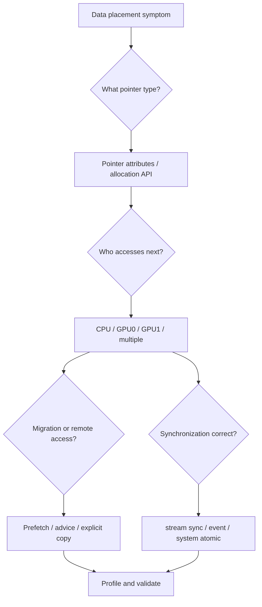

# 第 24 章 数据放置排错：慢、不一致、偶发 page fault 时怎么查

CUDA 数据放置问题常常表现得很模糊：程序能跑但慢，第一次慢后面快，换机器后行为变了，多 GPU 时某些阶段突然变慢，CPU/GPU 共享数据偶发不一致。要排查这类问题，不能只看 kernel 代码，要沿着“指针属于哪里、下一步谁访问、迁移何时发生、同步是否正确”这条线查。

本章给出一个实用的排查流程。

## 24.1 问题的由来

数据放置问题横跨多个层次：

- 指针类型：pageable、pinned、mapped、device、managed。
- 平台能力：limited/full UM、HMM、ATS、P2P。
- 访问模式：顺序、随机、CPU/GPU 交替、多 GPU 交替。
- 同步语义：stream order、device sync、system-scope atomic。
- 性能工具：page fault、migration、copy engine、kernel timeline。

如果只看某一个层次，很容易误判。

## 24.2 核心模型

图 24.1 是本章的排查流程。从症状出发，先弄清指针类型（看分配 API 或 pointer attributes），再弄清下一步由谁访问（CPU、GPU0、GPU1 还是多方同时访问）。之后分两路检查：一路看是否发生迁移或远程访问，用 prefetch、advice 或显式 copy 处理；另一路看同步是否正确，用 stream sync、event 或 system-scope atomic 处理。最后用 profiler 验证。

<figure>

<figcaption>图 24.1：数据放置排错流程：先查指针和访问者，再分迁移与同步两路处理</figcaption>
</figure>

整体顺序是从语义到性能：先确认访问合法、同步正确，再谈迁移和带宽。

## 24.3 详解

### 24.3.1 第一步：确认指针类型

记录分配来源：

| 分配方式 | 可能类型 |
|---|---|
| `malloc` / `new` | pageable host memory |
| `cudaMallocHost` | pinned host memory |
| `cudaHostAlloc` + `cudaHostAllocMapped` | mapped pinned host memory |
| `cudaMalloc` | device memory |
| `cudaMallocManaged` | managed memory |
| VMM API | virtual memory mapping |

能用 `cudaPointerGetAttributes` 查的先查。普通 `malloc`/`new` 指针也能查：调用返回 `cudaSuccess`，`type` 为 `cudaMemoryTypeUnregistered`，说明这是没有经过 CUDA 分配或注册的 pageable 内存（CUDA 11 之前这种情况会返回错误）。

### 24.3.2 第二步：确认访问者和阶段

把程序分成阶段：

| 阶段 | 访问者 | 访问类型 |
|---|---|---|
| 初始化 | CPU | write |
| 计算 | GPU0 | read/write |
| 后处理 | GPU1 或 CPU | read/write |
| 输出 | CPU | read |

如果 CPU 和 GPU 交替访问同一 managed range，要考虑迁移。若并发访问，要考虑同步和 system scope。

### 24.3.3 第三步：把迁移移出 kernel 路径

Managed memory 慢，常见原因是 kernel 内 page fault。先试：

```cpp
cudaMemLocation gpu{cudaMemLocationTypeDevice, device};
cudaMemPrefetchAsync(ptr, bytes, gpu, 0, stream);
kernel<<<grid, block, 0, stream>>>(ptr);
```

如果性能明显改善，说明迁移时机是问题的一部分。再考虑 advice 是否能稳定 residency。

### 24.3.4 第四步：检查隐式同步

Pinned memory 缺失、legacy default stream、阻塞 copy、allocation/free 都可能打断 overlap。用 Nsight Systems 看时间线，不要只看单个 kernel 时间。

### 24.3.5 第五步：平台能力差异

换机器后行为变化时，先打印 device attributes。不要假设每台机器都支持 full UM、pageable access 或 host native atomic。

## 24.4 代码示例

一个排查辅助函数：

```cpp
void print_memory_capabilities(int device)
{
    struct Item {
        cudaDeviceAttr attr;
        const char* name;
    };
    Item attrs[] = {
        {cudaDevAttrManagedMemory, "ManagedMemory"},
        {cudaDevAttrConcurrentManagedAccess, "ConcurrentManagedAccess"},
        {cudaDevAttrPageableMemoryAccess, "PageableMemoryAccess"},
        {cudaDevAttrPageableMemoryAccessUsesHostPageTables,
         "PageableMemoryAccessUsesHostPageTables"},
        {cudaDevAttrDirectManagedMemAccessFromHost,
         "DirectManagedMemAccessFromHost"},
        {cudaDevAttrHostNativeAtomicSupported,
         "HostNativeAtomicSupported"},
    };
    for (auto item : attrs) {
        int value = 0;
        cudaDeviceGetAttribute(&value, item.attr, device);
        std::printf("%s = %d\n", item.name, value);
    }
}
```

一个 managed range 迁移诊断片段：

```cpp
cudaMemLocation gpu{cudaMemLocationTypeDevice, device};
cudaMemPrefetchAsync(ptr, bytes, gpu, 0, stream);
cudaStreamSynchronize(stream);
int last = -1;
cudaMemRangeGetAttribute(&last,
                         sizeof(last),
                         cudaMemRangeAttributeLastPrefetchLocation,
                         ptr,
                         bytes);
std::printf("last prefetch location = %d\n", last);
```

## 24.5 工程判断

| 症状 | 优先排查 | 可能修复 |
|---|---|---|
| `cudaMemcpyAsync` 不重叠 | host buffer 是否 pinned | `cudaMallocHost` /`cudaHostRegister` |
| managed kernel 第一次慢 | page fault/JIT/context 混在一起 | 预热 + prefetch + event 计时 |
| CPU/GPU 交替访问慢 | page ping-pong | 阶段化访问，prefetch，减少共享页 |
| 多 GPU 阶段慢 | residency/P2P/topology | preferred location、accessed-by、peer copy |
| mapped memory kernel 慢 | 跨互连直接访问 | 改为 device memory + explicit copy |
| 偶发不一致 | 缺同步或 atomic scope 错 | stream sync、event、system-scope atomic |
| 换平台行为变 | UM capability 不同 | 查 attributes，保守路径 |

## 24.6 API 与要点速查

排查工具和 API：

| 工具/API | 用途 |
|---|---|
| `cudaPointerGetAttributes` | 查指针属性 |
| `cudaDeviceGetAttribute` | 查 device capability |
| `cudaMemRangeGetAttribute` | 查 managed range hint/state |
| `cudaMemPrefetchAsync` | 控制迁移时机 |
| `cudaMemAdvise` | 设置使用 hint |
| Nsight Systems | 看 copy/kernel/page fault/同步时间线 |
| Nsight Compute | 看 kernel 访存效率 |
| `CUDA_VISIBLE_DEVICES` | 控制多 GPU 可见集合 |
| `CUDA_MANAGED_FORCE_DEVICE_ALLOC` | managed allocation 策略调试，需谨慎使用 |

排查顺序压缩版：

1. 指针来自哪里。
2. 谁访问，按什么顺序访问。
3. 是否需要同步或 system-scope atomic。
4. 迁移是否落在 kernel 内。
5. 多 GPU 是否受拓扑影响。
6. 平台 attribute 是否支持你假设的行为。

## 24.7 小结

读完本章，你应该能够：

- 系统排查数据放置导致的慢和不一致。
- 把 managed memory 问题拆成 residency、migration、sync、platform capability。
- 判断 pinned/mapped/managed/device memory 的替代关系。
- 用 attributes 和 range query 验证假设。
- 决定何时从方便的 Unified Memory 切回显式 copy 或 VMM。
