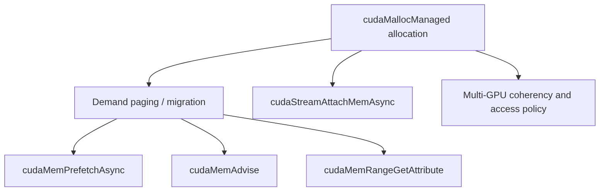

# 第 25 章 Unified Memory reference：advice、prefetch、range attribute 与 stream attach

## 25.1 问题的由来

前面几章已经讲过 managed memory 的迁移、prefetch 和 advice。除此之外还有不少参考级的细节：Unset advice、batch prefetch、range attribute、stream attach、managed memory 与 IPC/多 GPU/host 线程的边界。它们在日常入门中不常见，在性能排查时却很关键。

本章把 Unified Memory 的调优 API 和边界规则整理成可查的表。

## 25.2 核心模型

Managed memory 的关键是“位置和访问者会变”。围绕一块 `cudaMallocManaged` 分配，本章的 API 可以分成三组（图 25.1）：围绕按需分页和迁移的 prefetch、advice 和 range query；表达 stream 关联的 `cudaStreamAttachMemAsync`；以及多 GPU 下的一致性和访问策略。

<figure>

<figcaption>图 25.1：围绕一块 managed allocation 的 API：迁移控制、stream attach 与多 GPU 策略</figcaption>
</figure>

第一组里，advice、prefetch 和 range query 分别对应意图、行动和观察。

## 25.3 详解

`cudaMemPrefetchAsync` 是主动迁移，`cudaMemAdvise` 是给 runtime 的长期访问提示。它们都不是同步原语。prefetch 提交到 stream 后仍要通过 stream/event 表达使用顺序。

Unset advice 很容易漏。设置 preferred location、read mostly、accessed by 后，如果访问模式改变，应当显式撤销，否则旧 hint 可能继续影响迁移策略。

Range attribute 是观察工具。你可以查询某段 managed memory 的 preferred location、accessed-by、last prefetch location 等属性，避免只靠 profiler 猜。

`cudaStreamAttachMemAsync` 把 managed allocation 的 stream association 表达出来。它适合把“某段 managed memory 接下来由这个 stream 的 work 使用”告诉 runtime。

## 25.4 代码示例

Prefetch + advice：

```cpp
float* x = nullptr;
cudaMallocManaged(&x, bytes);
cudaMemLocation gpu{cudaMemLocationTypeDevice, device};
cudaMemAdvise(x, bytes, cudaMemAdviseSetPreferredLocation, gpu);
cudaMemAdvise(x, bytes, cudaMemAdviseSetAccessedBy, gpu);
cudaMemAdvise(x, bytes, cudaMemAdviseSetReadMostly, gpu);  // location 被忽略
cudaMemPrefetchAsync(x, bytes, gpu, 0, stream);
kernel<<<grid, block, 0, stream>>>(x);
```

CUDA 13 的 `cudaMemAdvise` 和 `cudaMemPrefetchAsync` 都用 `cudaMemLocation` 指定位置，prefetch 还有一个目前必须为 0 的 `flags` 参数（见[第 20 章](ch020.md)）。read-mostly 这条 advice 不看 location 参数，但仍要传一个。

撤销 advice：

```cpp
cudaMemAdvise(x, bytes, cudaMemAdviseUnsetPreferredLocation, gpu);  // location 被忽略
cudaMemAdvise(x, bytes, cudaMemAdviseUnsetAccessedBy, gpu);
cudaMemAdvise(x, bytes, cudaMemAdviseUnsetReadMostly, gpu);         // location 被忽略
```

Range attribute 查询：

```cpp
int location = 0;
cudaMemRangeGetAttribute(
    &location,
    sizeof(location),
    cudaMemRangeAttributePreferredLocation,
    x,
    bytes);
```

Batch prefetch 的 API 在新 runtime 中用于提交多个 range：

```cpp
void* ptrs[] = {a, b, c};
size_t sizes[] = {bytes_a, bytes_b, bytes_c};
// 三段都预取到同一个 GPU：只需要一个 location，从第 0 段起生效
cudaMemLocation loc{cudaMemLocationTypeDevice, device};
size_t loc_start = 0;
cudaMemPrefetchBatchAsync(ptrs, sizes, 3, &loc, &loc_start, 1, 0, stream);
```

目标位置按分段方式给出：`prefetchLocs[k]` 从第 `prefetchLocIdxs[k]` 个 range 开始生效，一直用到下一个分段的起点。`flags` 目前必须为 0，`stream` 不能是 legacy 默认 stream。

Stream attach：

```cpp
cudaStreamAttachMemAsync(stream, x, bytes, cudaMemAttachSingle);
```

## 25.5 工程判断

| 场景 | API | 注意点 |
|---|---|---|
| 已知下一步由某 GPU 使用 | `cudaMemPrefetchAsync` | 仍要按 stream 同步 |
| 长期主要由某 GPU 使用 | `cudaMemAdviseSetPreferredLocation` | 访问模式改变后 unset |
| 多 GPU 都会访问 | `cudaMemAdviseSetAccessedBy` | 不等于复制数据 |
| 多读少写 | `cudaMemAdviseSetReadMostly` | 写入会影响副本/迁移 |
| 想观察 runtime 状态 | `cudaMemRangeGetAttribute` | 查询结果是辅助，不是完整 profiler |
| 某 stream 独占使用一段 managed memory | `cudaStreamAttachMemAsync` | association 不是互斥锁 |

## 25.6 API 与要点速查

Managed allocation：

| API/枚举 | 作用 |
|---|---|
| `cudaMallocManaged` | 分配 managed memory |
| `cudaMemAttachGlobal` | 全局可访问 |
| `cudaMemAttachHost` | host attach |
| `cudaMemAttachSingle` | 单 stream association |
| `CU_MEM_ATTACH_HOST` | Driver API managed attach flag |
| `cuMemAllocManaged` | Driver API managed allocation |

Advice：

| Advice | 含义 |
|---|---|
| `cudaMemAdviseSetReadMostly` | 读多写少 |
| `cudaMemAdviseUnsetReadMostly` | 撤销 read-mostly |
| `cudaMemAdviseSetPreferredLocation` | 设置 preferred location |
| `cudaMemAdviseUnsetPreferredLocation` | 撤销 preferred location |
| `cudaMemAdviseSetAccessedBy` | 设置 accessed-by |
| `cudaMemAdviseUnsetAccessedBy` | 撤销 accessed-by |

Prefetch / discard：

| API | 作用 |
|---|---|
| `cudaMemPrefetchAsync` | 单 range prefetch |
| `cudaMemPrefetchBatchAsync` | 多 range prefetch |
| `cudaMemDiscardBatchAsync` | 多 range discard hint |
| `cudaMemLocation` | prefetch/advice 的 location 描述 |
| `cudaMemLocationTypeInvalid` | invalid location type |

Range attributes：

| Attribute | 说明 |
|---|---|
| `cudaMemRangeAttributeReadMostly` | read-mostly 状态 |
| `cudaMemRangeAttributePreferredLocation` | preferred location |
| `cudaMemRangeAttributeAccessedBy` | accessed-by 列表 |
| `cudaMemRangeAttributeLastPrefetchLocation` | last prefetch location |
| `cudaMemRangeAttributeLastPrefetchLocationType` | last prefetch location type |
| `cudaMemRangeAttributeLastPrefetchLocationId` | last prefetch location id |

Host/system memory 相关 API 和 flag：

| API/flag | 作用 |
|---|---|
| `cudaHostAlloc` / `cudaMallocHost` | pinned host allocation |
| `cuMemAllocHost` / `cuMemHostAlloc` | Driver API 中对应的 pinned host 分配函数，阅读 Driver API 代码时会见到 |
| `cudaHostAllocMapped` | mapped host allocation |
| `cudaSetDeviceFlags(cudaDeviceMapHost)` | 启用 mapped host memory 相关设备 flag |
| `cudaDeviceMapHost` | device flag |

## 25.7 小结

读完本章，你应该能够：

- 把 prefetch、advice、range query 分成行动、提示和观察。
- 撤销不再适用的 managed memory advice。
- 查到 batch prefetch/discard 和 stream attach 的入口。
- 识别 pinned/mapped host memory 在 Runtime API 和 Driver API 里的名字和 flag。
