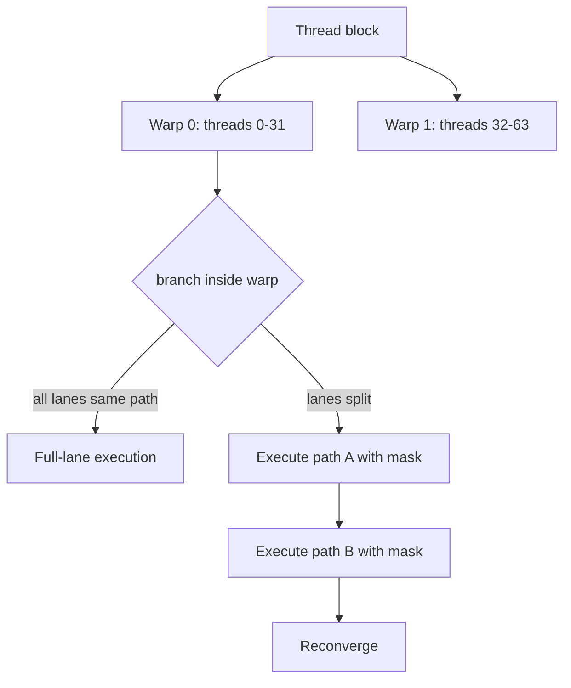

# 第 26 章 SIMT 的性能含义：warp 是执行单位，线程是编程单位

CUDA 让你用 thread 写程序，但 GPU 的性能行为经常由 warp 决定。一个 thread 有自己的索引、寄存器和控制流；一个 warp 通常包含 32 个 thread，硬件按 warp 成组发射和执行指令。功能正确的 kernel 也可能很慢，原因常常不在算术太多，而在 warp 内线程的行为太分散。

SIMT 的基础定义见[第 9 章](ch009.md)。本章只从性能角度看它：分支分化、active mask、独立线程调度和 warp-synchronous 写法分别怎样影响 kernel。

## 26.1 问题的由来

你写的是这样的代码：

```cpp
int i = blockIdx.x * blockDim.x + threadIdx.x;
if (predicate[i]) {
    out[i] = slow_path(in[i]);
} else {
    out[i] = fast_path(in[i]);
}
```

从线程语义看，每个 thread 独立处理自己的 `i`，这没有问题。可从 warp 性能看，如果同一个 warp 里一半线程走 slow path，一半线程走 fast path，硬件不能把两条路径当作满 32 lane 的同一条指令流同时推进。它会用 active mask 分别执行不同路径。

分支不是错误，分支分化才是性能问题。

## 26.2 核心模型

thread block 先被切成若干 warp。遇到分支时，如果一个 warp 的所有 lane 都走同一条路径，这条路径就以满 lane 执行；如果 lane 分成两组，硬件用 active mask 先执行一条路径、再执行另一条，最后在分支结束处重新汇合。

<figure>

<figcaption>图 26.1：warp 内分支一致时满 lane 执行，分化时按 mask 依次执行两条路径</figcaption>
</figure>

这张图的重点是：不同 warp 可以走不同路径，代价主要来自同一个 warp 内 lane 分散。

## 26.3 详解

### 26.3.1 Warp 划分决定很多直觉

thread block 在执行时被切成若干 warp，每个 warp 32 个 thread，再交给 SM 调度。切分按线程的线性编号进行，多维 block 先按 x、y、z 的顺序展开成一维编号，再每 32 个一组。

所以连续 thread ID 进入同一个 warp。对一维 block，thread 0 到 31 是第一个 warp，32 到 63 是第二个 warp。这解释了几个常见建议：

- block size 最好是 warp size 的倍数，避免最后一个 warp 大量 inactive lane。
- 让相邻 thread 访问相邻数据，方便 global memory coalescing。
- 避免以奇偶 thread、随机 flag 这样的方式在 warp 内制造分支分化。

### 26.3.2 Divergence 的代价是 lane 利用率

下面这段代码功能正确：

```cpp
if ((threadIdx.x & 1) == 0) {
    out[i] = in[i] * 2.0f;
} else {
    out[i] = in[i] + 1.0f;
}
```

但它让同一个 warp 内奇偶 lane 走不同路径。硬件通常会分别执行两条路径，每次只有一部分 lane 活跃。

如果分支条件按 warp 或 block 分组，成本就不同：

```cpp
int warp_id = threadIdx.x >> 5;
if ((warp_id & 1) == 0) {
    // 整个 warp 更可能一起走
} else {
    // 另一个 warp 走另一条路径
}
```

优化分支时要问的是：这个条件在同一个 warp 内是否一致。

### 26.3.3 Independent thread scheduling 不是“warp 不重要了”

Volta 以后引入 independent thread scheduling，线程可以在更细粒度上发散和重聚。这提高了灵活性，但也让旧式依赖 warp lockstep 的代码变危险。

如果代码正确性依赖 warp 内线程相对进度，应该显式写同步。例如 warp 内的 lane 通过 shared memory 交换数据：

```cpp
__shared__ float buf[32];            // 假设 block 只有一个 warp
int lane = threadIdx.x & 31;
buf[lane] = v;                       // 每个 lane 写自己的槽位
__syncwarp();                        // 32 个 lane 都到达后，写入对彼此可见
float right = buf[(lane + 1) & 31];  // 再读相邻 lane 写的值
```

`__syncwarp()` 不带参数时 mask 是全 1，要求 warp 的 32 个 lane 都执行到这里。只有部分 lane 进入这段代码时，要传入按程序逻辑确定的 mask（见下一节）。尤其是使用 warp-level primitives、shared memory 临时交换、部分 lane 提前 return 时，mask 和同步要写清楚。

### 26.3.4 Warp primitive 里的 mask 是语义，不是样板

```cpp
// 调用约定：warp 的 32 个 lane 都会执行到这里；
// 没有数据的 lane 传入 0 参与计算，而不是提前 return
__device__ float warp_sum(float v)
{
    const unsigned full_mask = 0xffffffffu;
    for (int offset = 16; offset > 0; offset >>= 1) {
        v += __shfl_down_sync(full_mask, v, offset);
    }
    return v;  // lane 0 得到整个 warp 的和
}
```

调用方要让越界的 lane 继续参与：

```cpp
float v = (i < n) ? in[i] : 0.0f;  // 越界 lane 不 return，贡献 0
float s = warp_sum(v);
```

`*_sync` 系列 primitive 的 mask 写的是“按程序逻辑，哪些 lane 会一起执行到这条指令”，应由调用方根据控制流给出。不要用 `__activemask()` 临时凑一个 mask：它只报告此刻恰好一起执行的 lane。在 independent thread scheduling 下，即使逻辑上 32 个 lane 都会到达，它们也可能分批到达，`__activemask()` 返回的就只是其中一部分。

上面的树形归约每一步都要读 `lane + offset` 的值，32 个 lane 必须全部参与，所以 mask 写成全 1，越界的 lane 以 0 参与。如果某些 lane 已经 return，即使 mask 写了全 1，也读不到它们的值，结果不可靠。确实只有部分 lane 参与时，mask 要准确列出这些 lane，而且每个 lane 读取的源 lane 也必须在 mask 里。

## 26.4 代码示例

下面是把分支从 thread 交错改成 warp 分组的示意：

```cpp
__global__ void grouped_branch(const float* in, float* out, int n)
{
    int i = blockIdx.x * blockDim.x + threadIdx.x;
    if (i >= n) return;
    int warp_id = threadIdx.x >> 5;
    if ((warp_id & 1) == 0) {
        out[i] = in[i] * 2.0f;
    } else {
        out[i] = in[i] + 1.0f;
    }
}
```

这只是示意，不是通用优化模板。实际能不能这样改，要看数据布局是否允许重排。如果为了减少分支分化而破坏了访存连续性，可能得不偿失。

## 26.5 工程判断

| 现象 | 可能原因 | 优先处理 |
|---|---|---|
| 分支很多但性能正常 | 分支在 warp 内一致 | 不必强行消除 |
| 奇偶 thread 分支很慢 | warp 内 lane 交错分化 | 数据重排或按 warp 分组 |
| warp primitive 结果偶发错 | mask 与实际参与的 lane 不一致 | 由调用方按控制流写出明确 mask；需要整个 warp 参与时不让 lane 提前 return |
| Volta+ 上旧代码出错 | 依赖隐式 warp lockstep | 加 `__syncwarp()` |
| block size 不是 32 倍数 | 最后 warp lane 浪费 | 调整 block size 或接受小尾部 |
| 分支优化后更慢 | 访存局部性被破坏 | 同时看 memory pattern |

## 26.6 API 与要点速查

Warp/SIMT 关键点：

| 概念 | 说明 |
|---|---|
| Warp size | 通常 32 个 thread |
| Active mask | 当前参与某条路径或 warp primitive 的 lane 集合 |
| Divergence | 同一 warp 内线程走不同控制路径 |
| Reconvergence | 分支路径执行后重新汇合 |
| Independent thread scheduling | 更细粒度调度，要求旧式 warp-synchronous 代码显式同步 |

常用函数：

| 函数 | 用途 |
|---|---|
| `__activemask` | 获取此刻一起执行的 lane mask，不宜直接当作 `*_sync` 的 mask |
| `__syncwarp` | warp 级同步 |
| `__shfl*_sync` | warp 内寄存器交换 |
| `__ballot_sync` | 收集 predicate |
| `__all_sync` / `__any_sync` | warp 内投票 |

## 26.7 小结

读完本章，你应该能够：

- 把 SIMT 性能问题定位到 warp 行为。
- 判断分支是否真的造成 warp divergence。
- 理解 independent thread scheduling 带来的同步要求。
- 在使用 warp primitive 时认真处理 mask。
- 把控制流优化和访存优化一起权衡。
