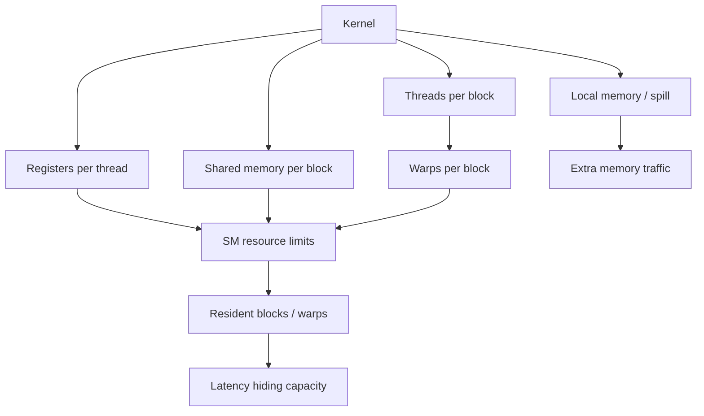

# 第 27 章 Occupancy 不是越高越好：register、shared memory、local memory 如何约束并发

Occupancy 经常被初学者当成性能分数：越高越好。这个理解太粗。Occupancy 只是 SM 上活跃 warp 数和最大可活跃 warp 数之间的关系，它影响 latency hiding，但不是唯一目标。一个 kernel 可能 occupancy 不高但很快，也可能 occupancy 很高却被访存或指令瓶颈卡住。

要弄清楚的是：register、shared memory、local memory 和 block size 怎样共同限制一个 SM 上能驻留多少 block 和 warp（SM residency）。

## 27.1 问题的由来

SM 通过保留多个 warp 的上下文隐藏延迟。当一个 warp 等 global memory 或依赖时，调度器切到另一个 ready warp。要有足够多的 ready warp，就需要足够的 resident blocks/warps。

但每个 block 都要消耗资源：

- 每个 thread 使用 register。
- 每个 block 使用 shared memory。
- 每个 kernel 可能使用 dynamic shared memory。
- 每个 SM 有最大 block、warp、thread 上限。

资源用多了，resident warp 变少，latency hiding 变弱。

## 27.2 核心模型

一个 kernel 的每线程 register 数、每 block shared memory 用量和每 block 的 warp 数，都要折算到 SM 的资源上限里，再加上 SM 自身的 block 数、warp 数上限，其中最紧的那一项决定 SM 上能驻留多少 block 和 warp，进而决定隐藏延迟的能力。local memory 和 spill 走另一条线：它们不直接减少驻留 warp，但会带来额外的访存流量。

<figure>

<figcaption>图 27.1：register、shared memory 和 block 大小共同决定 SM 上驻留的 warp 数</figcaption>
</figure>

所以 occupancy 是资源约束的结果，不是可以单独调节的旋钮。

## 27.3 详解

### 27.3.1 Register pressure

每个 thread 的 register 数乘以 block thread 数，会消耗 SM register file。寄存器多可能是好事：减少重复计算和访存。但过多会降低 resident blocks，甚至导致 spill。

查看 ptxas 输出：

```bash
nvcc -O3 --ptxas-options=-v -lineinfo kernel.cu -o kernel
```

关注：

| 字段 | 含义 |
|---|---|
| `reg` | 每线程 register 数 |
| `smem` | shared memory |
| `lmem` | local memory，常与 spill 或大局部对象有关 |

### 27.3.2 Local memory 不是“本地快内存”

Local memory 的作用域是 thread，但物理访问通常走 device memory 路径。常见来源：

- 大的局部数组。
- 动态索引导致数组不能放 register。
- register 不足导致 spill。

看到 local memory 增加，不要只调 block size，要检查代码结构、模板展开、inline、变量生命周期和寄存器限制。

### 27.3.3 Shared memory

shared memory 按 block 分配。每个 block 用量越大，同一 SM 上能驻留的 block 往往越少。shared memory 可以显著减少 global memory 访问，但如果复用不足，可能只是在牺牲 occupancy。

### 27.3.4 Launch bounds 和 register 限制

`__launch_bounds__` 可以告诉编译器你的 block size 和希望的最小 block residency：

```cpp
__global__ __launch_bounds__(256, 2)
void kernel(float* out)
{
    // ...
}
```

`-maxrregcount` 也能限制寄存器：

```bash
nvcc -O3 -Xptxas=-maxrregcount=64 kernel.cu -o kernel
```

这类约束可能提高 occupancy，也可能引发 spill。必须用实际运行时间和 profiler 验证。

### 27.3.5 Shared/L1 carveout

部分架构中 L1 和 shared memory 共享一块片上资源。可以设置偏好：

```cpp
cudaFuncSetAttribute(kernel,
                     cudaFuncAttributePreferredSharedMemoryCarveout,
                     cudaSharedmemCarveoutMaxShared);
```

这只是偏好（preferred），驱动不保证在每种架构上都照办。

## 27.4 代码示例

用 Runtime API 查询 kernel 资源：

```cpp
cudaFuncAttributes attr{};
cudaFuncGetAttributes(&attr, my_kernel);
printf("numRegs = %d\n", attr.numRegs);
printf("sharedSizeBytes = %zu\n", attr.sharedSizeBytes);
printf("localSizeBytes = %zu\n", attr.localSizeBytes);
printf("maxThreadsPerBlock = %d\n", attr.maxThreadsPerBlock);
```

用 occupancy API 找一个起点：

```cpp
int minGridSize = 0;
int blockSize = 0;
cudaOccupancyMaxPotentialBlockSize(&minGridSize,
                                   &blockSize,
                                   my_kernel,
                                   0,
                                   0);
my_kernel<<<minGridSize, blockSize>>>(args...);
```

这个 block size 是起点，不是最终答案。另外，`minGridSize` 是让所有 SM 都达到这个 occupancy 所需的最少 block 数，不是按数据量算出的 grid。上面直接用它 launch，前提是 kernel 用 grid-stride loop 覆盖全部元素；否则 grid 仍要按 `(n + blockSize - 1) / blockSize` 计算。

## 27.5 工程判断

| 现象 | 可能原因 | 处理 |
|---|---|---|
| occupancy 很低 | register 或 shared memory 过多 | 查 ptxas、func attributes |
| 限制 register 后更慢 | 发生 spill | 查看 `lmem` 和 local load/store |
| shared memory tile 后没变快 | 复用不足或 bank conflict | 看访存模式和 Nsight 指标 |
| block size 增大后失败 | threads/register/shared 超上限 | 查 compute capability |
| occupancy 很高仍慢 | memory bandwidth 或 instruction bottleneck | 看 memory throughput 和 warp stall |
| carveout 设置无效 | 架构或资源约束限制 | 当作偏好，不当硬保证 |

## 27.6 API 与要点速查

Shared/L1 carveout 常量：

| 常量 | 含义 |
|---|---|
| `cudaSharedmemCarveoutDefault` | 默认策略 |
| `cudaSharedmemCarveoutMaxL1` | 偏向 L1 |
| `cudaSharedmemCarveoutMaxShared` | 偏向 shared memory |

除了这三个常量，也可以直接传 0 到 100 之间的整数，表示希望划给 shared memory 的百分比。

相关 API/选项：

| 名称 | 用途 |
|---|---|
| `cudaFuncGetAttributes` | 查询 kernel 函数资源属性 |
| `cudaOccupancyMaxPotentialBlockSize` | 估算 block size 起点 |
| `cudaFuncSetAttribute` | 设置 kernel 属性 |
| `cudaFuncAttributePreferredSharedMemoryCarveout` | shared/L1 carveout 偏好 |
| `--ptxas-options=-v` | 输出 ptxas 资源使用 |
| `--resource-usage` | 输出资源报告 |
| `-Xptxas=-warn-spills` | 警告 spill |
| `-Xptxas=-warn-lmem-usage` | 警告 local memory 使用 |

## 27.7 小结

读完本章，你应该能够：

- 解释 occupancy 和 latency hiding 的关系。
- 从 register/shared/local memory 判断 residency 约束。
- 识别 local memory spill 的风险。
- 把 occupancy 当诊断指标，而不是唯一目标。
- 谨慎使用 launch bounds、register limit 和 carveout。
