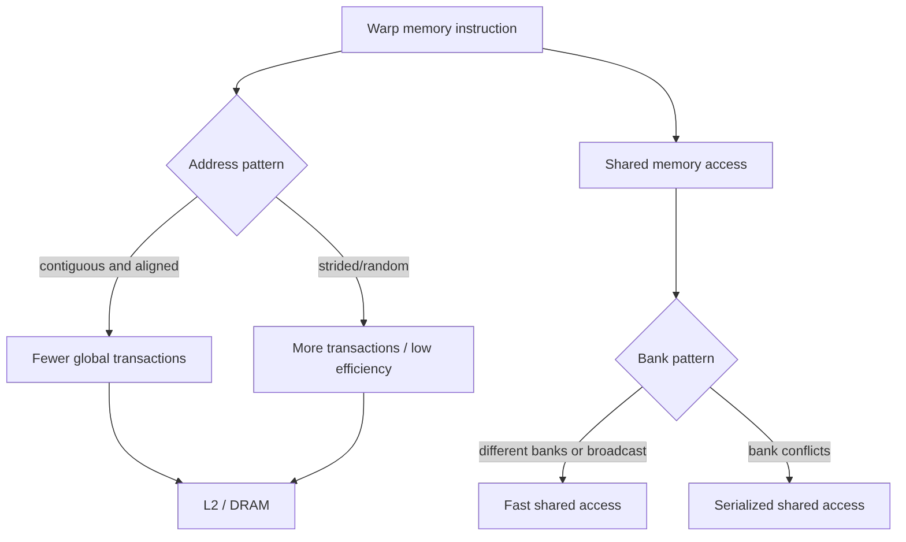
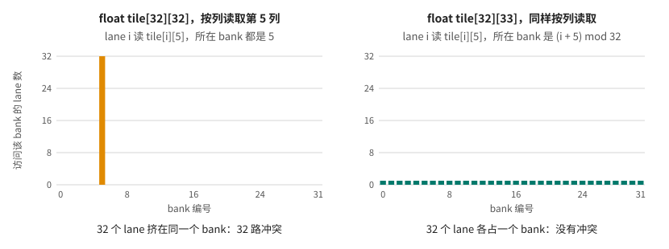

# 第 28 章 Memory access 才是很多 kernel 的上限：coalescing、bank conflict 与 cache

很多 CUDA kernel 不是算得太慢，而是数据供不上。GPU 有大量执行单元，如果 warp 的 global memory 访问无法合并，或者 shared memory 访问发生 bank conflict，SM 就会等待数据。优化 kernel 时，访存模式往往比算术表达式更重要。

本章把 global memory coalescing、shared memory bank conflict 和 L1/L2/constant/texture cache 放在一起讲。

## 28.1 问题的由来

一个 warp 中 32 个 thread 同时访问内存。理想情况是相邻 thread 访问相邻地址，这样硬件可以把多个 load/store 合并成较少 memory transaction。糟糕情况是每个 thread 访问相距很远的地址，硬件搬回大量没用的数据。

shared memory 也不是无条件快。如果多个 thread 访问落在同一个 bank 的不同地址，就可能序列化。

## 28.2 核心模型

一条 warp 级访存指令，去向不同，要看的东西也不同。访问 global memory 时看地址模式：连续且对齐的地址合并成少量 transaction，跨步或随机的地址拆成更多 transaction，最终都落到 L2 和 DRAM 上。访问 shared memory 时看 bank 模式：lane 分布在不同 bank，或者读同一个地址（广播），可以一次完成；发生 bank conflict 时，访问被拆成几次串行执行。

<figure>

<figcaption>图 28.1：warp 访存指令：global 看地址能否合并，shared 看 bank 是否冲突</figcaption>
</figure>

访问模式决定硬件搬了多少有效数据，以及片上共享内存能否并行服务。

## 28.3 详解

### 28.3.1 Global memory coalescing

向量加法天然友好：

```cpp
int i = blockIdx.x * blockDim.x + threadIdx.x;
c[i] = a[i] + b[i];
```

连续 thread 访问连续元素，warp 的 load/store 容易被合并。

二维矩阵转置则容易出问题：读连续，写可能 stride 很大；或者反过来。常见优化是用 shared memory tile 把全局不连续访问改写成更友好的块状访问。

转置把第 r 行第 c 列的元素搬到第 c 行第 r 列。矩阵按行存储时，一个 warp 读入某一行里相邻的 32 个元素是连续访问；可这 32 个元素在输出矩阵里落在同一列的 32 个不同行上，相邻 lane 的写地址彼此相隔一整行。读路径和写路径不可能同时天然连续，因此 naive transpose 往往一边 coalesced，另一边 uncoalesced。shared memory tile 的作用是先把一个 32 x 32 的块按行读进片上，再换个方向从 tile 里取数、按行写出去，让 global memory 上的读和写都变成连续访问。

### 28.3.2 Alignment

地址对齐影响 transaction 数量和指令选择。结构体数组如果字段访问导致 stride，不一定适合 coalescing。有时 AoS 改 SoA 会明显改善。

| 布局 | 访问模式 |
|---|---|
| AoS: `{x,y,z}{x,y,z}` | thread 只读 `x` 时 stride 访问 |
| SoA: `x[] y[] z[]` | thread 只读 `x` 时连续访问 |

### 28.3.3 Shared memory bank conflict

shared memory 被分成多个 bank。不同 thread 访问不同 bank 可以并行；访问同一 bank 的不同地址可能冲突。广播同一地址通常有特殊处理，不能简单归为冲突。

典型风险来自二维 tile：

```cpp
__shared__ float tile[32][32];
float v = tile[threadIdx.x][threadIdx.y];
```

访问维度和数组布局不匹配时，warp 可能集中访问同一 bank。常见手段是 padding：

```cpp
__shared__ float tile[32][33];
```

多出的 1 列改变 bank 映射，减少冲突。

用一个简单的模型就能算出冲突：在目前主流架构上，shared memory 有 32 个 bank，连续的 4 字节字依次落在相邻 bank 上，第 k 个字所在的 bank 是 `k mod 32`。设 warp 中 lane t 访问第 `s * t` 个 4 字节字（步长为 s）：

| 步长 s | lane t 所在 bank | 结果 |
|---|---|---|
| 1 | `t mod 32` | 32 个 lane 各占一个 bank，无冲突 |
| 2 | `2t mod 32` | lane t 与 lane t+16 落在同一 bank，2-way conflict |
| 3 | `3t mod 32` | 3 与 32 互质，32 个 lane 仍分到 32 个不同 bank，无冲突 |

一般地，步长 s 与 32 的最大公约数是几，就是几路冲突。判断 shared memory 性能时，不能只看“用了 shared memory”，还要看 lane 到 bank 的映射。

把这个模型用到二维数组上。`float tile[32][32]` 中，`tile[r][c]` 是第 `32r + c` 个字，所在 bank 就是 `c`：

- 按行访问（lane i 读 `tile[r][i]`）：32 个 lane 分到 32 个 bank，无冲突。
- 按列访问（lane i 读 `tile[i][c]`）：32 个 lane 全部落在 bank `c`，形成 32-way conflict。

改成 `tile[32][33]` 后，`tile[r][c]` 变成第 `33r + c` 个字，所在 bank 是 `(r + c) mod 32`。按列访问时 lane i 落在 bank `(i + c) mod 32`，32 个 lane 正好错开到 32 个不同 bank；按行访问仍然无冲突。多出的一列只多占 32 个 float，却把整列落在同一 bank 的模式打散了，所以 `tile[32][33]` 这种写法能明显改善转置 kernel。

图 28.2 把两种布局下按列读取第 5 列的情况画成柱状图：横轴是 bank 编号，柱高是落在该 bank 上的 lane 数。

<figure>

<figcaption>图 28.2：按列读取 32×32 与 32×33 的 shared memory tile 时，每个 bank 被访问的 lane 数</figcaption>
</figure>

### 28.3.4 Cache 不是同步语义

L1/L2、constant cache、texture cache 都影响性能，不提供线程同步保证。两个 thread 是否能看到彼此写入，要靠同步、fence、atomic、stream ordering 或 memory model，不能靠“应该进 cache 了”来推断。

constant memory 适合小型只读广播访问；texture 更适合某些空间局部性访问；普通 global cache 对不规则访问有帮助但不能扭转所有坏模式。

## 28.4 代码示例

一个带 padding 的 shared tile 转置 kernel：

```cpp
template<int TILE>
__global__ void transpose_tiled(const float* in, float* out,
                                int width, int height)
{
    __shared__ float tile[TILE][TILE + 1];
    int x = blockIdx.x * TILE + threadIdx.x;
    int y = blockIdx.y * TILE + threadIdx.y;
    if (x < width && y < height) {
        tile[threadIdx.y][threadIdx.x] = in[y * width + x];
    }
    __syncthreads();
    int ox = blockIdx.y * TILE + threadIdx.x;
    int oy = blockIdx.x * TILE + threadIdx.y;
    if (ox < height && oy < width) {
        out[oy * height + ox] = tile[threadIdx.x][threadIdx.y];
    }
}
```

这个例子展示了两个思想：global memory 读写尽量按连续 tile 组织，shared memory 加 padding 减少转置访问时的 bank conflict。

## 28.5 工程判断

| 症状 | 可能原因 | 检查/处理 |
|---|---|---|
| global load efficiency 低 | warp 地址不连续 | 看相邻 thread 地址 |
| 写带宽远低于读带宽 | store stride 或 scattered write | 改布局或 tile |
| shared memory 指标差 | bank conflict | padding、调整索引 |
| constant memory 不快 | 每线程读不同地址 | 改 global/texture 或重排访问 |
| cache 命中低 | 局部性差 | 重排数据、tile、prefetch |
| 正确性依赖 cache | 缺同步 | 使用正确同步原语 |

## 28.6 API 与要点速查

访存概念速查：

| 概念 | 说明 |
|---|---|
| Coalescing | warp 内访问合并成更少 memory transaction |
| Alignment | 地址对齐影响 transaction 和指令 |
| Bank conflict | shared memory 多 lane 访问同一 bank 不同地址 |
| Broadcast | 多 lane 访问同一地址时可能被优化 |
| L1/L2 cache | global memory 缓存层 |
| Constant cache | 小型只读广播数据路径 |
| Texture cache | 图像/空间局部性访问路径 |

布局判断：

| 模式 | 常见选择 |
|---|---|
| 每线程处理同一字段 | SoA 常优于 AoS |
| 矩阵 tile 复用 | shared memory tile |
| 转置/重排 | shared tile + padding |
| 稀疏随机访问 | 先考虑重排或压缩，不要只依赖 cache |

## 28.7 练习

1. 写一个朴素转置 kernel：每个 thread 读 `in[y * width + x]`、写 `out[x * height + y]`；再写一个读写都按行的拷贝 kernel，作为同样数据量下的带宽参照。用 Nsight Compute 比较两者的有效带宽和 global load/store 的访存效率。转置版的读是连续的，写却是跨行的，一次 store 被拆成很多 transaction，所以整体明显慢于拷贝。
2. 改成 28.4 节的 shared memory tile 写法，但先用 `tile[TILE][TILE]`，不加 padding。确认 global 读写都已连续后，在 Nsight Compute 里查看 shared memory bank conflict 指标，找出冲突来自哪一次 shared 访问（按 28.3.3 节的模型，是按列读 tile 的那一次）。
3. 把 tile 改成 `TILE + 1` 列，再测一次。bank conflict 应当基本消失，带宽向拷贝 kernel 靠拢。记录相对变化和指标即可，不要把某一张卡上的具体数字当成普遍结论，不同架构上三个版本的差距可能很不一样。
4. （可选）写一个 block 内的 shared memory 归约，比较两种下标写法：一种让连续线程访问 `s[2 * stride * tid]` 和 `s[2 * stride * tid + stride]`（`stride` 逐轮翻倍）；另一种让前一半线程访问 `s[tid]` 和 `s[tid + stride]`（`stride` 逐轮减半）。比较两者的 bank conflict 和耗时，并用 28.3.3 节的步长模型解释为什么前者有冲突、后者没有。

## 28.8 小结

读完本章，你应该能够：

- 用 warp 地址模式判断 coalescing。
- 知道 shared memory 快也可能 bank conflict。
- 用 padding 处理典型转置冲突。
- 区分 cache 性能效果和同步语义。
- 把数据布局纳入 kernel 性能设计。
