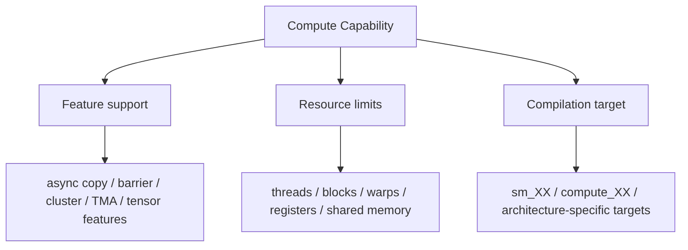

# 第 29 章 Compute Capability 不是背表：它告诉你哪些优化真的存在

Compute Capability 不只是“GPU 越新数字越大”的标签。它是 CUDA 程序员查硬件功能、资源上限、编译目标和兼容性的入口。很多优化能不能用，不取决于你会不会写 API，而取决于目标 GPU 是否支持。

官方文档里与 compute capability 相关的表格很多，不适合背。更实用的做法是为自己要支持的 GPU 整理一张工程能力卡。

## 29.1 问题的由来

你可能写了一个使用 async barrier、cluster、TMA、DPX 或某种 atomic 的 kernel。代码能不能编译、能不能运行、是否走硬件加速路径，都和 compute capability 有关。

同样，block size、shared memory tile、寄存器使用、resident warps，也都要受到每代架构资源上限约束。

## 29.2 核心模型

compute capability 同时回答三类问题：有哪些硬件特性（async copy、barrier、cluster、TMA、tensor 相关特性），资源上限是多少（thread、block、warp、register、shared memory），以及该生成哪些编译目标（`sm_XX`、`compute_XX` 和架构专属目标）。

<figure>

<figcaption>图 29.1：compute capability 决定特性支持、资源上限和编译目标</figcaption>
</figure>

查表不是为了记住数字，而是为了回答“当前优化依赖的假设是否成立”。

## 29.3 详解

### 29.3.1 查询 compute capability

Runtime API：

```cpp
int major = 0;
int minor = 0;
cudaDeviceGetAttribute(&major,
                       cudaDevAttrComputeCapabilityMajor,
                       device);
cudaDeviceGetAttribute(&minor,
                       cudaDevAttrComputeCapabilityMinor,
                       device);
```

Driver API：

```cpp
cuDeviceGetAttribute(&major,
                     CU_DEVICE_ATTRIBUTE_COMPUTE_CAPABILITY_MAJOR,
                     device);
```

命令行：

```bash
nvidia-smi --query-gpu=name,compute_cap --format=csv
```

NVML 适合系统管理：

```cpp
nvmlDeviceGetCudaComputeCapability(nvmlDevice, &major, &minor);
```

### 29.3.2 建一张能力卡

每个目标 GPU 至少记录：

| 项目 | 为什么重要 |
|---|---|
| compute capability | 判断 feature support 和编译目标 |
| max threads per block | block size 上限 |
| max blocks/warps per SM | occupancy 上限 |
| registers per SM | register-bound kernel 判断 |
| shared memory per block/SM | tile 和 dynamic shared memory 上限 |
| L2 size/cache behavior | 访存调优背景 |
| tensor features | TF32/FP16/BF16/FP8/WMMA/WGMMA 等 |
| cluster/TMA/DPX | 现代 kernel 组织能力 |

### 29.3.3 baseline、family-specific、architecture-specific

较新的 CUDA 架构引入更细的目标类型：

| 目标类型 | 例子 | 含义 |
|---|---|---|
| baseline | `compute_100` | 通用特性，追求更广兼容 |
| family-specific | `compute_100f` | 同一 family 内共享特性 |
| architecture-specific | `compute_100a` | 特定架构专属特性 |

普通应用优先 baseline。只有明确需要某个专属 feature 时，才接受更窄的运行范围。

### 29.3.4 Feature support 和性能路径

几个典型例子：

| 特性 | 查表意义 |
|---|---|
| independent thread scheduling | 影响旧式 warp-synchronous 代码 |
| hardware `memcpy_async` | 决定 async copy 是否有硬件路径 |
| async barrier | 决定 split arrive/wait 是否硬件加速 |
| thread block cluster | 决定 cluster launch 是否可用 |
| distributed shared memory | 决定 cluster 级 shared 协作 |
| TMA | 决定 tensor memory accelerator 路径 |

## 29.4 代码示例

打印能力卡的骨架：

```cpp
void print_device_card(int device)
{
    cudaDeviceProp prop{};
    cudaGetDeviceProperties(&prop, device);
    printf("name: %s\n", prop.name);
    printf("compute capability: %d.%d\n", prop.major, prop.minor);
    printf("maxThreadsPerBlock: %d\n", prop.maxThreadsPerBlock);
    printf("maxThreadsPerMultiProcessor: %d\n",
           prop.maxThreadsPerMultiProcessor);
    printf("regsPerMultiprocessor: %d\n", prop.regsPerMultiprocessor);
    printf("sharedMemPerBlock: %zu\n", prop.sharedMemPerBlock);
    printf("sharedMemPerMultiprocessor: %zu\n",
           prop.sharedMemPerMultiprocessor);
    printf("warpSize: %d\n", prop.warpSize);
}
```

Feature guard 示例：

```cpp
bool supports_cluster(const cudaDeviceProp& prop)
{
    return prop.major >= 9;
}
```

真实代码中更建议查具体 attribute，而不是只用 major/minor 粗判断。

## 29.5 工程判断

| 问题 | 查 compute capability 的目的 |
|---|---|
| kernel launch 资源失败 | 查 block/thread/shared/register 上限 |
| async copy 没效果 | 查是否有硬件加速路径 |
| cluster launch 失败 | 查 CC 和 cluster 支持 |
| TMA 代码不可用 | 查架构能力 |
| 二进制换 GPU 不能跑 | 查 `sm_XX`/`compute_XX` 目标 |
| 性能表差异 | 查算术吞吐、memory 和 tensor feature |

## 29.6 API 与要点速查

官方《CUDA C++ Programming Guide》里与 compute capability 有关的表格，可以按下面几类去查：

| 表格类别 | 应该查什么 |
|---|---|
| 设备与 SM 信息 | threads/block、warps/SM、blocks/SM、registers |
| 存储信息 | shared memory、constant memory、L2、alignment |
| 算术吞吐 | 不同数据类型吞吐差异 |
| 特性支持 | UM、cooperative launch、cluster、TMA、DPX、tensor |
| 兼容性 | cubin/PTX 运行目标和架构特性 |

Little-endian：

NVIDIA GPU 架构使用 little-endian。普通 CUDA 程序很少需要关心，但做二进制协议、外部 API 互操作、网络数据或跨设备共享 memory 时，需要确认字节序解释。

## 29.7 小结

读完本章，你应该能够：

- 把 compute capability 当作工程查表入口。
- 为目标 GPU 建能力卡。
- 判断某个优化是否有硬件支持。
- 区分 baseline、family-specific、architecture-specific 目标。
- 避免在错误硬件假设上调优。
