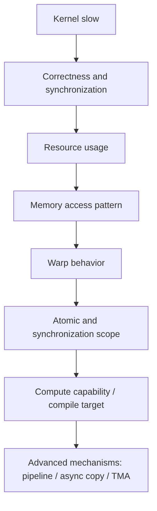

# 第 30 章 一个实用的 kernel 性能排查顺序

CUDA 性能优化最容易陷入随机调参：block size 改一改，shared memory 加一点，`--use_fast_math` 试一下，寄存器限制压一压。这样偶尔有效，但不可复现，也很难解释。

更可靠的做法是按层次排查：先正确性，再资源，再访存，再同步，再硬件能力，最后才考虑更底层指令或架构专用能力。

## 30.1 问题的由来

一个 kernel 慢可能有很多原因：

- warp 分支分化。
- global memory 访问不合并。
- shared memory bank conflict。
- register pressure 降低 occupancy。
- spill 到 local memory。
- atomic 热点竞争。
- 同步范围过大。
- 目标 GPU 不支持你以为存在的硬件路径。
- 编译目标不匹配。

如果没有排查顺序，很容易把时间花在不相关的旋钮上。

## 30.2 核心模型

在测量方式可信的前提下，排查按固定顺序往下走：先确认正确性和同步，再看资源使用、访存模式、warp 行为、atomic 与同步范围，然后核对 compute capability 和编译目标，最后才考虑 pipeline、async copy、TMA 这类高级机制。

<figure>

<figcaption>图 30.1：kernel 变慢时从正确性同步逐层排查到高级机制</figcaption>
</figure>

这个流程不是走一遍就结束。每改一处，都要回到 correctness 和 measurement。

## 30.3 详解

### 30.3.1 第一步：确认测量方式

先分清你测的是：

| 时间 | 含义 |
|---|---|
| CPU wall-clock | 包含提交、同步、copy、初始化 |
| CUDA event 时间 | GPU stream 上的执行区间 |
| Nsight Systems 时间线 | 端到端调度、copy、overlap |
| Nsight Compute 指标 | 单 kernel 内部瓶颈 |

首次运行要排除 context 初始化、module loading、JIT、managed memory page fault。

### 30.3.2 第二步：正确性同步

性能优化前先确认同步语义：

- warp 内依赖是否有 `__syncwarp`。
- block 内 shared memory 是否有 `__syncthreads`。
- 跨 block 是否错误依赖隐式顺序。
- atomic scope/order 是否足够。
- CPU/GPU 或多 GPU 共享数据是否有 system-scope 同步。

错误同步有时会表现成“快”，因为它少等了不该少等的东西。

### 30.3.3 第三步：资源使用

查看 ptxas 和 attributes：

```bash
nvcc -O3 --ptxas-options=-v -lineinfo kernel.cu -o app
```

关注 `reg`、`smem`、`lmem`。如果 `lmem` 增长，先查 spill 或大局部对象。

### 30.3.4 第四步：访存模式

看相邻 thread 访问是否连续，shared memory 是否 bank conflict，constant/texture 是否真的适合访问模式。很多 kernel 的上限是带宽，不是算术吞吐。

### 30.3.5 第五步：atomic 和 scope

如果所有 thread 都 atomic 到同一 global 地址，性能通常很差。优先考虑：

1. warp 内 reduction。
2. block 内 shared reduction。
3. 每 block 一个结果。
4. 最后少量 global atomic 或二阶段 kernel。

scope 越大成本越高。能 block scope 不要 system scope。

### 30.3.6 第六步：硬件能力

确认目标 GPU 和编译目标支持你的路径。例如 async copy、cluster、TMA、DPX、tensor features 都不是所有 GPU 都有。

## 30.4 代码示例

一个 profiling-friendly 的计时片段：

```cpp
cudaEvent_t start, stop;
cudaEventCreate(&start);
cudaEventCreate(&stop);
// warmup
kernel<<<grid, block, 0, stream>>>(args...);
cudaStreamSynchronize(stream);
cudaEventRecord(start, stream);
for (int i = 0; i < iters; ++i) {
    kernel<<<grid, block, 0, stream>>>(args...);
}
cudaEventRecord(stop, stream);
cudaEventSynchronize(stop);
float ms = 0.0f;
cudaEventElapsedTime(&ms, start, stop);
printf("avg kernel time = %f ms\n", ms / iters);
```

这个片段有三点：预热、用 event 测 GPU 时间、多次迭代降低抖动。

## 30.5 工程判断

| 优化动作 | 先确认 | 可能副作用 |
|---|---|---|
| 增大 block size | register/shared memory 是否允许 | occupancy 降低或 launch 失败 |
| 限制 register | 是否发生 spill | local memory 增加 |
| 加 shared memory tile | 数据是否复用 | bank conflict、occupancy 下降 |
| 用 atomic | scope 是否最小 | 热点竞争 |
| 用 fast math | 数值误差是否可接受 | 结果语义改变 |
| 用 async copy/pipeline | 计算能否覆盖搬运 | shared/register 增加抵消收益 |
| 用架构专属特性 | 部署 GPU 是否匹配 | 可运行范围缩小 |

## 30.6 API 与要点速查

排查工具：

| 工具/API | 用途 |
|---|---|
| CUDA event | GPU stream 时间 |
| Nsight Systems | 端到端时间线和 overlap |
| Nsight Compute | 单 kernel 指标 |
| ptxas verbose | register/shared/local 使用 |
| `cudaFuncGetAttributes` | Runtime 查询 kernel 资源 |
| occupancy API | block size 起点 |
| compute capability 表 | feature 和资源上限 |

高频指标方向：

| 指标方向 | 说明 |
|---|---|
| warp stall reasons | 看等待来源 |
| memory throughput | 看是否带宽受限 |
| global load/store efficiency | 看 coalescing |
| shared bank conflict | 看 shared memory 访问 |
| achieved occupancy | 看实际 active warp 情况 |
| instruction mix | 看算术/访存/控制流比例 |

## 30.7 练习

第十四部分（[第 84 章](ch084.md)到[第 86 章](ch086.md)）用一个分子动力学（MD）程序完整走了一遍从 CPU 热点到 GPU 迁移的过程。可以拿它把本章的排查顺序实际用一遍：

1. 先在 CPU 版本上做 profiling，确认求力函数占了绝大部分运行时间。如果它只占一半，即使 GPU 把这部分时间压到零，整体也最多快 2 倍，迁移值不值得做由这个比例决定。
2. 只把求力部分移植到 GPU，一个线程负责一个粒子，其余步骤留在 CPU，每个时间步来回拷贝坐标和力。用 Nsight Systems 看时间线：kernel 本身可能很快，但每步的 H2D/D2H 拷贝和同步可能成为新的主要开销。
3. 再把积分等其余步骤也搬到 GPU，让数据在整个时间步循环里留在 device 上，只在需要输出时拷回。对比第 2 步的时间线，解释为什么只迁移一个 kernel 往往不够。

## 30.8 小结

读完本章，你应该能够：

- 按顺序排查 kernel 性能，而不是随机调参。
- 先确认测量是否可信。
- 把资源、访存、同步、硬件能力分开看。
- 知道哪些优化可能改变正确性或数值语义。
- 决定何时进入第八部分的 pipeline、async copy、TMA 等现代机制（[第 47 章](ch047.md)到[第 49 章](ch049.md)）。
