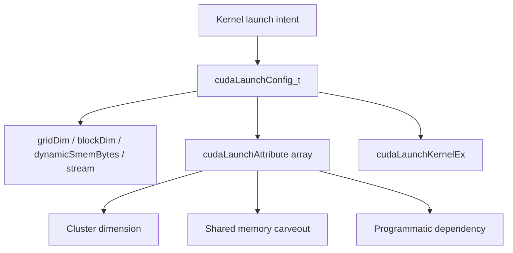
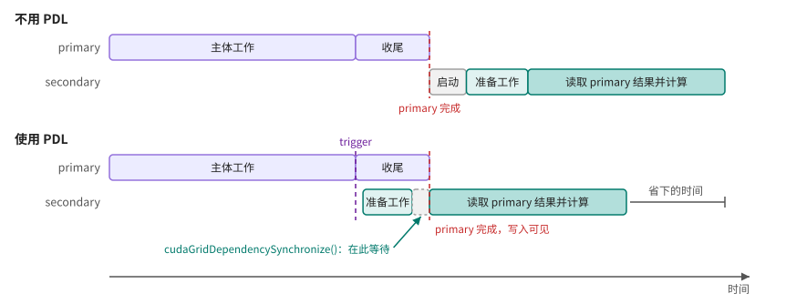

# 第 31 章 三尖括号不够用时：Runtime 高级 launch 与属性化 kernel 提交

三尖括号 launch 很适合基础 kernel：grid、block、dynamic shared memory、stream 四个参数足够表达大多数提交。但现代 CUDA 里，kernel launch 还可能携带 cluster dimension、shared memory carveout、programmatic dependent launch 等属性。此时需要 `cudaLaunchKernelEx`。

普通 launch 并没有过时。只是当 launch 本身要表达硬件布局和调度 hint 时，结构化的配置写起来更清楚。

## 31.1 问题的由来

基础 launch：

```cpp
kernel<<<grid, block, dynamic_smem_bytes, stream>>>(args...);
```

它只能表达四个固定位置。可是有些属性不是这四个位置能自然承载的：

- cluster dimension。
- preferred cluster dimension。
- preferred shared memory carveout。
- programmatic stream serialization。
- 未来新增 launch metadata。

`cudaLaunchKernelEx` 用 `cudaLaunchConfig_t` 和 `cudaLaunchAttribute` 把这些属性统一表达。

## 31.2 核心模型

`cudaLaunchConfig_t` 收纳原来三尖括号里的 grid、block、dynamic shared memory 和 stream，再挂上一个 `cudaLaunchAttribute` 数组，承载 cluster dimension、shared memory carveout、programmatic dependency 等属性，最后整体交给 `cudaLaunchKernelEx`。

<figure>

<figcaption>图 31.1：cudaLaunchConfig_t 加属性数组描述一次 kernel launch</figcaption>
</figure>

变化在于：launch 从“位置参数”变成了“配置对象 + 属性列表”。

## 31.3 详解

### 31.3.1 Cluster dimension

cluster launch 把多个 thread block 组织成更大的协作单元。运行期配置：

```cpp
cudaLaunchAttribute attr = {};
attr.id = cudaLaunchAttributeClusterDimension;
attr.val.clusterDim.x = 2;
attr.val.clusterDim.y = 1;
attr.val.clusterDim.z = 1;
```

如果指定 required cluster dimension，grid 每一维都必须能被 cluster 对应维度整除，否则 launch 失败。

### 31.3.2 编译期 cluster 标注

如果 cluster shape 是 kernel 语义的一部分，可以写在 kernel 定义上：

```cpp
__global__ __cluster_dims__(2, 1, 1)
void clustered(float* data) { }
```

如果 cluster shape 要按设备或输入调节，用 runtime launch attribute 更灵活。

### 31.3.3 Shared memory carveout

某些架构上 L1/shared memory 共享片上资源。可以设置偏好：

```cpp
cudaLaunchAttribute attr = {};
attr.id = cudaLaunchAttributePreferredSharedMemoryCarveout;
attr.val.sharedMemCarveout = cudaSharedmemCarveoutMaxShared;
```

这仍然是偏好，不是跨所有架构的硬保证。

### 31.3.4 Programmatic Dependent Launch

PDL 允许同一 stream 中的 secondary kernel 在 primary kernel 到达某个程序化完成点之后就开始执行，而不是等 primary kernel 完全结束才启动。

两种情况可以这样对比：

- 不用 PDL：primary kernel 全部结束、结果写回 global memory 之后，secondary kernel 才开始启动。
- 使用 PDL：primary 的所有 block 都调用了 `cudaTriggerProgrammaticLaunchCompletion()`（或已经退出）之后，secondary kernel 就可以被调度，先做与 primary 无关的准备工作；执行到 `cudaGridDependencySynchronize()` 时再停下来，等 primary grid 完成、结果可见后才读取它的输出。

图 31.2 把两种情况画在同一条时间轴上：

<figure>

<figcaption>图 31.2：不用 PDL 与使用 PDL 时两个 kernel 的时间线</figcaption>
</figure>

两个 kernel 的交界处因此可以重叠，省下的是 launch 间隙和 secondary 的准备时间。PDL 的完整用法见[第 45 章](ch045.md)。

这适合依赖边界非常清楚的两个 kernel，不适合用来给模糊依赖“碰运气”。

## 31.4 代码示例

运行期指定 cluster 大小的 launch。kernel 定义上没有 `__cluster_dims__`，每个 block 把自己在 cluster 里的序号写出来，便于验证 cluster 形状确实由 launch 决定：

```cpp
#include <cooperative_groups.h>
namespace cg = cooperative_groups;

// 普通 kernel：定义上没有 __cluster_dims__，cluster 形状完全由 launch 决定
__global__ void record_cluster_rank(int* rank_out, int n)
{
    int i = blockIdx.x * blockDim.x + threadIdx.x;
    if (i < n) {
        // 本 block 在所属 cluster 里的序号：0 .. cluster 大小-1
        rank_out[i] = static_cast<int>(cg::this_cluster().block_rank());
    }
}

cudaError_t launch_with_cluster(int* rank_out, int n,
                                unsigned cluster_x, cudaStream_t stream)
{
    const unsigned threads = 128;
    unsigned blocks = (n + threads - 1) / threads;
    // grid.x 必须是 cluster_x 的整数倍：向上补齐，多出的 block 由 i < n 挡掉
    blocks = (blocks + cluster_x - 1) / cluster_x * cluster_x;

    cudaLaunchAttribute attrs[1] = {};
    attrs[0].id = cudaLaunchAttributeClusterDimension;
    attrs[0].val.clusterDim.x = cluster_x;   // 每 cluster_x 个相邻 block 组成一个 cluster
    attrs[0].val.clusterDim.y = 1;
    attrs[0].val.clusterDim.z = 1;

    cudaLaunchConfig_t cfg = {};
    cfg.gridDim = dim3(blocks, 1, 1);
    cfg.blockDim = dim3(threads, 1, 1);
    cfg.dynamicSmemBytes = 0;
    cfg.stream = stream;
    cfg.attrs = attrs;
    cfg.numAttrs = 1;

    // kernel 参数直接跟在后面，类型由模板检查
    return cudaLaunchKernelEx(&cfg, record_cluster_rank, rank_out, n);
}
```

`cluster_x` 取 2 时，相邻 block 写出的序号是 0、1、0、1……；取 4 时是 0、1、2、3、0……。grid 维度不能被 cluster 维度整除时，`cudaLaunchKernelEx` 直接返回 `cudaErrorInvalidClusterSize`，kernel 不会运行，所以 launch 函数先把 block 数补齐。cluster launch 需要 compute capability 9.0 及以上，cluster 大小也受设备上限约束（可移植的上限是 8 个 block）。

PDL 结构示意：

```cpp
__global__ void primary_kernel(float* data)
{
    // publish data needed by secondary
    cudaTriggerProgrammaticLaunchCompletion();
    // independent tail work
}
__global__ void secondary_kernel(float* data)
{
    // independent setup
    cudaGridDependencySynchronize();
    // consume data from primary
}
```

PDL 的完整使用还需要 launch attribute 允许 programmatic stream serialization。

## 31.5 工程判断

| 需求 | API/机制 | 风险 |
|---|---|---|
| 普通 kernel launch | 三尖括号 | 简洁，足够大多数场景 |
| launch 需要多个属性 | `cudaLaunchKernelEx` | 属性与设备不兼容会失败 |
| cluster shape 固定 | `__cluster_dims__` | 写死后灵活性低 |
| cluster shape 运行期决定 | launch attribute | grid 维度和能力要匹配 |
| shared/L1 偏好 | carveout attribute | 只是 preferred |
| 两个 kernel 局部依赖 | PDL | 依赖点必须非常清楚 |

## 31.6 API 与要点速查

高级 Runtime launch 相关项：

| 名称 | 作用 |
|---|---|
| `cudaLaunchKernelEx` | 使用 extensible launch config |
| `cudaLaunchConfig_t` | grid、block、smem、stream、attrs |
| `cudaLaunchAttribute` | launch 属性 |
| `cudaLaunchAttributeClusterDimension` | required cluster dimension |
| `cudaLaunchAttributePreferredClusterDimension` | preferred cluster dimension |
| `cudaLaunchAttributePreferredSharedMemoryCarveout` | shared/L1 carveout 偏好 |
| `cudaLaunchAttributeProgrammaticStreamSerialization` | PDL 相关属性 |
| `cudaTriggerProgrammaticLaunchCompletion` | primary kernel 发布程序化完成点 |
| `cudaGridDependencySynchronize` | secondary kernel 等待 primary grid 完成 |

## 31.7 小结

读完本章，你应该能够：

- 判断什么时候三尖括号足够，什么时候需要 extensible launch。
- 用 `cudaLaunchKernelEx` 表达 cluster launch。
- 理解 launch attribute 是调度请求或偏好，不是任意保证。
- 把 PDL 看成明确依赖点优化，而不是通用加速按钮。
