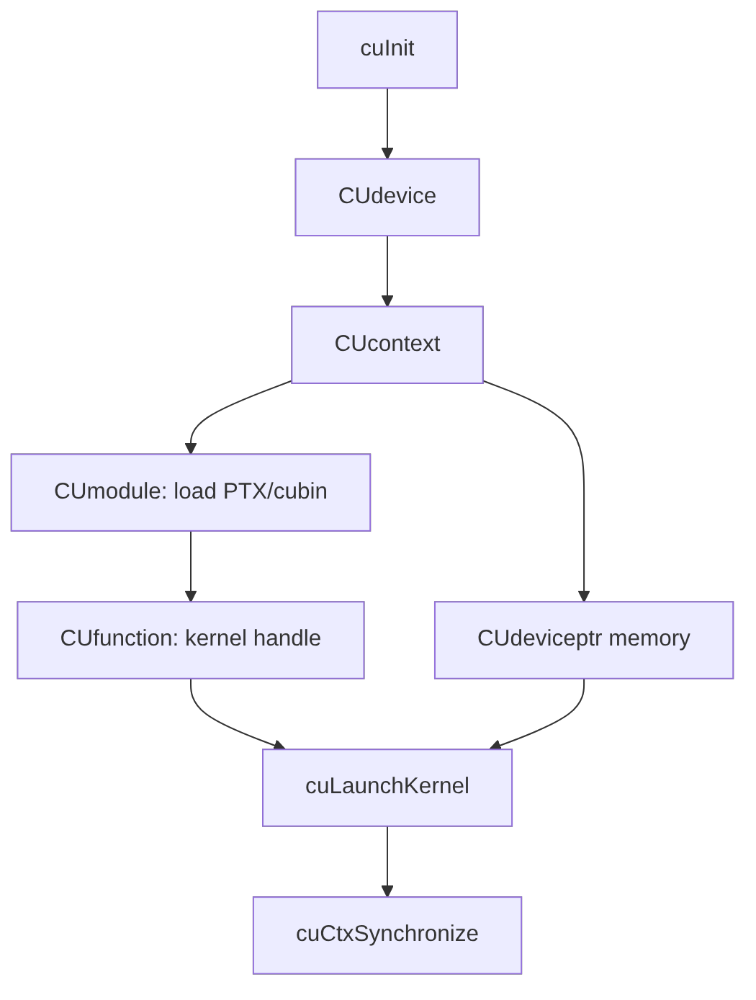

# 第 32 章 Driver API 最小路径：device、context、module、function、launch

CUDA Runtime API 足够写大多数程序。Driver API 并不更快，它的价值在于更显式：你可以管理 context、加载 PTX/cubin module、获取 kernel function handle、传入 JIT 选项，并在运行时决定加载什么代码。

本章给出 Driver API 从初始化到 launch 的最小路径。

## 32.1 问题的由来

如果你的程序只是在编译期链接好 kernel，然后用三尖括号启动，Runtime API 很合适。但如果你需要：

- 运行时加载 PTX/cubin。
- 插件系统按需加载 GPU 代码。
- 控制 context 和 module 生命周期。
- 获取 JIT 错误日志。
- 在更底层管理内存或虚拟地址。

Driver API 会更自然。

## 32.2 核心模型

一次 Driver API launch 要依次准备这些对象：`cuInit` 初始化，取得 `CUdevice`，在它上面创建 `CUcontext`；在 context 里加载 `CUmodule`（PTX 或 cubin），从中取出 `CUfunction`，同时分配 `CUdeviceptr` 内存；最后用 `cuLaunchKernel` 启动，用 `cuCtxSynchronize` 等待完成。

<figure>

<figcaption>图 32.1：Driver API 从 cuInit 到 cuLaunchKernel 的对象依赖链</figcaption>
</figure>

Driver API 是 handle-based。你不再依赖 C++ 编译器识别 kernel symbol，而是通过 module/function handle 启动。

## 32.3 详解

### 32.3.1 Context

Context 类似 GPU 上的执行环境，有自己的地址空间和资源归属。Driver API 中很多调用依赖当前 host thread 有 current context。

### 32.3.2 Module

Module 类似动态库，包含 PTX 或 cubin 中的 device code。可以用：

```cpp
cuModuleLoad(&module, "kernel.ptx");
```

如果加载 PTX，driver 可能在加载时 JIT 成当前 GPU 的机器码。

### 32.3.3 Function

Function 是 module 中的 kernel：

```cpp
cuModuleGetFunction(&func, module, "my_kernel");
```

这里的名字要和 PTX/cubin 里的符号匹配。C++ name mangling 可能影响查找，必要时使用 `extern "C"`。

### 32.3.4 Kernel arguments

`cuLaunchKernel` 接收的是 kernel 参数地址数组：

```cpp
void* args[] = {&d_x, &n};
```

注意数组元素是“参数存储位置的地址”，不是直接把参数值 cast 成 `void*`。

## 32.4 代码示例

最小 Driver API launch：

```cpp
#include <cuda.h>
#include <cstdio>
#include <cstdlib>
#define CU_CHECK(call)                                                     \
    do {                                                                   \
        CUresult err__ = (call);                                           \
        if (err__ != CUDA_SUCCESS) {                                       \
            const char* name = nullptr;                                    \
            const char* str = nullptr;                                     \
            cuGetErrorName(err__, &name);                                  \
            cuGetErrorString(err__, &str);                                 \
            std::fprintf(stderr, "%s:%d: %s: %s\n",                       \
                         __FILE__, __LINE__,                               \
                         name ? name : "CU_ERROR",                        \
                         str ? str : "unknown");                          \
            std::exit(1);                                                  \
        }                                                                  \
    } while (0)
int main()
{
    CU_CHECK(cuInit(0));
    CUdevice dev;
    CU_CHECK(cuDeviceGet(&dev, 0));
    CUcontext ctx;
    CU_CHECK(cuCtxCreate(&ctx, nullptr, 0, dev));
    CUmodule module;
    CU_CHECK(cuModuleLoad(&module, "kernel.ptx"));
    CUfunction func;
    CU_CHECK(cuModuleGetFunction(&func, module, "my_kernel"));
    int n = 1 << 20;
    size_t bytes = static_cast<size_t>(n) * sizeof(float);
    CUdeviceptr d_x;
    CU_CHECK(cuMemAlloc(&d_x, bytes));
    int block = 256;
    int grid = (n + block - 1) / block;
    void* args[] = {&d_x, &n};
    CU_CHECK(cuLaunchKernel(func,
                            grid, 1, 1,
                            block, 1, 1,
                            0,
                            nullptr,
                            args,
                            nullptr));
    CU_CHECK(cuCtxSynchronize());
    CU_CHECK(cuMemFree(d_x));
    CU_CHECK(cuModuleUnload(module));
    CU_CHECK(cuCtxDestroy(ctx));
}
```

`cuCtxCreate` 的第二个参数 `CUctxCreateParams*` 用来传 execution affinity 等创建选项，不需要时传 `nullptr`；CUDA 12.x 头文件里的 `cuCtxCreate` 没有这个参数，写作 `cuCtxCreate(&ctx, 0, dev)`。

## 32.5 工程判断

| 需求 | Runtime API | Driver API |
|---|---|---|
| 普通 CUDA C++ kernel | 更简单 | 不必要 |
| 动态加载 PTX/cubin | 不自然 | 适合 |
| 显式 context 管理 | 隐式 primary context | 显式 context |
| 获取 JIT error log | 能力有限 | `cuModuleLoadDataEx` |
| 插件化 GPU 代码 | 难管理符号和生命周期 | module/function 清晰 |
| VMM/低层内存 | 部分 Runtime 包装 | Driver API 更完整 |

## 32.6 API 与要点速查

Driver API 基本对象：

| 对象 | 句柄 | 说明 |
|---|---|---|
| Device | `CUdevice` | CUDA 设备 |
| Context | `CUcontext` | 执行环境和地址空间 |
| Module | `CUmodule` | PTX/cubin module |
| Function | `CUfunction` | kernel handle |
| Memory | `CUdeviceptr` | device pointer 句柄 |
| Stream/Event | `CUstream` / `CUevent` | Driver API stream/event |

常用 API：

| API | 用途 |
|---|---|
| `cuInit` | 初始化 Driver API |
| `cuDeviceGetCount` / `cuDeviceGet` | 枚举设备 |
| `cuCtxCreate` / `cuCtxDestroy` | 创建/销毁 context |
| `cuModuleLoad` / `cuModuleUnload` | 加载/卸载 module |
| `cuModuleGetFunction` | 获取 kernel |
| `cuMemAlloc` / `cuMemFree` | device memory |
| `cuMemcpyHtoD` / `cuMemcpyDtoH` | host/device copy |
| `cuLaunchKernel` | 启动 kernel |
| `cuCtxSynchronize` | 同步 context |

## 32.7 小结

读完本章，你应该能够：

- 写出 Driver API 从 init 到 launch 的最小路径。
- 解释 context、module、function 的关系。
- 理解 `cuLaunchKernel` 参数传递方式。
- 判断什么时候 Driver API 比 Runtime API 更合适。
