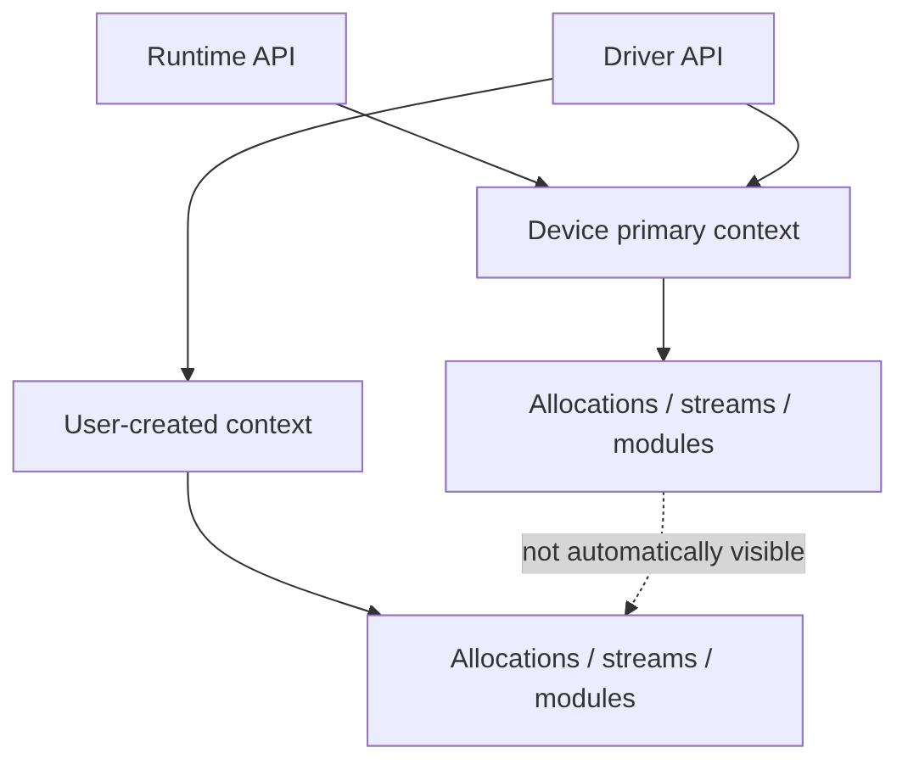

# 第 33 章 Runtime API 和 Driver API 能混用，但你必须知道上下文是谁的

CUDA 允许 Runtime API 和 Driver API 混用。这个能力很实用：你可以用 Driver API 动态加载 module，再调用使用 Runtime API 编写的库；也可以在 Runtime 程序中获取 current context 做底层操作。但混用时必须先回答一个问题：当前 context 是谁的，资源属于哪个 context。

不理解 context，就会遇到看似奇怪的问题：同一块 GPU 上分配的内存，另一个 module 看不见；某个 stream 不能用于当前 launch；Runtime API 突然初始化了 primary context。

## 33.1 问题的由来

Runtime API 默认隐藏 context。你写：

```cpp
cudaSetDevice(0);
cudaMalloc(&p, bytes);
```

Runtime 会使用该 device 的 primary context。Driver API 则让你显式创建或保留 context：

```cpp
cuCtxCreate(&ctx, nullptr, 0, dev);
```

如果一个进程里既有 Runtime，又有 Driver，又有第三方库，context 策略必须统一。

## 33.2 核心模型

Runtime API 和 Driver API 都可以使用 device 的 primary context，Driver API 还可以另外创建 user context。每个 context 各自拥有一批 allocation、stream 和 module，彼此之间不会自动可见。

<figure>

<figcaption>图 33.1：primary context 与 user context 各有资源，彼此不自动可见</figcaption>
</figure>

同一 device 上不同 context 也有不同地址空间和资源归属。指针数值相似不代表可互访。

## 33.3 详解

### 33.3.1 Primary context

Runtime API 使用 device primary context。Driver API 可以保留它：

```cpp
CUcontext ctx;
cuDevicePrimaryCtxRetain(&ctx, dev);
cuCtxSetCurrent(ctx);
```

如果你希望 Runtime API 和 Driver API 操作同一批资源，使用 primary context 通常更简单。

### 33.3.2 Current context

Driver API 很多调用依赖当前 host thread 的 current context：

```cpp
CUcontext current = nullptr;
cuCtxGetCurrent(&current);
```

多线程程序里，每个 host thread 都要明确自己的 current context。不要假设另一个线程设置过的 context 对当前线程自动有效。

### 33.3.3 Push/pop context

库代码如果临时切换 context，应该保存并恢复调用方 context。常见做法分两段：

- 库初始化时：用 `cuCtxCreate` 创建库自己的 context。新 context 会被压到当前线程的 context 栈顶，初始化完成后立刻 `cuCtxPopCurrent`，把调用方原来的 context 还回去。
- 每次库函数被调用时：先 `cuCtxPushCurrent` 压入库的 context，做完工作后 `cuCtxPopCurrent` 弹出。

这样调用方在库函数前后看到的 current context 不变，库函数不会破坏调用者的 CUDA 状态。

### 33.3.4 指针转换不是难点，context 才是

Runtime pointer 和 Driver `CUdeviceptr` 可以转换：

```cpp
CUdeviceptr dptr = reinterpret_cast<CUdeviceptr>(runtime_ptr);
float* p = reinterpret_cast<float*>(dptr);
```

要确认的是：这个 pointer 所属的 allocation 在当前 context 里是否可见。

## 33.4 代码示例

Runtime 初始化后获取 current context：

```cpp
cudaSetDevice(0);
float* d = nullptr;
cudaMalloc(&d, bytes);
CUcontext ctx = nullptr;
cuCtxGetCurrent(&ctx);
if (!ctx) {
    // Runtime may not have initialized yet, force it with cudaFree(0) or cudaSetDevice.
}
CUdeviceptr driver_ptr = reinterpret_cast<CUdeviceptr>(d);
```

Driver 先设置 primary context，再调用 Runtime：

```cpp
CUdevice dev;
cuDeviceGet(&dev, 0);
CUcontext primary;
cuDevicePrimaryCtxRetain(&primary, dev);
cuCtxSetCurrent(primary);
float* d = nullptr;
cudaMalloc(&d, bytes);  // uses current primary context
```

## 33.5 工程判断

| 场景 | 建议 |
|---|---|
| 普通应用 + CUDA 库 | 让 Runtime 管 primary context |
| 插件系统动态加载 PTX | 统一使用一个 primary context 或明确隔离 context |
| 多线程使用 Driver API | 每个线程设置 current context |
| 库内部切 context | push/pop，恢复调用方状态 |
| Runtime pointer 传给 Driver | 确认 current context 可见 |
| 多 context 隔离 | 不要假设 allocations/streams/modules 互通 |

## 33.6 API 与要点速查

Context API：

| API | 用途 |
|---|---|
| `cuCtxCreate` | 创建 user context |
| `cuCtxDestroy` | 销毁 context |
| `cuCtxSetCurrent` | 设置当前线程 current context |
| `cuCtxGetCurrent` | 获取 current context |
| `cuCtxPushCurrent` / `cuCtxPopCurrent` | 保存/恢复 context 栈 |
| `cuDevicePrimaryCtxRetain` | 获取 primary context |
| `cuDevicePrimaryCtxRelease` | 释放 primary context 引用 |

混用原则：

- Runtime API 构建在 Driver API 之上。
- Runtime 默认使用 primary context。
- Driver API 可以使用 primary context，也可以创建 user context。
- Stream/event/module/function 都属于特定 context。
- 多 context 不是多 stream；它们会带来更强隔离和更高管理复杂度。

## 33.7 小结

读完本章，你应该能够：

- 解释 primary context 和 user context 的区别。
- 在 Runtime/Driver 混用时确认 current context。
- 理解为什么同一 GPU 上多个 context 不自动共享资源。
- 设计库代码不破坏调用者 context。
