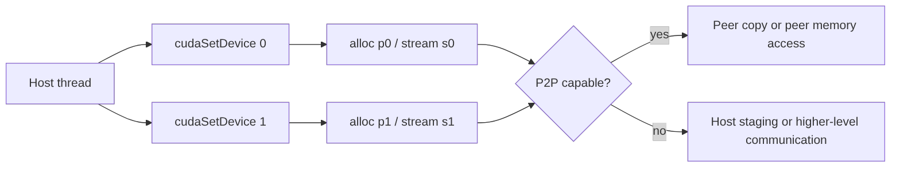

# 第 34 章 多 GPU 程序的第一步：设备选择、peer access 与拓扑判断

多 GPU 编程不是自动把一个 kernel 分散到多张卡上。最基本的工作仍然由 host 程序完成：枚举设备，选择当前设备，在每张设备上分配资源、创建 stream、启动 kernel，再通过 peer copy、peer access、NCCL、NVSHMEM、MPI 或 VMM/IPC 等机制通信。

本章只处理最基础也最容易错的一层：`cudaSetDevice`、stream/event 属主、peer copy 和 peer access。

## 34.1 问题的由来

单 GPU 程序里，当前 device 不太显眼。多 GPU 后，每个 Runtime API 调用都要问：

- 当前 host thread 的 current device 是谁？
- 这块 memory 是在哪张 GPU 上分配的？
- 这个 stream 属于哪张 GPU？
- 这个 event 记录在哪张 GPU 的 stream 上？
- 两张 GPU 能否 P2P？
- 是否启用了 peer access？

忽略这些问题，程序可能直接失败，也可能走低效 host staging。

## 34.2 核心模型

一个 host thread 用 `cudaSetDevice` 在两张 GPU 之间切换，分别分配 p0、s0 和 p1、s1。两张卡要交换数据时，先判断能否 P2P：能，就用 peer copy 或 peer memory access 走直连路径；不能，数据只能经 host 中转（peer copy 照样可以调用，由驱动自动中转），或者交给更高层的通信库。

<figure>

<figcaption>图 34.1：host thread 在两张 GPU 上分配资源，再按 P2P 能力选通信路径</figcaption>
</figure>

当前设备决定后续 allocation、stream/event、kernel launch 的归属。

## 34.3 详解

### 34.3.1 枚举设备

```cpp
int count = 0;
cudaGetDeviceCount(&count);
for (int dev = 0; dev < count; ++dev) {
    cudaDeviceProp prop{};
    cudaGetDeviceProperties(&prop, dev);
    printf("device %d: %s cc %d.%d\n",
           dev, prop.name, prop.major, prop.minor);
}
```

### 34.3.2 当前设备

```cpp
cudaSetDevice(0);
cudaMalloc(&p0, bytes);
kernel<<<grid, block>>>(p0);
cudaSetDevice(1);
cudaMalloc(&p1, bytes);
kernel<<<grid, block>>>(p1);
```

`cudaSetDevice` 影响当前 host thread 后续 Runtime API 调用。多 host thread 程序中，每个线程都要设置自己的 device。

### 34.3.3 Stream/event 属主

stream 属于创建它时的 device。不能在 device 1 当前状态下使用 device 0 的 stream launch kernel。

event 规则更细：

- `cudaEventRecord` 要求 event 和 stream 属于同一 device。
- `cudaStreamWaitEvent` 可以跨 device 等 event，因此可用于跨 GPU 依赖。

### 34.3.4 Peer copy

```cpp
cudaMemcpyPeerAsync(dst_on_dev1, 1,
                    src_on_dev0, 0,
                    bytes,
                    stream_on_dev1);
```

peer copy 表达设备间数据移动，不要求两张卡支持 P2P。没有启用 peer access（包括硬件根本不支持 P2P）时，驱动会经 host 内存中转，结果相同，只是更慢。能否走设备间直连路径，取决于拓扑、P2P 支持和是否启用了 peer access（见下一节）。

### 34.3.5 Peer memory access

启用 peer access 后，一个 GPU kernel 可以访问另一个 GPU 的 allocation：

```cpp
int can = 0;
cudaDeviceCanAccessPeer(&can, 1, 0);
if (can) {
    cudaSetDevice(1);
    cudaDeviceEnablePeerAccess(0, 0);
}
```

这个开关较全局：会影响当前 device 对 peer device 既有和未来 allocations 的访问映射，peer 数量多时可能增加 allocation 成本。大规模系统中，VMM 可以更细粒度控制可见范围。

## 34.4 代码示例

双 GPU peer copy 骨架：

```cpp
int can = 0;
cudaDeviceCanAccessPeer(&can, 1, 0);  // device 1 能否直接访问 device 0
cudaSetDevice(0);
float* p0 = nullptr;
cudaMalloc(&p0, bytes);
cudaStream_t s0;
cudaStreamCreate(&s0);
producer<<<grid, block, 0, s0>>>(p0);
cudaSetDevice(1);
if (can) {
    cudaDeviceEnablePeerAccess(0, 0);  // 这里只为让 copy 走直连路径
}
float* p1 = nullptr;
cudaMalloc(&p1, bytes);
cudaStream_t s1;
cudaStreamCreate(&s1);
// 无论 can 是否为 1 都可以这样调用；没有直连路径时驱动经 host 中转
cudaMemcpyPeerAsync(p1, 1, p0, 0, bytes, s1);
consumer<<<grid, block, 0, s1>>>(p1);
cudaStreamSynchronize(s1);
```

P2P 能力只影响 copy 走哪条路径、有多快，不影响能不能调用 `cudaMemcpyPeerAsync`，所以 copy 本身不放在 `if (can)` 里。这个骨架为了突出 peer copy，省略了 s0 和 s1 之间的依赖。真实代码里，s1 上的 copy 必须等 s0 上的 `producer` 写完 p0，做法就是下面的跨设备 event wait。

跨设备 event wait：

```cpp
cudaSetDevice(0);
cudaEvent_t ready;
cudaEventCreateWithFlags(&ready, cudaEventDisableTiming);
producer<<<grid, block, 0, s0>>>(p0);
cudaEventRecord(ready, s0);
cudaSetDevice(1);
cudaStreamWaitEvent(s1, ready, 0);
consumer<<<grid, block, 0, s1>>>(p1);
```

## 34.5 工程判断

| 需求 | 推荐路径 | 风险 |
|---|---|---|
| 每张 GPU 独立处理一份数据 | `cudaSetDevice` 后分别分配/launch | stream 用错 device |
| GPU 间传数据 | `cudaMemcpyPeerAsync` | 未启用 peer access 时经 host 中转，较慢 |
| kernel 直接访问 peer memory | `cudaDeviceEnablePeerAccess` | 全局映射增加 allocation 成本 |
| 跨 GPU 排序 | `cudaStreamWaitEvent` | event record 设备不匹配 |
| 多线程多 GPU | 每个线程设置 device/context | 继承错误假设 |
| 大规模拓扑通信 | NCCL/NVSHMEM/MPI/VMM | 手写 peer access 管理复杂 |

## 34.6 API 与要点速查

多 GPU Runtime API：

| API | 用途 |
|---|---|
| `cudaGetDeviceCount` | 获取 device 数 |
| `cudaGetDeviceProperties` | 查询属性 |
| `cudaSetDevice` | 设置当前 device |
| `cudaGetDevice` | 查询当前 device |
| `cudaDeviceCanAccessPeer` | 查询 peer access 能力 |
| `cudaDeviceEnablePeerAccess` | 启用 peer memory access |
| `cudaDeviceDisablePeerAccess` | 禁用 peer access |
| `cudaMemcpyPeer` / `cudaMemcpyPeerAsync` | peer copy |
| `cudaPointerGetAttributes` | 查询指针归属 |

UVA 提醒：

- UVA 让指针在统一地址空间中表达。
- UVA 不代表任意 GPU 都能直接访问该指针。
- 指针归属和 peer access 能力仍要查。

## 34.7 小结

读完本章，你应该能够：

- 正确管理多 GPU 当前设备。
- 避免 stream/event 跨设备误用。
- 写出 peer copy 和 peer access 的基本流程。
- 知道何时 peer access 不够细，需要 VMM 或通信库。
