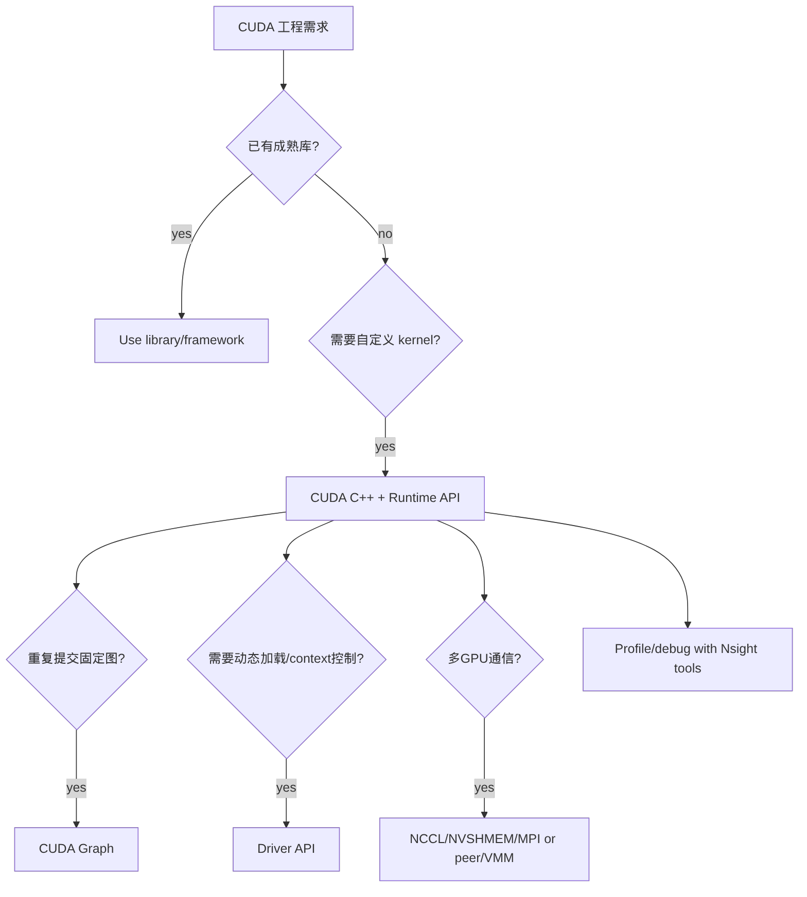

# 第 35 章 CUDA Feature Tour 到工程决策：不要把所有高级 API 都当默认选择

CUDA 的功能全貌像一张地图：CUDA 库、工具、Graph、Unified Memory、Driver API、多 GPU、Interop、语言扩展都在生态里有自己的位置。看这张地图，不是为了把每个功能都加进默认技术栈，而是为了在遇到工程问题时知道先看哪里。

本章把这张地图整理成工程选型表。

## 35.1 问题的由来

CUDA 生态很大。你可能想优化矩阵乘法、做 FFT、写图像处理、训练模型、做多 GPU 通信、动态加载 kernel、分析性能或调试非法访问。每个问题都有不同入口。

如果不先看地图，最常见的错误是过早手写 kernel，或者过早引入 Driver API、VMM、Graph 这类系统工具。

## 35.2 核心模型

遇到一个 CUDA 工程需求，先问有没有成熟的库或框架；没有，再用 CUDA C++ 和 Runtime API 写自定义 kernel。在此基础上，只有出现明确的问题，例如重复提交开销明显、需要动态加载或 context 控制、需要多 GPU 通信，才分别引入 CUDA Graph、Driver API 或 NCCL/NVSHMEM/MPI、peer access/VMM；整个过程都用 Nsight 工具定位瓶颈。

<figure>

<figcaption>图 35.1：从成熟库到自定义 kernel，再按需引入底层工具的选型流程</figcaption>
</figure>

选型顺序应该从成熟库到自定义 kernel，再到更低层控制。

## 35.3 详解

### 35.3.1 先找库

| 需求 | 优先看 |
|---|---|
| BLAS/矩阵运算 | cuBLAS |
| 线性方程/分解 | cuSOLVER |
| FFT | cuFFT |
| 深度学习 primitives | cuDNN |
| 随机数 | cuRAND |
| 稀疏矩阵 | cuSPARSE |
| 图像/信号处理 | NPP |
| 通用并行算法 | Thrust、CUB |
| GEMM/template kernel | CUTLASS |
| 多 GPU 通信 | NCCL |

这些库是工程上的主路径，不是给初学者的捷径。只有当库不覆盖你的数据结构、算子融合或访存模式时，手写 kernel 才成为核心方案。

### 35.3.2 再写 kernel

自定义 kernel 适合：

- 特殊数据结构。
- 多算子融合。
- 自定义 shared memory tile。
- 特殊同步或 warp primitive。
- 需要和业务逻辑紧密耦合的轻量计算。

写 kernel 时优先使用 Runtime API。Driver API 不会让 kernel 自动更快。

### 35.3.3 再考虑系统工具

| 工具 | 什么时候进入 |
|---|---|
| CUDA Graph | 重复提交固定执行图，CPU launch overhead 明显 |
| Stream-ordered allocator | allocation/free 在 stream 工作流中频繁出现 |
| Driver API | 动态加载、context、module、JIT、插件 |
| VMM/IPC | 跨进程、细粒度地址映射、共享内存 |
| Interop | OpenGL/D3D/Vulkan/NVSCI 资源共享 |
| CDP | device 侧根据数据动态 launch 子 kernel |

这些工具解决的是系统结构问题，不应该为了“高级”而提前引入。

### 35.3.4 工具链和调试工具

| 需求 | 工具 |
|---|---|
| 系统时间线 | Nsight Systems |
| 单 kernel 指标 | Nsight Compute |
| 内存错误/race | compute-sanitizer |
| device debug | cuda-gdb、Nsight |
| 编译中间产物 | `nvcc --keep`、`cuobjdump`、`nvdisasm` |
| 设备管理 | nvidia-smi、NVML |

## 35.4 代码示例

工程选型伪流程：

```text
如果是标准数学/信号/深度学习/通信问题:
    先查 CUDA library 或框架
否则如果瓶颈是自定义数据并行计算:
    写 CUDA C++ kernel + Runtime API
    用 stream/event 管理依赖
    用 Nsight 工具定位瓶颈
否则如果重复提交开销明显:
    引入 CUDA Graph
否则如果需要动态加载或 context 隔离:
    引入 Driver API
否则如果跨进程/外部 API/多 GPU 共享资源:
    查 IPC/VMM/Interop/NCCL/NVSHMEM
始终:
    查 compute capability 和目标平台限制
```

## 35.5 工程判断

| 决策 | 优先选择 | 避免 |
|---|---|---|
| 标准算子 | CUDA library | 从零手写低质量 kernel |
| 自定义算子 | Runtime API + kernel | 一开始上 Driver API |
| 重复执行固定流程 | CUDA Graph | 手动维护复杂同步链 |
| 多 GPU 深度学习通信 | NCCL | 手写 peer copy all-reduce |
| 动态 PTX/cubin | Driver API | 编译期硬塞所有变体 |
| 跨进程共享内存 | IPC/VMM | 传普通指针 |
| 图形资源共享 | Interop API | 同时让两个 API 访问同一资源 |

## 35.6 API 与要点速查

CUDA 生态索引：

| 类别 | 代表 |
|---|---|
| Dense linear algebra | cuBLAS、cuSOLVER |
| FFT | cuFFT |
| Sparse | cuSPARSE |
| Deep learning | cuDNN |
| Random | cuRAND |
| Image/signal | NPP |
| Generic parallel algorithms | Thrust、CUB |
| Tensor kernels | CUTLASS |
| Communication | NCCL |
| Debug/profile | Nsight Systems、Nsight Compute、compute-sanitizer、cuda-gdb |
| Compilation inspection | cuobjdump、nvdisasm、nvprune |
| System management | nvidia-smi、NVML |

这些主题在本书后面各部分的位置：

| 问题 | 对应章节 |
|---|---|
| Graph 和 stream-ordered allocator | 第七部分，[第 37 章](ch037.md)、[第 41 章](ch041.md) |
| Cooperative Groups、barrier、pipeline、TMA | 第八部分，[第 43 章](ch043.md)、[第 46 章](ch046.md)、[第 47 章](ch047.md)、[第 49 章](ch049.md) |
| Green Context、Lazy Loading、Error Log | 第九部分，[第 53 章](ch053.md)、[第 54 章](ch054.md)、[第 55 章](ch055.md) |
| IPC、VMM、EGM | 第十部分，[第 57 章](ch057.md)、[第 58 章](ch058.md)、[第 61 章](ch061.md) |
| CDP、Interop、Driver Entry Point | 第十一部分，[第 63 章](ch063.md)、[第 65 章](ch065.md)、[第 66 章](ch066.md)、[第 68 章](ch068.md) |
| 语言扩展、atomic、浮点、device API | 第十二部分，[第 72 章](ch072.md)、[第 73 章](ch073.md)、[第 74 章](ch074.md)、[第 75 章](ch075.md) |

## 35.7 小结

读完本章，你应该能够：

- 把 CUDA 生态功能映射到工程问题。
- 优先选择成熟库而不是盲目手写 kernel。
- 判断何时 Runtime API 足够，何时进入 Driver API。
- 知道 Graph、VMM、Interop 等工具解决的是系统结构问题。
