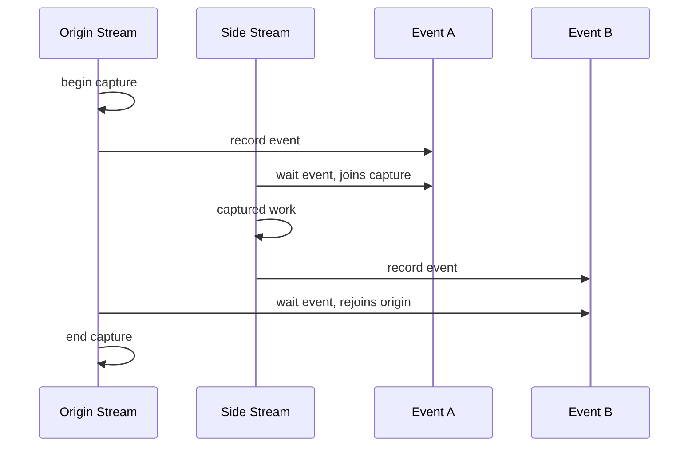

# 第 38 章 Stream Capture 的规则：你捕获的是依赖，不是随便录屏

Stream capture 是把已有 stream 代码迁移到 CUDA Graph 的最方便路径。但 capture 不是“录下这段 C++ 代码做了什么”。它捕获的是提交到 stream 的 CUDA work，以及通过 event 表达出来的依赖关系。理解这个边界，才能避免 capture invalidation。

## 38.1 问题的由来

已有代码通常长这样：

```cpp
cudaMemcpyAsync(..., stream);
kernel_a<<<grid, block, 0, stream>>>(...);
library_call(handle, stream);
kernel_b<<<grid, block, 0, stream>>>(...);
```

你不想把它重写成手工 graph node，只想直接 capture 起来。问题是：这段代码可能调用其他 stream、默认 stream、同步 API、allocation/free、库函数。哪些能捕获，哪些会让 capture 失败，必须明确。

## 38.2 核心模型

跨 stream capture 必须用 captured event 建立依赖，并在结束前把分支 join 回 origin stream。

图 38.1 是这个 fork–join 过程的时序：origin stream 开始 capture 后记录 event A；side stream 等待 event A，从这一刻起加入 capture，它之后提交的工作都会被记录；side stream 完成工作后记录 event B，origin stream 等待 event B，分支就 join 回来了；最后在 origin stream 上结束 capture。

<figure>

<figcaption>图 38.1：跨 stream capture 的 fork–join 时序</figcaption>
</figure>

## 38.3 详解

### 38.3.1 Capture mode

`cudaStreamBeginCapture` 有不同 capture mode：

| Mode | 直觉 |
|---|---|
| `cudaStreamCaptureModeGlobal` | 更严格，避免其他线程/API 破坏 capture |
| `cudaStreamCaptureModeThreadLocal` | 限制在当前线程范围 |
| `cudaStreamCaptureModeRelaxed` | 更宽松，但需要开发者更清楚风险 |

不确定时优先保守，不要为了绕过错误直接用 relaxed。

### 38.3.2 Origin stream

开始 capture 的 stream 是 origin stream。其他 stream 可以通过 event 加入 capture，但必须在结束前回到 origin stream：

```cpp
cudaStreamBeginCapture(stream1, cudaStreamCaptureModeGlobal);
kernel_A<<<grid, block, 0, stream1>>>(...);
cudaEventRecord(e1, stream1);
cudaStreamWaitEvent(stream2, e1);
kernel_C<<<grid, block, 0, stream2>>>(...);
cudaEventRecord(e2, stream2);
cudaStreamWaitEvent(stream1, e2);
cudaStreamEndCapture(stream1, &graph);
```

如果 side stream 没有 join 回来，CUDA 无法确定 graph 边界。

### 38.3.3 禁止和高风险操作

capture 期间不要随意调用：

- 会同步 captured stream 的 API。
- 会隐式同步 legacy default stream 的 API。
- 和 capture stream 不一致的 wait/query。
- 不支持 capture 的 allocation/free 或外部 API。
- 改变全局 context 状态且无法建模为 graph node 的 API。

如果 capture invalidated，不要继续使用部分生成的 graph。

### 38.3.4 Capture 不是 C++ 控制流

普通 C++ 分支在 capture 时只执行其中一条路径，Graph 里只会有实际提交的那条路径。如果你希望每次 launch 都在 device 侧判断分支，应使用 conditional node，而不是期待 capture 记住 C++ 的 `if`。

## 38.4 代码示例

一个跨 stream capture：

```cpp
cudaEvent_t e1, e2;
cudaEventCreateWithFlags(&e1, cudaEventDisableTiming);
cudaEventCreateWithFlags(&e2, cudaEventDisableTiming);
cudaStreamBeginCapture(s0, cudaStreamCaptureModeGlobal);
stage0<<<grid, block, 0, s0>>>(d0);
cudaEventRecord(e1, s0);
cudaStreamWaitEvent(s1, e1, 0);
stage1<<<grid, block, 0, s1>>>(d1);
cudaEventRecord(e2, s1);
cudaStreamWaitEvent(s0, e2, 0);
stage2<<<grid, block, 0, s0>>>(d2);
cudaGraph_t graph;
cudaStreamEndCapture(s0, &graph);
```

如果 `s1` 的工作没有通过 `e2` 回到 `s0`，`cudaStreamEndCapture` 会失败或 capture invalidated。

## 38.5 工程判断

| 操作 | Capture 中是否安全 | 说明 |
|---|---|---|
| 同一 stream kernel/memcpy async | 通常安全 | 会变成 graph node |
| 接受 stream 参数的库调用 | 通常可捕获 | 取决于库是否 capture-safe |
| legacy default stream 操作 | 高风险 | 可能引入隐式同步 |
| `cudaDeviceSynchronize` | 不适合 | 同步范围过宽且破坏 capture |
| captured event wait/record | 可用 | 跨 stream 依赖的正规方式 |
| 普通 blocking `cudaMemcpy` | 高风险 | 可能隐式同步 |
| capture 失败后继续用 graph | 错误 | graph 状态可能 invalidated |

## 38.6 API 与要点速查

Capture API：

| API | 用途 |
|---|---|
| `cudaStreamBeginCapture` | 开始 capture |
| `cudaStreamEndCapture` | 结束 capture，生成 graph |
| `cudaStreamIsCapturing` | 查询 stream 是否 capture 中 |
| `cudaStreamGetCaptureInfo` | 获取 capture 信息 |
| `cudaThreadExchangeStreamCaptureMode` | 临时切换线程 capture mode |

Capture 禁止项压缩清单：

- 不同步 captured stream。
- 不使用会影响 legacy NULL stream 的隐式同步。
- 不在捕获范围内调用不支持 capture 的 API。
- 跨 stream 分支必须用 event join 回 origin。
- capture invalidated 后必须丢弃结果。

## 38.7 小结

读完本章，你应该能够：

- 解释 stream capture 捕获的是 CUDA work 和依赖。
- 写出跨 stream capture 的 event join 结构。
- 识别 capture 中常见禁止项。
- 判断 capture 失败后不能继续使用 graph。
