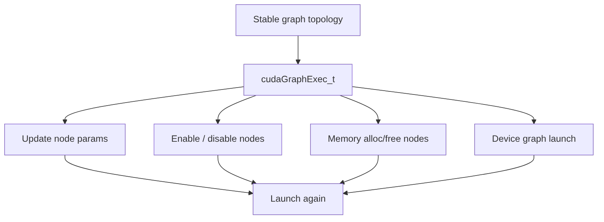

# 第 39 章 Graph Update、Memory Node 与 Device Graph Launch：Graph 不是一次性对象

CUDA Graph 的价值不只是“定义一次、launch 多次”。真实应用里，参数会变、内存生命周期会被图管理、GPU 端有时还要发起图。Graph 因此有三个重要扩展：update、memory nodes、device graph launch。

这三者都要求你把“图结构”和“每次运行的参数”分开。

## 39.1 问题的由来

很多 workload 拓扑稳定，但每轮参数不同：

- 指针地址变。
- copy size 变。
- kernel scalar 参数变。
- 某些 node 本轮需要禁用。

如果每轮销毁并重新 instantiate graph，Graph 的收益会被吃掉。Graph update 让你在兼容前提下复用 executable graph。

同时，allocation/free 如果仍在 graph 外部，就会把生命周期拆散。Memory node 可以把 allocation/free 纳入 graph 依赖。Device graph launch 则进一步把发起图的能力交给 GPU。

## 39.2 核心模型

Graph update 成功的前提是拓扑和基本语义兼容，不是任意替换图。

图 39.1 把本章的几种机制放在一起：它们都围绕一张拓扑固定的 `cudaGraphExec_t` 展开，分别改变 node 参数、node 的启用状态、图内内存的生命周期，或者把发起 graph 的位置移到 device 侧，然后再次 launch。实例化之后，图的结构本身不再改变。

<figure>

<figcaption>图 39.1：拓扑固定的 executable graph 上的几种扩展机制</figcaption>
</figure>

## 39.3 详解

### 39.3.1 Graph update

Whole graph update：

```cpp
cudaGraphExecUpdateResultInfo update_info{};
cudaGraphExecUpdate(exec, new_graph, &update_info);
```

如果 update 失败，通常需要重新 instantiate。失败原因可能是 node 类型变化、依赖关系变化、memory 类型变化、kernel 所属 context 变化等；`update_info.result` 给出失败类别，`errorNode` 和 `errorFromNode` 指出出问题的 node 或依赖边。CUDA 11 的写法是分别传入 error node 和 result 两个输出参数，CUDA 12 起合并成这个结构体。

Individual node update 适合持有 node handle 的场景：

| Node | Update API |
|---|---|
| Kernel | `cudaGraphExecKernelNodeSetParams` |
| Memcpy | `cudaGraphExecMemcpyNodeSetParams` |
| Memset | `cudaGraphExecMemsetNodeSetParams` |
| Host | `cudaGraphExecHostNodeSetParams` |
| Child graph | `cudaGraphExecChildGraphNodeSetParams` |
| Event | `cudaGraphExecEventRecordNodeSetEvent` /`cudaGraphExecEventWaitNodeSetEvent` |

Node enable/disable 适合超集图：

```cpp
cudaGraphNodeSetEnabled(exec, node, 0);
```

### 39.3.2 Graph memory nodes

Memory allocation/free node 把内存生命周期放入 graph。

allocation node 之后、free node 之前的 node 才能安全访问该 allocation。判断依据是依赖路径：一个 node 必须沿依赖边排在 allocation node 之后，同时又排在 free node 之前。只和其中一端有依赖的 node（例如某个 kernel 依赖了使用者，却和 free node 并列），或者与两者都没有依赖的 node，都不能访问这块内存。CUDA 可以利用这个有序生命周期复用虚拟地址和物理页。

### 39.3.3 Device graph launch

Device graph launch 允许 device code 发起已经实例化并上传的 graph。它适合 GPU 端控制流，不适合让 device 动态重写图结构。

三种模式：

| 模式 | 含义 |
|---|---|
| `cudaStreamGraphFireAndForget` | 发起子 graph，不等待当前 graph |
| `cudaStreamGraphTailLaunch` | 当前 graph 环境完成后执行 |
| `cudaStreamGraphFireAndForgetAsSibling` | 作为 sibling graph 发起 |

device graph launch 的 graph 必须在 host 端用 `cudaGraphInstantiateFlagDeviceLaunch` 实例化并 upload。

## 39.4 代码示例

update 或重建的流程：

```cpp
cudaGraphExecUpdateResultInfo info{};
cudaError_t st = cudaGraphExecUpdate(exec, new_graph, &info);
if (st != cudaSuccess || info.result != cudaGraphExecUpdateSuccess) {
    cudaGraphExecDestroy(exec);
    cudaGraphInstantiate(&exec, new_graph, 0);
}
```

Memory node 结构：

```cpp
cudaGraphNodeParams alloc_params{};
alloc_params.type = cudaGraphNodeTypeMemAlloc;
alloc_params.alloc.bytesize = bytes;
alloc_params.alloc.poolProps.allocType = cudaMemAllocationTypePinned;
alloc_params.alloc.poolProps.location.type = cudaMemLocationTypeDevice;
alloc_params.alloc.poolProps.location.id = device;
cudaGraphNode_t alloc_node;
// 参数依次是：依赖数组、每条依赖边的 edge data（nullptr 表示默认边）、依赖个数
cudaGraphAddNode(&alloc_node, graph, nullptr, nullptr, 0, &alloc_params);
void* dptr = alloc_params.alloc.dptr;  // 输出：这块 allocation 的地址
```

`allocType` 必须设成 `cudaMemAllocationTypePinned`，留空会得到 `cudaErrorInvalidValue`。`dptr` 在加 node 时就确定，之后每次 instantiate 和 launch 都不变，所以后续 node 可以直接把它写进参数。

Device graph launch：

```cpp
cudaGraphInstantiate(&exec, graph, cudaGraphInstantiateFlagDeviceLaunch);
cudaGraphUpload(exec, stream);
```

```cpp
__global__ void launch_child(cudaGraphExec_t exec)
{
    cudaGraphLaunch(exec, cudaStreamGraphTailLaunch);
}
```

## 39.5 工程判断

| 需求 | 机制 | 注意点 |
|---|---|---|
| 参数变化但拓扑稳定 | Graph update | 不兼容时重建 |
| 本轮跳过某个 node | node enable/disable | disabled node 类似 empty node |
| allocation/free 属于图内生命周期 | memory nodes | free 必须晚于全部使用者 |
| 减少首次 launch 抖动 | `cudaGraphUpload` | 最好 launch 到同一 stream |
| device 端决定后续 graph | device graph launch | 结构必须 host 端固定 |
| graph memory 物理页占用高 | trim/query graph memory | 不要和 mempool 假设混用 |

## 39.6 API 与要点速查

Graph memory API：

| API/属性 | 用途 |
|---|---|
| `cudaGraphNodeTypeMemAlloc` | allocation node |
| `cudaGraphNodeTypeMemFree` | free node |
| `cudaGraphInstantiateFlagAutoFreeOnLaunch` | launch 前自动释放遗留 graph allocation |
| `cudaDeviceGraphMemTrim` | 释放 graph memory pool 空闲物理页 |
| `cudaDeviceGetGraphMemAttribute` | 查询 graph memory |
| `cudaGraphMemAttrReservedMemCurrent` | reserved physical memory |
| `cudaGraphMemAttrUsedMemCurrent` | used physical memory |

Device launch 相关：

| 名称 | 用途 |
|---|---|
| `cudaGraphInstantiateFlagDeviceLaunch` | 允许 device graph launch |
| `cudaGraphUpload` | 上传 graphExec |
| `cudaStreamGraphFireAndForget` | fire-and-forget |
| `cudaStreamGraphTailLaunch` | tail launch |
| `cudaStreamGraphFireAndForgetAsSibling` | sibling launch |
| `cudaGetCurrentGraphExec` | device 端获取当前 graphExec |

## 39.7 小结

读完本章，你应该能够：

- 判断 Graph update 是否适合当前 workload。
- 把参数变化和拓扑变化分开。
- 理解 graph memory node 的有序生命周期。
- 说清 device graph launch 的三种模式和限制。
