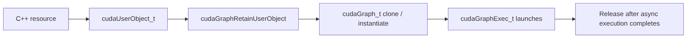

# 第 40 章 Graph 中的资源生命周期：User Object 解决谁来释放的问题

CUDA Graph 把执行变成异步图之后，C++ 资源生命周期会变难。一个库函数内部创建了临时对象，graph capture 后这个对象可能在未来某次 graph launch 才真正被使用。此时 RAII 的作用域结束，不代表 GPU 不再需要它。

CUDA user object 就是为这个问题设计的：把用户资源和 CUDA 管理的引用计数对象绑定，让 graph 持有引用，直到异步执行安全结束。

## 40.1 问题的由来

普通 stream 代码中，库可以这样管理资源：

1. 分配临时 resource。
2. 提交 kernel 使用 resource。
3. 用 host callback 在 stream 完成后释放。

但 capture 中 callback 或某些释放路径可能不允许；更重要的是，graph 被实例化后可以 launch 多次，resource 生命周期不再等同于一次函数调用。

## 40.2 核心模型

Graph 持有的是 user object 引用，而不是普通 C++ 局部变量生命周期。

图 40.1 是一份资源在 graph 中的完整路径：C++ 资源先包装成 `cudaUserObject_t`，再通过 `cudaGraphRetainUserObject` 交给 graph；graph 被 clone 或 instantiate 时，引用随之传给新的 graph 或 `cudaGraphExec_t`；executable graph 可以 launch 多次，只有相关的异步执行全部完成、所有引用都释放之后，资源才会被销毁。

<figure>

<figcaption>图 40.1：C++ 资源经 user object 交给 graph 管理的生命周期</figcaption>
</figure>

## 40.3 详解

### 40.3.1 User object 适合库作者

如果一个库内部需要为 graph node 准备资源，例如参数 buffer、外部句柄、临时 descriptor，它可以创建 user object 并让 graph retain。调用方不需要知道资源何时能安全释放。

### 40.3.2 Graph clone 和 instantiate 会传播引用

Graph clone、instantiate、exec destroy 都可能延长 user object 生命周期。只有所有引用都释放，且相关异步执行完成后，destructor 才能安全发生。

### 40.3.3 不要阻塞 destructor 等 GPU

User object destructor 不应该反过来等待 CUDA 工作。它在 CUDA 内部的共享线程上执行，里面不能调用任何 CUDA API，也应避免阻塞；需要做的事如果涉及 CUDA 调用，可以通知另一个线程去做。资源释放要设计成不会和 CUDA 内部回调或 graph 进度互相等待。

## 40.4 代码示例

基本结构：

```cpp
struct Resource {
    void* ptr;
};
void CUDART_CB destroy_resource(void* p)
{
    auto* r = static_cast<Resource*>(p);
    delete r;
}
cudaUserObject_t make_user_object(Resource* r)
{
    cudaUserObject_t obj;
    cudaUserObjectCreate(&obj,
                         r,
                         destroy_resource,
                         1,
                         cudaUserObjectNoDestructorSync);
    return obj;
}
void attach_to_graph(cudaGraph_t graph, cudaUserObject_t obj)
{
    cudaGraphRetainUserObject(graph,
                              obj,
                              1,
                              cudaGraphUserObjectMove);
}
```

如果 graph 后续 instantiate 为 `cudaGraphExec_t` 并异步 launch，user object 会跟随 graph/exec 生命周期保留引用。

## 40.5 工程判断

| 场景 | 是否适合 user object | 原因 |
|---|---|---|
| graph node 使用库内部 descriptor | 适合 | descriptor 生命周期随 graph |
| capture 中不能用 host callback 释放 | 适合 | 避免 callback 模式 |
| 普通同步函数内临时对象 | 不一定 | RAII 已足够 |
| 资源释放需要阻塞等待 GPU | 不适合直接做 | 可能死锁或拖慢 |
| graph clone/多 exec 共享资源 | 适合 | 引用计数语义清楚 |

## 40.6 API 与要点速查

User object API：

| API/flag | 用途 |
|---|---|
| `cudaUserObjectCreate` | 创建 user object |
| `cudaUserObjectRetain` | 增加引用 |
| `cudaUserObjectRelease` | 释放引用 |
| `cudaGraphRetainUserObject` | graph 持有 user object |
| `cudaGraphUserObjectMove` | 把引用转移给 graph |
| `cudaUserObjectNoDestructorSync` | 目前唯一的 flag，创建时必须传入：任何 CUDA API 都不会等待 destructor 执行完，需要同步时自己发信号 |

生命周期提醒：

- graph clone 会复制引用关系。
- graphExec 运行未完成时，资源不能提前释放。
- graphExec destroy 不一定立刻调用 destructor，可能等异步执行完成。
- user object 是生命周期工具，不是通用数据同步工具。

## 40.7 小结

读完本章，你应该能够：

- 解释为什么 graph 让普通 RAII 变得不够。
- 知道 user object 解决的是异步资源生命周期。
- 判断库内部 graph 资源是否应绑定 user object。
- 避免在 destructor 中做危险同步。
