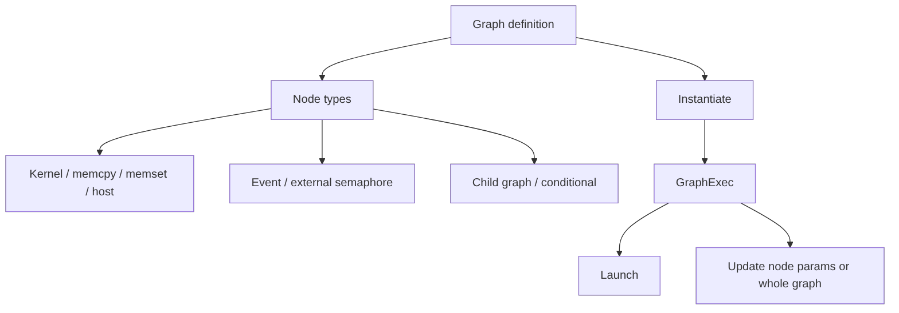

# 第 42 章 CUDA Graph 速查：节点类型、更新与条件执行

## 42.1 问题的由来

前面几章已经讲了 CUDA Graph 的动机（[第 37 章](ch037.md)）、stream capture（[第 38 章](ch038.md)）、update、memory node 与 device graph launch（[第 39 章](ch039.md)）、user object（[第 40 章](ch040.md)）和 stream-ordered allocator（[第 41 章](ch041.md)）。还有一批 API 细节分散在各处：不同 node 类型、条件节点、event node、external semaphore node、instantiate 参数和各类 update API。

本章把这些内容集中成一份速查。

## 42.2 核心模型

Graph API 不只有 kernel node。它把一组异步操作和依赖关系装配成可以重复 launch 的执行对象。

图 42.1 按两条线组织本章内容：一条是 graph definition 里能放哪些 node；另一条是 definition 实例化成 GraphExec 之后能做什么，即 launch，或者更新单个 node 的参数、用新 graph 整体更新。

<figure>

<figcaption>图 42.1：graph 的 node 类型与 GraphExec 的用法</figcaption>
</figure>

## 42.3 详解

### 42.3.1 两条构图路线

手工构图和 stream capture 是两条路线。手工构图显式调用 `cudaGraphAdd*Node`，适合框架和生成器；stream capture 适合把已有 stream 程序录制成 graph。

### 42.3.2 两类 update

Graph update 分两类：

- 更新单个 node 参数，例如 kernel/memcpy/memset/host node。
- 用新 graph 更新已实例化 graph exec，例如 `cudaGraphExecUpdate`。新 graph 的拓扑（node 和依赖边）必须和原来一致，能变的只是 node 参数，而且参数变化本身也有限制（见[第 39 章](ch039.md)）；拓扑变了就只能重新 instantiate。

### 42.3.3 Conditional node

Conditional node 容易被忽略。它允许 graph 中出现 if/while/switch 类控制结构，但不是把任意 host 逻辑搬进 graph：条件值保存在一个 `cudaGraphConditionalHandle` 里，由 graph 内的 kernel 在 device 侧调用 `cudaGraphSetConditional` 写入；每个分支本身是一张 body graph。三种类型的执行规则：

- if（`cudaGraphCondTypeIf`）：条件值非零时执行一次 body graph。body 数量设为 2 时，第二个 body 是 else 分支，条件值为 0 时执行。
- while（`cudaGraphCondTypeWhile`）：条件值非零就执行 body graph，执行完再检查一次，直到条件变为 0。通常由 body 里的 kernel 更新条件值，否则循环不会结束。
- switch（`cudaGraphCondTypeSwitch`）：条件值为 n 时执行第 n 个 body graph（从 0 开始计数），超出范围时一个都不执行。

创建句柄时带上 `cudaGraphCondAssignDefault`，每次 graph launch 开始时条件值都会被重置为指定的默认值；不带这个 flag 时，launch 开始时的条件值没有保证，必须先由图内上游的 kernel 设置。官方《CUDA C++ Programming Guide》的 Conditional Graph Nodes 一节有这三种结构的示意图。

## 42.4 代码示例

Kernel node：

```cpp
cudaKernelNodeParams params{};
params.func = reinterpret_cast<void*>(kernel);
params.gridDim = grid;
params.blockDim = block;
params.sharedMemBytes = shared_bytes;
params.kernelParams = args;
cudaGraphNode_t node{};
cudaGraphAddKernelNode(&node, graph, deps, num_deps, &params);
```

Memcpy/memset/host node：

```cpp
cudaGraphAddMemcpyNode(&copy_node, graph, deps, num_deps, &copy_params);
cudaGraphAddMemsetNode(&set_node, graph, deps, num_deps, &memset_params);
cudaGraphAddHostNode(&host_node, graph, deps, num_deps, &host_params);
```

Instantiate with params：

```cpp
cudaGraphInstantiateParams inst{};
inst.flags = cudaGraphInstantiateFlagUpload;
cudaGraphExec_t exec{};
cudaGraphInstantiateWithParams(&exec, graph, &inst);
```

Update：

```cpp
cudaGraphExecUpdateResultInfo info{};
cudaGraphExecUpdate(exec, new_graph, &info);
```

Conditional handle：

```cpp
cudaGraphConditionalHandle handle{};
cudaGraphConditionalHandleCreate(&handle, graph, 0, cudaGraphCondAssignDefault);
```

## 42.5 工程判断

| 需求 | Graph 机制 | 注意点 |
|---|---|---|
| 重复执行固定 DAG | instantiate + launch | definition 和 exec 分开 |
| 修改 kernel 参数 | node params update | 拓扑不能随意变 |
| 拓扑不变，多个 node 的参数一起变 | `cudaGraphExecUpdate` | 新旧 graph 拓扑必须一致；可能失败，要检查 update result |
| 修改图结构（增删 node 或依赖边） | 重新 instantiate | 整图 update 不接受拓扑变化 |
| 表达事件依赖 | event record/wait node | 与 stream event 类似但在 graph 内 |
| 外部同步 | external semaphore node | 用于 interop/外部资源 |
| 条件执行 | conditional node | 只表达 graph 支持的条件结构 |

## 42.6 API 与要点速查

Node add API：

| Node | API |
|---|---|
| Kernel | `cudaGraphAddKernelNode` |
| Memcpy | `cudaGraphAddMemcpyNode` |
| Memset | `cudaGraphAddMemsetNode` |
| Host | `cudaGraphAddHostNode` |
| Child graph | `cudaGraphAddChildGraphNode` |
| Empty | `cudaGraphAddEmptyNode` |
| Event record | `cudaGraphAddEventRecordNode` |
| Event wait | `cudaGraphAddEventWaitNode` |
| External semaphore signal | `cudaGraphAddExternalSemaphoresSignalNode` |
| External semaphore wait | `cudaGraphAddExternalSemaphoresWaitNode` |
| Conditional | `cudaGraphAddNode` +`cudaGraphNodeTypeConditional` |

Update / setter API：

| API | 作用 |
|---|---|
| `cudaGraphExecUpdate` | 用新 graph 更新 exec |
| `cuGraphExecUpdate` | Driver API graph update |
| `cudaGraphKernelNodeSetParams` | 更新 kernel node params |
| `cudaGraphExecKernelNodeSetParams` | 更新 executable kernel node |
| `cudaGraphMemcpyNodeSetParams` | 更新 memcpy node |
| `cudaGraphMemsetNodeSetParams` | 更新 memset node |
| `cudaGraphHostNodeSetParams` | 更新 host node |
| `cudaGraphExecExternalSemaphoresSignalNodeSetParams` | 更新 external signal node |
| `cudaGraphExecExternalSemaphoresWaitNodeSetParams` | 更新 external wait node |
| `cudaGraphNodeGetEnabled` | 查询 node enabled 状态 |

Conditional graph：

| Token | 作用 |
|---|---|
| `cudaGraphConditionalHandle` | 条件句柄 |
| `cudaGraphConditionalHandleCreate` | 创建条件句柄 |
| `cudaGraphCondAssignDefault` | 每次 launch 时把条件值重置为默认值 |
| `cudaGraphCondTypeIf` | if 条件 |
| `cudaGraphCondTypeWhile` | while 条件 |
| `cudaGraphCondTypeSwitch` | switch 条件 |
| `cudaGraphSetConditional` | device 侧设置条件值 |
| `cudaGraphNodeTypeConditional` | conditional node 类型 |

Instantiate：

| Token | 作用 |
|---|---|
| `cudaGraphInstantiateWithFlags` | 带 flags 实例化 |
| `cudaGraphInstantiateWithParams` | 使用 params 实例化 |
| `cudaGraphInstantiateParams` | instantiate 参数 |
| `cudaGraphInstantiateFlagUpload` | instantiate 时顺带上传到 `uploadStream`，只用于 `cudaGraphInstantiateWithParams` |
| `result_out` / `errNode_out` | `cudaGraphInstantiateParams` 的输出字段：失败类别（`cudaGraphInstantiateResult`）和出错的 node |

Graph 结构查询：

| Token | 作用 |
|---|---|
| `cudaGraphGetEdges` | 列出 graph 的依赖边，可同时取回每条边的 edge data |
| `cudaGraphNodeGetDependencies` / `cudaGraphNodeGetDependentNodes` | 列出某个 node 的前驱/后继，同样可取回 edge data |
| `cudaErrorLossyQuery` | 查询结果会丢掉有意义的信息时返回的错误。常见情况是图里有带非默认 edge data 的边（例如 programmatic 依赖边），调用方却没有传入接收 edge data 的参数；用较旧版本的 API 查询使用了新功能的对象，也会得到它 |

## 42.7 小结

读完本章，你应该能够：

- 查到 Graph 不同 node 类型的 add/update API。
- 知道 conditional node 的关键 token。
- 说出 if、while、switch 三种 conditional node 的执行规则。
- 判断什么时候手工构图比 stream capture 更合适。
