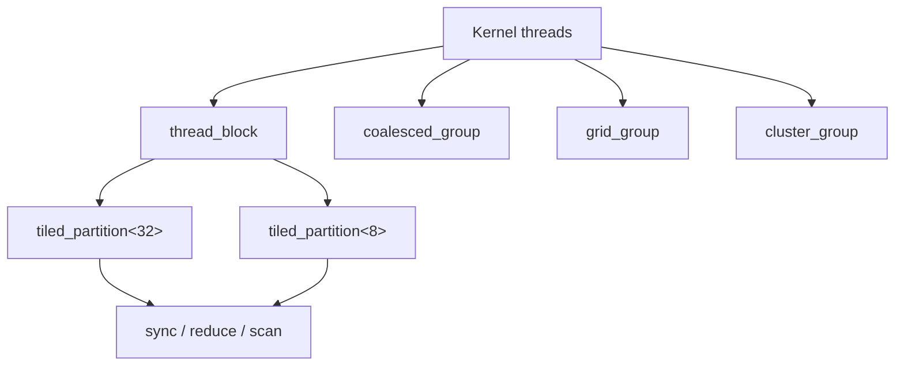

# 第 43 章 Cooperative Groups：把“谁在一起协作”写进类型和对象里

早期 CUDA 代码里，协作范围经常隐含在写法中：`__syncthreads()` 暗示整个 block，warp primitive 暗示一个 warp，`if (threadIdx.x == 0)` 暗示某个 block 的一个线程。Cooperative Groups 把“哪些线程一起做事”显式写成对象。

这样代码更好读，也能减少同步范围和参与者不一致带来的错误。

## 43.1 问题的由来

一个 reduction 可能发生在 block 内，也可能发生在 8 线程 tile 内，还可能发生在 coalesced active lanes 内。如果只看 shared memory 和 `__syncthreads()`，读者很难知道这段代码假设的协作范围。

Cooperative Groups 把协作范围变成类型和值：

```cpp
cg::thread_block block = cg::this_thread_block();
cg::thread_block_tile<32> warp = cg::tiled_partition<32>(block);
int sum = cg::reduce(warp, x, cg::plus<int>());
```

这里 `warp` 的类型明确告诉你：参与 reduce 的是从当前 thread block 切出来的一个 32 线程 tile。

## 43.2 核心模型

Group 是协作范围，collective 必须由参与 group 的线程一致执行。图 43.1 是常见 group 的派生关系：`thread_block` 可以继续切成固定大小的 tile，在 tile 上做 sync、reduce、scan；`coalesced_group`、`grid_group`、`cluster_group` 分别对应当前活跃的线程、整个 grid 和一个 cluster。

<figure>

<figcaption>图 43.1：从 kernel 线程派生出的各类 group 及其上的 collective 操作</figcaption>
</figure>

## 43.3 详解

### 43.3.1 隐式 group 要尽早创建

不要在只有部分线程进入的分支中创建需要全体参与的 group：

```cpp
cg::thread_block block = cg::this_thread_block();
if (threadIdx.x < 128) {
    // 可以在这里使用 block 的部分 thread 做普通工作
}
block.sync();
```

危险写法是：

```cpp
if (threadIdx.x < 128) {
    auto tile = cg::tiled_partition<32>(cg::this_thread_block());
    tile.sync();
}
```

partition 是 collective，父 group 的参与者必须一致。

### 43.3.2 常见 group

| Group | 范围 |
|---|---|
| `thread_block` | 当前 block |
| `thread_block_tile<N>` | 从父 group 切出的固定大小 tile |
| `coalesced_group` | 当前 coalesced active threads |
| `grid_group` | cooperative launch 下的 grid |
| `cluster_group` | thread block cluster |

### 43.3.3 Collective

Cooperative Groups 提供 sync、reduce、scan、invoke\_one 等操作，它们都把“协作范围”作为参数：

```cpp
cg::thread_block_tile<32> tile = cg::tiled_partition<32>(block);
int prefix = cg::exclusive_scan(tile, x);
int sum = cg::reduce(tile, x, cg::plus<int>());
```

注意 reduce 和 scan 能接受的 group 类型。以 CUDA 13 的头文件为准，`cg::reduce`、`cg::inclusive_scan`、`cg::exclusive_scan` 只接受 `thread_block_tile`（包括 64 到 1024 线程、大小为 2 的幂的多 warp tile）和 `coalesced_group`；把整个 `thread_block` 直接传进去会在编译期触发 static_assert（“This group does not exclusively represent a tile”）。整个 block 范围的归约通常分两步：先在 tile 内归约，再经 shared memory 汇总，写法见 43.4 节。如果 block 大小在编译期已知且是 2 的幂，也可以用 `cg::tiled_partition<256>(block)` 这样把整个 block 切成一个多 warp tile，再在它上面 reduce；多 warp tile 在 compute capability 8.0 以下还需要用 `cg::block_tile_memory` 提供暂存空间。

`invoke_one` 适合让 group 中的一个线程执行一次串行动作，不必硬编码 `threadIdx.x == 0`。

## 43.4 代码示例

Block reduce：先在每个 warp 大小的 tile 内用 `cg::reduce` 求和，各 tile 的部分和写进 shared memory，再由第 0 个 tile 汇总。

```cpp
#include <cooperative_groups.h>
#include <cooperative_groups/reduce.h>
namespace cg = cooperative_groups;
// blockDim.x 取 32 的倍数（最多 1024）
__global__ void block_reduce(const int* in, int* out)
{
    __shared__ int warp_sums[32];
    cg::thread_block block = cg::this_thread_block();
    cg::thread_block_tile<32> warp = cg::tiled_partition<32>(block);
    int i = blockIdx.x * blockDim.x + threadIdx.x;
    int s = cg::reduce(warp, in[i], cg::plus<int>());   // 第一步：warp 内求和
    if (warp.thread_rank() == 0) {
        warp_sums[warp.meta_group_rank()] = s;
    }
    block.sync();
    if (warp.meta_group_rank() == 0) {                   // 第二步：第 0 个 warp 汇总
        int v = warp.thread_rank() < warp.meta_group_size()
                    ? warp_sums[warp.thread_rank()] : 0;
        int sum = cg::reduce(warp, v, cg::plus<int>());
        if (warp.thread_rank() == 0) {
            out[block.group_index().x] = sum;
        }
    }
}
```

`meta_group_rank()` 是这个 tile 在父 group（这里是 block）中的序号，`meta_group_size()` 是父 group 被切成的 tile 数，用它们代替手算 `threadIdx.x / 32`。

Tile partition：

```cpp
cg::thread_block block = cg::this_thread_block();
cg::thread_block_tile<8> tile = cg::tiled_partition<8>(block);
int lane = tile.thread_rank();
tile.sync();
```

## 43.5 工程判断

| 需求 | Group/机制 | 风险 |
|---|---|---|
| block 内同步 | `thread_block::sync` | 只有部分线程调用会死锁 |
| 小组内 reduce | `tiled_partition<N>` | partition 必须 collective |
| active lanes 协作 | `coalesced_threads` | active 集合由控制流决定 |
| grid 级同步 | `this_grid` | 需要 cooperative launch |
| cluster 级同步 | `this_cluster` | 需要 cluster launch 和硬件支持 |
| 只执行一次串行动作 | `invoke_one` | 不要硬编码错误协作范围 |

## 43.6 API 与要点速查

Cooperative Groups API 速查：

| 类别 | 名称 |
|---|---|
| group 获取 | `this_thread_block`、`this_grid`、`this_cluster`、`coalesced_threads` |
| partition | `tiled_partition`、`labeled_partition`、`binary_partition` |
| collective | `sync`、`reduce`、`inclusive_scan`、`exclusive_scan`、`invoke_one` |
| group 信息 | `thread_rank`、`size`、`group_index`、`dim_threads` |

写法规则：

- 隐式 group handle 尽早创建。
- collective 要由 group 参与者一致执行。
- group handle 传参优先按引用。
- 不要把 warp/block/grid 协作范围隐藏在魔法数字里。

## 43.7 练习

1. 先用 `__shfl_down_sync` 写一个 warp 内求和：32 个 lane 各持一个整数，循环把偏移从 16 减半到 1。再用 `cg::tiled_partition<32>` 加 `cg::reduce` 重写同一功能，比较两版的结果是否一致。观察协作范围分别写在哪里：手写版藏在 `0xffffffff` 掩码和循环起点 16 里，Cooperative Groups 版写在 tile 的类型参数里。
2. 把第 1 题的 tile 大小从 32 改成 8，输出每个 tile 的 `cg::reduce` 结果，确认得到的是每 8 个线程一组的部分和。再试着让手写 shuffle 版本得到同样的结果，记下需要改动的地方（掩码、偏移起点、写回条件），体会为什么把范围放进类型里更不容易出错。
3. 修改 43.3.1 的危险写法：把 `tiled_partition<32>` 移到分支之前，只把 `tile.sync()` 和计算留在 `if (threadIdx.x < 128)` 里，block 大小取 256。说明为什么这样是安全的（每个 32 线程 tile 要么整体进入分支，要么整体不进入）；再把条件改成 `threadIdx.x < 100`，指出哪个 tile 只有部分线程会调用 `tile.sync()`，以及这为什么违反 collective 的参与者一致要求。

## 43.8 小结

读完本章，你应该能够：

- 用 group 对象表达协作范围。
- 识别 group 创建时机导致的死锁风险。
- 用 tile 上的 reduce/scan 替代手写 shuffle 样板，并知道 block 级归约要先在 tile 内归约再汇总。
- 判断什么时候需要 grid/cluster 级协作。
