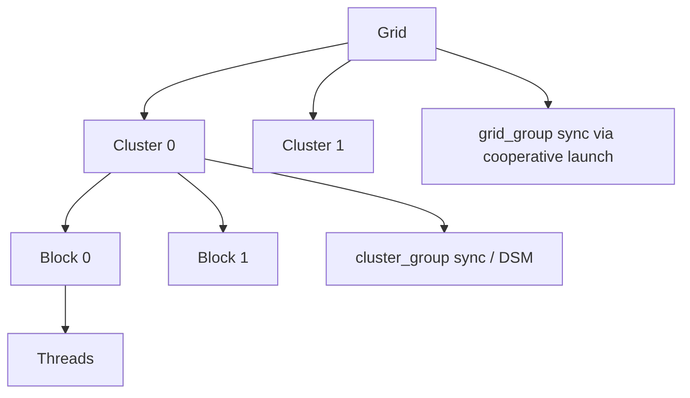

# 第 44 章 从 block 到 cluster：更大范围协作的代价和边界

普通 CUDA kernel 最可靠的同步范围是 block。更大范围的协作不能靠随手扩大 `__syncthreads()` 得到，它需要特殊 launch、硬件支持和更严格的资源约束。Grid-level cooperation 和 cluster-level cooperation 都有价值，但不能把它们当作普通 kernel 的默认能力。

## 44.1 问题的由来

有些算法需要比 block 更大的协作范围：

- grid 内阶段性同步。
- 多个相邻 block 共享或交换数据。
- cluster 内 distributed shared memory。
- 长尾任务需要 cluster 级 work stealing。

普通 kernel 中，block 之间没有默认同步，因为 block 会分批调度。要获得更大范围同步，必须让 CUDA 在 launch 阶段知道这些 block 需要共同驻留或共同管理。

## 44.2 核心模型

Grid group 要求 cooperative launch。Cluster group 要求 cluster launch 和对应 compute capability。

图 44.1 把这几层放在一起：启用 cluster launch 时，grid 由若干 cluster 组成，cluster 由若干 block 组成。block 内的同步最便宜；cluster 内可以用 `cluster_group` 同步并访问 distributed shared memory（DSM）；整个 grid 的同步则要靠 cooperative launch 下的 `grid_group`。

<figure>

<figcaption>图 44.1：grid、cluster、block 三层结构与各层的同步方式</figcaption>
</figure>

## 44.3 详解

### 44.3.1 Cooperative launch

Grid-level synchronization 需要 cooperative launch。启动前应查询：

```cpp
int supported = 0;
cudaDeviceGetAttribute(&supported,
                       cudaDevAttrCooperativeLaunch,
                       device);
```

如果不支持，就不能假设 `this_grid().sync()` 可用。

### 44.3.2 Cluster group

Cluster 把多个 block 组织成更高层协作单位。cluster group 支持 cluster 内同步，并可配合 distributed shared memory 等能力。

```cpp
namespace cg = cooperative_groups;
__global__ void clustered(float* data)
{
    cg::cluster_group cluster = cg::this_cluster();
    data[blockIdx.x * blockDim.x + threadIdx.x] = 1.0f;
    cluster.sync();
}
```

### 44.3.3 Cluster Launch Control

Cluster Launch Control 用于 cluster 级 work stealing：某些 cluster 处理完自己的 work 后，可以尝试获取尚未开始的 work unit，减少长尾。

它适合任务块耗时差异大、输出位置可明确映射、任务可以安全重新分配的场景，但不能当作通用的动态调度系统。

## 44.4 代码示例

Runtime cluster launch：

```cpp
cudaLaunchConfig_t config = {};
config.gridDim = dim3(num_blocks);
config.blockDim = dim3(256);
config.stream = stream;
cudaLaunchAttribute attr = {};
attr.id = cudaLaunchAttributeClusterDimension;
attr.val.clusterDim.x = 2;
attr.val.clusterDim.y = 1;
attr.val.clusterDim.z = 1;
config.attrs = &attr;
config.numAttrs = 1;
cudaLaunchKernelEx(&config, clustered, d_data);
```

`clusterDim` 是只有 `x`、`y`、`z` 三个字段的匿名结构体，不是 `dim3`，要逐个字段赋值；`gridDim` 的每一维都必须是对应 cluster 维度的整数倍。

Cooperative kernel launch 思路：

```cpp
void* args[] = {&d_data, &n};
cudaLaunchCooperativeKernel(reinterpret_cast<void*>(coop_kernel),
                            grid,
                            block,
                            args,
                            shared_bytes,
                            stream);
```

## 44.5 工程判断

| 需求 | 机制 | 注意点 |
|---|---|---|
| block 内协作 | ordinary block + shared memory | 最常用、成本最低 |
| grid 内同步 | cooperative launch + `this_grid` | grid size 受 resident 能力限制 |
| cluster 内同步 | cluster launch + `this_cluster` | 需要 CC 和 launch 属性 |
| distributed shared memory | cluster 机制 | 数据范围和同步必须明确 |
| 长尾任务 | Cluster Launch Control | 任务幂等和输出位置要设计 |
| 多 GPU 大范围协作 | NCCL/NVSHMEM/MPI/Graph | 不要用已移除 multi-device cooperative launch |

## 44.6 API 与要点速查

相关能力：

| 项 | API/概念 |
|---|---|
| cooperative launch support | `cudaDevAttrCooperativeLaunch` |
| cooperative launch | `cudaLaunchCooperativeKernel` |
| grid group | `cooperative_groups::this_grid` |
| cluster group | `cooperative_groups::this_cluster`、`cluster_group` |
| cluster launch | `cudaLaunchAttributeClusterDimension`、`__cluster_dims__` |
| work stealing | Cluster Launch Control |

CUDA 13 起，Cooperative Groups multi-device launch API 已移除。多设备协作应使用更合适的通信和调度层。

## 44.7 小结

读完本章，你应该能够：

- 解释为什么普通 kernel 不能随便 block 间同步。
- 区分 grid-level cooperative launch 和 cluster launch。
- 判断 cluster 是否值得引入。
- 知道 Cluster Launch Control 解决的是长尾 work stealing。
