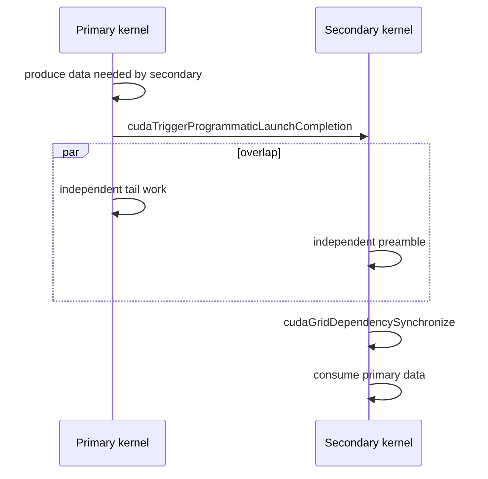

# 第 45 章 Programmatic Dependent Launch：让 kernel 之间的依赖更早暴露

同一 stream 中的 kernel 默认串行：后一个 kernel 要等前一个 kernel 的所有 block 都结束、写入全部可见之后才开始调度。这个语义简单可靠，但有时太保守：primary kernel 最后一批 block 收尾时，GPU 上往往已有不少 SM 空闲；secondary kernel 开头也可能有一段与 primary 结果无关的准备工作（初始化 shared memory、读取参数、计算地址等），本可以提前做。

Programmatic Dependent Launch，简称 PDL，让你在两个 kernel 里各标一个点：primary 里的触发点表示“从这里起，后继可以开始调度”；secondary 里的等待点表示“从这里起，需要 primary 的结果”。触发点只影响调度时机，等待点才承担数据依赖。

## 45.1 问题的由来

普通 stream 顺序：

```text
primary 完全结束 -> secondary 开始
```

PDL 想表达：

```text
primary 到达触发点
  -> secondary 开始调度，执行独立部分（与 primary 剩余部分重叠）
  -> secondary 在等待点阻塞，直到 primary 整个 grid 完成且写入可见
  -> secondary 使用 primary 的数据
```

PDL 并没有放松数据同步：secondary 读取 primary 的结果之前，仍然要等 primary 整个 grid 结束。它提前的只是 secondary 的调度和那段独立的准备工作。

## 45.2 核心模型

PDL 的关键是两个点：primary 何时 trigger，secondary 何时 wait。图 45.1 画出了这两个点之间的时间关系：primary 在某个位置调用 `cudaTriggerProgrammaticLaunchCompletion`（图中放在产生 secondary 所需数据之后，这是常见位置，但不是正确性要求）；此后 primary 剩余的工作和 secondary 的独立 preamble 可以并行；secondary 在 `cudaGridDependencySynchronize` 处等待。注意图中等待点画在并行区之后：它要等 primary 的尾部工作也结束、整个 grid 完成，之后才能使用 primary 的数据。

<figure>

<figcaption>图 45.1：PDL 中 primary 的 trigger 点与 secondary 的 wait 点</figcaption>
</figure>

## 45.3 详解

### 45.3.1 Primary kernel

Primary 在希望后继开始调度的位置调用：

```cpp
cudaTriggerProgrammaticLaunchCompletion();
```

只有当 primary 的每个 block 都调用过它（或者已经退出）时，后继 grid 才可以开始调度；如果 primary 从不调用，这个时机就推迟到 primary 的所有 warp 执行完毕、grid 正式完成之前。它只决定后继何时可以开始调度，本身不提供任何内存可见性保证，不是“数据发布点”：写在它前面的数据，secondary 也要等到等待点之后才能读。

因此触发点放在哪里不影响正确性，只影响 secondary 能提前多少。常见做法是放在 primary 主体工作之后、收尾工作之前。

### 45.3.2 Secondary kernel

Secondary 可以先做独立工作，然后在需要使用 primary 数据之前调用：

```cpp
cudaGridDependencySynchronize();
```

它会阻塞调用线程，直到 primary（准确地说，是所有直接前驱 grid）全部完成、写入对本 grid 可见。primary 的结果只能在这之后读；在等待点之前读 primary 写的数据得不到任何保证。等待点之前的部分就是 secondary 的 preamble，它有机会与 primary 的 tail 重叠。

### 45.3.3 Launch attribute

需要用 `cudaLaunchAttributeProgrammaticStreamSerialization` 允许 programmatic stream serialization。这个属性加在 secondary 的 launch 上（通过 `cudaLaunchKernelEx`），表示 secondary 自己会用等待点解决对前一个 kernel 的依赖；primary 用普通方式启动即可。

设备端的两个调用会编译成 `griddepcontrol` 指令，要求 compute capability 9.0 及以上，编译目标低于 `sm_90` 时 ptxas 直接报错。即使硬件支持，PDL 也只是提供重叠机会，不保证一定并发。

### 45.3.4 Graph 中的 PDL

Graph edge 也可以携带 programmatic dependency：

| 名称 | 作用 |
|---|---|
| `cudaGraphDependencyTypeProgrammatic` | programmatic 依赖类型，下游 kernel node 可以用 `cudaGridDependencySynchronize` |
| `cudaGraphKernelNodePortProgrammatic` | 上游 kernel node 的出端口：所有 block 都触发过（或已退出）时激活 |

这让 Graph 能表达比普通完整依赖更细的 kernel 间边。

## 45.4 代码示例

下面是一个可以直接编译运行的最小示例（需要 compute capability 9.0+，例如 `nvcc -arch=sm_90`）。`producer` 把输入放大两倍写到 `mid`，`consumer` 先读取与 `producer` 无关的 `bias`，再等待 `producer` 完成后读取 `mid`：

```cpp
#include <cstdio>
#include <vector>
#include <cuda_runtime.h>

// 前驱：mid = 2 * in
__global__ void producer(const float* in, float* mid, int n)
{
    int i = blockIdx.x * blockDim.x + threadIdx.x;
    if (i < n) mid[i] = 2.0f * in[i];
    // 从这里起允许后继 grid 开始调度。它不发布任何数据，
    // 也不保证上面的写入对后继可见。
    cudaTriggerProgrammaticLaunchCompletion();
    // ……这里还可以有与后继无关的收尾工作……
}

// 后继：out = mid + bias
__global__ void consumer(const float* mid, const float* bias, float* out, int n)
{
    int i = blockIdx.x * blockDim.x + threadIdx.x;
    float b = (i < n) ? bias[i] : 0.0f;   // 不依赖前驱的准备工作，可以提前做
    // 阻塞到前驱 grid 全部完成、且它的内存写入对本 grid 可见。
    cudaGridDependencySynchronize();
    if (i < n) out[i] = mid[i] + b;       // 前驱的结果只能在这之后读
}

int main()
{
    const int n = 1 << 20;
    const size_t bytes = n * sizeof(float);
    std::vector<float> h_in(n, 1.0f), h_bias(n, 0.5f), h_out(n);
    float *in, *mid, *bias, *out;
    cudaMalloc(&in, bytes);
    cudaMalloc(&mid, bytes);
    cudaMalloc(&bias, bytes);
    cudaMalloc(&out, bytes);
    cudaMemcpy(in, h_in.data(), bytes, cudaMemcpyHostToDevice);
    cudaMemcpy(bias, h_bias.data(), bytes, cudaMemcpyHostToDevice);

    cudaStream_t stream;
    cudaStreamCreate(&stream);
    const int threads = 256, blocks = (n + threads - 1) / threads;

    // 前驱：普通启动
    producer<<<blocks, threads, 0, stream>>>(in, mid, n);

    // 后继：带上 programmatic stream serialization 属性
    cudaLaunchAttribute attr = {};
    attr.id = cudaLaunchAttributeProgrammaticStreamSerialization;
    attr.val.programmaticStreamSerializationAllowed = 1;
    cudaLaunchConfig_t cfg = {};
    cfg.gridDim = dim3(blocks);
    cfg.blockDim = dim3(threads);
    cfg.stream = stream;
    cfg.attrs = &attr;
    cfg.numAttrs = 1;
    cudaLaunchKernelEx(&cfg, consumer, mid, bias, out, n);

    cudaMemcpyAsync(h_out.data(), out, bytes, cudaMemcpyDeviceToHost, stream);
    cudaStreamSynchronize(stream);
    printf("out[0] = %.1f (expect 2.5), %s\n", h_out[0],
           cudaGetErrorString(cudaGetLastError()));

    cudaStreamDestroy(stream);
    cudaFree(in);
    cudaFree(mid);
    cudaFree(bias);
    cudaFree(out);
}
```

两个调用的分工可以这样体会：把 `producer` 里的 `cudaTriggerProgrammaticLaunchCompletion()` 删掉，结果仍然正确，只是 `consumer` 要到 `producer` 的所有 warp 都执行完才能开始调度，失去了提前量；反过来，把 `consumer` 里的 `cudaGridDependencySynchronize()` 删掉，`consumer` 就可能读到 `producer` 尚未写完的 `mid`，这是数据竞争，即使某次运行碰巧结果正确也不能说明没问题。

## 45.5 工程判断

| 场景 | 适合 PDL 吗 | 原因 |
|---|---|---|
| secondary 完全依赖 primary 最终结果 | 不适合 | 无可重叠 preamble |
| secondary 有不依赖 primary 的 preamble，primary 末尾有收尾工作或最后一波 block 填不满 GPU | 适合 | primary 的尾部可与 secondary 的 preamble 重叠 |
| 希望 secondary 在 primary 结束前读到部分结果 | 不适合 | 等待点总要等 primary 整个 grid 完成，触发点不发布数据 |
| 依赖点模糊 | 不适合 | 在等待点之前读 primary 的结果会产生数据竞争 |
| 只想让两个 kernel 并发 | 不适合 | PDL 不是并发保证 |
| Graph 中需要部分依赖 | 可考虑 | 使用 programmatic edge |

## 45.6 API 与要点速查

PDL API 和概念：

| 名称 | 说明 |
|---|---|
| `cudaTriggerProgrammaticLaunchCompletion` | primary kernel 内调用：允许后继 grid 开始调度，不提供内存可见性保证 |
| `cudaGridDependencySynchronize` | secondary kernel 内调用：等待前驱 grid 完成且其写入可见 |
| `cudaLaunchAttributeProgrammaticStreamSerialization` | 加在 secondary 的 launch 上的属性 |
| `cudaGraphDependencyTypeProgrammatic` | Graph programmatic edge |
| `cudaGraphKernelNodePortProgrammatic` | Graph kernel node programmatic port |

限制：

- 设备端调用需要 compute capability 9.0 及以上。
- 触发点只管调度，不是数据发布点。
- 不保证两个 kernel 一定并发。
- 不能替代任意数据同步。
- 依赖点必须由程序员保证语义正确。

## 45.7 小结

读完本章，你应该能够：

- 解释 PDL 解决的是 kernel launch 依赖过保守。
- 写出 primary trigger 和 secondary wait 的结构。
- 区分触发点（决定后继何时可以调度）和等待点（等前驱完成且写入可见）。
- 判断哪些 kernel pair 适合 PDL。
- 知道 PDL 与 Graph programmatic edge 的关系。
