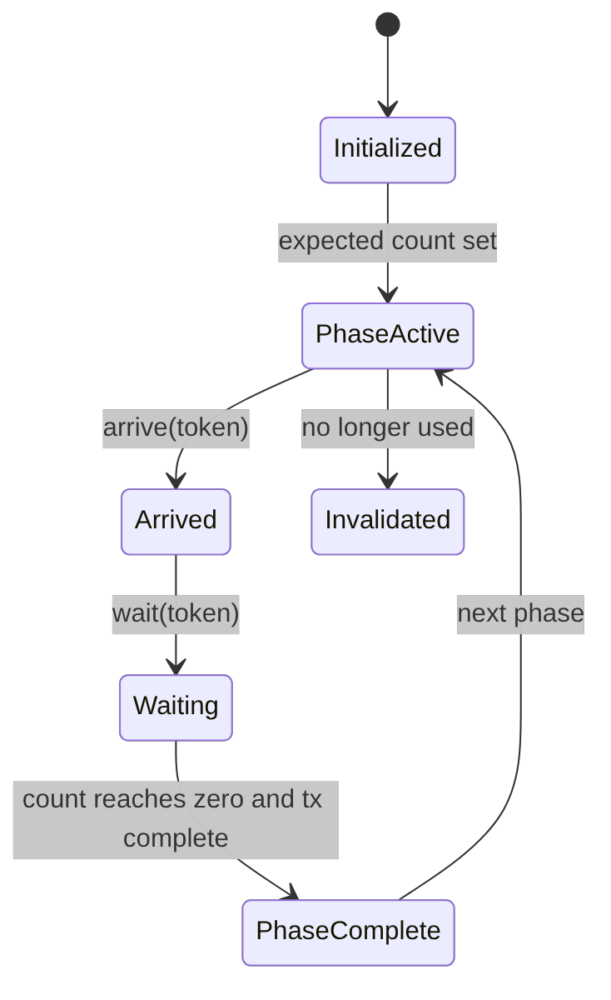

# 第 46 章 Asynchronous Barrier：把 arrive 和 wait 拆开以后，程序结构发生什么变化

`__syncthreads()` 是到达即等待。Asynchronous Barrier 把同步拆成 `arrive` 和 `wait`：线程可以先声明“我已经完成同步前的发布”，再做一段不依赖其他线程的工作，最后等待其他参与者到达。

这个机制是 pipeline、async copy、TMA 等现代 CUDA 结构的基础之一。

## 46.1 问题的由来

传统同步：

```text
write_shared();
__syncthreads();
read_shared_from_others();
```

如果线程在写完 shared 后还有一些独立工作，本可以利用等待时间。split arrive/wait 允许：

```text
write shared -> arrive -> independent work -> wait -> consume shared
```

同步点从一堵“墙”变成了“两段式协议”。

## 46.2 核心模型

Barrier 有 phase，token 属于特定 phase，不能随意跨 phase 使用。图 46.1 是一个 phase 的状态变化：初始化时设定 expected count；线程 arrive 拿到 token，再用这个 token wait；到达计数归零、并且被跟踪的异步 transaction 也全部完成时，这个 phase 结束，barrier 进入下一个 phase。barrier 不再使用、它占的 shared memory 要挪作他用时，要先结束它的生命周期（低层 API 用 `__mbarrier_inval`）。

<figure>

<figcaption>图 46.1：async barrier 一个 phase 从初始化到完成的状态变化</figcaption>
</figure>

## 46.3 详解

### 46.3.1 `cuda::barrier`

高层 C++ 写法：

```cpp
#include <cuda/barrier>
#include <utility>

using block_barrier = cuda::barrier<cuda::thread_scope_block>;

__global__ void kernel(/* ... */)
{
    __shared__ block_barrier bar;
    if (threadIdx.x == 0) {
        init(&bar, blockDim.x);       // 参与者 = block 内全部线程
    }
    __syncthreads();                  // 初始化完成、对全 block 可见后才能用

    // ……把本线程负责的数据写进 shared memory……
    block_barrier::arrival_token token = bar.arrive();  // 只登记到达，不阻塞
    // ……与其他线程无关的工作……
    bar.wait(std::move(token));       // 等本 phase 的所有参与者到达
    // ……现在可以读其他线程写入的 shared memory……
}
```

初始化本身也需要同步。常见做法是一个线程 init，全 block `__syncthreads()`。`arrive()` 返回的 token 记录的是当前 phase，`wait` 要把它原样交回去；`wait` 的参数是右值引用，所以写成 `std::move(token)`。

用 CUDA 13 编译时，nvcc 会对 `__shared__ cuda::barrier` 报 warning #20054，意思是 shared 变量不做动态初始化。barrier 本来就由 `init` 显式初始化，这个警告可以忽略；想消掉它，可以在 kernel 前加 `#pragma nv_diag_suppress static_var_with_dynamic_init`。

### 46.3.2 `__mbarrier`

更底层 primitive：

```cpp
#include <cuda_awbarrier_primitives.h>
__shared__ __mbarrier_t bar;
if (threadIdx.x == 0) __mbarrier_init(&bar, blockDim.x);
__syncthreads();
__mbarrier_token_t token = __mbarrier_arrive(&bar);
while (!__mbarrier_try_wait(&bar, token, 1000)) {}
```

底层 API 适合库实现或需要更贴近 PTX 控制的场景。普通代码优先高层 C++。

### 46.3.3 Transaction count

当 barrier 跟踪异步内存操作时，等待的不只是 thread arrive，还包括 async transaction 完成。TMA 和 bulk async copy 中经常需要 `barrier_expect_tx` 或类似机制。

### 46.3.4 Warp divergence 与 arrive

需要注意：发散的 warp 对 barrier 做 arrive 时，更新次数可能增加。完全收敛的 warp 可能只更新一次，完全发散可能更新多次。arrive 前用 `__syncwarp()` 收敛可以减少不必要开销。

## 46.4 代码示例

一个最小 split arrive/wait：每个线程把自己的输入写进 shared memory 后 arrive，在等待期间算一个只依赖自身输入的多项式，wait 返回后再读右邻线程写入的值，两者相加作为输出。

```cpp
#include <cuda/barrier>
#include <utility>

constexpr int kBlock = 256;
using block_barrier = cuda::barrier<cuda::thread_scope_block>;

// out[i] = poly(in[i]) + in[右邻线程]，右邻在 block 内循环取
__global__ void mix_with_neighbor(const float* in, float* out)
{
    __shared__ float vals[kBlock];
    __shared__ block_barrier bar;
    if (threadIdx.x == 0) {
        init(&bar, blockDim.x);
    }
    __syncthreads();

    int gid = blockIdx.x * blockDim.x + threadIdx.x;
    float x = in[gid];
    vals[threadIdx.x] = x;                         // 1. 发布自己的值
    block_barrier::arrival_token token = bar.arrive();  // 2. 到达但不等待

    float own = 1.0f + x * (0.5f + x * 0.25f);     // 3. 只用自己数据的计算

    bar.wait(std::move(token));                    // 4. 等所有线程都已发布
    float right = vals[(threadIdx.x + 1) % blockDim.x];
    out[gid] = own + right;                        // 5. 合成输出
}

// 启动：mix_with_neighbor<<<n / kBlock, kBlock>>>(d_in, d_out);  n 为 kBlock 的倍数
```

第 3 步的计算放在 arrive 和 wait 之间，就是拆分同步的意义：如果写成 `__syncthreads()`，这段计算只能排在同步之前或之后，没法和“等其他线程写完”重叠。读 `vals` 必须放在 wait 之后，因为 arrive 只保证本线程的写入已经发布，不保证别的线程也写完了。

## 46.5 工程判断

| 需求 | 机制 | 风险 |
|---|---|---|
| 简单 block 同步 | `__syncthreads()` | 最清楚，优先使用 |
| arrive 后有独立工作 | `cuda::barrier` | token/phase 要正确 |
| 跟踪 async copy/TMA | barrier + transaction count | expected tx 必须匹配 |
| 库级底层控制 | `__mbarrier_*` 或 PTX | 生命周期复杂 |
| 部分线程退出 | early exit / expected count 调整 | count 不匹配会 hang |
| arrive 前 warp 发散 | `__syncwarp()` 收敛 | 否则更新次数增加 |

## 46.6 API 与要点速查

Barrier API：

| 名称 | 作用 |
|---|---|
| `cuda::barrier` | C++ barrier |
| `barrier::arrival_token` | phase token |
| `barrier.arrive` / `barrier.wait` | split synchronization |
| `cuda::device::barrier_arrive_tx` | arrive with transaction |
| `cuda::device::barrier_expect_tx` | expected transaction count |
| `__mbarrier_init` | 初始化低层 barrier |
| `__mbarrier_arrive` | arrive |
| `__mbarrier_try_wait` | 尝试 wait |
| `__mbarrier_inval` | invalidation |

核心规则：

- barrier 对象通常位于 shared memory。
- expected count 必须等于参与者协议。
- token 只对对应 phase 有效。
- shared memory 复用前要结束 barrier 生命周期。

## 46.7 小结

读完本章，你应该能够：

- 解释 arrive/wait 与 `__syncthreads()` 的差异。
- 写出 `cuda::barrier` 和 `__mbarrier` 的最小结构。
- 理解 phase、token、transaction count。
- 识别 barrier count 不匹配导致的 hang。
