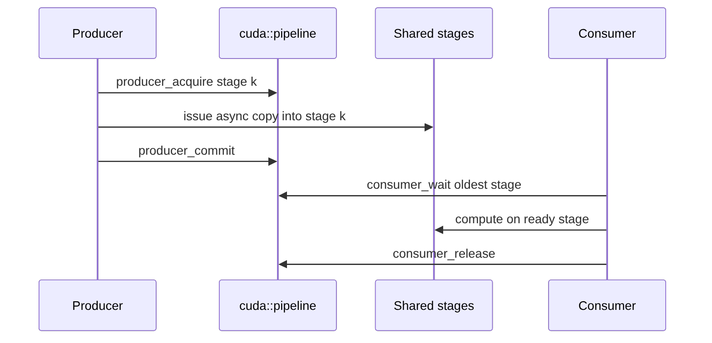

# 第 47 章 Pipeline：把加载和计算做成真正的生产者-消费者

Pipeline 把“准备数据”和“消费数据”组织成多阶段队列。它比手写两个 barrier 更结构化：producer acquire stage，发起异步 copy，commit；consumer wait stage，计算，release。这样 global-to-shared 搬运和计算就有机会重叠。

所以 pipeline 首先是 kernel 内部隐藏延迟的一种组织方式，其次才是一组 API。

## 47.1 问题的由来

很多高性能 kernel 都在做类似事情：

1. 从 global memory 加载 tile 到 shared memory。
2. 用 shared tile 计算。
3. 加载下一 tile。
4. 继续计算。

如果每轮都同步等待加载完成再计算，global memory latency 很难隐藏。双缓冲或多缓冲可以让下一块加载和当前块计算重叠。

## 47.2 核心模型

Stage 的生命周期比单次同步更重要：empty、being filled、ready、being consumed、released。图 47.1 按时间顺序画出一个 stage 在 producer 和 consumer 之间的流转：producer 先 acquire 第 k 个 stage，把异步 copy 发到这个 stage，再 commit；consumer 等待最旧的 ready stage，在上面计算，用完后 release，让这个 stage 回到可写状态。

<figure>

<figcaption>图 47.1：一个 stage 在 producer 与 consumer 之间的流转顺序</figcaption>
</figure>

## 47.3 详解

### 47.3.1 四个动作

| 动作 | 含义 |
|---|---|
| `producer_acquire` | 获取可写 stage |
| `producer_commit` | 提交本 stage 的异步操作 |
| `consumer_wait` | 等待最旧 ready stage |
| `consumer_release` | 释放 stage 供复用 |

### 47.3.2 Shared state

Block scope pipeline 通常需要 shared state：

```cpp
__shared__ cuda::pipeline_shared_state<
    cuda::thread_scope_block, stages> state;
auto pipe = cuda::make_pipeline(block, &state);
```

`stages` 是编译期常量，决定这个 pipeline 最多同时有几个 stage 在途。和 `cuda::barrier` 一样，把 `pipeline_shared_state` 声明成 `__shared__` 时 nvcc 会给出 warning #20054（shared 变量不做动态初始化），它由 `make_pipeline` 负责初始化，警告可以忽略（见[第 46 章](ch046.md)）。

### 47.3.3 Prologue、steady state、epilogue

真实的多阶段 pipeline 不会一轮 acquire/wait 就结束，通常分三段：

- prologue：预填几个 stage。
- steady state：每轮生产下一 stage、消费当前 stage。
- epilogue：排空剩余 stage。

### 47.3.4 Warp specialization

更复杂的 kernel 会让一部分 warp 专门搬数据，另一部分 warp 专门计算：

```cpp
int warp_id = threadIdx.x / warpSize;
if (warp_id == 0) {
    // producer warp
} else {
    // consumer warps
}
```

收益来自角色分工，成本来自同步复杂度和资源占用。没有明确瓶颈时不要过早引入。

## 47.4 代码示例

单 stage 形态，用于理解 API。block 范围的 pipeline 要用 `cuda::make_pipeline(group, &shared_state)` 创建：不带参数的 `cuda::make_pipeline()` 只能得到 thread 范围的 pipeline，没有只接收一个 group 的重载。

```cpp
#include <cooperative_groups.h>
#include <cuda/pipeline>
namespace cg = cooperative_groups;
__global__ void piped_copy(const float* gmem, float* out)
{
    extern __shared__ float smem[];
    __shared__ cuda::pipeline_shared_state<cuda::thread_scope_block, 1> state;
    cg::thread_block block = cg::this_thread_block();
    auto pipe = cuda::make_pipeline(block, &state);
    const float* src = gmem + blockIdx.x * blockDim.x;
    pipe.producer_acquire();
    cuda::memcpy_async(block,
                       smem,
                       src,
                       sizeof(float) * blockDim.x,
                       pipe);
    pipe.producer_commit();
    pipe.consumer_wait();
    out[blockIdx.x * blockDim.x + threadIdx.x] = smem[threadIdx.x] * 2.0f;
    pipe.consumer_release();
}
```

每个 block 处理 `blockDim.x` 个元素，dynamic shared memory 的大小在 launch 时给出，例如 `piped_copy<<<blocks, threads, threads * sizeof(float)>>>(d_in, d_out)`。真实优化版会把这扩展为双缓冲或多缓冲。

## 47.5 工程判断

| 场景 | Pipeline 是否合适 | 原因 |
|---|---|---|
| 每轮加载 tile 后计算 | 合适 | 可重叠搬运和计算 |
| 加载数据几乎不耗时 | 收益有限 | 管理开销可能超过收益 |
| 计算无法覆盖 copy latency | 需要更多 stage 或重构 | 单纯 pipeline 不够 |
| 参与线程集合不一致 | 高风险 | collective 语义可能被破坏 |
| producer/consumer 角色明确 | 可考虑 warp specialization | 同步复杂度上升 |

## 47.6 API 与要点速查

Pipeline API：

| 名称 | 作用 |
|---|---|
| `cuda::pipeline` | C++ pipeline 对象 |
| `cuda::pipeline_shared_state` | shared pipeline state |
| `cuda::make_pipeline` | 创建 pipeline |
| `producer_acquire` | 获取 stage |
| `producer_commit` | 提交 stage |
| `consumer_wait` | 等待 stage ready |
| `consumer_release` | 释放 stage |
| `__pipeline_memcpy_async` | 底层 async copy primitive |
| `__pipeline_commit` | 底层 commit |
| `__pipeline_wait_prior` | 等待 prior stage |
| `__pipeline_arrive_on` | pipeline arrive-on barrier |

风险点：

- producer/consumer 次数必须匹配。
- early exit 要处理参与者集合。
- warp specialization 要保证角色之间同步清楚。
- 增加 stage 会增加 shared memory/register 使用。

## 47.7 小结

读完本章，你应该能够：

- 把 pipeline 理解成 stage 队列。
- 写出 producer/consumer 的基本 API 顺序。
- 判断什么时候 pipeline 有可能隐藏延迟。
- 识别 warp specialization 的收益和代价。
