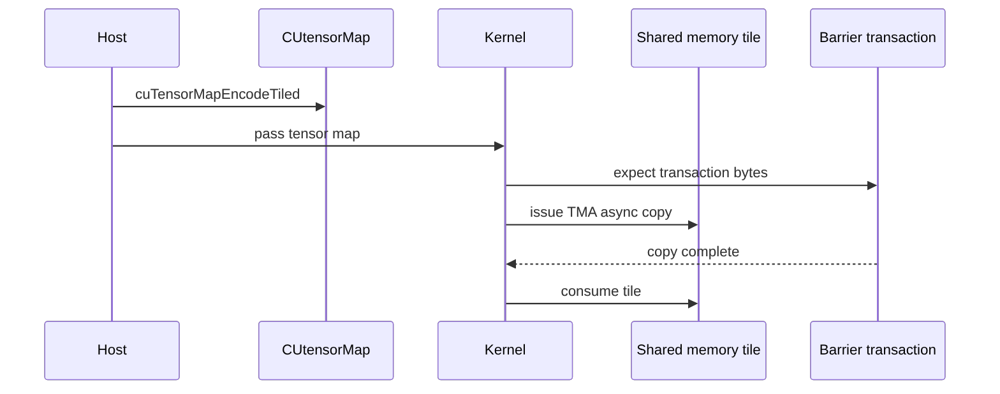

# 第 49 章 TMA：Tensor Memory Accelerator 的 host/device 双侧流程

TMA 面向大块、多维 tensor tile 搬运。和 LDGSTS 这类每线程小块 global-to-shared copy 不同，TMA 需要 host 端构造 `CUtensorMap`，device 端使用 tensor map 发起 bulk async copy，并用 barrier transaction count 等待完成。

学习 TMA，与其背 PTX 名字，不如先把 host 和 device 两侧的流程分开。

## 49.1 问题的由来

现代 GEMM、卷积、attention 等 kernel 需要反复搬运多维 tile。手写每线程小 copy 不仅样板复杂，也很难表达 tensor 维度、stride、swizzle、interleave、L2 promotion 等信息。TMA 把这些元数据打包成 tensor map，让硬件按 tile 语义搬运。

## 49.2 核心模型

Host 负责描述 tensor，device 负责发起 copy 和等待事务完成。图 49.1 把两侧串成一条时间线：host 用 `cuTensorMapEncodeTiled` 编码出 `CUtensorMap` 并作为参数传给 kernel；kernel 先在 barrier 上登记预期的 transaction 字节数，再发起 TMA 异步拷贝把 tile 搬进 shared memory；barrier 确认传输完成后，kernel 才读取这块 tile。

<figure>

<figcaption>图 49.1：TMA 中 host 编码 tensor map、kernel 等待传输完成的流程</figcaption>
</figure>

## 49.3 详解

### 49.3.1 Host 端 tensor map

TMA 的 host 入口是 `CUtensorMap`：

```cpp
CUtensorMap tensor_map{};
cuTensorMapEncodeTiled(&tensor_map,
                       CU_TENSOR_MAP_DATA_TYPE_FLOAT32,
                       rank,
                       global_address,
                       global_dim,
                       global_stride,
                       box_dim,
                       element_stride,
                       CU_TENSOR_MAP_INTERLEAVE_NONE,
                       CU_TENSOR_MAP_SWIZZLE_NONE,
                       CU_TENSOR_MAP_L2_PROMOTION_NONE,
                       CU_TENSOR_MAP_FLOAT_OOB_FILL_NONE);
```

这里描述的是全局 tensor 的形状、stride、tile box、元素 stride 和 shared memory 布局相关选项。注意维度顺序：`global_dim[0]`、`box_dim[0]` 是变化最快（内存中连续）的那一维，`global_stride` 只给出第 1 维起各维的字节跨度。

`cuTensorMapEncodeTiled` 对参数有一组硬性要求，不满足时直接返回 `CUDA_ERROR_INVALID_VALUE`。常用的几条：`CUtensorMap` 对象本身要 64 字节对齐（这个类型在 C++11 下自带 128 字节对齐，直接声明变量即可满足，自己从堆上分配时才需要留意）；`global_address` 至少 16 字节对齐；`global_stride` 的每一项都是 16 的倍数；`box_dim` 每一维不超过 256，且不用 interleave 时 `box_dim[0]` 乘以元素字节数要是 16 的倍数。

### 49.3.2 Device 端 copy

Device 端会使用 tensor map 发起 async transaction，把 global tile 搬到 shared memory。等待不只是线程 arrive，还包括 TMA transaction 完成，因此 barrier transaction count 很重要。

### 49.3.3 Tensor map 修改

某些高级用法允许 device 端替换 tensor map 的 global address、element type、interleave、swizzle 等字段。这属于库级能力，普通应用应先使用 host 端固定 tensor map。

## 49.4 代码示例

Host 侧编码骨架：

```cpp
CUtensorMap map{};
uint64_t global_dim[2] = {cols, rows};
uint64_t global_stride[1] = {cols * sizeof(float)};
uint32_t box_dim[2] = {tile_cols, tile_rows};
uint32_t elem_stride[2] = {1, 1};
cuTensorMapEncodeTiled(&map,
                       CU_TENSOR_MAP_DATA_TYPE_FLOAT32,
                       2,
                       d_matrix,
                       global_dim,
                       global_stride,
                       box_dim,
                       elem_stride,
                       CU_TENSOR_MAP_INTERLEAVE_NONE,
                       CU_TENSOR_MAP_SWIZZLE_NONE,
                       CU_TENSOR_MAP_L2_PROMOTION_NONE,
                       CU_TENSOR_MAP_FLOAT_OOB_FILL_NONE);
```

Device 侧伪流程：

```cpp
__global__ void tma_kernel(const __grid_constant__ CUtensorMap map)
{
    extern __shared__ float tile[];
    // initialize barrier
    // barrier_expect_tx(bytes)
    // issue TMA copy using &map into tile
    // wait barrier transaction complete
    // compute on tile
}
```

tensor map 按值作为 kernel 参数传入时，参数要写成 `const __grid_constant__ CUtensorMap`。TMA 指令需要的是 tensor map 在参数空间里的地址；不加 `__grid_constant__` 的按值参数，一旦在 kernel 里取地址，编译器可能先把它复制到线程的 local memory，得到的地址不能交给 TMA 使用。`__grid_constant__` 要求参数是 `const` 的，保证 kernel 里取到的地址就是参数本身的地址。

这里保留伪代码，是因为具体 device TMA API/namespace 会随 CUDA 版本和使用层级变化；本章的重点是流程和约束。

## 49.5 工程判断

| 场景 | 是否适合 TMA | 原因 |
|---|---|---|
| 大块多维 tensor tile | 适合 | tensor map 可描述 shape/stride/swizzle |
| 小量标量 copy | 不适合 | LDGSTS 或普通 load 更简单 |
| GEMM/conv/attention 内核 | 常适合 | tile 搬运是核心成本 |
| 数据布局频繁变化 | 谨慎 | tensor map 构造和更新成本 |
| 不清楚 barrier transaction | 不适合直接手写 | 容易错等或早读 |

## 49.6 API 与要点速查

TMA host 端：

| API/枚举族 | 作用 |
|---|---|
| `CUtensorMap` | tensor map 描述对象 |
| `cuTensorMapEncodeTiled` | 编码 tiled tensor map |
| `CUtensorMapDataType` | 元素类型 |
| `CUtensorMapInterleave` | interleave 布局 |
| `CUtensorMapSwizzle` | shared memory swizzle |
| `CUtensorMapL2promotion` | L2 promotion |
| `CUtensorMapFloatOOBfill` | 越界填充 |

Device/低层相关：

| 名称 | 作用 |
|---|---|
| `device::memcpy_async_tx` | 带 transaction 的 async copy |
| `device::barrier_expect_tx` | barrier expected transaction |
| `ptx::mbarrier_expect_tx` | PTX mbarrier transaction |
| `ptx::fence_proxy_tensormap_generic` | tensor map proxy fence |
| `ptx::tensormap_replace_global_address` | 替换 tensor map global address |
| `ptx::tensormap_replace_elemtype` | 替换元素类型 |
| `ptx::tensormap_replace_interleave_layout` | 替换 interleave |
| `ptx::tensormap_replace_swizzle_mode` | 替换 swizzle |

## 49.7 小结

读完本章，你应该能够：

- 把 TMA 分成 host tensor map 和 device async copy 两侧。
- 知道 `CUtensorMap` 描述 tensor tile 的哪些属性。
- 理解 TMA 为什么必须配合 barrier transaction。
- 判断 TMA 适合大块多维 tile，不适合小碎片 copy。
