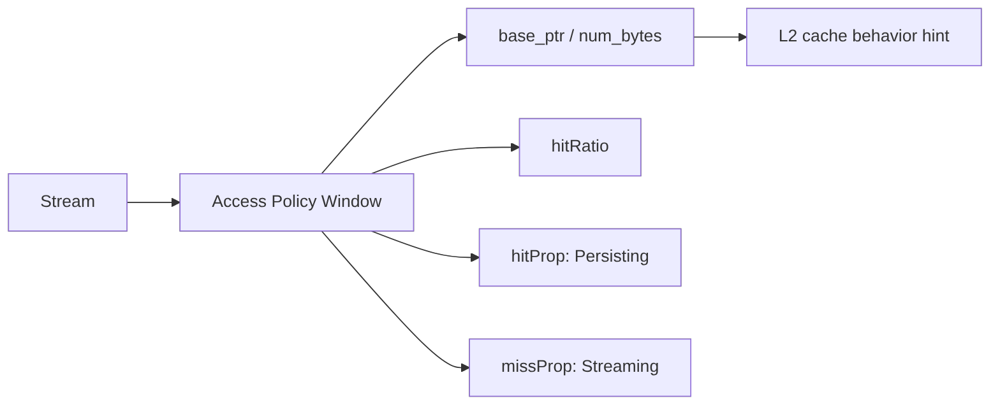

# 第 50 章 L2 Cache Control：哪些数据值得被“持久化”留在 L2

L2 access policy window 允许你给某段内存访问设置 cache policy hint，让小型热数据更可能留在 L2 中。它不是通用的加速按钮，也不能把任意大的数组“锁进 cache”。如果窗口过大或 hitRatio 不合理，可能伤害其他数据访问。

## 50.1 问题的由来

某些 kernel 会反复访问一小段热数据，例如 lookup table、系数、反复使用的中间块。如果这些数据能更稳定地留在 L2，后续访问可能受益。

但 L2 是共享资源。你让一段数据 persisting，就可能挤压其他数据。使用 L2 policy 之前要先确定热数据集，不要抱着“试试看”的心态去设。

## 50.2 核心模型

access policy window 是 stream attribute，影响该 stream 中相关访问的 cache hint。图 50.1 列出了它的组成：窗口挂在 stream 上，由 `base_ptr`/`num_bytes` 圈定地址范围，`hitRatio` 决定窗口内多大比例的访问按 `hitProp`（这里是 Persisting）处理，其余访问按 `missProp`（这里是 Streaming）处理。这些字段合起来只是给 L2 的行为提示。

<figure>

<figcaption>图 50.1：stream 上 access policy window 的组成字段</figcaption>
</figure>

## 50.3 详解

### 50.3.1 Window

Window 由 `base_ptr` 和 `num_bytes` 描述。它应该覆盖真实热数据范围，而不是整个大数组。

### 50.3.2 hitRatio

`hitRatio` 表示 runtime 应如何在窗口中选择 persisting 的比例。它是 policy hint，不是命中率保证。

### 50.3.3 hit/miss property

常见属性：

| 属性 | 含义 |
|---|---|
| `cudaAccessPropertyPersisting` | 这类访问的数据更倾向于留在 L2 |
| `cudaAccessPropertyStreaming` | 更偏流式，不长期占用 |
| `cudaAccessPropertyNormal` | 普通策略 |

### 50.3.4 Reset

使用后应重置或调整策略，避免后续无关工作继承不合适的 cache hint。

## 50.4 代码示例

下面的函数让一个查表 kernel 在指定 stream 上运行时，尽量把小查找表留在 L2：

```cpp
#include <algorithm>
#include <cuda_runtime.h>

// 每个线程按 idx 查表：table 很小、被反复读，是想留在 L2 的热数据
__global__ void gather(const float* table, const int* idx, float* out, int n)
{
    int i = blockIdx.x * blockDim.x + threadIdx.x;
    if (i < n) out[i] = table[idx[i]];
}

void run_with_hot_table(cudaStream_t stream, const float* table, size_t table_bytes,
                        const int* idx, float* out, int n)
{
    int dev = 0, max_persist = 0, max_window = 0;
    cudaGetDevice(&dev);
    cudaDeviceGetAttribute(&max_persist, cudaDevAttrMaxPersistingL2CacheSize, dev);
    cudaDeviceGetAttribute(&max_window, cudaDevAttrMaxAccessPolicyWindowSize, dev);

    // 1. 为 persisting 访问预留一部分 L2，不超过设备上限
    size_t reserve = std::min(table_bytes, static_cast<size_t>(max_persist));
    cudaDeviceSetLimit(cudaLimitPersistingL2CacheSize, reserve);

    // 2. 在 stream 上设置窗口，大小不超过设备允许的最大值
    cudaStreamAttrValue attr = {};
    attr.accessPolicyWindow.base_ptr  = const_cast<float*>(table);
    attr.accessPolicyWindow.num_bytes = std::min(table_bytes, static_cast<size_t>(max_window));
    // 窗口比预留区大时，只让相应比例的访问按 persisting 处理，免得互相挤出
    attr.accessPolicyWindow.hitRatio  =
        std::min(1.0f, static_cast<float>(reserve) / attr.accessPolicyWindow.num_bytes);
    attr.accessPolicyWindow.hitProp   = cudaAccessPropertyPersisting;
    attr.accessPolicyWindow.missProp  = cudaAccessPropertyStreaming;
    cudaStreamSetAttribute(stream, cudaStreamAttributeAccessPolicyWindow, &attr);

    // 3. 在这个 stream 上运行会反复读 table 的 kernel
    gather<<<(n + 255) / 256, 256, 0, stream>>>(table, idx, out, n);

    // 4. 清除窗口：num_bytes 为 0 表示不再有窗口
    attr.accessPolicyWindow.num_bytes = 0;
    cudaStreamSetAttribute(stream, cudaStreamAttributeAccessPolicyWindow, &attr);

    // 5. 等 kernel 结束，再把已驻留的 persisting 行降回普通状态
    cudaStreamSynchronize(stream);
    cudaCtxResetPersistingL2Cache();
}
```

几处细节：

- `cudaLimitPersistingL2CacheSize` 是整个设备的设置，上限由 `cudaDevAttrMaxPersistingL2CacheSize` 给出；`cudaDeviceSetLimit` 对它只是提示，驱动可能按自己的粒度调整实际值，可以用 `cudaDeviceGetLimit` 读回确认。
- 窗口的 `num_bytes` 不能超过 `cudaDevAttrMaxAccessPolicyWindowSize`。
- 窗口比预留容量大时，用 `hitRatio` 按比例缩小被标成 persisting 的那部分访问，避免窗口内的数据在有限的预留区里互相驱逐。
- 清除窗口只是让后续访问不再带 persisting 提示，已经驻留在 L2 里的 persisting 行不会自动降级，所以最后还要调用 `cudaCtxResetPersistingL2Cache`。如果之后不再需要预留，也可以再把 `cudaLimitPersistingL2CacheSize` 设回 0。

## 50.5 工程判断

| 场景 | 是否适合 L2 policy | 原因 |
|---|---|---|
| 小型热数据反复访问 | 适合尝试 | persisting 可能提高复用 |
| 一次性顺序扫描大数组 | 不适合 | streaming 更合理 |
| 多个 kernel 共享热表 | 可考虑 | 但要看 L2 竞争 |
| 窗口大于 L2 可承载 | 高风险 | 挤压其他数据 |
| 不确定热点 | 先 profile | 不要盲设 |

## 50.6 API 与要点速查

关键 API/字段：

| 名称 | 作用 |
|---|---|
| `cudaStreamSetAttribute` | 设置 stream attribute |
| `cudaStreamAttributeAccessPolicyWindow` | access policy window 属性 |
| `accessPolicyWindow.base_ptr` | window 起始地址 |
| `accessPolicyWindow.num_bytes` | window 大小 |
| `accessPolicyWindow.hitRatio` | persisting 选择比例 hint |
| `cudaAccessPropertyPersisting` | persisting policy |
| `cudaAccessPropertyStreaming` | streaming policy |
| `cudaAccessPropertyNormal` | normal policy |
| `cudaLimitPersistingL2CacheSize` | 为 persisting 访问预留的 L2 容量（配合 `cudaDeviceSetLimit`） |
| `cudaDevAttrMaxPersistingL2CacheSize` | 可预留容量的上限 |
| `cudaDevAttrMaxAccessPolicyWindowSize` | `num_bytes` 的上限 |
| `cudaCtxResetPersistingL2Cache` | 把已驻留的 persisting 行恢复为普通状态 |

使用原则：

- window 覆盖真实热数据。
- 不要把大工作集都标成 persisting。
- 用 profiler 验证 L2 hit 和整体性能。
- 作用结束后重置策略。

## 50.7 小结

读完本章，你应该能够：

- 解释 access policy window 是 L2 cache hint。
- 判断哪些数据适合 persisting。
- 写出设置和重置 stream attribute 的流程。
- 意识到 L2 是共享资源，错误策略会伤害整体。
