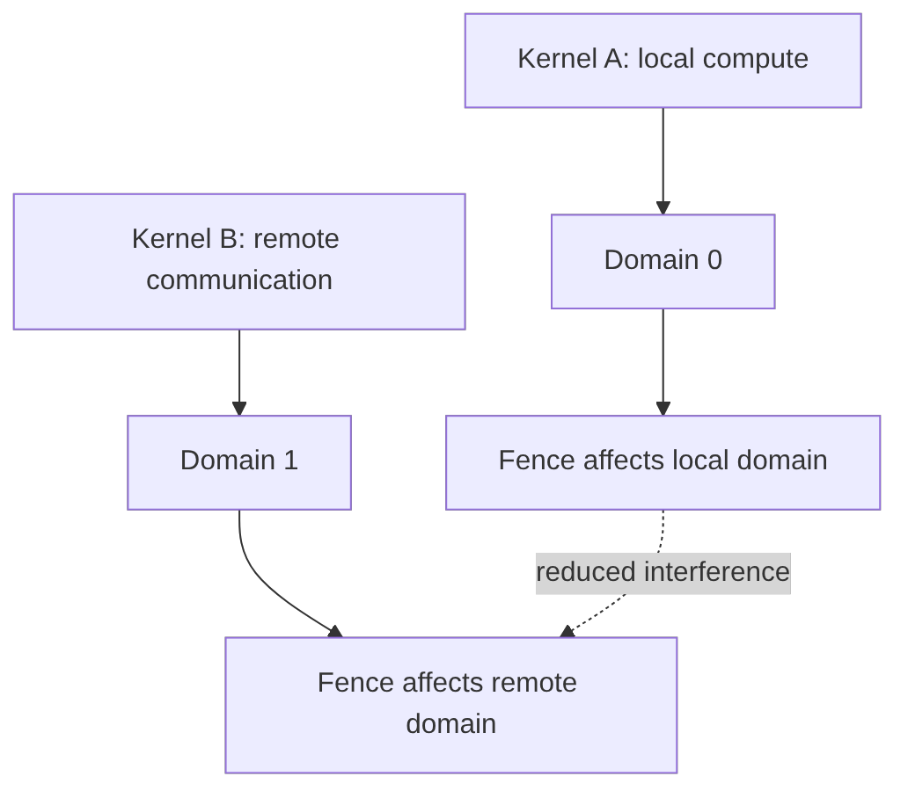

# 第 51 章 Memory Synchronization Domains：减少不必要的 fence 干扰

Fence 的成本不仅来自当前线程要等待自己的写入，还可能来自系统必须保守处理不相关的内存流量。Memory Synchronization Domains 的目标是减少这种 fence interference：把不相关通信放到不同 domain，避免一个 kernel 的 fence 影响另一个无关通信域。

这是高级性能隔离工具。使用前要先保证 memory model 正确。

## 51.1 问题的由来

一个应用可能同时做：

- 本地 GPU memory 计算。
- 跨 GPU 通信。
- 网络或 NVLink 相关通信。
- 系统级 memory 交互。

如果所有同步都落在同一默认域，某些 fence 可能保守等待不相关流量，造成干扰。Memory sync domains 让 launch 可以标注 domain，帮助硬件/driver 缩小干扰范围。

## 51.2 核心模型

Domain 并不绕过同步语义，它只是把同步的影响范围划分得更精确。图 51.1 是一个典型场景：Kernel A 做本地计算，放在 domain 0；Kernel B 做远程通信，放在 domain 1。A 中的 fence 只需要顾及本地 domain 的内存流量，不必再等 B 产生的远程流量，两者的相互干扰因此减小。

<figure>

<figcaption>图 51.1：本地计算与远程通信分属不同 domain 以减少 fence 干扰</figcaption>
</figure>

## 51.3 详解

### 51.3.1 Fence interference

如果一个 kernel 的 fence 需要等待大量不相关 remote traffic，性能可能下降。Domains 让不同类型流量分开，减少不必要等待。

### 51.3.2 Launch attribute

Memory sync domain 通常通过 launch attribute 设置。它属于 kernel launch 级元数据，和 stream、graph、PDL 一样，是更细的调度/同步提示。

### 51.3.3 先正确，再优化

Domains 不能修复 data race。如果两个 kernel 真的共享数据并需要可见性，它们仍然需要正确的依赖、fence、atomic scope/order。Domain 只是减少不相关流量的干扰。

## 51.4 代码示例

示意 launch 属性：

```cpp
cudaLaunchAttribute attr = {};
attr.id = cudaLaunchAttributeMemSyncDomain;
attr.val.memSyncDomain = cudaLaunchMemSyncDomainRemote;
cudaLaunchConfig_t cfg = {};
cfg.gridDim = grid;
cfg.blockDim = block;
cfg.stream = stream;
cfg.attrs = &attr;
cfg.numAttrs = 1;
cudaLaunchKernelEx(&cfg, communication_kernel, args...);
```

具体的 domain 枚举和可用性以所用 CUDA 版本的官方文档为准。这里要抓住的是：它是 launch 级的同步域标注。

## 51.5 工程判断

| 场景 | 是否考虑 sync domains | 原因 |
|---|---|---|
| 单 kernel 本地计算 | 通常不需要 | 默认域足够 |
| 本地计算和远程通信并行 | 可考虑 | 减少 fence interference |
| 多 GPU 通信密集 | 可考虑 | remote traffic 可能干扰 |
| 程序存在 data race | 不能靠 domain 修复 | 先修 memory model |
| 不清楚瓶颈来源 | 先 profile | domain 是高级优化 |

## 51.6 API 与要点速查

关键概念：

| 概念 | 说明 |
|---|---|
| Memory Synchronization Domain | launch 级同步域 |
| Fence interference | fence 等待不相关流量导致干扰 |
| Default domain | 默认同步域 |
| Remote domain | 通信/远程访问相关域 |
| Launch attribute | 通过 extensible launch 设置 |

相关 API/字段：

| 名称 | 作用 |
|---|---|
| `cudaLaunchKernelEx` | 带属性 launch |
| `cudaLaunchAttributeMemSyncDomain` | 设置 memory sync domain |
| `cudaLaunchMemSyncDomainDefault` | 默认域 |
| `cudaLaunchMemSyncDomainRemote` | 远程通信域 |

## 51.7 小结

读完本章，你应该能够：

- 解释 memory sync domains 解决的是 fence interference。
- 知道它是 launch 级优化工具，不是同步正确性工具。
- 判断本地计算和远程通信并行时为什么可能需要 domain。
- 在使用前先确认 memory model 和依赖正确。
