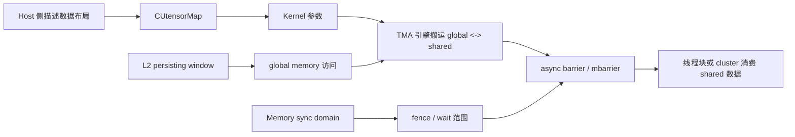

# 第 52 章 TMA、L2 持久化与内存同步域：现代 Kernel 协作的细节索引

前面几章（[第 43 章](ch043.md)到[第 51 章](ch051.md)）已经把 Cooperative Groups、异步拷贝、pipeline、barrier、TMA 和同步域放在一条工程主线上讲过：它们共同解决的问题，是让 kernel 内部的数据搬运、计算阶段和跨引擎同步不必只靠粗粒度的 `__syncthreads()`。本章不重复主线，而是把容易漏掉的 API、常量、限制条件和几条关键的执行时间线集中整理在一起。

这些内容读起来像参考手册，但背后有一条线索。现代 CUDA kernel 的性能问题经常来自三个边界：数据从 global 到 shared 的路径是否能被硬件异步化，L2 是否能保留确实会被复用的数据，同步是否把无关内存操作也拖进了等待范围。TMA、access policy window 和 memory synchronization domain 正好分别对应这三个边界。

## 52.1 核心模型

图 52.1 把这三者放到同一条数据路径上：host 描述数据布局、编码成 `CUtensorMap` 交给 kernel，TMA 据此在 global 和 shared 之间搬运；L2 persisting window 作用在 TMA 发出的 global memory 访问上；memory sync domain 决定 fence 和 wait 的范围。三条线最后都汇合到 async barrier，barrier 完成后，线程块或 cluster 才消费 shared 数据。

<figure>

<figcaption>图 52.1：TMA、L2 持久化窗口与同步域在数据路径上的作用位置</figcaption>
</figure>

可以把它们理解为三条互相叠加的控制线。`CUtensorMap` 描述的是“怎么搬”；L2 policy 描述的是“哪些 global 数据更值得留在缓存里”；memory domain 描述的是“哪些同步需要互相看见”。三者都不是算法本身，但会决定一个算法在 Hopper 及后续架构上能不能吃到硬件能力。

## 52.2 详解

TMA 的要点不在“异步拷贝”这几个字，而在于把复杂的多维张量寻址从线程代码里移出去。传统写法里，线程要计算全局地址、shared 地址、边界条件和分块偏移；TMA 写法里，Host 先构造 `CUtensorMap`，kernel 内部用这个描述符发起搬运，硬件负责按 tiled layout 把数据送进 shared memory。这样做的价值是减少地址计算指令，也让拷贝路径更接近硬件数据搬运单元。

L2 persisting cache window 解决的是另一个问题：有些数据在多个 kernel 或多个 tile 中反复访问，但默认缓存策略未必会把它们长期保留。通过 access policy window，程序可以告诉 CUDA 某段地址范围的数据更值得留在 L2。它不会强制锁住缓存，只是一个受概率和容量限制的提示，因此必须和 `cudaLimitPersistingL2CacheSize`、窗口大小、命中比例一起看。

Memory synchronization domain 则更偏系统语义。GPU 上的 fence、barrier、stream 依赖和设备内存访问可能来自不同引擎、不同通信路径。默认把所有同步都放在同一个大域里，语义简单但代价可能偏大。把本地计算和远端通信放进不同 domain，可以减少无关写入对同步延迟的影响。

## 52.3 代码示例

下面是 TMA 描述符常见的 Host 侧骨架。真实项目要根据元素类型、维度、shared layout 和边界策略调整参数。

```cpp
#include <cuda.h>
CUtensorMap tensor_map;
void build_tensor_map(float* global_ptr,
                      cuuint64_t global_dim0,
                      cuuint64_t global_dim1,
                      cuuint64_t stride0,
                      cuuint32_t box_dim0,
                      cuuint32_t box_dim1) {
    cuuint64_t global_dim[2] = {global_dim0, global_dim1};
    cuuint64_t global_stride[1] = {stride0};
    cuuint32_t box_dim[2] = {box_dim0, box_dim1};
    cuuint32_t element_stride[2] = {1, 1};
    CUresult status = cuTensorMapEncodeTiled(
        &tensor_map,
        CU_TENSOR_MAP_DATA_TYPE_FLOAT32,
        2,
        global_ptr,
        global_dim,
        global_stride,
        box_dim,
        element_stride,
        CU_TENSOR_MAP_INTERLEAVE_NONE,
        CU_TENSOR_MAP_SWIZZLE_NONE,
        CU_TENSOR_MAP_L2_PROMOTION_NONE,
        CU_TENSOR_MAP_FLOAT_OOB_FILL_NONE);
    if (status != CUDA_SUCCESS) {
        // 生产代码中应读取错误名和错误字符串，并回退到普通 async copy 路径。
    }
}
```

尺寸和 stride 数组要用 `cuda.h` 定义的 `cuuint64_t`、`cuuint32_t`。在 64 位 Linux 上 `cuuint64_t` 是 `unsigned long`，换成 `unsigned long long` 数组会因为指针类型不匹配而编译失败。

kernel 侧通常不会重新计算 tensor 的完整布局，而是以 `const __grid_constant__ CUtensorMap` 参数接收 tensor map（见[第 49 章](ch049.md)），发起 TMA load/store，并用 async barrier 确认 shared memory 中的数据已经可被消费。不同 CUDA 版本和架构会暴露不同层次的 C++ wrapper、PTX 或内建函数，工程上要把 TMA 路径隔离在小的 backend 文件里。

## 52.4 工程判断

| 问题 | 更适合的机制 | 不适合的情况 | 判断依据 |
|---|---|---|---|
| 多维 tile 从 global 搬到 shared，地址计算复杂 | TMA / tensor map | 数据布局简单、tile 很小、架构不支持 | 地址计算指令占比、shared tile 复用次数、目标 SM 版本 |
| warp 或 block 内部做普通异步拷贝 | `cuda::memcpy_async` / `cooperative_groups::memcpy_async` | 拷贝形状需要 TMA 描述符，或需要 cluster 级数据路径 | 拷贝粒度、对齐、同步范围 |
| 多个 kernel 反复访问同一段只读或近似只读数据 | L2 access policy window | 工作集远大于可保留 L2，或者访问没有复用 | L2 hit rate、窗口大小、`hitRatio` 调参 |
| 本地计算和远端通信互相拖慢 fence | Memory synchronization domain | 程序同步关系简单，或者没有远端写入路径 | fence 等待时间、通信引擎和计算引擎是否交错 |
| block 间需要硬件协作边界 | Cooperative Groups / cluster group | 只需要 block 内同步 | launch 约束、cluster 尺寸、occupancy |

## 52.5 API 与要点速查

### 52.5.1 TMA 描述符与枚举

| 名称 | 用途 | 使用提醒 |
|---|---|---|
| `CUtensorMap` | TMA 张量映射描述符 | 通常由 Host 构造，再传给 kernel 使用 |
| `cuTensorMapEncodeTiled` | 编码 tiled tensor map | 需要指定数据类型、维度、全局尺寸、stride、box、swizzle 等 |
| `CUtensorMapDataType` | 元素类型枚举 | 必须和真实 global memory 元素类型一致 |
| `CU_TENSOR_MAP_DATA_TYPE_UINT8` | 8-bit unsigned 元素 | 常见于量化或字节级搬运 |
| `CU_TENSOR_MAP_DATA_TYPE_INT32` | 32-bit signed 元素 | 常见于整数张量 |
| `CU_TENSOR_MAP_DATA_TYPE_FLOAT32` | 32-bit float 元素 | FP32 tile 的常见选择 |
| `CUtensorMapInterleave` | 描述 interleave 策略 | 和数据布局、硬件加载路径相关 |
| `CU_TENSOR_MAP_INTERLEAVE_NONE` | 不使用 interleave | 默认直观路径 |
| `CUtensorMapSwizzle` | shared 侧 swizzle 策略 | 用于降低 shared bank conflict |
| `CU_TENSOR_MAP_SWIZZLE_NONE` | 不做 swizzle | 便于验证正确性 |
| `CU_TENSOR_MAP_SWIZZLE_32B` | 32B swizzle | 适合特定 shared 访问模式 |
| `CU_TENSOR_MAP_SWIZZLE_64B` | 64B swizzle | 需要结合 shared layout 测试 |
| `CU_TENSOR_MAP_SWIZZLE_128B` | 128B swizzle | 常用于更宽粒度的 bank conflict 缓解 |
| `CUtensorMapL2promotion` | L2 promotion 策略 | 提示 TMA 访问的缓存倾向 |
| `CU_TENSOR_MAP_L2_PROMOTION_NONE` | 不做额外 promotion | 保守配置 |
| `CUtensorMapFloatOOBfill` | 浮点越界填充策略 | 用于边界 tile |
| `CU_TENSOR_MAP_FLOAT_OOB_FILL_NONE` | 越界元素填 0 | 边界 tile 中超出 tensor 范围的部分读到 0 |
| `CU_TENSOR_MAP_FLOAT_OOB_FILL_NAN_REQUEST_ZERO_FMA` | 越界元素填一个特殊的 NaN 常量 | 只能用于浮点元素类型，便于区分越界元素 |

### 52.5.2 异步拷贝、pipeline 与 barrier 相关符号

| 名称 | 层级 | 说明 |
|---|---|---|
| `cuda::memcpy_async` | CUDA C++ | C++ barrier/pipeline 生态下的异步拷贝入口 |
| `cooperative_groups::memcpy_async` | Cooperative Groups | 面向 group 的异步拷贝 |
| `cooperative_groups::wait` | Cooperative Groups | 等待 group 关联异步操作完成 |
| `cooperative_groups::invoke_one` | Cooperative Groups | 在 group 中选一个执行函数，常用于一次性初始化 |
| `cooperative_groups::cluster_group` | Cooperative Groups | cluster 级协作对象 |
| `cooperative_groups::this_cluster` | Cooperative Groups | 获取当前 cluster group |
| `__mbarrier_try_wait_parity` | 低层 barrier | 带 parity 的非阻塞等待尝试 |
| `__mbarrier_test_wait_parity` | 低层 barrier | 测试 barrier 是否到达目标 parity |
| `__pipeline_memcpy_async` | 低层 pipeline | 发起异步 copy |
| `__pipeline_commit` | 低层 pipeline | 提交当前阶段 |
| `__pipeline_wait_prior` | 低层 pipeline | 等待之前若干阶段完成 |
| `__pipeline_arrive_on` | 低层 pipeline | 与 barrier 交互 |
| `__align__` | 声明属性 | shared buffer 给异步搬运对齐时常用 |

这些低层符号最好被封装起来。直接在业务 kernel 中散布 `__pipeline_*` 和 `__mbarrier_*`，后续维护成本很高，也不利于按架构做 fallback。

### 52.5.3 L2 persisting cache 相关 API

| API / 字段 | 用途 | 备注 |
|---|---|---|
| `cudaDeviceGetLimit` | 查询设备 limit | 可查询当前 persisting L2 大小限制 |
| `cudaDeviceSetLimit` | 设置设备 limit | 配合 `cudaLimitPersistingL2CacheSize` |
| `cudaLimitPersistingL2CacheSize` | L2 持久化容量 limit | 不能超过设备允许范围 |
| `cudaCtxResetPersistingL2Cache` | 重置 persisting L2 状态 | 在阶段切换或调参时有用 |
| `cudaStreamSetAttribute` | 设置 stream 属性 | 可设置 access policy window |
| `cudaStreamGetAttribute` | 读取 stream 属性 | 用于验证配置 |
| `cudaKernelNodeAttributeAccessPolicyWindow` | graph kernel node 的 L2 policy 属性 | graph 场景下不能只设置 stream |
| `cudaKernelNodeAttrValue` | kernel node 属性值 union | 承载 access policy 参数 |
| `cudaGraphKernelNodeSetAttribute` | 设置 graph kernel node 属性 | graph launch 前配置 |
| `cudaGraphKernelNodeGetAttribute` | 读取 graph kernel node 属性 | 调试和验证 |

Access policy window 的核心字段包括 `base_ptr`、`num_bytes`、`hitRatio`、`hitProp`、`missProp`。常见组合是 `hitProp` 用 `cudaAccessPropertyPersisting`，`missProp` 用 `cudaAccessPropertyStreaming` 或普通策略。`hitRatio` 是缓存策略的概率提示，不要把它理解成真实命中率。

### 52.5.4 Memory synchronization domain 相关 API 和枚举

| 名称 | 用途 | 说明 |
|---|---|---|
| `cudaDevAttrMemSyncDomainCount` | 查询设备支持的同步域数量 | 支持数量和架构相关 |
| `cudaLaunchAttributeMemSyncDomainMap` | 配置逻辑 domain 到物理 domain 的映射 | 用于 launch attribute |
| `cudaLaunchAttributeMemSyncDomain` | 指定本次 launch 使用的 domain | 和 `cudaLaunchConfig_t` 配合 |
| `cudaStreamAttributeMemSyncDomain`、`cudaKernelNodeAttributeMemSyncDomain` | 同一属性在 stream、graph kernel node 上的别名 | 分别配合 `cudaStreamSetAttribute`、`cudaGraphKernelNodeSetAttribute` |
| `cudaLaunchMemSyncDomainDefault` | 默认同步域 | 本地计算一般使用 |
| `cudaLaunchMemSyncDomainRemote` | 远端同步域 | 通信、远端写入路径常用 |

使用 memory domain 时要先把同步关系画清楚。错误地把有依赖的写入分到不同 domain，可能让程序看似更快但语义不再成立；正确做法是只把确实无关的通信路径和本地计算路径隔离。实际调优时，先用 profiling 证明 fence 等待确实是瓶颈，再引入 domain 映射。

### 52.5.5 PDL 时间线、TMA swizzle 与 Cluster Launch Control 流程

**PDL 时间线**：同一 stream 中依次提交 primary、secondary 和另一个 kernel，三种写法的差别如下：

| 写法 | secondary 何时开始执行 | 能重叠的部分 |
|---|---|---|
| 普通 stream 顺序 | primary 完全结束之后 | 没有，三个 kernel 首尾相接 |
| secondary 开头有一段 preamble，但不用 PDL | 仍在 primary 完全结束之后 | 没有；preamble 虽然不依赖 primary，也只能排在后面 |
| 使用 PDL | primary 的每个 block 都执行过触发调用（或已退出）之后即可开始调度 | secondary 的 preamble 与 primary 的尾部重叠，后续 kernel 也随之提前 |

PDL 把 secondary 的调度时机从“primary 整个 kernel 完成”提前到“primary 显式声明的触发点”。它改善的是排队和启动重叠，不代表两个 kernel 可以随意读写同一数据：触发点不发布任何数据，`cudaGridDependencySynchronize` 仍会等到 primary 整个 grid 完成、写入可见才返回，读取 primary 的结果必须放在它之后。完整的写法见[第 45 章](ch045.md)。

**Cluster**：cluster 是 block 之上的一层协作层级。它不是普通 block 的语法糖，会影响 launch 约束、资源占用和可见的同步范围。cluster 越大，协作能力越强，但能同时驻留的空间也越受限。

**TMA 与 shared memory swizzle**：TMA 的数据搬运不再由每个线程逐元素执行普通 load/store，而是由描述符驱动硬件完成。描述符里的 swizzle 选项决定 tile 在 shared memory 中怎么摆：以每行 128 字节的 tile 为例，如果按行原样写入，每一行同一列位置的 16 字节单元都会落到同一组 bank 上，按列读取时就会产生多路 bank conflict。`CU_TENSOR_MAP_SWIZZLE_32B`、`64B`、`128B` 让 TMA 在写入时按行号对列位置做异或错位，把同一列的数据分散到不同的 bank 组；kernel 读取时必须按同样的规则换算地址。swizzle 粒度越大，错位覆盖的范围越大，对 shared buffer 的对齐要求也越高。官方《CUDA C++ Programming Guide》讲 TMA swizzle 的小节有逐个 bank 的布局示意，可以对照阅读。

**Cluster Launch Control 的执行流程**：用 Cluster Launch Control 做 work stealing 的 kernel 通常写成一个循环：

1. 初始化一个用来接收取消结果的 barrier（只做一次）。
2. 同步 block 内的线程。
3. 发出异步的取消请求，尝试取消一个尚未启动的 block，把它的工作接过来。
4. 在等待请求结果的同时，计算当前手里的工作。
5. 等待取消请求的结果：成功时拿到被取消 block 的索引，回到第 2 步处理这份工作；失败说明已经没有可接手的工作，退出循环。

这个循环让先完成的 block 继续消化剩余工作，从而压缩长尾，背景见[第 44 章](ch044.md)。

## 52.6 小结

读完本章，你应该能够：

- 判断一个 shared-memory tile 流水线是该用普通 async copy，还是该升级到 TMA。
- 把 `CUtensorMap` 的 Host 构造参数和 kernel 中的 tile 搬运关系对应起来。
- 用 L2 access policy window 描述“哪些数据值得保留”，也知道它只是策略提示。
- 解释 memory synchronization domain 为什么能减少无关 fence 干扰。
- 把 PDL、cluster、TMA、barrier、L2 policy 和 sync domain 放在同一个现代 kernel 优化模型里。
