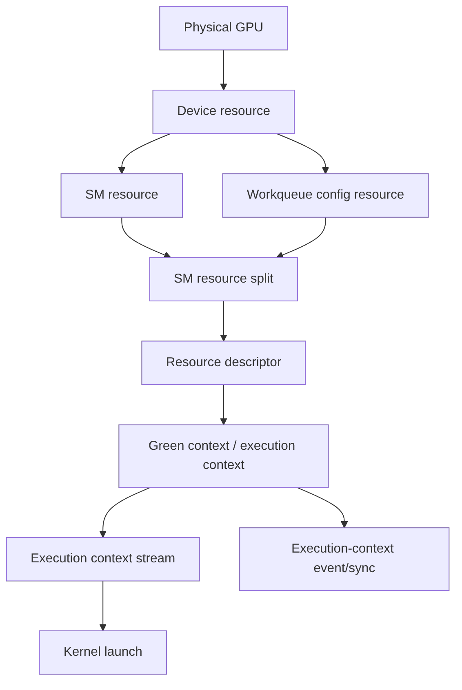

# 第 53 章 Green Context：把 GPU 资源切给不同工作负载

## 53.1 问题的由来

当一个 CUDA 应用只有一个主 kernel，默认调度通常够用。问题出现在应用开始混合不同工作负载之后：一个长 kernel 占满 SM，另一个短小但延迟敏感的 kernel 即使放在高优先级 stream 上，也只能等前者已有 thread block 逐渐退出。

Green Context 的目标是资源可控，不是平均吞吐最大化。你可以把一部分 SM 和 workqueue 资源划给某个 execution context，让提交到这个 context 的 work 只能使用这些资源。这样做会牺牲一部分整体吞吐，但能降低关键工作被长任务挤压的尾延迟。

还要记住一点：Green Context 不需要改 kernel 代码。改变的是提交路径，也就是 kernel 被 launch 到哪个 execution context 所属的 stream。

## 53.2 核心模型

Green Context 的对象关系如图 53.1：先从设备上查询 SM resource 和 workqueue 配置 resource；把 SM resource 切分成若干组，和 workqueue 配置一起生成 resource descriptor；再用 descriptor 创建 green context（在 Runtime 中以 execution context 表示）。之后通过这个 context 创建 stream 并 launch kernel，也可以针对整个 context 记录 event 或同步。

<figure>

<figcaption>图 53.1：从设备资源到 green context stream 的创建链路</figcaption>
</figure>

这条链路里最容易误解的是 stream。普通 stream 只表达顺序关系；Green Context stream 还带着 execution context 的资源归属。kernel 仍然是同一个 kernel，但它可使用的 SM 集合由 stream 所属的 context 限定。

## 53.3 详解

Green Context、MIG 和 MPS 都和资源隔离有关，但层级不同。

| 机制 | 主要边界 | 典型用途 |
|---|---|---|
| Green Context | 同一应用或同一 primary context 下的 execution context | 应用内部给关键任务预留 SM/workqueue |
| MIG | GPU instance | 云服务、多租户、强隔离 |
| MPS | 多进程 CUDA client | MPI、服务化、多进程共享 |
| MPS static partitioning | 不同进程的静态 SM 分区 | 多进程静态分区，但不允许像 green context 那样 oversubscribe |

Green Context 的资源对象从 `cudaDevResource` 开始。你先查询设备上的可划分资源，再用 `cudaDevSmResourceSplit` 生成一个或多个 SM resource group，然后把这些 resource 组合成 descriptor，最后创建 green context。

SM resource split 不是简单整数切分。`smCount` 可能受到最小分区粒度、co-scheduling 对齐、cluster 需求和 backfill 行为约束。另外，如果 `coscheduledSmCount` 或 `preferredCoscheduledSmCount` 设为 0，CUDA 会用设备的默认对齐值；调试时可以检查调用后的 `groupParams`，确认最终被填成了什么。

workqueue 资源解决另一个问题：多个看似独立的 stream 如果落到同一个底层 workqueue，可能产生 false dependency，导致本该并发的工作被序列化。通过 `cudaDevResourceTypeWorkqueueConfig` 和 sharing scope，可以让 green context 的 workqueue 分配更符合并发预期。

Graph 场景要单独记住一条规则：Graph launch stream 不决定图内 kernel node 的 execution context。图内 node 的 context 在 node 创建时决定。stream capture 会把参与 capture 的 stream context 记录进相关 node；手写 Graph API 时，要用能显式携带 context 的 V2 参数，而不是无法指定 context 的旧式便捷 API。

### 53.3.1 用工具验证资源划分

Green Context 配置完成后，不应该只看 kernel 时间猜测资源划分是否生效。Nsight Compute 可以显示每个 Green Context 被 provision 的 SM 资源，Nsight Systems 可以在 CUDA HW timeline 中显示不同 Green Context 的执行行。

Nsight Compute 的 Green Context Resources 部分逐个列出 Green Context 分到的资源，用来验证 SM 是否按预期分配。要看的是每个 context 被允许使用哪些 SM，以及多个 context 之间有没有预期外的重叠；kernel 实际用了多少 SM 不是重点。

Nsight Systems 的时间线适合对比划分前后的效果。不使用 Green Context 时，短 kernel 即使在更高优先级的 stream 上，通常也要等已经驻留的长 kernel 的 block 陆续结束才能拿到 SM，从 launch 到真正开始执行之间有一段明显的空等。stream priority 只影响调度顺序，不会抢占已经在运行的 block。

把 SM 切给两个 Green Context、关键 kernel launch 到预留了 SM 的那个 context 之后，时间线上它几乎在 launch 后立刻开始。代价是长 kernel 和短 kernel 各自可用的 SM 都受限，长 kernel 的执行时间也可能变长，总吞吐和尾延迟之间需要按业务目标取舍。

## 53.4 代码示例

下面是一个保留关键 API 顺序的最小流程。真实代码必须对每个 CUDA 调用做错误检查，并根据设备实际 SM 数调整分组参数。

```cpp
int device = 0;
cudaSetDevice(device);
cudaDevResource initial_sm{};
cudaDeviceGetDevResource(device, &initial_sm, cudaDevResourceTypeSm);
cudaDevResource split[2]{};
cudaDevSmResourceGroupParams groups[2]{};
groups[0].smCount = 16;
groups[1].smCount = 8;
cudaDevSmResourceSplit(
    split,
    2,
    &initial_sm,
    nullptr,
    0,
    groups);
cudaDevResource resources[2]{};
resources[0] = split[0];
resources[1].type = cudaDevResourceTypeWorkqueueConfig;
resources[1].wqConfig.device = device;
resources[1].wqConfig.sharingScope =
    cudaDevWorkqueueConfigScopeGreenCtxBalanced;
resources[1].wqConfig.wqConcurrencyLimit = 4;
cudaDevResourceDesc_t desc{};
cudaDevResourceGenerateDesc(&desc, resources, 2);
cudaExecutionContext_t green_ctx{};
cudaGreenCtxCreate(&green_ctx, desc, device, 0);
cudaStream_t stream{};
cudaExecutionCtxStreamCreate(&stream, green_ctx, cudaStreamDefault, 0);
my_kernel<<<grid, block, 0, stream>>>(args...);
cudaGetLastError();
cudaExecutionCtxSynchronize(green_ctx);
cudaStreamDestroy(stream);
cudaExecutionCtxDestroy(green_ctx);
```

如果 kernel 使用 cluster，需要把 green context stream 放进 `cudaLaunchConfig_t::stream`，再调用 occupancy API。这样 `cudaOccupancyMaxPotentialClusterSize` 和 `cudaOccupancyMaxActiveClusters` 才会按该 context 的 SM 资源计算。下面的片段里，`cluster_kernel` 是一个使用 cluster 的 kernel（需要 compute capability 9.0+），`green_stream` 是上面那样用 `cudaExecutionCtxStreamCreate` 创建的 stream：

```cpp
// green_stream 由 cudaExecutionCtxStreamCreate 创建，属于某个 green context
cudaLaunchAttribute cluster_attr{};
cluster_attr.id = cudaLaunchAttributeClusterDimension;
cluster_attr.val.clusterDim.x = 2;      // 候选的 cluster 形状
cluster_attr.val.clusterDim.y = 1;
cluster_attr.val.clusterDim.z = 1;

cudaLaunchConfig_t cfg{};
cfg.gridDim = dim3(64);
cfg.blockDim = dim3(256);
cfg.dynamicSmemBytes = 0;
cfg.stream = green_stream;              // occupancy 按这个 stream 所属 context 的 SM 计算
cfg.attrs = &cluster_attr;
cfg.numAttrs = 1;

// 这个 kernel 在该 context 里最多能用多大的 cluster（会忽略 cfg 里的 cluster 维度）
int max_cluster_size = 0;
cudaOccupancyMaxPotentialClusterSize(&max_cluster_size, cluster_kernel, &cfg);

// 按 cfg 里的 cluster 形状，最多能有多少个 cluster 同时驻留
int max_active_clusters = 0;
cudaOccupancyMaxActiveClusters(&max_active_clusters, cluster_kernel, &cfg);
```

两个查询对 cluster 维度的处理不同：`cudaOccupancyMaxPotentialClusterSize` 忽略配置里的 cluster 维度，回答“最大能用多大的 cluster”；`cudaOccupancyMaxActiveClusters` 则要求配置里给出 cluster 维度（除非 kernel 编译时已经固定了 cluster 大小），回答“这种形状的 cluster 最多能同时驻留几个”。把 `cfg.stream` 换成普通 stream 再查一次，可以直接看到 green context 的 SM 限制对结果的影响。

## 53.5 工程判断

| 场景 | 是否适合 Green Context | 判断理由 |
|---|---|---|
| 一个长任务和一个低延迟关键任务共用 GPU | 适合 | 用 SM 分区降低关键任务等待时间 |
| 想让单个 kernel 跑得更快 | 通常不适合 | 可用 SM 变少，吞吐可能下降 |
| 多租户强隔离 | 优先 MIG | Green Context 不是安全隔离边界 |
| 多进程 MPI 共享 GPU | 优先 MPS 或 MIG | Green Context 更偏应用内部资源域 |
| 需要测试少量 SM 下的库行为 | 适合 | 不必改变 kernel，只改变提交 stream |
| Graph 中混用多个资源域 | 可用但要谨慎 | node context 在创建时确定，不由 graph launch stream 决定 |

## 53.6 API 与要点速查

Green Context 相关 API 和对象：

| 名称 | 作用 |
|---|---|
| `cudaExecutionContext_t` | Runtime 暴露的 execution context 抽象，可对应 primary context 或 green context |
| `cudaDeviceGetExecutionCtx` | 获取设备 primary execution context |
| `cudaDeviceGetDevResource` | 查询设备资源，例如 SM resource |
| `cudaDevSmResourceSplit` | 按 group params 切分 SM resource |
| `cudaDevResourceGenerateDesc` | 从 resource 数组生成 descriptor |
| `cudaGreenCtxCreate` | 根据 descriptor 创建 green context |
| `cudaExecutionCtxStreamCreate` | 创建属于 execution context 的 stream |
| `cudaExecutionCtxGetDevResource` | 查询 execution context 关联资源 |
| `cudaStreamGetDevResource` | 查询 stream 关联资源 |
| `cudaExecutionCtxRecordEvent` | 记录整个 execution context 的完成点 |
| `cudaExecutionCtxWaitEvent` | 让 execution context 后续 work 等待 event |
| `cudaExecutionCtxSynchronize` | CPU 等待 execution context 所有 work 完成 |
| `cudaExecutionCtxGetDevice` | 查询 execution context 所属设备 |
| `cudaExecutionCtxGetId` | 查询 execution context 唯一标识 |
| `cudaExecutionCtxDestroy` | 销毁显式创建的 execution context |

资源和 split 字段：

| 名称 | 说明 |
|---|---|
| `cudaDevResourceTypeSm` | SM resource |
| `cudaDevResourceTypeWorkqueueConfig` | workqueue 配置 resource |
| `cudaDevWorkqueueConfigScopeGreenCtxBalanced` | 面向 green context 平衡 workqueue |
| `cudaDevSmResourceGroupParams::smCount` | 目标 SM 数 |
| `cudaDevSmResourceGroupParams::coscheduledSmCount` | 希望共同调度的一组 SM 数 |
| `cudaDevSmResourceGroupParams::preferredCoscheduledSmCount` | 首选共同调度规模 |
| `cudaDevSmResourceGroupBackfill` | 允许 backfill 行为 |
| `cudaErrorInvalidResourceConfiguration` | 资源配置不合法时常见错误（Driver API 中对应 `CUDA_ERROR_INVALID_RESOURCE_CONFIGURATION`） |

与 Graph/PDL 的相邻概念：

| 名称 | 作用 |
|---|---|
| `cudaGraphDependencyTypeProgrammatic` | Graph edge 使用 programmatic dependency |
| `cudaGraphKernelNodePortProgrammatic` | programmatic outgoing port |
| `cudaGraphKernelNodePortLaunchCompletion` | launch completion outgoing port |
| `cudaGraphEdgeData` | Graph edge metadata |
| `cudaLaunchAttributeProgrammaticStreamSerialization` | programmatic stream serialization 属性 |
| `cudaLaunchAttributeProgrammaticEvent` | programmatic event 属性 |

验证工具：

| 工具 | 看什么 |
|---|---|
| Nsight Systems | CUDA HW timeline 中的 Green Context row |
| Nsight Compute | Green Context Resources、Launch Statistics 中的 SM 数 |

## 53.7 小结

读完本章，你应该能够：

- 解释 Green Context 为什么是延迟和隔离工具，不是通用加速开关。
- 写出 resource split 到 stream create 的最小流程。
- 区分 Green Context、MIG、MPS 和 MPS static partitioning。
- 知道 Graph 中 node context 和 launch stream 的区别。
- 用 Nsight 工具验证资源分区是否生效。
