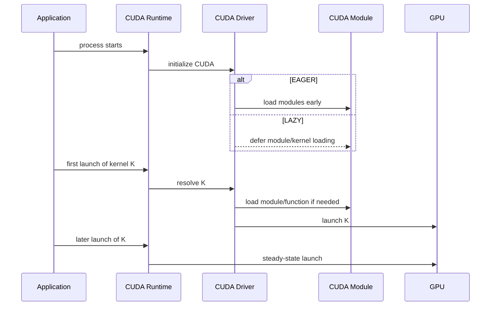

# 第 54 章 Lazy Loading：第一次慢可能是模块加载，不是 kernel 慢

## 54.1 问题的由来

大型 CUDA 程序经常链接很多库：cuBLAS、cuDNN、推理框架、自研算子库、插件模块。一次运行真正用到的 kernel 可能只是其中一部分。如果启动时把所有 CUDA module 和 kernel 全部加载进 device memory，启动成本和显存占用都会被放大。

Lazy Loading 的思路是把加载推迟到第一次使用。这样启动更轻，但第一次触达某个 module 或 kernel 的时刻可能变慢。很多 benchmark 里看到的“第一轮特别慢”，并不一定是 kernel 本身慢，可能是 module loading、function resolution、JIT 或 device memory 分配挤进了测量窗口。

## 54.2 核心模型

Lazy Loading 改变的是“加载发生在哪个时刻”，不是 kernel 的语义。遵守 CUDA 编程模型的程序不应该因为 lazy loading 而得到不同结果，但时间线会变化。

图 54.1 对比了两种加载时机。eager 模式在 CUDA 初始化时就加载 module；lazy 模式先跳过这一步，等应用第一次 launch 某个 kernel K 时，driver 解析 K，按需加载对应的 module 和 function，然后才真正 launch。此后再 launch K 就不再有加载成本，进入稳态。

<figure>

<figcaption>图 54.1：module 加载时机：初始化时加载或推迟到首次 launch</figcaption>
</figure>

## 54.3 详解

Lazy Loading 涉及的层面和前提条件如下：

| 层面 | 含义 |
|---|---|
| module loading | CUDA module 是否在初始化阶段加载 |
| kernel loading | module 中具体 kernel 是否等到第一次使用才加载 |
| runtime requirement | 使用 CUDA 11.7+ runtime 的程序或库才能受益 |
| driver requirement | driver 需要 515 或更新 |
| compiler requirement | 不要求特定编译器，旧编译器产物也可能受益 |
| managed variable 例外 | 含 managed variables 的 module 仍可能 eager load |

从 CUDA 12.3 起，lazy loading 在所有平台默认启用。你可以用 `CUDA_MODULE_LOADING` 控制行为，也可以在运行时用 Driver API 查询当前模式。

```cpp
#include <cuda.h>
#include <iostream>
int main()
{
    CUmoduleLoadingMode mode;
    if (cuInit(0) != CUDA_SUCCESS ||
        cuModuleGetLoadingMode(&mode) != CUDA_SUCCESS) {
        std::cerr << "failed to query module loading mode" << std::endl;
        return 1;
    }
    std::cout << "loading mode = "
              << (mode == CU_MODULE_LAZY_LOADING ? "lazy" : "eager")
              << std::endl;
}
```

这段程序直接调用 Driver API，链接时要加 `-lcuda`。返回值用 `if` 检查而不放进 `assert`：定义了 `NDEBUG` 的发布构建会把 `assert` 连同里面的 `cuInit` 调用一起删掉。

强制预加载一个 kernel 可以用 `cudaFuncGetAttributes`。这不是为了获得属性，而是让 CUDA 必须解析这个 kernel。

```cpp
cudaFuncAttributes attr{};
cudaFuncGetAttributes(&attr, my_kernel);
```

Driver API 中，`cuModuleGetFunction` 也会触发对应 function 的加载。注意 `cuModuleLoad` 本身不保证马上把 module 加载进 device memory。

## 54.4 代码示例

一个更稳妥的 benchmark 结构是先固定加载策略，再做 warm-up，最后测 steady-state。加载策略用环境变量固定，分别跑一次对比：

```bash
CUDA_MODULE_LOADING=LAZY ./bench
CUDA_MODULE_LOADING=EAGER ./bench
```

程序里先显式预加载 kernel，再预热，最后计时：

```cpp
#include <cstdio>
#include <cuda_runtime.h>

__global__ void saxpy(float a, const float* x, float* y, int n)
{
    int i = blockIdx.x * blockDim.x + threadIdx.x;
    if (i < n) y[i] = a * x[i] + y[i];
}

float bench_saxpy(const float* x, float* y, int n, int warmup, int iters)
{
    dim3 block(256), grid((n + block.x - 1) / block.x);

    // 1. 计时之前先让 kernel 加载：查询属性迫使 CUDA 解析这个 kernel
    cudaFuncAttributes attr{};
    cudaFuncGetAttributes(&attr, saxpy);

    // 2. 预热几次并同步，把其他一次性开销也挡在计时区间外
    for (int i = 0; i < warmup; ++i) {
        saxpy<<<grid, block>>>(2.0f, x, y, n);
    }
    cudaDeviceSynchronize();

    // 3. 用 event 包住多次迭代，只测稳态
    cudaEvent_t start, stop;
    cudaEventCreate(&start);
    cudaEventCreate(&stop);
    cudaEventRecord(start);
    for (int i = 0; i < iters; ++i) {
        saxpy<<<grid, block>>>(2.0f, x, y, n);
    }
    cudaEventRecord(stop);
    cudaEventSynchronize(stop);

    float total_ms = 0.0f;
    cudaEventElapsedTime(&total_ms, start, stop);
    cudaEventDestroy(start);
    cudaEventDestroy(stop);

    float avg_ms = total_ms / iters;
    printf("saxpy: %.3f ms per launch (%d iterations)\n", avg_ms, iters);
    return avg_ms;
}
```

三步各管一件事：`cudaFuncGetAttributes` 让 kernel 的加载发生在计时之前；预热消化掉首次 launch 的其他一次性开销；event 只包住稳态迭代，再除以迭代次数得到单次平均耗时。用两种 `CUDA_MODULE_LOADING` 分别运行，稳态结果应该基本一致；如果差别明显，说明还有加载开销漏进了计时区间。

如果你维护自己的显存池，不要在程序启动时把全部 VRAM 占满。lazy loading 可能把 module 所需的 device memory 分配推迟到首个 kernel 附近，届时如果 allocator 已经吃完显存，加载会失败。可行的做法是预留空间、预加载 kernel，或者使用 `cudaMallocAsync` 这类更能和 CUDA 运行时协作的分配路径。

## 54.5 工程判断

| 现象 | 可能原因 | 处理方式 |
|---|---|---|
| 第一次 launch 明显慢 | Lazy module/kernel loading、JIT、context 初始化 | warm-up 或显式预加载 |
| 启动时间变短但首个请求变慢 | LAZY 把加载推迟到请求路径 | 服务启动阶段预热关键 kernel |
| 两个 kernel 本应并发但第一次没有并发 | 首次加载打乱时间线 | 预加载并发路径上所有 kernel |
| 启动时分配完整 VRAM，运行时加载失败 | module memory 被推迟分配 | 给 CUDA module 留余量或改用协作 allocator |
| 想复现实验时间线 | 加载策略变化 | 固定 `CUDA_MODULE_LOADING=EAGER` 或 `LAZY` |

## 54.6 API 与要点速查

环境变量：

| 变量 | 可选值 | 作用 |
|---|---|---|
| `CUDA_MODULE_LOADING` | `LAZY`、`EAGER` | 控制 module/kernel loading 策略 |
| `CUDA_MODULE_DATA_LOADING` | `EAGER` 等 | 控制 module data loading 行为 |

关键 API：

| API | 作用 |
|---|---|
| `cuModuleGetLoadingMode` | 查询当前 loading mode |
| `cudaFuncGetAttributes` | Runtime 侧触发某个 kernel 加载，也可读取 kernel 属性 |
| `cuModuleGetFunction` | Driver 侧获取 function，可能触发加载 |
| `cuModuleLoad` | 加载 module 句柄，但不等价于立即把所有内容加载进 device memory |

版本与约束：

| 项 | 要点 |
|---|---|
| Runtime 版本 | CUDA Runtime 11.7 起可受益；静态链接旧 runtime 的库不会自动受益 |
| Driver 版本 | 需要 515 或更新 |
| CUDA 12.3 起 | Lazy loading 默认启用 |
| Compiler | 不要求重新编译 PTX/SASS，但 runtime 版本仍重要 |
| Managed variables | 可能导致 module eager load |

潜在风险：

| 风险 | 原因 |
|---|---|
| 并发行为变化 | 首次加载插入了额外工作 |
| 显存分配失败 | module memory 分配推迟，和用户 allocator 冲突 |
| 测量污染 | first-use 成本进入 kernel 计时 |

## 54.7 小结

读完本章，你应该能够：

- 判断首轮慢是否可能来自加载而不是 kernel。
- 用环境变量固定 lazy/eager 行为。
- 用 `cuModuleGetLoadingMode` 查询当前模式。
- 为服务和 benchmark 设计预热路径。
- 避免把 lazy loading 的首触发成本误算成 kernel 稳态性能。
