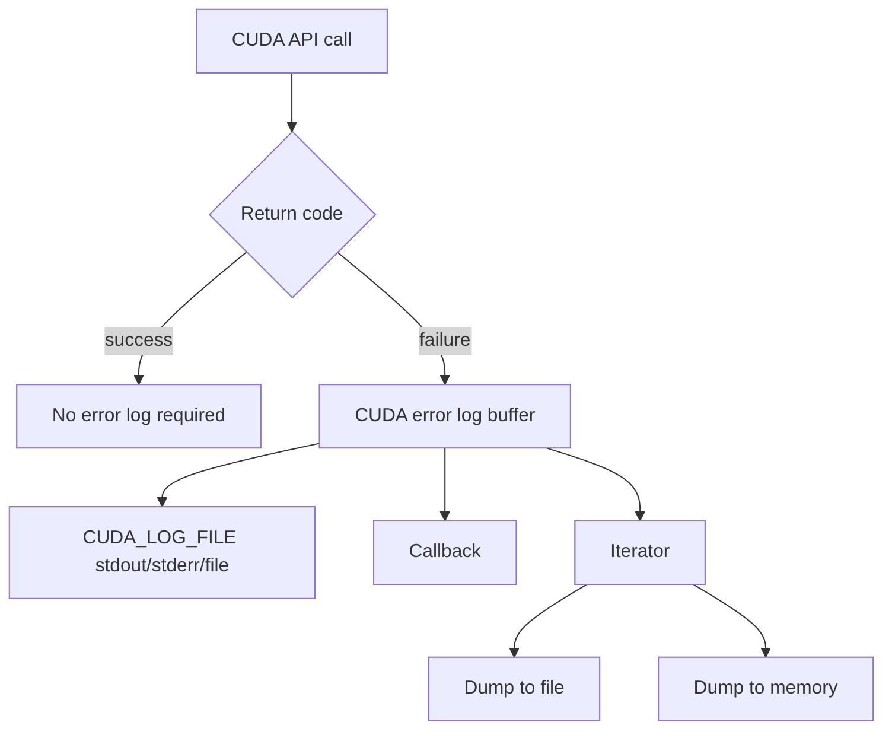

# 第 55 章 Error Log Management：让 CUDA 错误有可读上下文

## 55.1 问题的由来

CUDA API 的返回码很重要，但很多时候不够。`CUDA_ERROR_INVALID_VALUE` 或 `cudaErrorInvalidValue` 能告诉你“有个参数不对”，却不一定告诉你是哪一个参数、哪个状态、哪个 entry point 产生了问题。

Error Log Management 解决的是诊断信息的可读性。它让 CUDA 在 API 失败时输出 plain-English 日志，包含时间、线程、来源、严重级别和消息内容，消息里会写出出错的 API entry point。它不是异常机制，也不替代返回码检查；它更像失败现场的附加说明。

## 55.2 核心模型

日志可能通过环境变量直接输出，也可以通过 Driver API 读取。即使程序启动前没有设置 `CUDA_LOG_FILE`，仍可以通过 API dump 当前日志缓冲。

图 55.1 是日志的流向：API 调用成功时不需要日志；失败时，相关信息写入 CUDA 的错误日志缓冲。之后有三条路把它取出来：用 `CUDA_LOG_FILE` 直接输出到 stdout、stderr 或文件；注册 callback 实时接收；或者用 iterator 把缓冲内容 dump 到文件或内存。

<figure>

<figcaption>图 55.1：CUDA API 失败后错误日志的三种取出方式</figcaption>
</figure>

## 55.3 详解

最简单的启用方式是设置 `CUDA_LOG_FILE`。

```bash
CUDA_LOG_FILE=stdout ./app
CUDA_LOG_FILE=stderr ./app
CUDA_LOG_FILE=/tmp/cuda-errors.log ./app
```

在本书使用的 CUDA 13.3 驱动上，每条日志的形式是：

```text
[Time][TID][Source][Severity] Message
```

`Source` 一般是 `CUDA`，`Severity` 用一个字母表示（`E` 为错误）。一次 API 失败通常留下两条消息：先是一条说明具体原因，再是一条写明返回码和入口函数。下面是一段示意，时间、线程号和消息内容都是编的，场景是 `cuMemcpy2D` 收到的每行字节数大于源数据的 pitch：

```text
[09:41:07.215][140228513318720][CUDA][E] WidthInBytes (4096) is larger than srcPitch (2048)
[09:41:07.215][140228513318720][CUDA][E] Returning 1 (CUDA_ERROR_INVALID_VALUE) from cuMemcpy2D_v2
```

入口函数用的是驱动内部带版本后缀的名字（例如 `_v2`）；通过 Runtime API 调用时，日志里出现的可能是它内部调用的 Driver API 入口，例如 `cudaMalloc` 申请不到显存时，看到的是 `cuMemAlloc_v2` 返回 `CUDA_ERROR_OUT_OF_MEMORY`。这类信息比只看到 `CUDA_ERROR_INVALID_VALUE` 更适合定位参数问题。不同驱动版本的字段细节可能略有差别，以实际输出为准。

Driver API 提供两类访问方式。第一类是 callback，当有日志产生时回调你的函数；第二类是 iterator 和 dump，把当前缓冲区内容写到文件或内存。

## 55.4 代码示例

callback 的形状如下：

```cpp
#include <cuda.h>
#include <cstdio>
void log_callback(void* user_data,
                  CUlogLevel level,
                  char* message,
                  size_t length)
{
    FILE* out = static_cast<FILE*>(user_data);
    fwrite(message, 1, length, out);
    fputc('\n', out);
}
void install_log_callback()
{
    CUlogsCallbackHandle handle{};
    cuLogsRegisterCallback(log_callback, stderr, &handle);
    // 运行需要诊断的 CUDA 调用。
    cuLogsUnregisterCallback(handle);
}
```

iterator + memory dump 的流程更适合把日志纳入测试框架。`cuLogsCurrent` 把 iterator 定位到日志的当前末尾，所以要在运行待诊断的调用之前取 iterator，之后再从它开始 dump：

```cpp
CUlogIterator it{};
cuLogsCurrent(&it, 0);                 // 记下日志当前的末尾，之后产生的日志从这里读
// ……运行需要诊断的 CUDA 调用……
std::vector<char> buffer(25600 + 1);   // 驱动日志缓冲最多 25600 字节，另留一个 '\0'
size_t size = buffer.size();           // 传入：buffer 的容量
cuLogsDumpToMemory(&it, buffer.data(), &size, 0);
std::string logs(buffer.data(), size); // 返回：实际写入的字节数，不含 '\0'
```

`cuLogsDumpToMemory` 没有“先查询大小”的用法：`buffer` 不能为 `NULL`（传空指针会直接返回 `CUDA_ERROR_INVALID_VALUE`，这次失败本身也会写进日志）。正确做法是预先分配足够大的 buffer，调用前把 `*size` 设成它的容量，返回后 `*size` 是实际写入的字节数，不含驱动追加的结尾 `'\0'`。驱动的日志缓冲最多 25600 字节，按这个上限再加 1 分配，就不会因为 buffer 太小而丢日志（驱动缓冲本身写满后，最旧的日志仍会被覆盖）；buffer 装不下全部日志时，驱动会在开头加一条截断提示，只保留最新的那部分；一条消息都装不下时返回 `CUDA_ERROR_INVALID_VALUE`。iterator 会自动前移，下次 dump 只得到新产生的日志。

dump 到文件：

```cpp
CUlogIterator it{};
cuLogsCurrent(&it, 0);
// ……运行需要诊断的 CUDA 调用……
cuLogsDumpToFile(&it, "/tmp/cuda-driver.log", 0);
```

`cuLogsDumpToFile` 的 iterator 也可以传 `NULL`，表示从缓冲里最早还保留着的日志开始全部写出。

实际代码要检查所有返回值。这里展示的是对象关系和调用顺序。

## 55.5 工程判断

| 需求 | 做法 | 注意点 |
|---|---|---|
| 临时调试一个二进制 | `CUDA_LOG_FILE=stderr` | 只在失败时可能有内容 |
| CI 里保存 CUDA 诊断 | dump 到文件 | 文件路径要可写 |
| 测试框架检查错误文本 | dump 到 memory | 按 25600 字节上限预先分配 buffer，容量通过 `size` 传入 |
| 服务进程统一收集错误 | register callback | callback 要轻量，不要做复杂 CUDA 调用 |
| 精确定位异步 kernel 错误 | 配合同步和 `CUDA_LAUNCH_BLOCKING=1` | log 不会替代同步边界 |

## 55.6 API 与要点速查

环境变量：

| 名称 | 作用 |
|---|---|
| `CUDA_LOG_FILE=stdout` | 输出到标准输出 |
| `CUDA_LOG_FILE=stderr` | 输出到标准错误 |
| `CUDA_LOG_FILE=/path/file.log` | 输出到指定文件 |

Driver API：

| API/类型 | 作用 |
|---|---|
| `CUlogLevel` | 日志级别 |
| `CUlogsCallback` | callback 函数类型 |
| `CUlogsCallbackHandle` | 已注册 callback 的句柄 |
| `cuLogsRegisterCallback` | 注册日志 callback |
| `cuLogsUnregisterCallback` | 注销日志 callback |
| `CUlogIterator` | 日志缓冲迭代器 |
| `cuLogsCurrent` | 获取当前日志迭代器 |
| `cuLogsDumpToFile` | 把日志 dump 到文件 |
| `cuLogsDumpToMemory` | 把日志 dump 到用户 buffer |

限制和注意点：

| 项 | 说明 |
|---|---|
| 日志语言 | 日志消息为 US English，不做本地化 |
| buffer 上限 | 日志 buffer 最大 25600 字节 |
| 无错误运行 | 可能没有任何日志输出 |
| 返回码 | 仍然必须检查，日志只是补充上下文 |
| 异步错误 | 仍需要在同步点暴露，日志不能改变 CUDA 异步语义 |

## 55.7 小结

读完本章，你应该能够：

- 用 `CUDA_LOG_FILE` 快速获得 CUDA API 错误上下文。
- 知道 callback 和 dump API 的区别。
- 把 error log 纳入测试或服务日志系统。
- 理解 error log 与返回码、同步点之间的边界。
