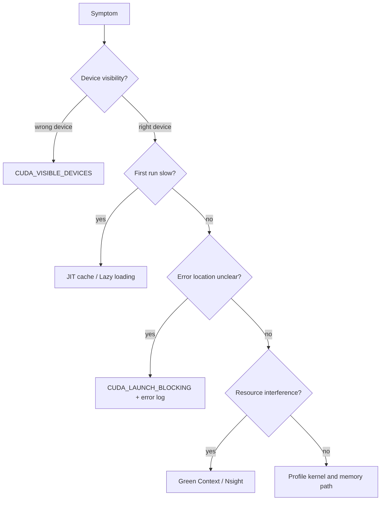

# 第 56 章 CUDA 运行时可观测性手册：从设备可见性到 JIT、加载和错误

## 56.1 问题的由来

当 CUDA 程序从单文件 demo 进入真实系统，很多问题不再发生在 kernel 算法本身，而是发生在运行环境：看见了哪张 GPU、PTX 是否 JIT、JIT cache 是否命中、module 是 lazy 还是 eager、异步错误什么时候暴露、日志有没有记录。

本章把分散在各处的环境变量和诊断入口整理成一份操作手册。不必每次都打开所有开关，按问题类型选择最小可用的观测手段即可。

## 56.2 核心模型

排查顺序应该从“环境是否符合预期”开始，而不是一上来重写 kernel。

图 56.1 是一个按症状排查的顺序：先确认程序用的是不是预期的 GPU；设备没问题但第一次运行慢，就查 JIT cache 和 lazy loading；错误位置说不清，就用 `CUDA_LAUNCH_BLOCKING` 加 error log 把位置固定下来；怀疑多个任务争抢资源，就用 Green Context 和 Nsight 观察；这些都排除之后，再去 profile kernel 和内存访问路径。

<figure>

<figcaption>图 56.1：按症状排查 CUDA 运行环境问题的顺序</figcaption>
</figure>

## 56.3 详解

`CUDA_VISIBLE_DEVICES` 是最基础的设备可见性控制。它改变进程看到的 CUDA device ordinal。多 GPU 程序、容器、调度系统、EGM 拓扑诊断都会用到它。EGM 场景下有一条要注意：不要用 cgroups 限制可见设备来做路由控制，因为这可能阻断 EGM routing；应使用 `CUDA_VISIBLE_DEVICES`。

JIT 相关变量用于确认 fatbin 中的 PTX 和 cubin 是否按预期被使用。第一次运行慢可能来自 PTX JIT，也可能来自 lazy loading。二者的区别是：JIT 关注从 PTX 生成目标代码，lazy loading 关注 module/kernel 什么时候加载。

异步错误定位要把 launch 边界和执行边界分开。`cudaGetLastError` 更适合检查 launch 配置错误；`cudaDeviceSynchronize` 或 stream/event 同步点才能暴露 kernel 执行期间的很多错误。`CUDA_LAUNCH_BLOCKING=1` 让 kernel launch 变成阻塞式，适合把错误位置固定在更接近出错调用的地方。

Error Log 则负责把“invalid value”这类粗错误码补成更可读的上下文。Green Context 和 Nsight 工具负责观察资源域和调度效果。

## 56.4 代码示例

常用诊断命令组合：

```bash
# 确认设备重编号后的行为。
CUDA_VISIBLE_DEVICES=0 ./app
CUDA_VISIBLE_DEVICES=1 ./app
# 固定 launch 错误位置。
CUDA_LAUNCH_BLOCKING=1 CUDA_LOG_FILE=stderr ./app
# 对比 lazy/eager 的 first-use 成本。
CUDA_MODULE_LOADING=LAZY ./bench
CUDA_MODULE_LOADING=EAGER ./bench
# 强制验证 PTX JIT 路径。
CUDA_FORCE_PTX_JIT=1 ./app
CUDA_DISABLE_PTX_JIT=1 ./app
```

一个最小错误检查边界：

```cpp
#define CHECK_CUDA(call)                                                   \
    do {                                                                    \
        cudaError_t err__ = (call);                                          \
        if (err__ != cudaSuccess) {                                          \
            fprintf(stderr, "%s:%d: %s\n",                                  \
                    __FILE__, __LINE__, cudaGetErrorString(err__));          \
            std::abort();                                                    \
        }                                                                   \
    } while (0)
kernel<<<grid, block, 0, stream>>>(args...);
CHECK_CUDA(cudaGetLastError());        // launch boundary
CHECK_CUDA(cudaStreamSynchronize(stream)); // execution boundary
```

## 56.5 工程判断

| 问题 | 第一检查项 | 常用工具 |
|---|---|---|
| 程序跑到了错误 GPU | device ordinal 是否被重映射 | `CUDA_VISIBLE_DEVICES`、`cudaGetDeviceProperties` |
| 第一次运行慢 | JIT、lazy loading、context init | `CUDA_FORCE_PTX_JIT`、`CUDA_MODULE_LOADING`、warm-up |
| 第二次运行变快 | JIT cache 命中或加载已完成 | `CUDA_CACHE_*`、固定加载策略 |
| 错误行号不准 | 异步错误延迟暴露 | `CUDA_LAUNCH_BLOCKING=1`、显式同步 |
| 错误码太粗 | 缺少错误上下文 | `CUDA_LOG_FILE`、`cuLogsDumpToMemory` |
| 高优先级 kernel 仍被长任务挡住 | SM 资源被占满 | Green Context、Nsight Systems |
| Graph 中资源域不符合预期 | node 创建时 context 错误 | 检查 capture stream 或 node params |

## 56.6 API 与要点速查

运行时环境变量速查：

| 变量 | 作用 | 常见用途 |
|---|---|---|
| `CUDA_VISIBLE_DEVICES` | 控制进程可见 GPU 并重编号 | 调度、隔离、复现多 GPU 行为 |
| `CUDA_LAUNCH_BLOCKING` | 让 kernel launch 阻塞 | 定位异步错误 |
| `CUDA_MODULE_LOADING` | 控制 lazy/eager loading | 对比 first-use latency |
| `CUDA_MODULE_DATA_LOADING` | 控制 module data loading | 处理 data eager/lazy 行为 |
| `CUDA_FORCE_PTX_JIT` | 强制从 PTX JIT | 验证 forward compatibility |
| `CUDA_DISABLE_PTX_JIT` | 禁止 PTX JIT | 确认 cubin 是否足够 |
| `CUDA_CACHE_DISABLE` | 禁用 JIT cache | 排查 cache 影响 |
| `CUDA_CACHE_PATH` | 设置 JIT cache 路径 | 容器或只读环境 |
| `CUDA_CACHE_MAXSIZE` | 设置 JIT cache 大小 | 大型应用 cache 调优 |
| `CUDA_LOG_FILE` | 输出 error log | 增强错误上下文 |
| `CUDA_DEVICE_MAX_CONNECTIONS` | 影响 GPU workqueue 连接上限 | 并发和 workqueue false dependency 排查 |

诊断入口速查：

| 入口 | 解决什么 |
|---|---|
| `cudaGetLastError` | launch 配置和最近 runtime 错误 |
| `cudaPeekAtLastError` | 查看但不清除 last error |
| `cudaDeviceSynchronize` | 暴露全设备执行错误 |
| `cudaStreamSynchronize` | 暴露指定 stream 执行错误 |
| `cuModuleGetLoadingMode` | 查询 lazy/eager loading |
| `cuLogsCurrent` | 获取 error log iterator |
| Nsight Systems | 看时间线、并发、Green Context row |
| Nsight Compute | 看 kernel 资源、SM 使用、Green Context Resources |

## 56.7 小结

读完本章，你应该能够：

- 按症状选择环境变量，而不是盲目打开所有开关。
- 区分 JIT、lazy loading 和 kernel 稳态性能。
- 建立 launch boundary 和 execution boundary 的错误检查习惯。
- 把 error log、Nsight 和 CUDA API 返回值组合起来排查复杂问题。
